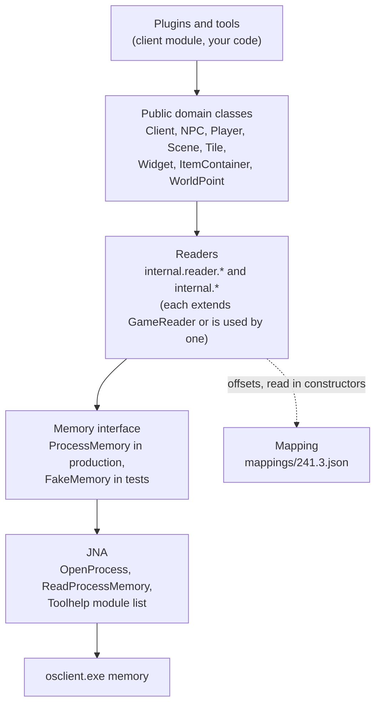
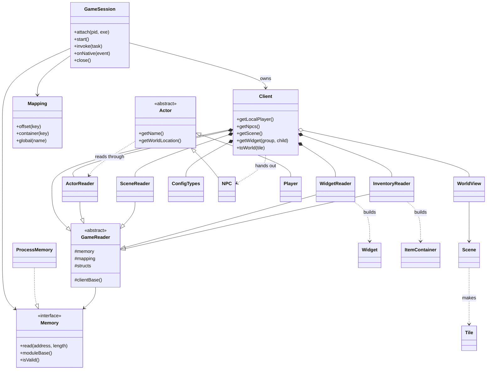
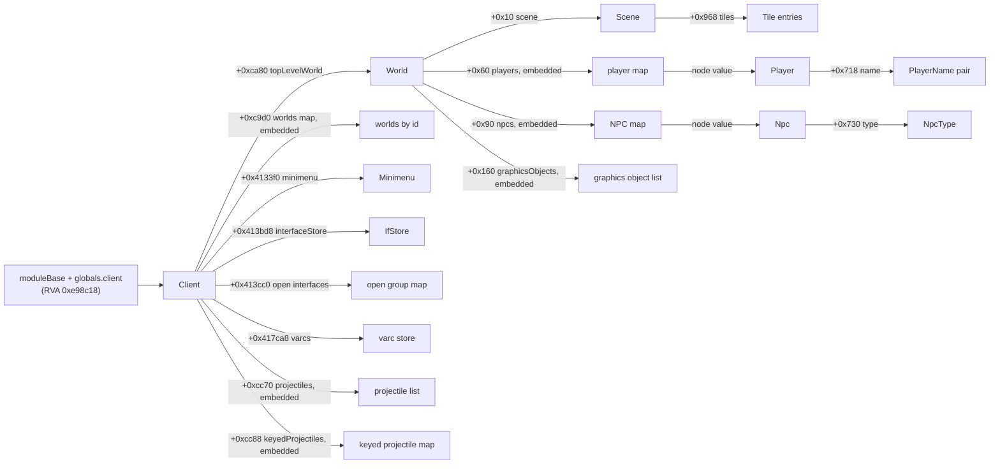
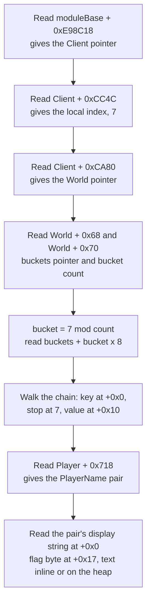
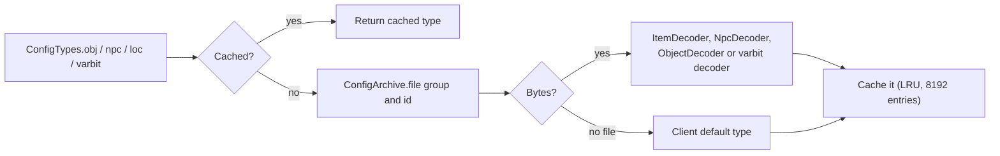
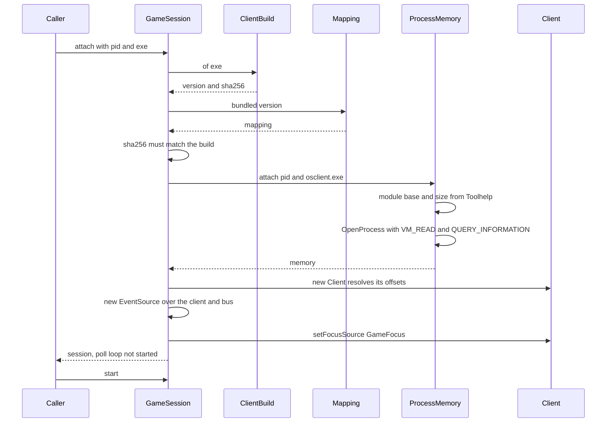
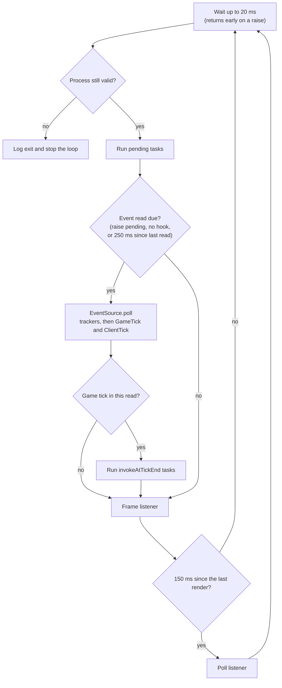

# API Internals

The API (`api/`) reads the `osclient.exe` process and presents what it finds as the RuneLite-shaped classes plugins
use. This page covers the layers under those classes: the memory layer, how offsets are resolved and followed, the
container layouts the readers walk, actor and scene identity, the definitions decoded from the config archive, the
poll loop, and the tests. The user-level tour is in [`../api.md`](../api.md). The offsets come from the mapping
described in [`mapping-format.md`](mapping-format.md), and the events are described in [`events.md`](events.md).



## Layers

| Layer | Packages | Role |
|---|---|---|
| Domain | `com.kraken.api`, `actor`, `scene`, `collision`, `item`, `definition`, `widgets`, `coords`, `events`, `eventbus`, `gameval`, `highlight`, `action` | Public, RuneLite-named classes. Plugins use only these. |
| Readers | `internal.reader.*`, plus `ConfigTypes`, `ConfigArchive`, `StructReader` and `internal.event.*` | Each one reads one part of the game, usually by replaying what a Lua handler reads. |
| Memory | `memory.Memory`, `memory.ProcessMemory`, `memory.MemoryException` | Absolute-address reads. |
| Mapping | `mapping.Mapping`, `ClientBuild` | Offsets from `mappings/<version>.json`, and the build identity. |

Two rules shape the layers:

* **No interfaces or adapters in the domain.** A domain class is a concrete class that calls its reader directly. The
  interfaces that exist are seams with a reason: `Memory` has two implementations (`ProcessMemory`, `FakeMemory`), and
  `NativeInvoker`, `ScriptHook` and `ActorReader.NodeVisitor` are implemented by the client or by lambdas.
* **Plumbing is public, marked `Internal`.** Java has no friend packages, so the readers and the classes the domain
  packages share (`Client.getActorReader()`, `MapCoord`, `ConfigTypes`) are public. Their Javadoc says so, and
  plugins don't need them.

Most getters replay one Lua handler of the client's plugin API (`ClientState`, `ClientOp`, `IfType`, `World`…), and
the Javadoc names that function. Where the API differs on purpose, the Javadoc says so. For example,
`Client.getNpcIndexByName` differs from `ClientOp.getNpcIdByName` because the native handler looks the match up again
by uid, so Lua returns -1 for almost every NPC.

## Key Files

| File | Role |
|---|---|
| [`GameSession`](../../api/src/main/java/com/kraken/api/GameSession.java) | Attach, the poll loop, client-thread tasks, the hook seams |
| [`TaskQueue`](../../api/src/main/java/com/kraken/api/TaskQueue.java) | The queues behind `invoke`, `invokeLater` and `invokeAtTickEnd` |
| [`ClientBuild`](../../api/src/main/java/com/kraken/api/ClientBuild.java) | Version and SHA-256 of the exe |
| [`Mapping`](../../api/src/main/java/com/kraken/api/mapping/Mapping.java) | Reads `mappings/<version>.json` |
| [`Memory`](../../api/src/main/java/com/kraken/api/memory/Memory.java) | The read interface every reader uses |
| [`ProcessMemory`](../../api/src/main/java/com/kraken/api/memory/ProcessMemory.java) | `ReadProcessMemory` over JNA |
| [`Client`](../../api/src/main/java/com/kraken/api/Client.java) | Root getters; resolves the offsets of the top-level reads once |
| [`GameReader`](../../api/src/main/java/com/kraken/api/internal/reader/GameReader.java) | Base of the readers: the `safe*` helpers and `clientBase()` |
| [`StructReader`](../../api/src/main/java/com/kraken/api/internal/reader/StructReader.java) | EASTL string and hash_map reads |
| [`ActorReader`](../../api/src/main/java/com/kraken/api/internal/reader/ActorReader.java) | NPCs, players, their fields, names, head bars, hitsplats |
| [`SceneReader`](../../api/src/main/java/com/kraken/api/internal/reader/SceneReader.java) | Worlds, the scene, tiles, locs, item piles, collision |
| [`WidgetReader`](../../api/src/main/java/com/kraken/api/internal/reader/WidgetReader.java) | Interface store, open groups, sub-interfaces |
| [`InventoryReader`](../../api/src/main/java/com/kraken/api/internal/reader/InventoryReader.java) | The inventory table |
| [`MenuReader`](../../api/src/main/java/com/kraken/api/internal/reader/MenuReader.java) | Minimenu rows and the open flag |
| [`ProjectileReader`](../../api/src/main/java/com/kraken/api/internal/reader/ProjectileReader.java), [`GraphicsObjectReader`](../../api/src/main/java/com/kraken/api/internal/reader/GraphicsObjectReader.java) | Projectiles and graphics objects |
| [`ScriptReader`](../../api/src/main/java/com/kraken/api/internal/reader/ScriptReader.java), [`ChatReader`](../../api/src/main/java/com/kraken/api/internal/reader/ChatReader.java) | Script stacks, chat history |
| [`ConfigArchive`](../../api/src/main/java/com/kraken/api/internal/ConfigArchive.java), [`ConfigBuffer`](../../api/src/main/java/com/kraken/api/internal/ConfigBuffer.java), [`ConfigTypes`](../../api/src/main/java/com/kraken/api/internal/ConfigTypes.java) | The in-memory config archive, the byte reader, and the definition cache |
| [`ItemDecoder`](../../api/src/main/java/com/kraken/api/internal/ItemDecoder.java), [`NpcDecoder`](../../api/src/main/java/com/kraken/api/internal/NpcDecoder.java), [`ObjectDecoder`](../../api/src/main/java/com/kraken/api/internal/ObjectDecoder.java) | Item, NPC and loc definitions |
| [`EventSource`](../../api/src/main/java/com/kraken/api/internal/event/EventSource.java), [`Tracker`](../../api/src/main/java/com/kraken/api/internal/event/Tracker.java) | Turns reads into events (see [`events.md`](events.md)) |
| [`NativeCall`](../../api/src/main/java/com/kraken/api/internal/invoke/NativeCall.java), [`NativeInvoker`](../../api/src/main/java/com/kraken/api/internal/invoke/NativeInvoker.java) | Calls the hook runs on the game thread |
| [`EntityVisibility`](../../api/src/main/java/com/kraken/api/render/EntityVisibility.java), [`VisibilityRules`](../../api/src/main/java/com/kraken/api/render/VisibilityRules.java) | The rules the hook hides entities by (see [`entity-visibility.md`](entity-visibility.md)) |
| [`ComponentWrites`](../../api/src/main/java/com/kraken/api/internal/widget/ComponentWrites.java) | The widget setters' writes, waiting to be sent (see [`widget-writes.md`](widget-writes.md)) |
| [`GameFocus`](../../api/src/main/java/com/kraken/api/internal/GameFocus.java) | Whether the game's process has keyboard focus |
| [`GameFixture`](../../api/src/test/java/com/kraken/api/GameFixture.java), [`FakeMemory`](../../api/src/test/java/com/kraken/api/FakeMemory.java) | The fake game the tests read |

## The Memory Layer

`ProcessMemory` is the only production `Memory`. It does four things:

* **Attach.** `ProcessMemory.attach(pid, "osclient.exe")` takes the module base and size from a Toolhelp snapshot
  (`TH32CS_SNAPMODULE | TH32CS_SNAPMODULE32`), then opens the process with `PROCESS_VM_READ |
  PROCESS_QUERY_INFORMATION`. Nothing is written: the handle has no write right.
* **Read.** `read(address, length)` calls `ReadProcessMemory` once. A short read counts as a failure. Each call
  allocates its own buffer, and nothing is cached or batched at this level. The readers batch on their side (see
  [Container Layouts](#container-layouts) for whole-table reads).
* **Guard.** Addresses below `0x10000` or above `0x7FFFFFFFFFFF`, and lengths of zero or less, throw a
  `MemoryException` without a system call. A null pointer read therefore fails the same way an unmapped read does.
* **Liveness.** `isValid()` is `GetExitCodeProcess` returning `STILL_ACTIVE` (259). The poll loop calls it on every
  iteration.

`MemoryException` is a `RuntimeException`. The readers catch it and return a fallback. The poll loop catches it per
stage and keeps going while the process is alive.

`Memory` has four abstract methods, and everything else is a default method built on `read`:

| Method | Contract |
|---|---|
| `byte[] read(long address, int length)` | Bytes at an absolute address, or `MemoryException` |
| `long moduleBase()` | Where `osclient.exe` is loaded this run (ASLR moves it), so RVAs add to it |
| `long moduleSize()` | Size of the module image |
| `boolean isValid()` | Whether the process is still alive and readable |
| `readPointer`, `readLong`, `readInt`, `readShort`, `readU8` | Little-endian reads built on `read` (`readShort` returns the unsigned value as an `int`) |

A fake needs those four methods. `FakeMemory` implements them over a list of allocated segments, and throws
`MemoryException` for any address no segment covers.

## The Mapping and the Build

`GameSession.attach` identifies the build before it opens the process:

1. `ClientBuild.of(exe)` reads the file, finds the `VS_FIXEDFILEINFO` block (signature `0xFEEF04BD`), and takes the
   version as `major.minor` from `dwFileVersionMS`, for example `241.3`. It also hashes the file with SHA-256. The
   updater's `pe.py` reads the version the same way, and the two must change together.
2. `mappingFor(build)` loads `mappings/241.3.json` from the classpath (`Mapping.bundled`), or from a folder if
   a caller passes one (`mappingFor(build, dir)`).
3. The mapping's `sha256` must match the build's (case-insensitively). A mapping made from another binary throws
   `UnsupportedBuildException` with a hint to re-run the updater.

`Mapping` holds the parsed JSON and answers keyed lookups. The key names follow the mapping's sections (see
[`mapping-format.md`](mapping-format.md) for the sections):

| Method | Looks in | When the key is missing |
|---|---|---|
| `offset("Struct.field")` | `structs` | throws `MissingMappingException` |
| `offsetOr(key, fallback)`, `has(key)` | `structs` | the fallback, or false |
| `global(name)`, `hasGlobal(name)` | `globals` (RVA) | throws, or false |
| `function(name)`, `hasFunction(name)` | `functions` (RVA) | throws, or false |
| `container("kind.field")` | `containers` | throws |
| `enumValue(table, name, fallback)` | `enums` | the fallback |
| `eventHooks(name)` | `events` | an empty list |

Readers resolve their keys once, in their constructors, and keep the offsets in final fields. `Client`'s constructor
resolves the keys of the top-level reads with `mapping.offset`, so a mapping that lacks one of them fails at
`new Client` with `MissingMappingException`. Keys that older mappings may lack are read with `optionalOffset`,
`optionalGlobal`, `containerOr` or `has`. Each gives -1 or a fallback, and the reader checks for that before it reads.

## Readers and Offsets

Every reader extends `GameReader` (`Client`, `ActorReader`, `SceneReader`, `WidgetReader`, `InventoryReader`,
`MenuReader`, `ProjectileReader`, `GraphicsObjectReader`, `ScriptReader` and `ChatReader`). `GameReader` holds the
memory, the mapping, a `StructReader`, and the RVA of the `Client` global. Its `clientBase()` reads that global, so each
top-level getter starts with a read of `moduleBase + globals.client` followed by the pointer's value.



The helpers return the fallback when a read fails:

| Helper | Reads | Fallback |
|---|---|---|
| `safePointer(address)` | 8-byte pointer | `0` |
| `safeLong(address, fallback)`, `safeInt(address, fallback)` | 8 and 4 bytes, little-endian | the given value |
| `safeU8(address, fallback)`, `safeFloat(address, fallback)` | 1 byte; 4-byte float | the given value |
| `readInts(address, count)` | `count` ints in one read | `null` (an empty array for a count of 0) |
| `readBlock(address, length)` | a byte block as a little-endian buffer | `null` |
| `structs.string(address)` | an EASTL string | `""` |
| `structs.hashGet(map, key)` | a hash_map value pointer | `0` |

Each helper folds a `MemoryException` into its fallback. Readers check a resolved offset is at least 0 before they use
it (`npcUid` returns -1 when `Npc.index` is missing, for example), since an offset of -1 would read the byte before
the struct.

## Container Layouts

The readers walk the EASTL containers and the config archive. The mapping's `containers` section gives the in-container
offsets (241.3 values below), and the archive's layout is in the `Js5*` structs. The capacity word of each EASTL
container isn't read.

### EASTL String (24 bytes, `string.*`)

```text
Inline (flag byte at +0x17 has bit 0x80 clear)
  +0x00  text bytes, up to 23
  +0x17  flag = 0x17 - length            length = ssoCapacity (0x17) - flag

Heap (flag byte at +0x17 has bit 0x80 set)
  +0x00  char* text
  +0x08  u64 size
  +0x10  capacity (not read); its top byte is the flag at +0x17
```

`StructReader.readString` decodes both forms. A heap string whose text lies inside the block already read is taken from
that block rather than read again. Strings longer than 4096 bytes come back as `""`. The size of the object
(`string.size` = 0x18) is the stride of an array of them.

### EASTL hash_map (`hash_map.*`)

```text
map object                                     buckets array (one pointer per bucket)
  +0x08  buckets      -> ------------------>   [0] -> first node or 0
  +0x10  bucketCount     (read as 64 bits)     [1] -> ...
                                               [count-1] -> ...

node
  +0x00  key   (u32)
  +0x10  value (pointer; the Player* or Npc*, for example)
  +0x18  next  (pointer to the next node in the bucket, or 0)
```

Lookup is `bucket = key mod bucketCount` (the key treated as unsigned), then a walk along `next` until the key matches.
`StructReader.hashGet` guards the walk with a chain limit, and it refuses a bucket count above 2^24. The map object
itself is either embedded in its owner (`World+0x60` for players, `World+0x90` for NPCs, `Client+0xC9D0` for worlds) or
a global (`inventories.buckets`, `chatLines.buckets`).

### Vector (Begin and End Pointers)

```text
+0x00  begin  -> first element
+0x08  end    -> one past the last element      count = (end - begin) / element size
```

The readers use vectors for the minimenu rows (`Minimenu.rows` at 0x280), an actor's hitmarks (`Actor.hitmarks` at
0x330), its spot animations (`Actor.spotAnims` at 0x6F0, a `vector_map`), the varc store (`Varcs.entries` at 0x48 and
`entriesEnd` at 0x50), and an inventory's slot ids and counts (`Inventory.ids`, `Inventory.counts`, both `int` vectors).
`readVector` and `readInts` read the whole element block in one call and reject lengths above a fixed cap.

### EASTL List (Sentinel and Nodes)

```text
sentinel, embedded in its owner (Client+0xCC70 projectiles, World+0x160 graphics objects)
  +0x00  next -> first node (the sentinel itself when empty)

node
  +0x00  next
  +0x08  prev
  +0x18  value: the object pointer (list.node.value; the shared_ptr's ptr field)
```

The walks stop at the sentinel, a zero pointer, or a fixed guard. A node whose value is zero makes the whole list read
as unreadable, for the graphics objects, so a half-written list yields nothing rather than a partial list.

### Shared Pointer (`jag::shared_ptr`)

A `jag::shared_ptr` keeps its object pointer at `+0x08` (`shared_ptr.ptr`). The widget store reads it that way: each
slot is 16 bytes, and the component pointer is at `+0x08` of the slot. The list and map readers take the object
pointer straight from their node's value offset (`list.node.value`, `hash_map.node.value`).

### Config Archive (Js5 Layout)

```text
global configCache -> Js5Archive
  +0x28 groupCount (long)        +0x30 groups -> Js5Group[] (stride 0x70)

Js5Group (one per config group, e.g. OBJ = 10)
  +0x04 version (int; -1 = group not present)
  +0x40 fileCount (long)         +0x48 files -> Js5File[] (stride 0x20)

Js5File (one per id)
  +0x08 start (long; -1 = absent)
  +0x18 buffer -> Packet         (0 until the group's bytes are loaded)

Packet
  +0x08 length (long)            +0x10 data -> bytes
  file bytes = data[start .. length)
```

`ConfigArchive.file(group, id)` returns the bytes from `start` to the end of the buffer. The decoders read until their
end opcode, so the trailing bytes don't matter. `files(group)` reads the whole file table in one go, which costs
about two reads per file instead of eight.

## The Object Graph

The client keeps the state the API reads in a handful of objects. Pointers marked "embedded" are part of the owner's
struct, so their address is the owner plus the offset.



Some state is in globals rather than in the client: `inventories.buckets`, `chatLines.buckets`, `configCache`,
`varps` and `varpsBits` (the varp arrays), `scriptRunner` and `cycle`. A few offsets are inline values in the client,
not pointers: `Client.skillXp`, `skillLevel` and `skillBase` are arrays of 25 ints, and `Client.playerIndices` is an
array of player indices. `Client.skillIndexMax` (25) is a count, though it sits under `structs`.

Key 241.3 values, for orientation:

| Owner | Field | Offset | What the reader does with it |
|---|---|---|---|
| Client | `gameState`, `loginToken`, `tickCount` | `0x2160`, `0x3318`, `0x3198` | Logged-in check; tick counter |
| Client | `localPlayerIndex` | `0xCC4C` | Index of the local player |
| Client | `topLevelWorld` | `0xCA80` | Pointer to the top-level `World` |
| Client | `worldFlags` | `0x30A4` | World type and profile |
| Client | `actorSteps` | `0x26D8` | Actor step counter for overhead text timers |
| Client | `mapLoader` | `0x49A8` | `MapLoader.baseX` and `baseZ` give the map base |
| Client | `minimenu` | `0x4133F0` | Pointer to the minimenu |
| Client | `interfaceStore`, `interfaces`, `subInterfaces` | `0x413BD8`, `0x413CC0`, `0x413BA0` | Component store, open groups, sub-interfaces |
| Client | `topLevelInterface` | `0x413BC8` | The top-level interface group |
| Client | `varcs` | `0x417CA8` | Pointer to the varc store |
| Client | `projectiles`, `keyedProjectiles` | `0xCC70`, `0xCC88` | Projectile list and keyed map |
| Client | `friendManager` | `0x4800` | Friend and ignore name lists |
| World | `scene`, `plane`, `width`, `height` | `0x10`, `0x18`, `0x1C`, `0x20` | Scene pointer, plane and size |
| World | `players`, `npcs` | `0x60`, `0x90` | Hash maps keyed by index |
| World | `npcIndices`, `npcIndexCount` | `0xD0`, `0xD8` | Active NPC index list |
| World | `graphicsObjects` | `0x160` | Graphics object list |

The actor and scene fields are in the same table format:

| Owner | Field | Offset | Notes |
|---|---|---|---|
| Actor | `pathX`, `pathZ` | `0x3F0`, `0x418` | Scene tile of the actor |
| Actor | `fineX`, `fineZ` | `0x268`, `0x26C` | Fine position, 1/128 of a tile |
| Actor | `worldId` | `0x4A0` | 0 for the top-level world |
| Actor | `name` | `0x710` | An NPC's own name (inline EASTL string) |
| Actor | `interacting`, `interactingType` | `0x3A8`, `0x3A7` | Target index and kind |
| Actor | `headbars` | `0x388` | List of head bars |
| Actor | `overheadText`, `overheadTimer` | `0x2D8`, `0x2F4` | Overhead text and its timer |
| Npc | `type`, `index`, `spawnCycle` | `0x730`, `0x738`, `0x73C` | Type pointer, index, creation cycle |
| NpcType | `id`, `name`, `type` | `0x0`, `0x8`, `0x94` | Base type's id, name, category |
| Player | `name`, `level`, `index` | `0x718`, `0x798`, `0x79C` | Name pair pointer, level, index |
| PlayerName | `display`, `normalized` | `0x0`, `0x18` | Two EASTL strings |
| Scene | `sizeX`, `sizeZ` | `0x948`, `0x94C` | Scene dimensions |
| Scene | `tiles`, `bridgeTiles` | `0x968`, `0x980` | Tile tables of 16-byte entries (pointer at `+0x8`) |
| Scene | `tileSettings`, `collisionMaps` | `0x400`, `0x2F8` | Settings bytes; per-level collision records |
| Tile | `wall`, `wallDecor`, `groundDecor` | `0x108`, `0x110`, `0x118` | Pointers to the tile's locs |
| Tile | `gameObjects`, `gameObjectCount` | `0x38`, `0x34` | Object list of the tile |

### Vars, Widgets, Inventories, Menu, Chat, Projectiles and Scripts

These parts are read the same way: a global or a client field leads to a container, and the container's nodes hold the
records. Each one is a separate reader.

* **Varps and varbits.** The `varps` global is the server's copy (`getServerVarpValue`). The `varpsBits` global is the
  client's working copy, and `getVarpValue` and `getVarbitValue` read it. A varbit is `(varp >> lsb) & mask`, using its
  `VarbitComposition` (the varp index, `lsb` and `msb`). `varpCount` bounds the varp ids.
* **Varcs.** `Client.varcs` points at a store whose entries are a sorted vector of 0x30-byte `VarcEntry` records: key at
  `+0x0`, value at `+0x8`, and type at `+0x28` (1 for an int, 2 for a string). `findVarc` binary-searches the entries as
  the client does.
* **Widgets.** `Client.interfaceStore` points at an `IfStore`: `groupCount` at `+0x6888` and `groups` at `+0x6890`. Each
  group record is 0x18 bytes, with the component count at `+0x8` and the slots at `+0x10`. A slot is 0x10 bytes, and its
  component pointer is at `+0x8`. `getWidget(group, child)` looks up `group << 16 | child`. A static component's dynamic
  children hang off its `dynSlots`, counted by `dynCount`. The groups on screen are in the open-interface map
  (`Client.interfaces`). The groups opened inside a component are in `Client.subInterfaces`, keyed by that component's
  id. The top-level interface id is `Client.topLevelInterface`. A component's click mask (`Widget.getClickMask`) is
  the events the server set on a slot range holding its slot, else its own `IfType.events` (`+0x2B0`). The server's
  ranges are a hash_multimap on the client, `Client.ifEvents.buckets` and `bucketCount` (bucket = packed id % count),
  whose `IfEventsNode`s hold the packed id (`key`), the first and last slot (`from`, `to`; -1 for a static component),
  the `events` and `next`.
* **Inventories.** The `inventories.buckets` global points at the bucket heads, and `inventories.bucketCount` gives the
  count. Each node has the inventory id at `+0x0`, `next` at `+0x38`, the slot ids as a vector at `+0x8` and `+0x10`,
  and the counts as a vector at `+0x20` and `+0x28`. The slot count comes from the inventory's definition
  (`ConfigTypes.invSize`, config group 5).
* **Menu.** `Client.minimenu` points at a `Minimenu`. Its `rows` vector (`+0x280`) holds 0x18-byte nodes of `{list,
  index, children}`. A row's entry is `list.entries` (`+0x18`) plus `index` times `MinimenuEntry.size` (0x150). A node
  without a list is a submenu group, and it shows its first child's entry. `open` (`+0x7C0`) is the open flag,
  `clicked` (`+0x3D8`) holds a copy of the last entry run, and `clickCycles` (`+0x534`) says when. The options the
  server set for other players are there too: `playerOps` (`+0x898`), eight EASTL strings with op 1 first and "" for
  an unset option, and `playerOpPriorities` (`+0x958`), a byte each, set for an option listed below Walk here.
* **Chat.** The `chatLines.buckets` and `chatLines.bucketCount` globals hold a hash_map from line id to `ChatLine`. The
  `chatLines.nextId` global is the next id. A `ChatLine` has its type at `+0x40`, its cycle at `+0x8`, and its name,
  text and sender as EASTL strings at `+0x48`, `+0x70` and `+0xA0`. Lines added between two reads have ids from the
  earlier counter up to the current one.
* **Projectiles and graphics objects.** `Client.projectiles` is an embedded list of `Projectile` records, and
  `Client.keyedProjectiles` is an embedded hash_map of the ones the server can retarget, keyed by the key it sent.
  `World.graphicsObjects` is an embedded list of `GraphicsObject` records, which hold the spot animation id (`+0x274`),
  the level, the fine position, the height, and the animation frame.
* **Scripts.** The `scriptRunner` global holds the script engine. Its int stack is an inline array at `+0x50`, with the
  size at `+0xFF0`. Its object stack is an inline array of 0x28-byte `VarValue` records at `+0xFF8`, with the size at
  `+0xAC38`. A `VarValue`'s kind byte at `+0x20` says whether it holds an int, a string or a long. The stacks hold
  values only while a script runs.

## Following a Pointer Chain

The local player's name takes a short chain of reads, each one a pointer or an int. The walk below uses the fixture's
values: the local player is index 7 (Zezima), and the players map is at `World+0x60`.



`ActorReader.playerName` does the last two steps: it reads the pointer at `Player.name`, then `StructReader.string` on
the pair. `playerName` cuts the string at the first NUL. The normalised name (`PlayerName.normalized`, `+0x18`) is the
one friend and ignore lists are keyed by.

An NPC's name takes fewer steps. `ActorReader.npcName` reads the inline `Actor.name` (`+0x710`) first. If that's
empty, it follows `Npc.type` to the base type. It returns the name of the multi-NPC child that the type's varbit or varp
selects, when there is one, and the base type's name otherwise.

## Actor Handles and Identity

`Client` keeps one handle per NPC index and one per player index, in a `ConcurrentHashMap`. Asking for the same
index again returns the same object while the actor at that index is unchanged. The handle stores what it was pinned to:

| Handle | Pinned to | Live check (`address()`) |
|---|---|---|
| `NPC` | the NPC's address and its creation cycle (`Npc.spawnCycle`) | `actors.npc(index)` must return the same address with the same cycle |
| `Player` | the player's address and display name | `actors.player(index)` must return the same address with the same name |

A handle whose actor has gone, or whose index now holds another actor, reads its last values. `getName()`,
`getWorldLocation()` and `getLocalLocation()` return the value from the last live read, and so does `NPC.getId()`.
`Player.getId()` is the index, which the handle keeps. The other getters return their "nothing" values
(`isInteracting()` is false, for example).

`Client.npc(index)` and `Client.player(index)` replace the stored handle when the pinned check fails, and return null
when nothing is at the index. A handle is not replaced when a read finds the index empty, so one failed read doesn't
cost it its identity. The stored handles are never removed, so the map holds at most one handle per index (65536 NPC
slots, 2048 player slots).

`IndexedObjectSet` backs `WorldView.npcs()` and `WorldView.players()`. Its `byIndex` looks up one actor, and its
iteration reads the loaded list each time it is called.

## Scene, Tiles and Coordinates

### The Map Base

The scene is a square of tiles, 104 by 104 in a normal map, that the client loads around the player. Its south-west
corner is at a world tile, the map base. `Client.mapLoader` holds that tile: `MapLoader.baseX` and `baseZ`. Every
actor and tile the readers return is in scene coordinates, relative to the map base. The base moves when the client
rebuilds the scene, so converting a scene tile to a world tile reads the base again each time (`Client.toWorld`).

### Coordinate Types

| Type | Space | Notes |
|---|---|---|
| `MapCoord(level, x, z)` | Scene tile | What the readers return. `z` is north |
| `FineCoord(x, y, z)` | Fine scene position, 1/128 tile | `y` is the ground height (more negative is higher) |
| `WorldPoint(x, y, plane)` | World tile | `y` is north. `Client.toWorld` makes one from a `MapCoord` |
| `LocalPoint(x, y, worldView)` | Scene position in 1/128 tile | `y` is north. `getLocalLocation()` builds it from `fine.x` and `fine.z` |

The client keeps height in `y` and north in `z`. The API swaps them: a `MapCoord`'s `z` becomes a `WorldPoint`'s `y`,
and a `FineCoord`'s `z` becomes a `LocalPoint`'s `y`. `LocalPoint.fromScene` returns the centre of a tile
(`tile * 128 + 64` on each axis), while the actor's own fine position is wherever the actor stands within the tile.

`WorldView.contains(point)` checks x and y against the map base only, so a tile on another plane is still inside
the scene.

### Tiles and Objects

`SceneReader.tile(scene, level, x, z)` finds a tile pointer in the table at `Scene.tiles`:

```text
index   = ((level * sizeX) + x) * sizeZ + z
pointer = *(table + index * 16 + 8)            (16-byte entries, pointer at +0x8)
```

Level -1 is the bridge table (`Scene.bridgeTiles`), and its index is `x * sizeZ + z`.

A `Tile` is a handle on a scene position, made with the map base it was read with. Its object and item getters read the
game on each call, after checking the map base still matches. Once the scene has reloaded with another base, they read
empty, and the position now belongs to another part of the world. Get tiles again from `Scene.getTiles()`.

Objects are values. `TileObject.equals` compares the loc's id, layer and scene tile, so two reads of the same
object in the same scene are equal. A `Set<TileObject>` filled from spawn events can be emptied by the despawn events.
A loc's id comes from the 64-bit `Loc.tag` in its struct: the id is in the bits from `Loc.tagIdShift` (16 bits), and
the kind is in the bits from `Loc.tagKindShift` (3 bits). A tile's object list also holds actors and item piles, so
`SceneReader.isLocTag` filters on the kind.

`TileItem` is different. A ground item handle has identity only when the item spawn events hand it out.
`Tile.getGroundItems()` makes new handles on each call, so compare those by id and tile.

### Collision

`SceneReader.collisionMap` copies one level's flags into a `CollisionData`. The level's record is found through the
scene's collision vector (`Scene.collisionMaps` to `collisionMapsEnd`), one record per level with stride `0x28`. The
record holds the origin (`originX`, `originZ`), the size, and a pointer to its columns. The copy covers the scene.
`SceneReader.liveCollision` reads a tile at a time, straight from the client, for the `CollisionLines` tests that
only look at a few tiles.

## Snapshots and Values

Some types are snapshots of one read. Others are handles that read the game when asked.

| Type | Source | Behaviour |
|---|---|---|
| `NPC`, `Player` | the handle's index and pin | Live while loaded; keeps last values after |
| `Tile` | a scene position and a map base | Live; empty once the map base moves |
| `TileObject` and its subclasses | the loc in one scene read | A value (`equals` by loc) |
| `TileItem` | the item spawn events | A handle with identity; reads are per call |
| `Widget` | one copy of the `IfType` struct | A snapshot; fetch again to see changes |
| `ItemContainer`, `Item` | the inventory node's vectors | A snapshot of the slots |
| `Projectile`, `GraphicsObject` | one read of the list | A snapshot; `GraphicsObject.finished()` reads the game |
| `MenuEntry` | one minimenu row | A snapshot of the row's text and ids |
| `CollisionData` | one copy of a level's flags | A snapshot |
| Script stacks | captured by the hook during a script event | A copy, per thread (a `ThreadLocal`) |

`Widget` reads `IfType` fields in one block. Its size is the largest field offset plus the size of an EASTL string, so
the snapshot covers every field the constructor maps.

## Definitions

Definitions (items, NPC types, locs, inventory sizes, varbits) come from the config archive, not from the client's own
decoded types. The client keeps each decoded type in a cache of 64 entries, so most ids aren't present at any moment.
The raw file bytes stay in the archive for the whole session, and decoding them gives the same type for any id.



* **Decoders** read the file with `ConfigBuffer`: big-endian integers, the OSRS smart encodings, zero-terminated
  Windows-1252 strings, and the shared params block (opcode 249). A decoder starts from the same defaults as the
  client's constructor, applies each opcode until 0, and then runs the client's post-step. Opcodes the client doesn't
  handle throw `ConfigFormatException` rather than desync the rest of the file.
* **Default types.** An id with no file gets the client's default type (an empty name and price 1 for items, for
  example), never null. A file that doesn't decode gives null, and nothing is cached for it.
* **Item compositions** are merged after decoding, as the client's loader does: a noted item with its note template
  and the item it notes (opcodes 97 and 98), a bought item with its template and linked item (139 and 140), a
  placeholder with its template and linked item (148 and 149). On a free world, a members item is rewritten (name
  suffix, members notice, the ops reduced to "Take"). Templates link at most eight levels deep (`MAX_DEPTH`).
* **Membership.** An item's decode depends on whether the client is on a members world, so the item cache key includes
  that as a variant bit.
* **Live conditions.** `ItemComposition` and `ObjectComposition` resolve their conditional ground and inventory ops
  against the client at read time (`client::getVarpValue`, `client::getVarbitValue`), and
  `ObjectComposition.getImpostor()` picks the loc a multi-loc shows as the same way. The definition itself is cached,
  the choice is not.
* **Varbits.** `ConfigTypes.varbitsByVarp()` decodes every varbit once and groups the ids by the varp they live in. It
  matches the client's own index, which fires the varbit events.
* **The cache** is an LRU of 8192 entries keyed by group and id. `checkArchive()` clears it if the archive's address
  changes, which happens when the client builds a new archive.

`ConfigTypes` and its load methods are `synchronized`, so all definition lookups share one lock.

## The Game Session

### Attaching



`attach(pid, exe, bus)` opens the process and returns a session that isn't polling yet. `start()` begins the
`kraken-api-poll` thread, which is a daemon. The bus the session posts on is the one passed in, so subscribers
registered before `start()` see the replayed state.

The hash check runs before the process is opened, so a mismatch throws `UnsupportedBuildException` with nothing left
open. Once the process is open, the `Client` constructor can throw `MissingMappingException` if the mapping lacks a
required key. `attach` doesn't close the process handle on that path.

### Constructors

| Constructor | Use |
|---|---|
| `GameSession.attach(pid, exe[, bus])`, `attach(pid, exe, mappingsDir[, bus])` | The normal path |
| `attach(pid, build, mapping, bus)` | A caller that retries while the client boots: it reads and hashes once, then retries only this |
| `new GameSession(memory, mapping, bus)` | Tests and tools that have a memory image of their own |

The session owns its memory: `close()` closes a `ProcessMemory`, and nothing else.

### Seams the Client Uses

| Method | Caller | Effect |
|---|---|---|
| `setHookConnected(boolean)` | `NativeEventServer`, on connect and disconnect | Switches the event read to the raise-driven rate (see the poll loop) |
| `onNative(NativeEvent)` | `NativeEventServer` for each raise | Queues a source read and wakes the loop |
| `onScript(ScriptRun)` | `NativeEventServer` for each script report | Queues a script event post and wakes the loop |
| `setScriptHook(ScriptHook)` | `NativeEventServer`, when the script feature is on | Tells the source which script events the hook must report |
| `setNativeInvoker(NativeInvoker)` | `NativeEventServer`, when the call feature is on | Gives highlights and actions a connection to run calls on the game thread |
| `setPollListener(Runnable)` | `ProcessAttacher`, which forwards to the client's listeners | Runs at most every 150 ms on the poll thread |
| `setFrameListener(Runnable)` | `ProcessAttacher`, the overlay renderer | Runs every poll iteration, after the tick-end tasks |

`setNativeInvoker` runs on the thread that calls it, which is the hook's connection thread, rather than the poll thread.
`Highlights` and `Actions` make that safe with their own locks.

### Native Calls

A `NativeCall` is one call of a client function, which the hook DLL makes on the game thread. It holds the function's
RVA (relative to the module base), up to eight arguments, and a byte block the arguments can point into. The DLL
doesn't interpret a call. The API picks the function, the arguments and the bytes, using the mapping's `functions`
section for the RVA. Arguments go in RCX, RDX, R8 and R9, then on the stack. Each one has a kind:

| Kind | What the DLL passes |
|---|---|
| `IMM` | The value itself |
| `CLIENT` | The `Client` object's address plus the value. The call is skipped while the client pointer is null |
| `DATA` | A pointer to the call's data block, plus the value |
| `SCRATCH` | A pointer into a 4096-byte zeroed block shared by every call in one batch, plus the value. One call can build an object there for the next call to read |
| `INDIRECT` | The pointer stored in the `Client` object at the low 32 bits of the value, plus the high 32 bits. Skipped while either pointer is null |

`NativeCall.to(rva)` starts a builder. `Highlights` builds its calls like this:

```java
return NativeCall.to(rva).client(manager).imm(categoryIds.get(category)).imm(channel).build();
```

A `NativeInvoker` queues a batch and returns once the batch is sent, not once it has run. The client's
`NativeEventServer` supplies the production one, as a lambda that sends each batch on the hook's connection, and only
while that connection is up. `Highlights` and `Actions` hold the invoker, and each does its own work with it:

* `Highlights` sends only what changed, and when a connection comes up it applies every channel again.
  See [`in-game-drawing.md`](in-game-drawing.md).
* `Actions` runs the client's own minimenu row bodies. A call made while the hook is down is dropped and returns false.
  See [`menu-actions.md`](menu-actions.md).

Two other writes don't go through calls, because what they change comes and goes faster than a round trip:
`EntityVisibility` sends rules the hook applies to every entity each frame (`GameSession.setVisibilityHook`), and
`ComponentWrites` sends writes the hook makes after looking each component up by id (`GameSession.setComponentHook`).
Both flush at the end of each pass of the client thread, with the menu edits.

## The Poll Loop

The loop runs on `kraken-api-poll`, which is the client thread. A `TaskQueue` binds to that thread, and
`isClientThread()` is true there.



Each iteration does these steps in order:

1. **Wait.** `awaitNextIteration` waits up to `POLL_INTERVAL_MS` (20 ms). It returns at once if a raise arrived since
   the last wait (`wake()` sets the flag and notifies).
2. **Liveness.** If `memory.isValid()` is false, the loop logs `osclient.exe exited; stopping poll loop` and stops.
3. **Tasks.** `TaskQueue.runPending()` runs the tasks queued before this point, in order. A task that returns false
   is queued again at the front. A raise's own task runs here, and it sets `eventPollRequested`.
4. **Event read.** The read runs when `eventPollRequested` is set, or when `now - lastEventPoll >= safetyInterval`. The
   safety interval is 0 with no hook and `HOOKED_EVENT_POLL_MS` (250 ms) with one. `EventSource.poll()` runs the
   trackers in order and posts `GameTick` once per counted tick and `ClientTick` once per counted cycle.
5. **Tick end.** If that read saw a game tick, `TaskQueue.runTickEnd()` runs the `invokeAtTickEnd` tasks.
6. **Frame.** The frame listener runs on every iteration. The client uses it to draw overlays, and decides itself
   whether a frame is due.
7. **Poll listener.** It runs at most once every `RENDER_INTERVAL_MS` (150 ms).

Without a hook, the event read runs every 20 ms. With a hook connected, it runs on each raise and at least every 250
ms, which covers the ticks: `GameTick` and `ClientTick` come from the game's counters, not from a raise. The raise
decides when to read, and the counters decide what a tick is.

Each stage runs through `step()`. A `MemoryException` keeps the loop going while the process is alive. A
`RuntimeException` is logged as a warning and the loop carries on. Other `Error`s aren't caught, which ends the thread
(see [Failure Handling](#failure-handling)).

`close()` sets `running` to false, interrupts the thread, and closes the process handle. It doesn't wait for the
thread to finish.

## Client Thread Tasks

`TaskQueue` holds two lists: `pending` (run at the next poll) and `tickEnd` (run after a game tick's events).

| Method | On the poll thread | On another thread |
|---|---|---|
| `invoke(Runnable)` | Runs now | Queued for the next poll |
| `invoke(BooleanSupplier)` | Runs now; if it returns false, queued for the next poll | Queued; reruns at each poll until it returns true |
| `invokeLater(Runnable)`, `invokeLater(BooleanSupplier)` | Queued for the next poll, even on the poll thread | Queued for the next poll |
| `invokeAtTickEnd(Runnable)` | Queued for the tick end of the next game tick | Same |

A task that throws `RuntimeException` or `LinkageError` is logged at warning level and dropped. A `BooleanSupplier` that
throws isn't retried. `setScriptHook` and the raise and script reports go through `invoke`, so the source is only ever
touched on the poll thread.

## Failure Handling

| Situation | What happens |
|---|---|
| A read fails, or a pointer is null | `MemoryException`; the `safe*` helper or the reader returns its fallback |
| A list, map or vector is corrupt or cyclic | Bounds and guard counts stop the walk and return an empty or null result |
| A config file doesn't decode | `ConfigFormatException`, logged at FINE. Item, NPC and loc lookups return null and cache nothing. Varbit and inventory-size lookups fall back to the default and cache it |
| A required mapping key is missing | `MissingMappingException` from the constructor that needs it |
| An optional mapping key is missing | `-1`, `false` or the fallback, and the feature reads empty |
| A tracker's read fails with `MemoryException` | It keeps its baseline and compares again on the next poll |
| A tracker throws `RuntimeException` | Logged once per tracker until it succeeds again |
| A poll stage throws `RuntimeException` or `LinkageError` | Logged as a warning; the other stages still run |
| A poll stage throws any other `Error` | It ends the loop and reaches the thread's uncaught-exception handler; `running` is reset, so `start()` can run the loop again |
| The game exits | `isValid()` is false on the next iteration; the loop stops and `isAttached()` is false |

The reader fallbacks (`-1` for ints, `""` for strings, `null` for blocks and vectors) are why a logged-out client reads
as empty rather than failing. `Client.tickCount()` keeps the failure apart from a real zero: it returns -1 for a
failed read, since logout resets the counter to 0.

## Threading and Consistency

| Component | Threads and locks |
|---|---|
| `GameSession.start`, `close` | `synchronized` |
| `GameSession.invoke*`, `onNative`, `onScript`, `setScriptHook` | Any thread; the work runs on the poll thread |
| `GameSession.setNativeInvoker` | Any thread; `Highlights` and `Actions` lock internally |
| `Client` and readers | Any thread. Each getter reads memory on its own call. |
| `Client.npc`, `Client.player` | `ConcurrentHashMap.compute` per index |
| `ConfigTypes` | `synchronized` on every lookup |
| `Actor` last values | `volatile` fields |
| `Client.focus` | `volatile` |
| `TaskQueue` | `synchronized` lists; `owner` is `volatile` |
| `EventSource` and trackers | Poll thread only |
| `EventBus` | Thread-safe. A post runs the subscribers on the posting thread. |
| Script stacks | `ThreadLocal`, set only while a script event's handlers run |

Two reads in a row are not one consistent view. A `Client` getter reads memory when it's called, and the game can move
on between two calls. Read related values on the poll thread, in one place, or keep one snapshot object.

## Events

`EventSource` turns reads into events. It holds one tracker per kind of state (`LocTracker`, `StatTracker`,
`VarcTracker`, `WidgetTracker` and so on), and `poll()` runs them in a fixed order before it posts `GameTick` and
`ClientTick`. Each tracker's `run` depends on whether anyone subscribes to its events (`EventBus.hasSubscribers`):

* **Nobody subscribes.** The tracker forgets its baseline and waits.
* **The first subscriber.** The tracker reads a baseline. On the first poll after attaching, that baseline is posted
  as events, which is the replay. Otherwise it's silent.
* **After that.** The tracker compares each read with the baseline, posts the difference, and keeps the new read.

A tracker reads only while it's subscribed, so an unused event costs nothing. A `MemoryException` leaves the baseline
in place for the next poll. A native raise reaches the trackers through `EventSource.onNative`, which calls each
tracker's `onTrigger`. A tracker that reads on ticks or scene loads also reads when it's triggered. The script events
(`ScriptPreFired`, `ScriptPostFired`, `FakeXpDrop`) don't come from polls: `EventSource.onScript` posts them as the
hook reports each script.

The events themselves, and the order they're posted in, are in [`events.md`](events.md).

## Testing

Tests run headless. Nothing attaches to a process.

`GameFixture` lays out a small fake game in a `FakeMemory`, using the 241.3 mapping (`TestSupport.seedMapping()`). It
writes each field at `map.offset(...)`, so the tests check how the plumbing reads memory. They don't check the
offsets themselves: the mapping is the input, and a live check against a running client is what confirms it.

The fixture holds:

* a `Client` global at `MODULE_BASE + globals.client`, pointing at one client block at `CLIENT`;
* one world, the 8 by 8 scene at base 3200, 3200;
* NPC 5 (a goblin), NPC 6 (a multi-NPC that changes type on a varbit), and players 7 (Zezima, local), 9 and 10;
* stats, varps, varcs, inventories, a config archive with a few definitions, the interface store, projectiles, graphics
  objects, the minimenu, the script runner, and the chat history.

Each setter changes one thing, such as `setGameState`, `setStat`, `setVarp`, `setNpcType` or `addChatLine`, and the
next read sees it. Setters write with `memory.putInt` and friends at the mapped offsets.

A test that reads the client uses the fixture's own `Client` (abridged from `ClientTest`):

```java
class ClientTest {
    private GameFixture game;
    private Client client;

    @BeforeEach
    void setUp() throws IOException {
        game = new GameFixture();
        client = new Client(game.memory, game.map);
    }

    @Test
    void gameStateMapsTheRawValue() {
        assertEquals(GameState.LOGGED_IN, client.getGameState());
        game.setGameState(25);
        assertEquals(GameState.LOADING, client.getGameState());
    }
}
```

Tests sit in the package of the class they test (`ClientTest` in `com.kraken.api`, `ActorTest` in `actor`, and so on).
Event tests in `internal` use the fixture and a bus, and check what was posted.

`GameSessionTest` tests the loop. It uses the package-private constructor with `pollIntervalMs = 60_000`, so the
loop only moves when a raise wakes it (abridged):

```java
try (GameSession session = new GameSession(game.memory, game.map, bus, NO_TIMER_MS)) {
    session.setHookConnected(true);
    session.start();
    session.onNative(gameTickRaise(1));
    assertInstanceOf(GameStateChanged.class, seen.poll(5, TimeUnit.SECONDS));
}
```

To extend the fixture for a new read:

1. Give any new block an address constant, and `memory.alloc(address, size)` it in the matching `build*` method.
2. Write the fields with `memory.putInt`, `putLong`, `putBytes` or `putSsoString`, at `map.offset("Struct.field")`
   and `map.container(...)`. A key that a new read needs must already be in the 241.3 mapping, or the updater must
   produce it first.
3. Add a setter with a Javadoc line, and a test that changes it between two reads.

`FakeMemory` throws `MemoryException` for any address that isn't allocated, so a read through a missing pointer fails
the same way it does on the real process.

## Extension Points

### Adding a Lua-Backed Read

A read that mirrors a Lua handler has four parts. [`cookbook.md`](cookbook.md) has the full steps.

1. **Find the handler.** Its RVA is in `analysis.json`, in the cache under `~/.kraken-native/cache/<sha256>/`. See
   [`reverse-engineering.md`](reverse-engineering.md).
2. **Map its constants to keys.** Each struct offset and global the handler uses needs a mapping key. If one is missing,
   add a recipe under `updater/src/native_updater/spec/` and re-run the updater.
3. **Replay the steps in a reader.** Put the code in the reader that owns the struct (`ActorReader` for actors,
   `SceneReader` for the scene, and so on), or in `Client` for top-level reads. Resolve the keys in the constructor. Use
   the `safe*` helpers, and check each optional offset is at least 0.
4. **Name it.** Give the public getter RuneLite's name if RuneLite has one, put the Lua function in its Javadoc, and
   describe any deliberate divergence.

Lua-only reads go on the matching domain class, and they don't get a separate layer.

### Adding a Reader

A reader extends `GameReader`, takes `(Memory, Mapping, ...)` in its constructor, resolves its keys there, and reads
through the helpers. `Client`'s constructor creates it, and a `@Getter` exposes it to the domain packages if they need
it. The reader's class Javadoc says what it reads and which keys are optional.

### Adding a Domain Class

A domain class is a `public final class` in the package that matches its concept. It takes the `Client` in its
constructor, and it reads through the reader it needs. It's a handle (pinned, like `NPC`), a value (`equals` on its
fields, like `TileObject`), or a snapshot (copied in one read, like `Widget`). Lombok `@Getter` covers plain fields. Its
Javadoc says which of the three it is.

## Known Gaps

These come from the Javadoc and are not bugs:

* **Sub-worlds.** Only the top-level world has a `WorldView`. `Client.getWorldView(id)` returns null for other ids. Name
  lookups (`getNpcIndexByName`, `getPlayerIndexByName`) walk every loaded world, though.
* **Rotation and config bits.** `GameObject` sizes are unrotated. The config bits of walls and decorations aren't read,
  and neither is bit 19 of an object's flags.
* **Item piles.** `TileItem`'s despawn time, ownership and privacy aren't read.
* **Heights.** `Actor` methods that draw above an actor take a fixed lift, because the height isn't read.
* **Instance templates.** `WorldPoint` doesn't convert an instance's template tile to its real-world tile, since the
  instance chunk table isn't read.
* **Highlight `disableModel`.** The client documents it as having no effect yet.
* **Decoded but unused.** Some config opcodes are read and dropped (NPC and loc opcode 42, the item sub-ops 200, 202 and
  43). Nothing returns them.
* **Writes.** Apart from highlights and menu actions, nothing writes to the game. Camera control and widget changes
  aren't offered.
