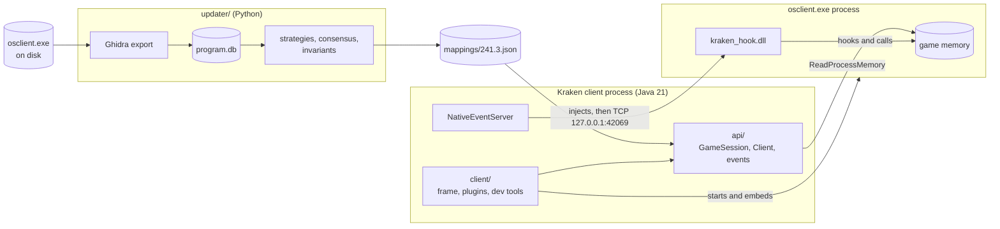
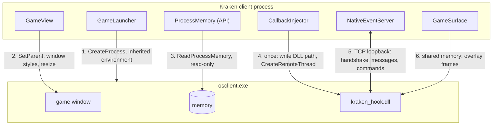
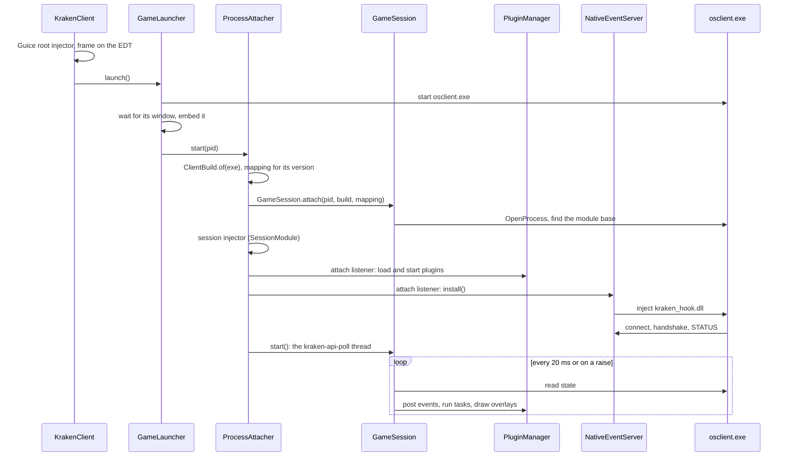
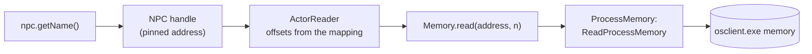
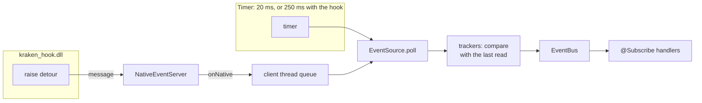
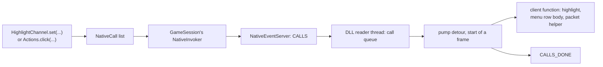
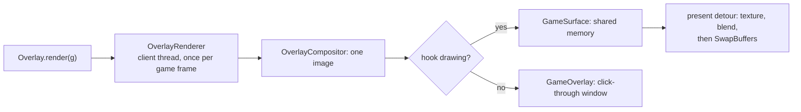
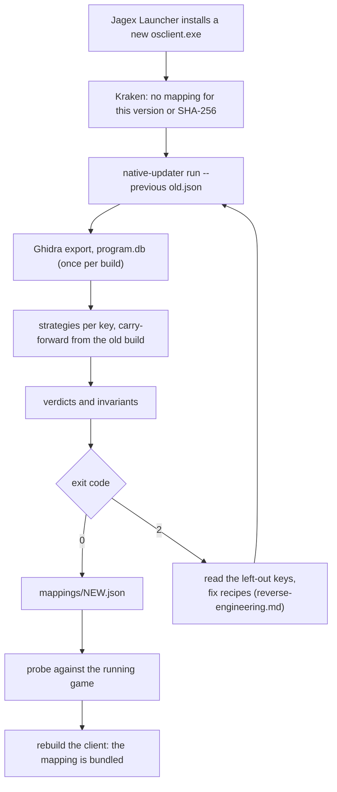

# Architecture

Kraken Native is three programs joined by one file. The **updater** studies a game build on disk and writes a
**mapping**: where everything the API needs lives in that build's memory. The **API** attaches to the running game and
reads it along the mapping's offsets. The **client** launches the game, hosts plugins on the API, and loads the
**native hook** into the game for what reading alone can't do.

## The Pieces

| Part | Language | What it does | Deep dive |
|---|---|---|---|
| `updater/` | Python 3.12 (uv) | Disassembles a build with Ghidra, finds every value the API needs by several independent methods, grades them, and writes `mappings/<version>.json` | [Updater](updater.md) |
| `api/src/main/resources/mappings/` | JSON | The contract: one file per game version, values only | [Mapping format](mapping-format.md) |
| `api/` | Java 21 | Attaches to the running game and reads it from outside with `ReadProcessMemory`, as a RuneLite-shaped API with events | [API internals](api.md), [Events](events.md) |
| `client/` | Java 21, Swing, Guice | Starts the game, embeds its window, attaches the API, hosts plugins, overlays and dev tools | [Client internals](client.md) |
| `client/src/main/native/kraken_hook/` | C++17 | Loaded into the game: reports event raises, runs client functions on the game thread, draws overlays in the game's frame, reports scripts | [Native hook](native-hook.md), [Native protocol](native-protocol.md) |

Two features cross every part: [drawing in the game](in-game-drawing.md) and [menu actions](menu-actions.md).

## Repository Layout

| Path | Holds |
|---|---|
| `api/src/main/java/com/kraken/api/` | The public API: `Client`, `GameSession` and the domain packages (`actor`, `scene`, `widgets`, `events`, …) |
| `api/src/main/java/com/kraken/api/internal/` | Plumbing: readers, event trackers, config decoders, native call records. Public only because Java has no friend packages |
| `api/src/main/java/com/kraken/api/gameval/` | Game constants generated by `./gradlew :api:generateGameval`; never edited by hand |
| `api/src/main/resources/mappings/` | The bundled mappings |
| `client/src/main/java/com/kraken/client/` | The client: startup, Guice modules, the launcher and attacher |
| `client/.../callback/` | The native hook's Java side: injection, the server, the protocol |
| `client/.../plugins/` | The plugin system, the settings system (`config/`) and the built-in plugins |
| `client/.../ui/` | The frame and sidebar, overlays (`overlay/`) and dev tools (`devtools/`) |
| `client/src/main/native/kraken_hook/` | The DLL's CMake project |
| `updater/src/native_updater/` | The updater: pipeline, analysis, strategies, feature modules, and the key specs in `spec/*.yaml` |
| `updater/corpus/` | Accepted values per game version, for the golden tests |
| `docs/` | User guides; `docs/developer/` is this documentation |

## The Mapping Contract

The game is a C++ program compiled with whole-program optimisation. Every build moves its structs' fields, globals and
functions, and nothing in it is named. Kraken never hard-codes an address. Instead:

1. For each build, the updater finds every value the API reads, anchored on things that survive compilation: the names
   of the game's Lua plugin API bindings, diagnostic strings, constants and the shape of the call graph.
2. It writes them to `mappings/<version>.json`, named after the exe's version (`241.3`) and stamped with its SHA-256.
3. At attach, the API picks the mapping by the running exe's version and refuses it unless the SHA-256 matches.
4. Each reader looks up its offsets once, when it's built. A missing required key stops the attach; a missing optional
   one makes the feature behind it read empty.

The same file feeds the native hook: the client turns its `events` and `functions` sections into the handshake that
tells the DLL what to hook and call. [Mapping format](mapping-format.md) covers every section and who reads it.

## Two Processes

Kraken's code runs in two processes, and every interaction between them goes through one of a few channels.

| Channel | Direction | Used for |
|---|---|---|
| 1. Process start | Client → game | Kraken starts `osclient.exe` itself, so Jagex account variables pass through its environment |
| 2. Window embedding | Client → game window | The game's top-level window becomes a child of Kraken's frame |
| 3. Memory reads | API → game | Every getter and every event tracker |
| 4. Injection | Client → game, once | Loads `kraken_hook.dll` |
| 5. Socket | Both ways | Raise and script reports out; call batches, the surface name, the frame cap and script filters in |
| 6. Shared memory | Client → DLL | Overlay pixels, triple-buffered |

The API alone uses only channel 3; it runs without the client (see [Using the API on its own](../api.md#using-the-api-on-its-own)).

## A Session, End to End

Details of each step are in [Client internals](client.md) (launch, attach, plugins), [API internals](api.md) (attach
and the poll loop) and [Native hook](native-hook.md) (injection and the handshake).

## How Data Flows

### Reading

A plugin's getter call reads game memory then and there. Nothing is cached between calls.

Each getter replays what one of the game's own Lua plugin API functions reads: the handler's chain of loads, starting
at the `Client` object (found through `globals.client`) and following the mapping's offsets. See
[API internals](api.md).

### Events

Events come from comparing reads, and the hook only decides *when* to read.

* Without the hook, the timer reads every 20 ms. With it, reads follow the raises (the hooked `clientCycle` raises
  once per 20 ms client cycle), and the 250 ms timer is only a safety net.
* Ticks come from the game's own counters, never from a raise alone.
* A tracker reads only while something subscribes to its events.
* Where a diff could miss a change (an interface closed and reopened between two reads, a varc set and reset), the
  tracker also applies the hook's reports in order.
* Script events come straight from the hook's reports.

See [Events](events.md).

### Writing

Kraken changes the game in two ways only, both by having the DLL call the client's own functions on the game thread.

See [In-game drawing](in-game-drawing.md#highlights) and [Menu actions](menu-actions.md).

### Drawing

Overlays are Java2D, drawn on the client thread, then shown either inside the game's frame or in a window over it.

See [In-game drawing](in-game-drawing.md#overlays).

## Threads

| Process | Thread | Runs |
|---|---|---|
| Kraken | Swing EDT | The frame, panels, settings pages, dev tool windows; plugin `startUp`/`shutDown` |
| Kraken | `kraken-api-poll` | The **client thread**: queued tasks, event trackers and handlers, tick-end tasks, overlay rendering, dev tool reads |
| Kraken | `kraken-api-attach` | Attaching the API and building the session injector |
| Kraken | `kraken-hook-install` | Extracting and injecting the DLL |
| Kraken | `kraken-hook-server` | Accepting the DLL's connection and reading its messages |
| Kraken | `kraken-scheduler` | A shared scheduled executor for plugins and the client |
| Kraken | `osclient-output` | Forwarding the game's console output to the log |
| Kraken | `kraken-shutdown`, `kraken-exit-watchdog`, `kraken-hook-flush` | Shutting down |
| Game | the game's main thread | The game, and every DLL detour: raises, scripts, the pump (calls, frame cap) and the present (overlay) |
| Game | DLL writer (init) thread | Connecting, the handshake, sending the ring's messages and STATUS/FRAME/FPS |
| Game | DLL reader thread | Reading commands: queuing calls, handing over surfaces, the frame cap and script filter |

## Where Kraken Touches the Game

In one place, for review:

* **Reads** memory through `ReadProcessMemory`, with a handle opened for `PROCESS_VM_READ | PROCESS_QUERY_INFORMATION`.
* **Starts** the game process and **re-parents** its window.
* **Injects** one DLL, once, by writing its path into the game and starting a thread on `LoadLibraryA`.
* **Hooks**, inside the DLL, the client's event raisers, a dozen plain functions, the per-frame step, the frame
  present and four script runtime functions. Every detour forwards to the original unchanged.
* **Calls**, on the game thread at the start of a frame, the client's highlight functions, minimenu row bodies and
  packet helpers. Every menu action reaches the game's servers as the real click would.
* **Writes**, on the game thread: the right-click menu's rows as the client rebuilds them, the hidden and 2D bytes of
  the entities the visibility rules hide (and back, for those it hid), and the drag fields and mouse-repeat listeners
  of components it looks up by id. With the calls, these are the only changes to game state Kraken makes.
* **Delays** frames, when the unfocused frame cap is on.
* **Draws** over the finished frame with its own GL objects, restoring the client's GL state after.

[The native hook](native-hook.md#every-place-kraken-changes-the-game) lists every hooked function with its mapping key.

## When the Game Updates

User steps are in [Mapping a new game build](../updater.md); what happens inside is in [Updater](updater.md), and how
to fix a value it got wrong in [Reverse engineering](reverse-engineering.md).

## Design Rules

These hold across the codebase; changes should keep them.

* **No hard-coded offsets.** Every address and offset comes from the mapping. A new build needs a new mapping, never a
  code change, unless the client's code changed shape.
* **One API layer, RuneLite's shape.** Concrete classes with RuneLite's names, types and meanings; no interfaces or
  adapters; no stubs for what can't be read. Lua-only reads go on the matching class.
* **Each getter replays a Lua handler.** The game's Lua plugin API is the reference for what a value means and where it
  lives. Javadoc names the Lua function and any deliberate divergence.
* **Read-only, except through the hook on the game thread.** Highlights and menu actions, run by the client's own
  code; menu rules applied as the client rebuilds the menu; visibility rules applied to every entity each frame; and
  component writes made after looking the component up by id.
* **Raises decide when to read; counters decide ticks.** The hook never replaces a read: trackers keep their
  whole-read fallback, so a dropped or unconfirmed message costs latency, not an event.
* **Fail soft.** A missing optional key reads empty; a missing hook falls back to polling; a faulting call is skipped
  under a guard. Only a missing required key stops the attach.
* **Stable identity.** One handle per actor, pinned to its address plus its creation cycle (NPCs) or name (players),
  keeping its last values once gone. Tile objects are values; widgets, projectiles and inventories are snapshots.

## Glossary

| Term | Meaning |
|---|---|
| Build | One compiled `osclient.exe`, identified by its version (`241.3`) and SHA-256 |
| RVA | Relative virtual address: an offset from the start of the loaded image. The mapping stores RVAs; adding the module base gives an address |
| Module base | Where Windows loaded `osclient.exe` in this run; it changes every launch |
| Mapping key | A named value in the mapping, such as `Actor.pathX` or `functions.present` |
| Recipe | A key's entry in `updater/.../spec/*.yaml`: the strategies that find it and the invariants that check it |
| Verdict | How sure the updater is of a value: `PROVEN`, `ANCHORED`, `INFERRED`, `NEEDS_REVIEW` or `FAILED` |
| Lua binding | A function of the game's Lua plugin API (`osrs.*`), registered with sol2; its handler names what it reads |
| Raise | The game's call that announces a plugin event (`ON_NPC_LOAD`, …) |
| Detour | A hook that sends a function's calls through Kraken's code first |
| Tracker | An API class that turns differences between reads into events |
| Client thread | `kraken-api-poll`, the thread events, tasks and overlays run on |
| Pump | The DLL's detour on the game's per-frame step, where calls run |
| Present | The game's end-of-frame call that shows the frame; the DLL draws overlays there |
| Surface | The shared-memory buffer overlay frames pass through |
| Session injector | The Guice child injector the client builds per attach, binding `Client`, `GameSession` and session services |
