# Kraken Client Internals

The client is the Java program a user runs. It starts `osclient.exe`, moves the game's window into its own frame,
attaches the API to the game, loads the plugins and injects the native hook. This page covers how that is put
together. The user's view is in [Using the Client](../client.md), and the plugin API is in
[Writing a Plugin](../writing-plugins.md).

## Key Files

Paths are under [`client/src/main/java/com/kraken/client/`](../../client/src/main/java/com/kraken/client/).

| File | Role |
|---|---|
| [`KrakenClient.java`](../../client/src/main/java/com/kraken/client/KrakenClient.java) | `main`, the command line, the startup order |
| [`KrakenModule.java`](../../client/src/main/java/com/kraken/client/KrakenModule.java), [`SessionModule.java`](../../client/src/main/java/com/kraken/client/SessionModule.java) | Guice bindings for the launch-time injector and the attached-game injector |
| [`GameLauncher.java`](../../client/src/main/java/com/kraken/client/GameLauncher.java) | Starts `osclient.exe`, waits for its window, embeds it, keeps it fitted |
| [`GameView.java`](../../client/src/main/java/com/kraken/client/GameView.java) | The canvas the game's window is re-parented into, and the Win32 focus handling |
| [`GameSizeCheck.java`](../../client/src/main/java/com/kraken/client/GameSizeCheck.java) | Decides when the game needs a second resize |
| [`ProcessAttacher.java`](../../client/src/main/java/com/kraken/client/ProcessAttacher.java) | Attaches the API on a background thread; the state and listener lists |
| [`ExitHandler.java`](../../client/src/main/java/com/kraken/client/ExitHandler.java), [`ExitConfirmation.java`](../../client/src/main/java/com/kraken/client/ExitConfirmation.java) | Shutdown, the 15 second watchdog, the close confirmation |
| [`FrameRates.java`](../../client/src/main/java/com/kraken/client/FrameRates.java) | Game and overlay frame rates, and the unfocused frame cap |
| [`KrakenConfig.java`](../../client/src/main/java/com/kraken/client/KrakenConfig.java) | Kraken's own settings, and the window layout it remembers |
| [`callback/NativeEventServer.java`](../../client/src/main/java/com/kraken/client/callback/NativeEventServer.java) | Injects `kraken_hook.dll` and runs its connection |
| [`callback/CallbackInjector.java`](../../client/src/main/java/com/kraken/client/callback/CallbackInjector.java) | The remote `LoadLibraryA` injection |
| [`callback/ClientThread.java`](../../client/src/main/java/com/kraken/client/callback/ClientThread.java) | Runs tasks on the API's poll thread |
| [`plugins/PluginManager.java`](../../client/src/main/java/com/kraken/client/plugins/PluginManager.java) | Plugin discovery, injection, order, lifecycle |
| [`plugins/Plugin.java`](../../client/src/main/java/com/kraken/client/plugins/Plugin.java), [`PluginDescriptor.java`](../../client/src/main/java/com/kraken/client/plugins/PluginDescriptor.java), [`PluginDependency.java`](../../client/src/main/java/com/kraken/client/plugins/PluginDependency.java) | The plugin base class and its annotations |
| [`plugins/config/`](../../client/src/main/java/com/kraken/client/plugins/config/) | `ConfigManager`, the proxy, the descriptors, the settings annotations |
| [`input/`](../../client/src/main/java/com/kraken/client/input/) | `KeyManager` and `HotkeyListener`: which keys are held while the game has the keyboard |
| [`worldhopper/`](../../client/src/main/java/com/kraken/client/worldhopper/) | The World Hopper: the world list, the hops and quick-hops, the sidebar page and its settings |
| [`util/`](../../client/src/main/java/com/kraken/client/util/), [`game/`](../../client/src/main/java/com/kraken/client/game/) | Helpers for plugins: wildcard and list matching, text and colour tags, quantities, whether an NPC is dying |
| [`ui/KrakenFrame.java`](../../client/src/main/java/com/kraken/client/ui/KrakenFrame.java) | The main window: layout, window state, settings that reach the window |
| [`ui/Sidebar.java`](../../client/src/main/java/com/kraken/client/ui/Sidebar.java), [`HomePanel.java`](../../client/src/main/java/com/kraken/client/ui/HomePanel.java), [`PluginListPanel.java`](../../client/src/main/java/com/kraken/client/ui/PluginListPanel.java), [`ConfigPanel.java`](../../client/src/main/java/com/kraken/client/ui/ConfigPanel.java), [`ConsolePanel.java`](../../client/src/main/java/com/kraken/client/ui/ConsolePanel.java), [`Theme.java`](../../client/src/main/java/com/kraken/client/ui/Theme.java) | The sidebar pages, the console, the theme |
| [`ui/overlay/`](../../client/src/main/java/com/kraken/client/ui/overlay/) | Overlay manager, renderer, compositor, editor, and the two drawing targets |
| [`ui/devtools/`](../../client/src/main/java/com/kraken/client/ui/devtools/) | `DevTool`, its manager, the sidebar panel, the catalog, the views |
| [`ui/devtools/tools/`](../../client/src/main/java/com/kraken/client/ui/devtools/tools/) | The individual dev tools |

## Startup

`KrakenClient.launch` builds the injector, shows the frame, and then blocks on the game launcher. Everything the game
needs waits for the API to attach.

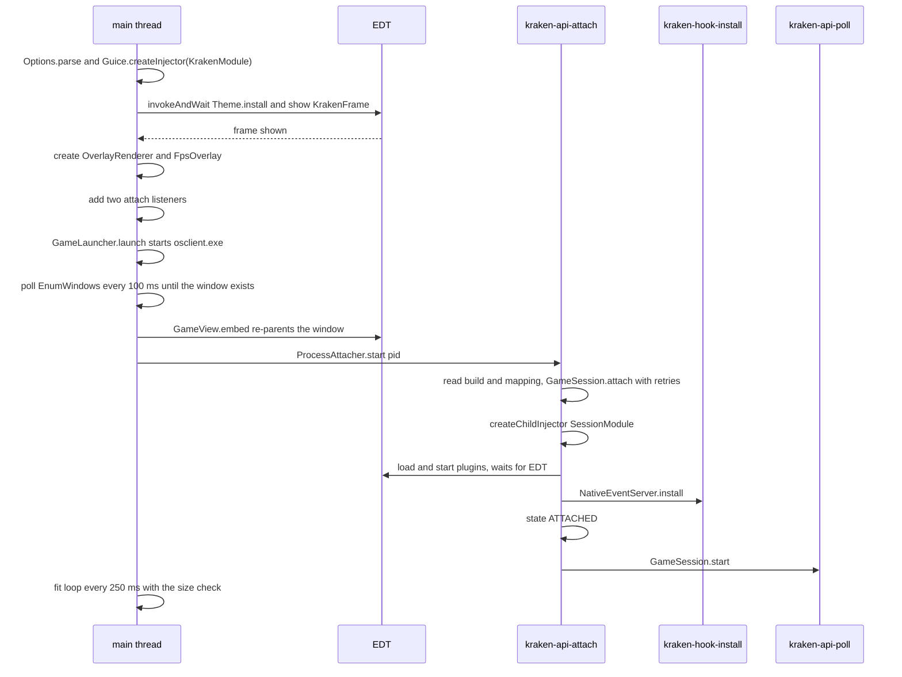

1. `KrakenClient.launch` parses the command line. Unknown options are collected and logged once the console exists.
2. `Guice.createInjector(new KrakenModule(exe, developerMode))` creates the launch-time injector.
3. On the EDT, `Theme.install()` sets up FlatLaf. Then `injector.getInstance(KrakenFrame.class)` creates the frame and
   shows it. Creating the frame creates most launch-time components (see [Guice Injectors](#guice-injectors)).
4. `OverlayRenderer` and `FpsOverlay` are created. Their constructors register the frame listener and set up the
   overlay state.
5. `PluginManager` and `ProcessAttacher` are obtained, and two attach listeners are added. The first loads and starts
   the plugins. The second installs the native hook. Both run on the attach thread, in that order.
6. `GameLauncher.launch()` runs on the main thread. It hashes the exe with SHA-256 and shows the first 16 hex characters
   as the **Build** row. It starts the process with `ProcessBuilder` in the exe's folder. The environment is inherited,
   which is how the Jagex session variables reach the game (see [Jagex Accounts](../jagex-accounts.md)). A shutdown hook
   destroys the process, and `onExit` runs `ExitHandler.exit`.
7. A daemon thread, `osclient-output`, copies the game's output into the `osclient` logger.
8. The launcher polls `GameView.find(pid)` every 100 ms until a visible top-level window belongs to the process. This
   wait has no timeout.
9. `GameView.embed(hwnd)` re-parents the window into the game area. Until then the canvas shows the logo and
   **Launching Old School RuneScape…**.
10. `ProcessAttacher.start(pid)` starts the `kraken-api-attach` thread.
11. The launcher loop runs every 250 ms while the process is alive. Each pass fits the window, reads the size the game
    records, and nudges the window if the game is drawing at an old size.

If step 6 throws, for example when the exe is missing, the launcher logs it and the game area shows **Could not launch
the client, see the console for details**. Kraken stays open with no game and no plugins.

## Guice Injectors

Kraken has three levels of injector. Guice gives a child injector every binding of its parent, but the parent can't see
the child's bindings. Each level therefore adds only what exists at that point in the run.

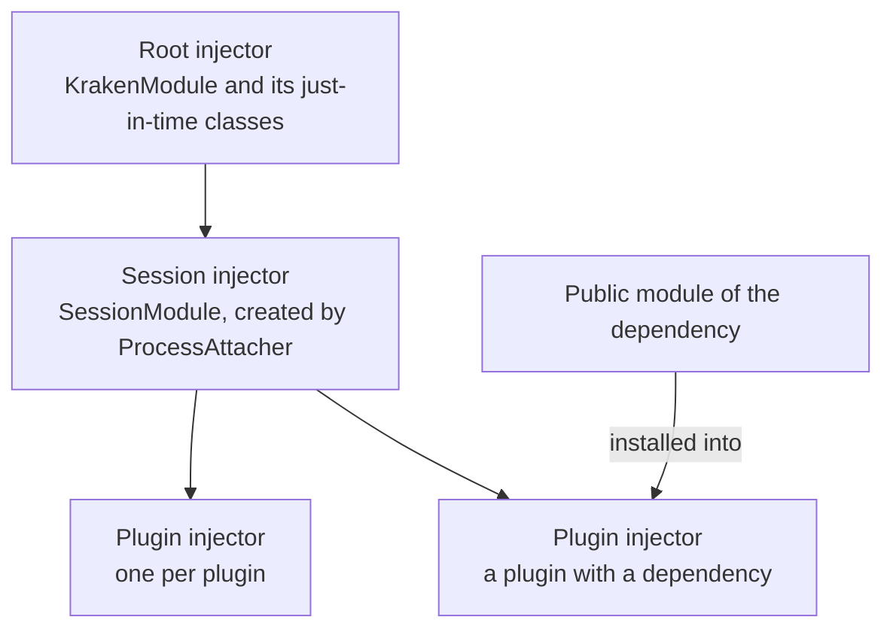

| Level | Bound explicitly | Created on first use |
|---|---|---|
| Root, `KrakenModule` | `@Named("exe") File`, `@Named("developerMode") boolean`, `@Named("settings") Path`, the `EventBus` instance, `@Named("edt") Executor`, `KrakenConfig` (a provider), `WorldHopperConfig` (a provider), and a `ScheduledExecutorService` provider that makes the `kraken-scheduler` thread | Every `@Singleton` class of the client: `KrakenFrame`, `GameView`, `GameLauncher`, `HomePanel`, `Sidebar`, `ConsolePanel`, `DevToolsPanel`, `DevToolManager`, `PluginListPanel`, `WorldHopperPanel`, `WorldService`, `ExitHandler`, `ConfigManager`, `FrameRates`, `ProcessAttacher`, `PluginManager`, `OverlayManager`, `OverlayRenderer`, `OverlayEditor`, `GameOverlay`, `GameSurface`, `FpsOverlay` |
| Session, `SessionModule` | `GameSession`, `Client`, `Mapping`, `@Named("pid") long`, `ClientThread` (singleton), `NativeEventServer` (singleton), `KeyManager` (singleton), `WorldHopper` (singleton) | Nothing; the session services above are bound explicitly so that every plugin shares one |
| Plugin | The plugin instance itself, and the plugin's own module (its `@Provides` methods) | Its `@Inject` fields, drawn from the session injector and its dependencies' public modules |

Two rules follow from this layout:

* A root-level class can't inject a session object. `GameSession` has no binding above the session injector, so Guice
  fails when such a class is first requested. Pre-game components use `ProcessAttacher` instead: its state (through
  `addStateListener`), its attach listeners, which are handed the session injector, and its poll and frame listeners.
  `DevToolManager`, `OverlayRenderer`, `HomePanel` and `WorldHopperPanel` all work this way.
* Plugins are installed as Guice modules. `PluginManager` builds each plugin's injector as a child of the session
  injector, binds the plugin instance, and installs the plugin, so its `@Provides` methods run. A dependency's public
  module (`Plugin.getPublicModule()`) is installed into the dependent plugin's injector.

`@Named("edt")` is an `Executor` that runs a task at once when called on the EDT, and otherwise queues it with
`SwingUtilities.invokeLater`. `PluginManager` uses it for `startUp` and `shutDown`.

[`client/lombok.config`](../../client/lombok.config) sets `lombok.copyableAnnotations += com.google.inject.name.Named`,
so a `@Named` on a field is copied onto the generated constructor parameter.
[`GameLauncher`](../../client/src/main/java/com/kraken/client/GameLauncher.java) depends on this. Its constructor comes
from `@AllArgsConstructor(onConstructor_ = @Inject)`, and it takes `@Named("exe")`. The same file sets
`config.stopBubbling = true`, so no parent `lombok.config` is applied.

## Embedding the Game Window

The game is a separate process with its own top-level window. Kraken turns that window into a child of a canvas in its
own frame, so the game appears inside the Kraken window and moves, clips and resizes with it.

### Win32 Terms

* **HWND**: a window handle, the number Windows uses to refer to a window. JNA exposes it as `WinDef.HWND`.
* **Top-level and child windows**: a child window (style `WS_CHILD`) lives inside its parent's client area and is
  clipped by it. `SetParent` changes a window's parent.
* **Window styles**: `GWL_STYLE` holds the frame bits (`WS_CAPTION`, `WS_THICKFRAME`, `WS_SYSMENU`, the min and max
  buttons) and `WS_POPUP`. `GWL_EXSTYLE` holds the extended bits.
* **Keyboard focus**: each thread has an input state, and `SetFocus` picks the window that gets the keys for the
  calling thread. A thread can only set focus on windows of threads whose input it shares.

### Finding and Re-parenting

`GameView.find(pid)` calls `EnumWindows` and returns the first visible top-level window whose
`GetWindowThreadProcessId` owner is the game's PID. `GameView.embed(hwnd)` then changes the window:

| Change | Why |
|---|---|
| Remove `WS_POPUP`, `WS_CAPTION`, `WS_THICKFRAME`, `WS_SYSMENU`, `WS_MINIMIZEBOX`, `WS_MAXIMIZEBOX` | The game's own frame and buttons would otherwise show inside Kraken's |
| Add `WS_CHILD` | Marks the window as a child, so Windows positions and clips it inside the canvas |
| `SetParent` to the `Canvas` handle of `GameView`'s host | Puts the game inside Kraken's frame. `Native.getComponentPointer` gives the canvas's `HWND` |

After the change, `embed` calls `fit()` and queues the focus start on the EDT.

### Fitting the Window

`GameView.fit()` reads the canvas's client rectangle (`GetClientRect`) and the game's rectangle (`GetWindowRect`). If the
sizes differ, it calls `SetWindowPos` with `SWP_NOZORDER | SWP_FRAMECHANGED | SWP_SHOWWINDOW` and fires the
`gameSize` property change, which `HomePanel` shows on the Kraken page. The fit runs in two places:

* on the EDT, from the canvas's `componentResized`;
* on the launcher thread, every 250 ms.

Neither path takes a lock. Both compute the same size from the same canvas, so an interleaving at worst repeats a resize.

### The Size Check

When the window is resized while the game is still starting, the game can keep drawing at the size it started at. Only
a corner of the game then shows, until the window is resized once more. The game records the size it draws at, and
`Client.getScreenWidth` and `getScreenHeight` read that record.

[`GameSizeCheck`](../../client/src/main/java/com/kraken/client/GameSizeCheck.java) compares the record with the fitted
size on each launcher pass:

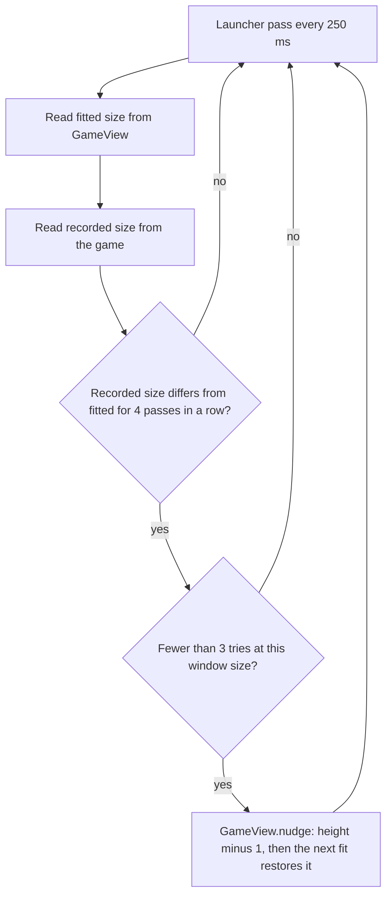

A try is counted per window size. A change of the fitted size starts the count again. A recorded size that is missing or
not positive counts as agreement, so the check does nothing until the API is attached.

### Keyboard Focus

The game takes Win32 focus itself when it is clicked, and it moves focus between its child windows. Swing doesn't see
that change. `GameView` keeps the two in step:

* **Focus to the game.** When Swing gives the view focus, or when the view starts showing, `focusGame()` calls
  `setFocus` on the game unless `gameHasFocus()` says it has it already. Focusing the game window again would move the
  focus off the child window the game keeps it on, and the game drops every held key when that child loses focus.
* **Swing follows the game.** A 100 ms timer moves Swing's focus to the view when the game has the keyboard, so a
  Kraken control stops looking focused.
* **Focus back to the frame.** When Swing's focus moves to a Kraken control while the game has the keyboard,
  `focusOwnerChanged` gives Win32 focus back to the frame. A click on a text field then types into the field.
* **Thread sharing.** `setFocus` calls `AttachThreadInput` to join the EDT's input state to the game's thread, then
  calls `SetFocus`. The join is never undone.

`gameHasFocus()` walks from `GUITHREADINFO.hwndFocus` up through its parents, and reports true if it reaches the game's
window.

## Attaching the API

[`ProcessAttacher`](../../client/src/main/java/com/kraken/client/ProcessAttacher.java) is the one place that moves the
client from "running" to "attached". It is a `@Singleton` in the root injector, so every pre-game component can read its
state.

### States

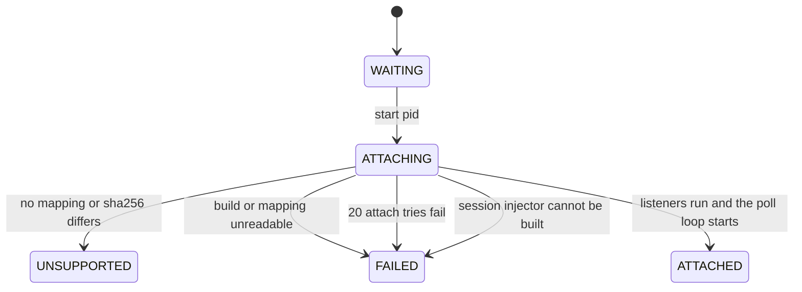

`ATTACHED` has no outgoing transition. The status line on the Kraken page shows the `detail` text:

| State | Detail text |
|---|---|
| `WAITING` | Waiting for the client to start… |
| `ATTACHING` | Attaching to osclient.exe (pid *n*)… |
| `ATTACHED` | Attached · client *version* |
| `UNSUPPORTED` | No mapping for client *version*. Run the updater for it. |
| `FAILED`, mapping or build unreadable | Could not read the client's build or mapping. See the console. |
| `FAILED`, out of attach tries or injector failed | Could not attach to osclient.exe. See the console. |

`UNSUPPORTED` is also the state for a mapping whose sha256 doesn't match the running exe. The text is the same, and the
console line carries the reason.

Besides the state, `ProcessAttacher` keeps what it learns for the Kraken page: `getPid()` from `start`, `getBuild()` once
the exe has been read, and `getMappingSource()` once the mapping has loaded (`BUNDLED_MAPPINGS`, or the
`kraken.mappings` folder).

### Retries and the Mapping

`attach` reads the build with `ClientBuild.of` and the mapping once, before any attach try, because neither changes while
the game runs. The mapping comes from one of two places:

* `-Dkraken.mappings=<dir>`: `GameSession.mappingFor(build, dir)` reads `<dir>/<version>.json`.
* Otherwise: `GameSession.mappingFor(build)` reads the bundled `mappings/<version>.json`.

`open` calls `GameSession.attach` up to 20 times, 500 ms apart. Those tries cover the time before the game's module is
loaded. `UnsupportedBuildException` is not retried, since a retry can't fix a mapping made from another binary. The
sha256 check happens inside `GameSession.attach`, against the running exe.

After a successful attach, `ProcessAttacher` creates the session injector from `SessionModule`, sets the poll and frame
listeners on the session, and sets the `session` field. It then runs the attach listeners, sets `ATTACHED`, and starts
the poll loop.

### Listeners

| Registration | Runs on | When | Registered by |
|---|---|---|---|
| `addStateListener` | EDT | Each state change | `HomePanel` (status line and build), `DevToolManager.attachStateChanged` |
| `addAttachListener` | `kraken-api-attach`, before `ATTACHED` and before the first poll | Once | `HomePanel` (takes the `NativeEventServer`), then `KrakenClient`: plugin loading, then the hook install |
| `addPollListener` | `kraken-api-poll` | Every 150 ms once attached | `KrakenFrame.readPlayer`, `HomePanel.readGame`, `DevToolManager.poll` |
| `addFrameListener` | `kraken-api-poll` | Every pass of the poll loop, about every 20 ms or on a hook raise | `OverlayRenderer.frame` |

A listener that throws is logged, and the other listeners still run. `notify` logs failures from the poll and frame
listeners on every failing pass, so listeners catch their own errors.

Attach listeners added after `ATTACHED` never run. Check `attached()` as well.

## Plugins

[`PluginManager`](../../client/src/main/java/com/kraken/client/plugins/PluginManager.java) owns the plugin list, the
running set and the failures. Its work is plugin discovery, the order of loading, and the lifecycle. The contract a plugin
author sees is in [Writing a Plugin](../writing-plugins.md).

### Discovery and Loading

`loadCorePlugins` scans `com.kraken.client.plugins` with ClassGraph. It takes every top-level class that carries
`@PluginDescriptor`. Nested classes are skipped, which is how the test fakes stay out of the scan.
`loadPlugins(parent, classes)` is the entry point for `--plugin` classes.

For each class, `loadPlugins` applies these rules:

* A class that isn't a `Plugin` or has no descriptor is logged and skipped.
* An abstract class is skipped silently.
* A `developerPlugin` is skipped unless `--developer-mode` is on.
* A class that is already loaded is skipped, so loading the same class twice loads it once.

The remaining classes are sorted by name, then placed so that every dependency comes first (`dependencyOrder`). A class
whose dependency isn't in the set is logged as **Not loading plugin X: it depends on Y, which can't be loaded**, and it
never reaches the plugin list. A cycle is logged and the class is left out.

`instantiate` creates each plugin with its no-argument constructor, made accessible. It then builds the plugin's
injector as a child of the parent injector, with the public modules of its `@PluginDependency` classes first and the
plugin module last. If the dependency has no public module, or the injector can't be built, the plugin stays in the list
with a failure and no injector.

### Lifecycle

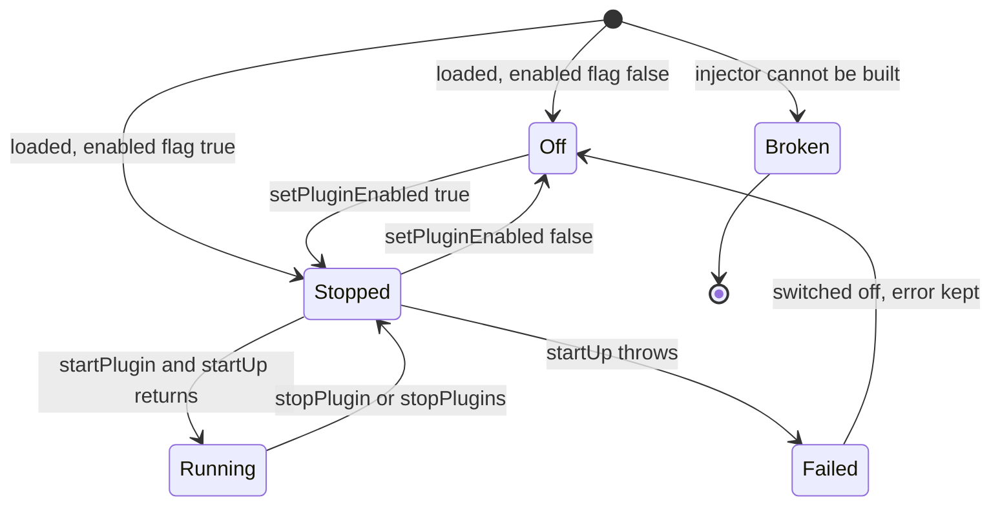

`startPlugin` and `stopPlugin` run their work on the EDT (`onEdt`), and the calling thread waits for the result. The
steps are:

* **Start** (`start`): skip if the plugin is running, off, or has no injector. Turn off any plugin it conflicts with, and
  stop that plugin. Mark it active, call `startUp`, then register it on the bus. On success, clear its failure, post
  `PluginChanged(plugin, true)` and notify the change listeners.
* **Failure** in `start`: stop the plugin (which runs `shutDown`), record the exception, and turn the plugin off. The
  Plugins page shows it as **failed**.
* **Stop** (`stop`): remove it from the running set, unregister it from the bus, run `shutDown` (an exception is logged),
  and post `PluginChanged(plugin, false)`.
* **Order**: `startPlugins` runs in load order, which is dependency order. `stopPlugins` runs in reverse.

`startUp` and `shutDown` both run on the EDT. Game events reach a plugin's handlers on the client thread, because the API
posts them there. The bus itself runs each handler on the thread that calls `post` (see
[`EventBus`](../../api/src/main/java/com/kraken/api/eventbus/EventBus.java)).

### Enabled State and Conflicts

The on/off state is a setting in the `kraken` group, under the key `kraken.<lower-cased simple class name>`, so
`TickCounterPlugin` is `kraken.tickcounterplugin`. Without a stored value, `enabledByDefault` decides.
`setPluginEnabled` stores the flag and clears the flag of any plugin it conflicts with. It doesn't start or stop anything.
`startPlugin` and `stopPlugin` act on the running state.

Two plugins conflict when one's name or `conflicts` contains the other's name or conflicts. Turning one on turns the
other off. The Plugins page asks first (`confirmConflicts`), and `start` does the same switch when a plugin is started
by other code.

### Failures

| Case | In the plugin list | Shown as | Logged |
|---|---|---|---|
| Class can't be created (no no-argument constructor, or it throws) | No | Nothing | Yes |
| A `@PluginDependency` isn't loaded | No | Nothing | Yes |
| The dependency has no public module | Yes, no injector | **failed to load**, toggle disabled | Yes |
| The injector can't be built (for example an unbound `@Inject`) | Yes, no injector | **failed to load**, toggle disabled | Yes |
| `startUp` throws | Yes, injector present | **failed to start**, switched off | Yes |

`getFailure(plugin)` returns the last error. The tooltip in the list shows its message, unwrapping causes that have none.

### Settings Lookup

`getPluginConfigProxy` looks through the plugin's injector for the first `Config` binding that doesn't come from a
dependency's public module. The cog on a plugin row appears when it finds one, and it opens a `ConfigPanel` with a back
arrow.

## Settings

Settings are typed values in one properties file, read through interface proxies. Kraken's own settings and every
plugin's settings use the same classes.

### Types

[`ConfigManager`](../../client/src/main/java/com/kraken/client/plugins/config/ConfigManager.java) converts strings in
`stringToObject` and writes values in `objectToString`:

| Java type | Stored as | Settings page control |
|---|---|---|
| `boolean` | `true` or `false`, case-insensitive; anything else is an error | Switch |
| `int`, `long`, `float`, `double` | Decimal text | Spinner, bounded by `@Range` and suffixed by `@Units` |
| `String` | The text | Text area, or a password field with `secret = true`; with `@Suggestions` a text field with a drop-down |
| Enum | The constant's name | Drop-down |
| `Set` of an enum | Names, comma-separated | A checkbox per constant |
| `Color` | `#AARRGGBB`; a decimal ARGB integer also reads | Swatch that opens a colour picker, with transparency if `@Alpha` |
| `Dimension` | `WIDTHxHEIGHT` | Two spinners |
| `Point` | `X:Y` | Two spinners |
| `Rectangle` | `X:Y:WIDTH:HEIGHT` | No control, so it suits hidden items |
| `Keybind` | `KEYCODE:MODIFIERS`, as `KeyEvent` codes and `InputEvent` masks; a modifier alone is stored as the modifier with key 0, so Alt is `0:512` | Button that records the keys pressed after it is clicked |
| `Button` | Nothing is stored | Button |

A `Keybind` setting only stores keys. The game reads the keyboard itself, so a plugin learns that a keybind is held
through [`KeyManager`](#keyboard), which can't stop the game from seeing the key.

### The Proxy

`ConfigManager.getConfig(type)` returns a `java.lang.reflect.Proxy` built on `ConfigInvocationHandler`. The handler has
these rules:

* A no-argument getter returns the stored value, converted to its return type. If nothing is stored, or the stored text
  doesn't convert, it returns the method's `default` body. A conversion failure is logged once per method.
* A one-argument `void` setter stores its argument with `setConfiguration`. A `null` argument unsets the key.
* A `default` method without `@ConfigItem` is a helper and runs as written.
* A `Button` getter returns `Button.INSTANCE` and reads nothing.

Values are not cached. Each getter reads the properties table, which is a map lookup and a parse.

### Storage

`ConfigManager` keeps one `Properties` table, loaded at construction from the settings file. The file is the path given
by `-Dkraken.settings` if that property is set, otherwise `~/.kraken-native/settings.properties` (see
[`KrakenModule.settingsFile`](../../client/src/main/java/com/kraken/client/KrakenModule.java)). Keys are `group.key`.

* Each change marks the table dirty and schedules one save 500 ms later on `kraken-scheduler`. Changes made in that window
  share the save.
* A save writes a temporary file in the same folder, then moves it over the settings file with `ATOMIC_MOVE`. If the
  file system refuses an atomic move, it falls back to a plain move.
* `flush()` cancels the pending save and writes at once. `ExitHandler` calls it as Kraken closes.

### Events

`setConfiguration` and `unsetConfiguration` post `ConfigChanged(group, null, key, oldValue, newValue)` after the lock is
released, on the thread that made the change. Setting a value to what it already is posts nothing.

| Event | Posted when | Thread |
|---|---|---|
| `ConfigChanged` | A setting is set or unset | The thread that made the change |
| `ConfigButtonClicked` | A `Button` on a settings page is clicked, after its `warning` is confirmed | EDT |
| `ConfigSuggestionsRequested` | A `@Suggestions` drop-down opens | EDT |
| `PluginChanged` | A plugin starts or stops | EDT |

`ConfigSuggestionsRequested.suggest` may be called later and from any thread. The Action Tester plugin answers it on the
client thread, since the list comes from the game.

### Descriptors and Visibility

`getConfigDescriptor(config)` reads the interface once per page. It takes the group from `@ConfigGroup`, the sections from
the `String` fields annotated `@ConfigSection`, and the items from the no-argument getters annotated `@ConfigItem`. Both
lists are sorted by `position`, then by name. Each item carries its `Range`, `Alpha`, `Units`, `Suggestions`, `@ShowIf`
and `@Unsupported` annotations, and each section carries its own `@ShowIf`.

`@ShowIf` decides visibility through `isShown`:

* A hidden item is never shown.
* An item or section is shown when each of its conditions holds, and each condition's item is itself shown. Hidden items
  count as shown here, so a hidden item can decide what the page shows.
* A section is shown when its conditions hold and at least one of its items is shown.
* A condition that loops back on itself never holds.

`checkConditions` logs a warning for a condition that names no item, or an enum value that the item's type doesn't have.

### Flow of a Change

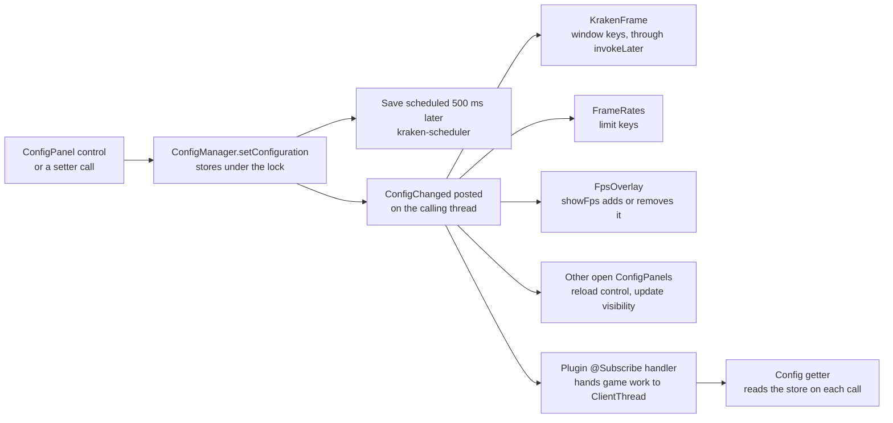

### The Settings Page

[`ConfigPanel`](../../client/src/main/java/com/kraken/client/ui/ConfigPanel.java) builds a page from a config's
descriptor. Its behaviour is:

* Items and collapsible sections appear in position order. The open or closed state of each section is kept in a static
  map for the rest of the run, so a plugin's page keeps its layout.
* `addNotify` subscribes to `ConfigChanged` for the page's group, and `removeNotify` unsubscribes. A page that isn't
  showing doesn't listen.
* A change from another source reloads only that control, so typing in another field isn't overwritten. Then the page
  updates the visibility of every item and section.
* Text fields save after a 600 ms pause in typing, or when they lose focus.
* An item with `warning` asks before its value changes.
* An item with [`@Unsupported`](../../client/src/main/java/com/kraken/client/plugins/config/Unsupported.java) is greyed
  out: its name and control are disabled, and both show a tooltip starting **Currently unsupported**, then the
  annotation's reason and the item's description. The value is still stored and read; the annotation marks a setting
  of a ported plugin that the client can't act on yet ([Plugin ports](plugin-ports.md)).
* A `Keybind` control shows the keybind. Clicked, it records the keys pressed together and stores them once they are
  all let go; Backspace or Delete stores `Keybind.NOT_SET`, and Escape or leaving the control keeps the old value.
* **Reset** asks first, then unsets every item that isn't hidden. Hidden items hold plugin state, so Reset leaves them.

[`KrakenConfig`](../../client/src/main/java/com/kraken/client/KrakenConfig.java) is the Settings tab. It is a
`@ConfigGroup("kraken")` interface like any other. Its hidden items hold the window's layout from the last run.

## Keyboard

The game window takes the keyboard, so Kraken gets none of the game's key events.
[`KeyManager`](../../client/src/main/java/com/kraken/client/input/KeyManager.java), a session service, reads the keys'
state from Windows (`GetAsyncKeyState`) instead, and counts keys only while `Client.isFocused()`:

* `isKeyPressed(keyCode)` and `isPressed(keybind)` read the keys when called, from any thread.
* A [`HotkeyListener`](../../client/src/main/java/com/kraken/client/input/HotkeyListener.java) registered with
  `registerHotkeyListener` is polled on the client thread at each pass while any listener is registered. It gets
  `hotkeyPressed` when all its keybind's keys are held and no other modifier, and `hotkeyReleased` when one is let go
  or the game loses the keyboard. A press shorter than a pass (about 20 ms) can be missed.
* `toWindows` turns `KeyEvent` codes into Windows virtual-key codes; letters, digits, F1-F12, arrows and most control
  keys share theirs.

Nothing here can consume or change a key: the game always sees it.

## World Hopper

The World Hopper is built in, not a plugin: a sidebar page that exists from launch and a session service that hops.
Its classes are in [`worldhopper/`](../../client/src/main/java/com/kraken/client/worldhopper/).

| Class | Injector | Role |
|---|---|---|
| `WorldClient` | Root | Fetches the world list from the address the game fetches it from (`slr.ws`) and decodes it into the API's `World`s |
| `WorldService` | Root | Keeps the last list; refreshes every ten minutes once started, and on request |
| `WorldHopperPanel` | Root | The sidebar page. Reads the current world in a poll listener and takes the `WorldHopper` from an attach listener |
| `WorldHopperConfig` | Root | Group `worldhopper`: the quick-hop keys and filters, and hidden items for the page's filters and sort |
| `WorldHopper` | Session | Runs hops and quick-hops on the client thread; registers the quick-hop `HotkeyListener`s |
| `QuickHop` | None | Picks the world a quick-hop goes to |

`KrakenClient` starts the `WorldHopper` from an attach listener. A hop follows the in-game world switcher: on each
`GameTick`, if the switcher (group 69) isn't in the component table, the hopper calls `Client.openWorldHopper()`,
the logout panel's World Switcher op, and gives up after three ticks; once it is open, it calls
`Client.hopToWorld(world)`, the switcher's "Switch" op with the world's number as the slot, and the server makes the
hop. The client's component op body sends nothing unless the server enabled the op on that component and slot, which
it does as it opens the switcher. That's why the switcher has to be open first. The hopper watches `GameStateChanged`
for the arrival, the "Please finish what you're doing" game message for a refusal, and gives up after ten ticks
without either. Its status goes to the page and the console.

The current world comes from `Client.getWorld()`, the mapping key `Client.currentWorld` that cs2's `map_world` reads.
Hopping from the login screen would need the client's own world change, which the API doesn't map.

## The Window

[`KrakenFrame`](../../client/src/main/java/com/kraken/client/ui/KrakenFrame.java) is a `JFrame` with the game area at
the centre, the sidebar on the right, and the console underneath.

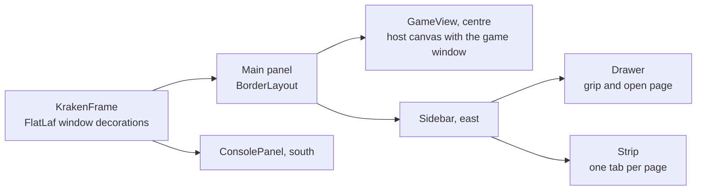

### Title Bar

FlatLaf draws the window decorations on Windows 10 and 11. Its `TitlePane.useWindowDecorations` default is `true`, and
FlatLaf says that `JFrame.setDefaultLookAndFeelDecorated` isn't needed. `KrakenFrame` sets `TITLE_BAR_SHOW_TITLE` to
`false`, so the bar shows no text. The title still reaches the taskbar and Alt+Tab. The title becomes
`Kraken - <name>` while a player is logged in (see `updateTitle`).

### Window State

`KrakenFrame` remembers its layout in hidden `KrakenConfig` items:

| Item | Holds |
|---|---|
| `windowBounds` | The last normal (not maximised) bounds |
| `windowMaximized` | Whether the window was maximised |
| `windowPanelGrowth` | How much the open panel widened the window, to give it back when the panel closes |
| `sidebarPanel` | The name of the open page |
| `sidebarWidth` | The width of the page drawer |
| `consoleExpanded`, `consoleHeight` | The console's state and height |

The window saves its bounds one second after it stops moving or resizing, and again on close. Nothing is saved while the
window is minimised or hidden. On launch, `place()` uses the saved bounds if the top 100 × 20 pixels of the window
fall on a screen. Otherwise it packs the window around the game at the game size and centres it. `keepOnScreen` then
moves the window the least it needs to sit inside its screen's usable area.

### Settings That Reach the Window

| Setting | Handler |
|---|---|
| `alwaysOnTop`, `lockWindowSize`, `growWindow`, `playerNameInTitle` | `applySettings`, through `WINDOW_KEYS` and `invokeLater` |
| `gameSize` | `applyGameSize`: leaves maximised, sets the game view's preferred size, packs, then keeps the window on screen |

`gameSize` is in the game's own pixels. `gameSize()` divides by the default transform of the window's screen, which turns
those pixels into the frame's own units.

### The Sidebar

[`Sidebar`](../../client/src/main/java/com/kraken/client/ui/Sidebar.java) holds one tab per page. Clicking a tab opens its
page in the drawer, and clicking the open tab closes the drawer. When a page opens, the window grows by the drawer's width
if `growWindow` is on and the window is normal, so the game keeps its size. Closing gives the width back. The grip on
the drawer's left edge resizes the page. Its minimum is 242 px, and the game keeps at least 320 px.

The four pages are added in `KrakenFrame`'s constructor: **Kraken** (`HomePanel`), **Plugins** (`PluginListPanel`),
**Dev Tools** (`DevToolsPanel`) and **Settings** (a `ConfigPanel` over `KrakenConfig`). `Sidebar.addTab` is
package-private, so pages are added from the `ui` package. The open page is stored by its tab name, so renaming a tab
means the page is not reopened at launch.

### Home Page

[`HomePanel`](../../client/src/main/java/com/kraken/client/ui/HomePanel.java) is the **Kraken** page: the attach status,
four cards of facts, and links. Each fact comes from where it is kept:

| Card | Rows | Source |
|---|---|---|
| Kraken | Version, Commit, Java, Plugins, Overlay FPS | `KrakenProperties`, `Runtime.version()`, `PluginManager` (change listener), `FrameRates` |
| Game client | Version, Build, PID, Size, FPS | `ProcessAttacher.getBuild()` and `getPid()`, `GameView`'s `gameSize`, `FrameRates` |
| Game | State, Player, World, World type, Jagex account | `GameFacts`, read on the poll thread; the `JX_` environment variables |
| API | Mapping, Native hook, Hooks, Features | `ProcessAttacher.getMappingSource()`, `NativeEventServer.getStatus()` and `getReport()` |

The status dot's colour follows the attach state: accent for `ATTACHED`, warning for `ATTACHING`, error for
`UNSUPPORTED` and `FAILED`, and muted for `WAITING`.

The page is a root singleton, so it reaches the session's `NativeEventServer` through an attach listener rather than by
injection. `GameFacts.read` runs in a poll listener, only while the page is showing (a hierarchy listener tracks that),
and hands the facts to the EDT only when they change. The frame rates, the process and build, and the hook are
refreshed by a one-second Swing timer.

[`KrakenProperties`](../../client/src/main/java/com/kraken/client/KrakenProperties.java) reads `kraken.properties`:
the version and commit, which `processResources` fills in (the commit from `git rev-parse --short HEAD`, empty outside
a checkout), and the link addresses. A placeholder the build didn't fill in reads as missing, and a link with no
address isn't shown. The links open in the default browser, and the last one opens the settings file's folder, on the
`kraken-scheduler` thread.

### Plugins Page

[`PluginListPanel`](../../client/src/main/java/com/kraken/client/ui/PluginListPanel.java) lists every plugin that isn't
`hidden`, sorted by name. The search matches the name, description and tags. Each row has a switch, a **failed** label
when there is a failure, and a cog when the plugin has settings. The panel refreshes through
`PluginManager.addChangeListener`. Turning a plugin on calls `setPluginEnabled(true)` and then `startPlugin`. Turning it
off calls `setPluginEnabled(false)` and `stopPlugin`.

### Console

[`ConsolePanel`](../../client/src/main/java/com/kraken/client/ui/ConsolePanel.java) exposes a `java.util.logging.Handler`
that `KrakenFrame` adds to the root logger. The handler's `publish` posts each record to the EDT, so records can come
from any thread. Each line is written with a timestamp, the level, the logger's last name segment, and the message. A
stack trace is written after its line. Warnings and errors are counted in the header. The text keeps at most 5,000 lines,
and the oldest are removed first. The header doubles as a status line when the console is collapsed.

### Theme

[`Theme`](../../client/src/main/java/com/kraken/client/ui/Theme.java) installs FlatDarkLaf with the JetBrains Mono
monospaced font and the Kraken accent colour (`#76b041`). Its colour constants are the greys of the panels, the
accent, the warning and error colours. The logo is a `BaseMultiResolutionImage`, so Java2D picks the copy that matches
the display's scale. `Theme.install()` must run on the EDT before any Swing component is created, which is why
`KrakenClient` calls it inside `invokeAndWait`.

## Frame Rates

[`FrameRates`](../../client/src/main/java/com/kraken/client/FrameRates.java) tracks two rates and a cap.

* **Game.** The hook reports the frames the game presented and the microseconds since its last report, about once a
  second. `gameFrames` turns them into a rate. The rate is treated as unknown after 3 seconds without a report, and
  `gameDisconnected` clears it when the hook drops.
* **Overlays.** `overlayFrameDrawn` marks each frame that is handed over. `RateMeter` counts marks in one-second windows,
  and reads 0 when nothing has come in for about a second. The Kraken page shows that as **idle**.
* **Cap.** `updateLimit` sets the limit to `unfocusedFps` (at least 1) while no Kraken window is active and
  `limitUnfocusedFps` is on. Otherwise it is 0. The active window is read from the focus manager 250 ms after the focus
  last changed, so moving between two Kraken windows doesn't count as unfocused. Each change calls the limit listeners.
  `NativeEventServer` is one of them, and it sends the limit on the connection that paces frames.

`HomePanel` shows the game and overlay rates on the Kraken page once a second. The game row shows `(capped at N)`
while a limit applies.

[`FpsOverlay`](../../client/src/main/java/com/kraken/client/ui/overlay/FpsOverlay.java) is an `OverlayPanel` at the top
centre, with priority `PRIORITY_HIGH`. It adds itself to the `OverlayManager` while `showFps` is on, and removes itself
when it is off. It shows two lines, **Game** and **Overlays**. The game line reads `–` while the hook isn't reporting.

## Overlays

The overlay framework lets plugins draw over the game. Its base class is
[`Overlay`](../../client/src/main/java/com/kraken/client/ui/overlay/Overlay.java). The user-facing behaviour is in
[Overlays](../client.md#overlays).

### Who Draws What

| Class | Role |
|---|---|
| `OverlayManager` | The list of overlays being drawn. Plugins `add` and `remove` theirs. Keeps each overlay's saved placement |
| `OverlayRenderer` | Draws the list once per game frame (or at the overlay frame rate in the window), and hands each frame to a drawing target. It runs on the poll thread |
| `OverlayCompositor` | Lays out one frame into a `Graphics2D`: layers, anchors, dynamic overlays, the editing outlines |
| `OverlayEditor` | Alt-drag moving and resizing. Runs on the EDT |
| `GameOverlay` | A transparent, click-through window over the game area. The window target |
| `GameSurface` | A shared-memory surface the hook draws inside the game's frame. The in-game target |

### Frame Path

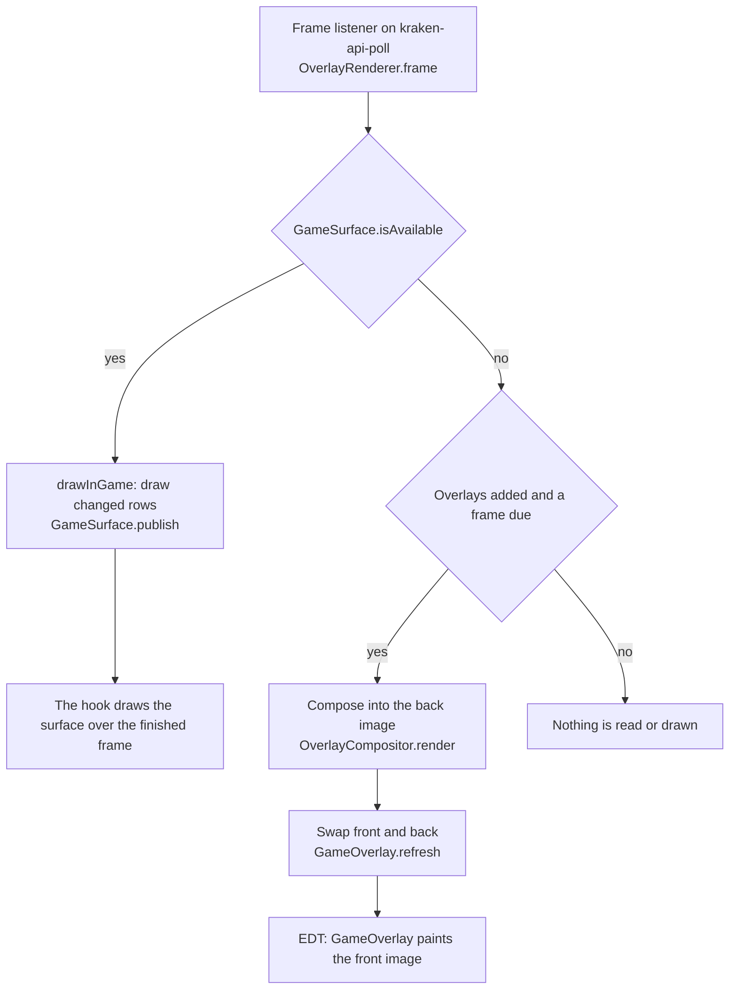

In the game, a frame is due for each frame the game presents: the hook reports each one (`PRESENT`), and
`GameSurface.presented` wakes the poll loop through `GameSession.requestFrame`, so the overlay moves with the scene.
`FrameSchedule` caps that at `overlayFrameRate` (240 by default, at most 240), and is the whole schedule for the window,
at most 50 a second there. The schedule steps by one interval per frame, so 30 frames a second on a 20 ms poll
averages 30 and doesn't drop to 25. A frame due after a pause starts the schedule again, so frames don't bunch up.

Overlays draw in the client's canvas pixels. The graphics are scaled from canvas pixels to the target's size. The
target's image is in device pixels, so text stays sharp on a scaled display.

`OverlayRenderer` checks `GameSurface.isAvailable` on each frame. The surface is available once the hook reports the
overlay feature and a framebuffer, the GL context is version 3 or later, and the hook has drawn the last surface it was
given. If the hook doesn't draw a new surface within 2 seconds, the surface is refused and the window target is used
again.

### Placement

`OverlayCompositor` draws the overlays in layer order: `ABOVE_SCENE`, `UNDER_WIDGETS` (the default), `ABOVE_WIDGETS`,
`ALWAYS_ON_TOP`. Within a layer, the order comes from `OverlayManager`'s comparator. Anchored overlays at one corner
stack, each placed by the size it drew at last frame. An overlay that skipped frames keeps its last real size.
`DYNAMIC` overlays draw over the whole canvas. An overlay with a `preferredLocation` is drawn there, kept on the canvas.
An overlay that throws is logged once, until it draws again, and the others still draw.

`OverlayManager` saves each user placement in the `overlays` group as `<name>_preferredLocation` and
`<name>_preferredSize`. The name is the overlay's simple class name, so two overlay classes with the same simple name
share a placement.

### Editing

`OverlayEditor` polls the Alt key every 30 ms on the EDT. It reads the key with `GetAsyncKeyState(VK_MENU)`, because the
game has the keyboard and Swing doesn't see Alt. The poll only counts Alt while a Kraken window is active, so Alt pressed
in another program has no effect. While Alt is held, the editor shows a `JWindow` over the game with the extended
styles `WS_EX_NOACTIVATE`, so a click doesn't take activation away from the frame. The window catches the mouse only
over the overlays that can be moved. A drag saves with `saveOverlay` on release, and a right-click resets the overlay.
While the user is editing, the compositor outlines the movable overlays in yellow.

### The Window Target

`GameOverlay` is a `JWindow` owned by the frame, so it stays above the frame and hides with it. It is laid over the game
area with `WS_EX_LAYERED | WS_EX_TRANSPARENT | WS_EX_NOACTIVATE`, so mouse clicks pass through to the game. It is shown
only while a painter reports that it is active. The renderer and the dev tools each add a painter. `GameOverlay` also
keeps a `Surface` record with the game area's size and scale, which the renderer uses for the frame's device size.

The in-game surface is covered in [In-Game Drawing](in-game-drawing.md).

## Dev Tools

Dev tools are the sidebar's **Dev Tools** page. Each tool extends
[`DevTool`](../../client/src/main/java/com/kraken/client/ui/devtools/DevTool.java). The user's view is in
[Dev Tools](../dev-tools.md).

### Parts

| Class | Role |
|---|---|
| `DevTool<S>` | One tool. `read(session)` runs on the poll thread and returns an immutable snapshot of type `S`. `paintOverlay` and `createView` run on the EDT |
| `DevToolManager` | Owns the catalog's tools. Stores the overlay switches and options in `java.util.prefs`, runs each showing tool's `read` on the poll thread, and hands the results to the EDT |
| `DevToolCatalog` | `create()` lists every tool in sidebar order. Add a tool here |
| `Category` | The six sections: Actors, Client state, Scene, Map & movement, Interface, Diagnostics |
| `ToolOption` | An on/off setting of one tool, such as **Ids**. Declared with `option(key, label, default)` |
| `PlannedTool` | A place for a tool the API can't read yet. It is greyed out, and its `needs()` text shows what's missing |
| `DevToolsPanel`, `CategorySection`, `ToolRow` | The sidebar: the filter, the sections, and each row's eye and window buttons |
| `view.ToolView<S>` | A popout's content: `update(S)` gets every new snapshot |
| `view.ToolWindow` | A `JDialog` owned by the frame, closed with Esc. It saves its bounds in the preferences under `window.<id>` |
| `view.TableView`, `FactsView`, `LogView`, `TabbedView`, `MappedView` | Reusable views: sortable tables, label and value pairs, an append-only log with filters, tabs, and a view that wraps another |
| `view.GamePicker` | Lets the user click something in the game. While it's on, a clear window over the game takes the mouse, and the handler hears each click and wheel turn |
| `tools.Listing`, `tools.Marks`, `tools.Projector` | For tools with both a table and an overlay: the snapshot holds the rows and the overlay's marks, and `Projector` projects scene positions on the poll thread |

### Data Flow

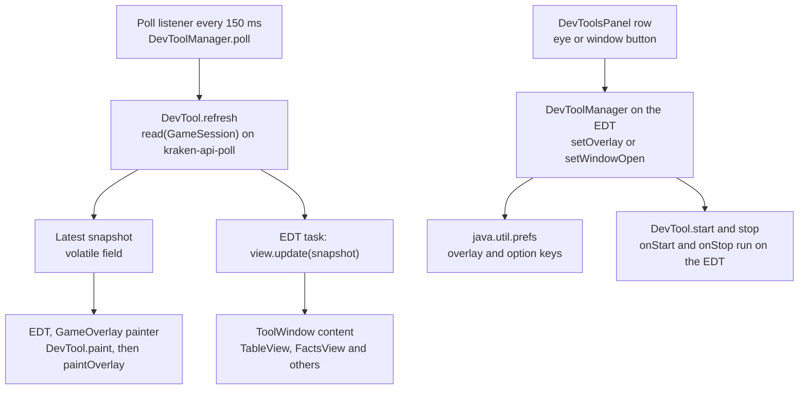

Each tool is read only while it is showing, either as an overlay or in its window. `updateLifecycle` starts a tool when
it starts showing with the API attached, and stops it when it stops showing. `start` calls `onStart` once, and `stop`
calls `onStop` and clears the snapshot. The `DevTool.onStart` javadoc says to subscribe to events there, on the EDT.
[`EventLogTool`](../../client/src/main/java/com/kraken/client/ui/devtools/tools/EventLogTool.java) subscribes from `read`
instead, on the poll thread, and drops its subscriptions in `onStop`.

A read that throws is logged once per tool, until its next successful read. Other tools keep running.

The snapshot is refreshed on the 150 ms poll listener, not on the 20 ms frame listener. A dev tool's overlay therefore
redraws about six or seven times a second. The tool's overlay repaint is requested after each refresh.

The overlay switch and the window are independent. Overlays are drawn only in the `GameOverlay` window, even when the
plugins draw in the game (see [Overlays](#overlays)). A tool's options and overlay switch are stored in
`HKEY_CURRENT_USER\Software\JavaSoft\Prefs\com\kraken\client\ui\devtools` on Windows. The window bounds go to the same
node. Open windows are not restored at launch.

### Widget Inspector

The widget inspector is the largest tool. It has these parts:

| Class | Role |
|---|---|
| `WidgetInspectorTool` | The `DevTool`. Builds the forest of open interfaces on the poll thread, with whole-tree reads spaced so they use at most `READ_SHARE` of the poll thread. The selected widget is read on every refresh |
| `WidgetForest` | Builds the tree from `GroupDraft`s. Each group goes under the component it's opened in, from the component table, and falls back to guessing from the drawing order when the table is missing |
| `WidgetNames` | The cache's names for groups, components and sprites, from the generated `gameval` constants. Read once, on first use |
| `WidgetDetail` | The selected node's fields, grouped into sections. Immutable |
| `WidgetDetailPanel` | The detail page on the EDT: a breadcrumb trail, the name and id, the code that fetches it, and the fields. Labels stay put while values change, so selected text survives an update |
| `WidgetInspectorView` | The popout: a **pick** bar that uses `GamePicker`, search and filter, the tree (merged by key with each new forest), and the detail panel |

### Adding a Tool

1. Subclass `DevTool<S>` in `ui/devtools/tools/`. Pass an id, a name, a `Category`, an `Ikon` and a description to the
   constructor.
2. Override `overlaySupport()` and `windowSupport()` to return `Support.READY` for each surface the tool has.
3. Implement `read(GameSession)`. Return an immutable snapshot, or null when there is nothing to show. Read the game
   through `session.client()`.
4. For an overlay, override `paintOverlay(S, OverlayContext)`. For a window, override `createView()` to return a
   `ToolView<S>`, which the manager calls each time the window opens.
5. Declare options with `option(key, label, default)` in the constructor.
6. Add the tool to `DevToolCatalog.create()`, in the order it should appear within its category.

Keep `read` cheap, since it runs on the client thread at each refresh.

## Exiting

[`ExitHandler`](../../client/src/main/java/com/kraken/client/ExitHandler.java) is where Kraken shuts down. The client's
only `System.exit` calls are in it. Two things call `exit`: the window's close, and the game's exit.

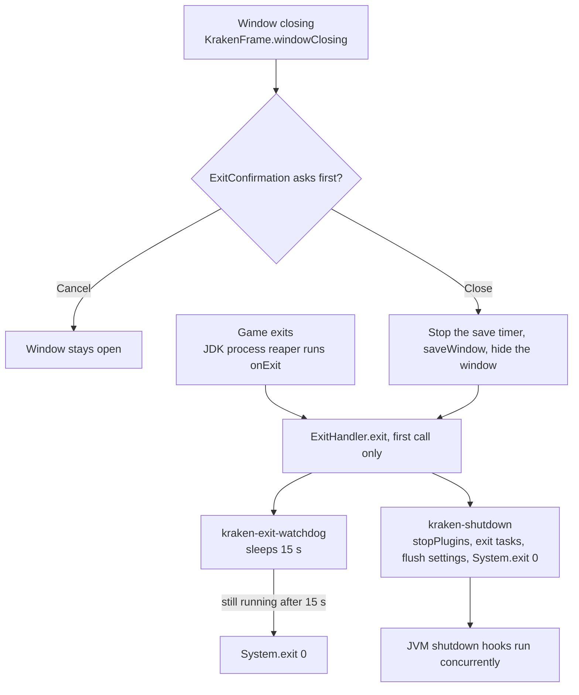

`exit` runs only once, guarded by an `AtomicBoolean`. On the first call it starts the 15 second watchdog, then starts the
`kraken-shutdown` thread. That thread stops the plugins in reverse order, runs the exit tasks registered with
`ExitHandler.addExitTask`, flushes the settings, and calls `System.exit(0)`. `KrakenClient` registers the native hook's
`flushOnExit` as one when the API attaches: it waits up to one second for the DLL to run the last calls sent, such as
the plugins turning their highlights off, so they run before the game is closed.
The work runs on a thread of its own, so the `onEdt` wait for each plugin's `shutDown` doesn't run on the EDT.

`ExitConfirmation` sets when the close asks. `NEVER` never asks, `LOGGED_IN` (the default) asks only while a player is
logged in and the API is attached, and `ALWAYS` always asks. The dialog says that closing Kraken closes the game too.

### Shutdown Hooks

Two shutdown hooks run when `System.exit` is called.

* The hook `GameLauncher` added calls `process.destroy()` on osclient. On Windows this ends the process at once, so the
  game gets no chance to run its own shutdown.
* The hook `NativeEventServer` added (`kraken-hook-flush`) runs the same flush as its exit task, for exits that don't
  go through `ExitHandler`. After an `ExitHandler` exit there is nothing left to wait for, and it returns at once.

The JDK runs shutdown hooks concurrently, in no particular order, which is why the flush that matters runs as an exit
task, before `System.exit`.

## Threads

| Thread | Created by | Runs |
|---|---|---|
| `main` | The JVM | `KrakenClient.launch`, then `GameLauncher.launch`: the window wait, the embed, and the fit and size-check loop every 250 ms |
| `AWT-EventQueue-0` (EDT) | Swing | Every Swing component and `Timer`, `startUp` and `shutDown` through `@Named("edt")`, state listeners, `ConfigChanged` handling in pages, overlay painting in `GameOverlay`, dev tool views, the console's appends |
| `kraken-api-attach` | `ProcessAttacher.start` | Reading the build and mapping, `GameSession.attach` with retries, the session injector, the attach listeners (plugin loading and start, which waits for the EDT, and the hook install) |
| `kraken-api-poll` | `GameSession.start` | The client thread. Game events, `ClientThread` tasks, `invokeAtTickEnd` tasks, the frame listener (overlay frames), and the 150 ms poll listeners (`KrakenFrame.readPlayer`, `DevToolManager.poll`) |
| `kraken-hook-install` | `NativeEventServer.install` | Extracts the DLL, binds `127.0.0.1:42069`, starts the server thread, injects the DLL with `CallbackInjector` |
| `kraken-hook-server` | `NativeEventServer.inject` | The accept loop and the reader for each DLL connection. Sends the handshake, parses each message, queues raises to the poll thread, reports frame rates and surface events |
| `kraken-scheduler` | `KrakenModule` (one daemon thread) | Delayed settings saves, and background work from plugins that use the injected `ScheduledExecutorService` |
| `osclient-output` | `GameLauncher` | Copies the game's output into the `osclient` logger |
| `kraken-exit-watchdog` | `ExitHandler.exit` | Sleeps 15 seconds, then exits the JVM |
| `kraken-shutdown` | `ExitHandler.exit` | Stops the plugins, runs the exit tasks, flushes the settings, exits the JVM |
| `kraken-hook-flush` | `NativeEventServer.inject` (a shutdown hook) | The last-calls flush, for exits that skip `ExitHandler` |
| JDK process reaper | The JDK | Completes `Process.onExit()`, so the `ExitHandler.exit` callback runs on it |

Writes to the hook connection come from several threads: the server thread (the handshake and the status replies), the
poll thread, and plugin code. `NativeEventServer.Connection.send` is synchronised, so frames never interleave.

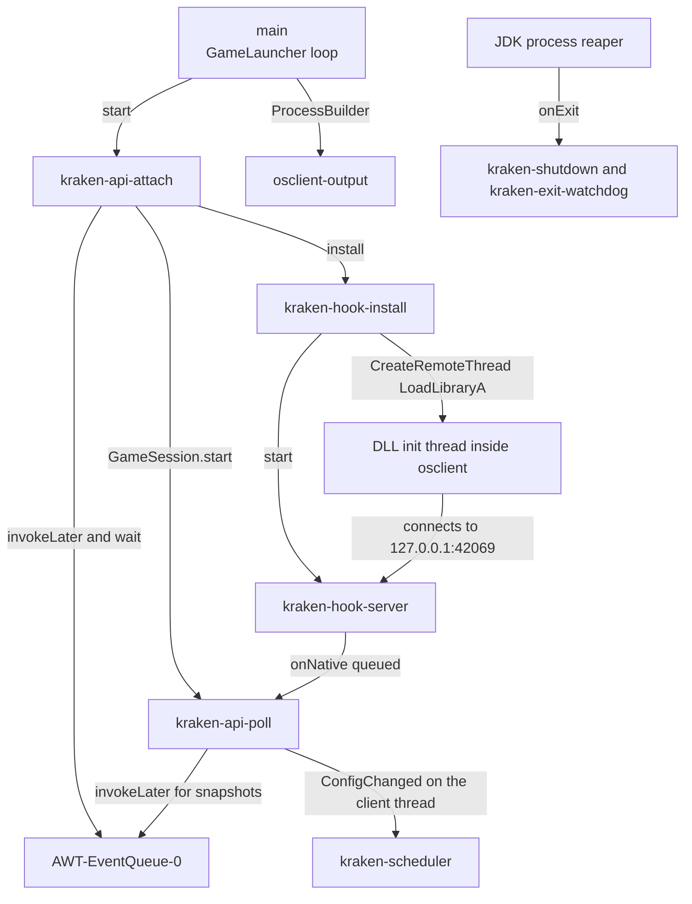

## Logging

Each class logs with Lombok's `@Log(topic = "kraken")`, which creates `Logger.getLogger("kraken")`. The API's classes use
`kraken.api`. The game's output uses `osclient`. All three are children of the root logger.

* The root logger keeps the JDK's default configuration: a `ConsoleHandler` on stderr, at level `INFO`. A record at `INFO`
  or above therefore appears in the terminal and in the console. A `FINE` record (for example a dropped hook message) is
  dropped by the root level, and no code in the client changes the level.
* `KrakenFrame` adds `ConsolePanel`'s handler to the root logger. It has no level of its own, so it shows what the root
  logger passes.
* Kraken writes no log file. The console keeps the last 5,000 lines.

## Testing

The client's tests run headless. `client/build.gradle` sets `java.awt.headless=true` for the test task, and uses JUnit 5
with the platform launcher. Lightweight Swing components can be built headless, so the tests create `JPanel`s and the
like, but no `JFrame` or `JWindow`. The Win32 code is not tested, because it needs a real window.

The test directory mirrors the main packages. These are the patterns to reuse:

* **Settings on a temp file.** `ConfigManagerTest`, `ConfigPanelTest` and `FrameRatesTest` use `@TempDir` for the
  settings file, and a single-thread scheduler that `@AfterEach` shuts down.
* **Plugins without Swing.** `PluginManagerTest` builds a `ConfigManager` on a temp file, a `GameSession` over a
  `Memory` that reads zeros with `Mapping.bundled("241.3")` (the test never calls `start`, so no poll loop runs), and a
  child injector with `new SessionModule(session, 0)`. It passes `Runnable::run` as the EDT, and nests its fake plugins
  as `static` classes, which the scan skips. The tests cover start, stop, dependency order, missing dependencies,
  failing start-up, persistence across launches, conflicts, developer mode, `@Provides`, the plugin config lookup and
  the scan itself.
* **Pure logic on plain values.** `OverlayRendererTest` tests the frame schedule and the row bookkeeping. `FrameRatesTest`
  tests the rate meter and the cap. `GameSizeCheckTest` tests the resize decision.
* **Fakes for the Win32 seam.** `GameSurfaceTest` replaces the memory mapping with a `RegionFactory` fake. The overlay
  compositor and drag tests run against plain `Graphics2D` images.
* **Headless panels.** `ConfigPanelTest` builds a page from a test config and drives its controls. The dev tool view tests
  (`LogViewTest`, `TabbedViewTest`, `WidgetDetailPanelTest`, `WidgetInspectorViewTest`) build their panels the same way.

Nothing in the client tests these areas: `ProcessAttacher`, `GameView`, `GameLauncher`, `CallbackInjector`,
`NativeEventServer`'s install and socket code (only `NativeProtocol` parsing is tested), `KrakenFrame`, `Sidebar`,
`HomePanel`, `PluginListPanel`, `ExitHandler`, `GameOverlay`, `OverlayEditor` and `DevToolManager`. Those areas are
exercised only by running the client (see [Using the Client](../client.md)).

## Extension Points

**A plugin.** Add a package under `com.kraken.client.plugins` with a `Plugin` subclass and a `@PluginDescriptor`. The
scan finds it, and nothing else needs registering. Put its settings in a `@ConfigGroup` interface, and provide it with a
`@Provides` method that calls `ConfigManager.getConfig`. Add overlays in `startUp` and remove them in `shutDown`. The
user-level guide is [Writing a Plugin](../writing-plugins.md). Use the `TickCounter` plugin as the smallest worked
example, and `npchighlight` for one with overlays. For a
plugin that depends on another, use `@PluginDependency` and override `getPublicModule()` in the dependency.

**A setting for Kraken itself.** Add a `@ConfigItem` getter with a default body to `KrakenConfig`, with a `position` and a
`section`. The Settings page builds the control. For a hidden value, give the item `hidden = true` and add a setter. If
the window has to react to the change, add the key to `KrakenFrame.WINDOW_KEYS` for the window, or subscribe to
`ConfigChanged` where the state lives, as `FrameRates` does.

**A sidebar page.** Build the `JComponent`, usually as a `@Singleton` with an `@Inject` constructor, and add it as a
constructor parameter of `KrakenFrame`. Then call `sidebar.addTab(title, icon, component)` in `KrakenFrame`'s
constructor. Use a name the user will recognise, because the name is the key the window uses to reopen the page.

**A session service.** Write the class with an `@Inject` constructor that takes `GameSession`, `Client` or `Mapping`.
Bind it in `SessionModule.configure()` with `bind(X.class).in(Singleton.class)`, as `ClientThread` and
`NativeEventServer` are bound. The explicit binding means every plugin gets the same instance, and it shows in one
place. A class in the root injector can't inject a session service, because the session injector doesn't exist yet.

**A dev tool.** See [Adding a Tool](#adding-a-tool).

**An overlay.** Extend `Overlay` and override `render(Graphics2D)`, or extend `OverlayPanel` for lines of text, then
`overlayManager.add(...)`. Choose the `OverlayPosition` and `OverlayLayer` in the constructor.

## Known Gaps

| Where | What |
|---|---|
| `NativeEventServer.onEvent` | Its taps have no callers. Its javadoc says the Event log tool uses them, but that tool subscribes to the API bus |
| `ProcessAttacher.open` | An interrupted attach returns with no state change, so the state stays `ATTACHING` |
| `GameLauncher.run` | The window wait has no timeout. A game that never shows a window keeps the splash up until the process exits |
| `GameView.fit` | Runs on the EDT and on the launcher thread without a lock |
| `DevToolManager.poll` | Runs on the 150 ms poll listener, so dev tool overlays update about six or seven times a second |
| `Overlay.getName` | Its javadoc says the name is for the log. `OverlayManager` also uses it as the key for saved placements |
| `KrakenClient.Options.parse` | The parameter named `builtins` receives the plugins passed to `launch`, which are not built-in |
| `FrameRates.updateLimit` | Calls the limit listeners while holding the object's lock, and one listener writes to a socket |
| `DevTool.onStart` and `EventLogTool` | The javadoc says a tool subscribes in `onStart` on the EDT. `EventLogTool` subscribes from `read` on the poll thread |

## See Also

* [Architecture](architecture.md): how the client fits with the updater and the API
* [In-Game Drawing](in-game-drawing.md): the surface, the drawing protocol, and the highlights
* [Native Hook](native-hook.md) and [Native Protocol](native-protocol.md): what the DLL does and what it sends
* [Menu Actions](menu-actions.md): how the Action Tester runs game actions
* [Cookbook](cookbook.md): step-by-step recipes for common changes
