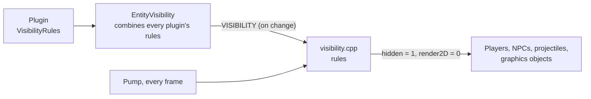

# Entity Visibility

The client's scene draw skips any entity whose **hidden** byte is set, and draws an actor's 2D elements (its name,
head bars and overhead text) only while its **render2D** byte is set. The game's Lua plugin API writes the same bytes
(`Entity.render3D`, `Entity.render2D`, `ClientOp.renderProjectiles`), but every entity the client creates starts
shown, so a one-off write doesn't hide the next player that walks into view. The native hook therefore holds
**rules** the Kraken client sends, and applies them to every player, NPC, projectile and graphics object at the start
of every frame, on the game thread. This page covers the flags, the hook's rules, the Java side and the recipes.

Plugin authors start with [`EntityVisibility`](../../api/src/main/java/com/kraken/api/render/EntityVisibility.java)
and [`VisibilityRules`](../../api/src/main/java/com/kraken/api/render/VisibilityRules.java). The wire format is in
[Native protocol](native-protocol.md#visibility).

## Key Files

| Path | Role |
|---|---|
| [`visibility.cpp`](../../client/src/main/native/kraken_hook/src/visibility.cpp) | The visibility block, VISIBILITY commands, and the walk the pump runs every frame |
| [`EntityVisibility`](../../api/src/main/java/com/kraken/api/render/EntityVisibility.java) | `Client.getEntityVisibility()`: hands out rules, combines them, sends them when they change |
| [`VisibilityRules`](../../api/src/main/java/com/kraken/api/render/VisibilityRules.java) | One plugin's rules: kinds hidden, actors decided apart, graphics objects by id |
| [`WireVisibility`](../../api/src/main/java/com/kraken/api/internal/render/WireVisibility.java), [`VisibilityHook`](../../api/src/main/java/com/kraken/api/internal/render/VisibilityHook.java) | The combined rules as the hook takes them, and the sender |
| [`NativeProtocol`](../../client/src/main/java/com/kraken/client/callback/NativeProtocol.java) | The visibility block of the handshake and the VISIBILITY command |
| [`EntityHiderPlugin`](../../client/src/main/java/com/kraken/client/plugins/entityhider/EntityHiderPlugin.java) | The plugin built on it |

## The Flags

Every entity the scene draws (players, NPCs, projectiles, keyed projectiles, graphics objects) shares one base
class. Its constructor (`0x63dde0` in 241.3, reached through the entity constructor `0x2a5b0` every one of those
constructors calls first) sets the model height to 1,000 and clears the byte at `+0x1c`. That byte is the hidden
flag: `Actor.hidden`, `Projectile.hidden`, `KeyedProjectile.hidden` and `GraphicsObject.hidden` in the mapping. All of
them are added to the scene through `0x6a12f0`, and the scene draw (`0x6a7400`) tests the flag at the entry of the
per-entity draw (`0x6a6d80`, `0x6a7150`) and skips the entity while it is set.

| Flag | Hides | Lua that writes it |
|---|---|---|
| `Actor.hidden` (`+0x1c`), nonzero hides | The actor's model | `Entity.render3D(b)` writes `!b` (handler `0x219db0`) |
| `Actor.render2D` (`+0x3a0`), zero hides | Its name, head bars and overhead text (read by `0x85fa0` and `0x861b0`) | `Entity.render2D(b)` writes `b` (handler `0x219ea0`) |
| `Projectile.hidden` (`+0x1c`) | A projectile in `Client.projectiles` | `ClientOp.renderProjectiles(b)` writes `!b` on each projectile in flight (handler `0x3ae120`) |
| `KeyedProjectile.hidden`, `GraphicsObject.hidden` (`+0x1c`) | A keyed projectile, a graphics object | None |

The client never sets the flags again after the constructor, so a hidden entity stays hidden until something shows it.

## The Hook's Rules

A VISIBILITY command replaces the rules the hook holds:

* **Kinds**: hide the local player's model or 2D elements, the other players', the NPCs', or every projectile.
* **Actors decided apart**: an actor's address and, per layer, whether it is hidden, overriding its kind.
* **Graphics objects** to hide, by spot anim id (at most 64).

At the start of each frame the pump walks every world (`Client.topLevelWorld`, then the sub-worlds in
`Client.worlds.map`): each world's players and NPCs (hash maps), each world's graphics objects (a list), then the
client's projectiles (a list) and keyed projectiles (a hash map). The local player is the top-level world's player
whose key is `Client.localPlayerIndex`, as the API's `getLocalPlayer()` has it. For each entity, the hook works out
what the rules want (the actor's decision if it has one, else its kind's) and settles each layer:

* wanted hidden and shown: the hook hides it and holds it;
* wanted hidden and already hidden: held only if the hook hid it before;
* not wanted hidden, held by the hook and still hidden: the hook shows it again.

So the hook only ever undoes what it did itself: an entity a Lua plugin hid stays hidden. What it holds is a sorted
list of addresses rebuilt every frame from the walk, so an entity that has gone drops out of it. Rules that hide
nothing still get one more walk, which shows everything held; after that the pump does nothing. A dropped connection
leaves empty rules behind, so the game is never left with entities hidden by a Kraken client that went away.

An entity that appears is drawn in the frame the client created it in, and hidden from the next: the pump runs
before the frame's logic.

## The Java Side

`Client.getEntityVisibility()` hands each plugin rules of its own (`createRules()`), each a set of kinds, graphics
object ids and actors decided apart (`setHidden(actor, hide3D, hide2D)`, `reset`, `resetActors`). An entity is hidden if
any plugin's rules hide it. `EntityVisibility` combines them: the kinds and graphics object ids are united, and each
actor some rules decide is hidden in a layer if any rules hide it there, by their decision or, where a set doesn't
decide it, by its kind in that set. An actor whose combined decision equals its kind's needs no rule and isn't sent.

The combined rules go out at the end of each pass of the client thread in which they changed
(`GameSession`'s `flushWrites`), and whole whenever the hook (re)connects (`GameSession.setVisibilityHook`, from the
hook server once STATUS reports `FEATURE_VISIBILITY`). About once a second, decisions about actors whose handle no
longer resolves to a loaded actor are dropped, so an address the client frees and reuses isn't hidden by mistake for
long. Closing rules drops them and shows again what they hid.

## Recipes

`Actor.hidden`, `Actor.render2D` and `Projectile.hidden` come from the Lua handlers that write them
(`40-actor.yaml`, `57-projectiles.yaml`). No Lua function reaches keyed projectiles or graphics objects, so
[`visibility.py`](../../updater/src/native_updater/visibility.py) (`renderable_hidden`,
[`91-visibility.yaml`](../../updater/src/native_updater/spec/91-visibility.yaml)) finds their flag through their
constructors: from the `GraphicsObjectCtor` or `KeyedProjectileCtor` fingerprint it follows the chain of first calls
made with the object (the entity base, then the renderable base, which calls nothing) and takes the one byte the last
stores 0 to. Each key's invariants require it to equal `Projectile.hidden` and `Actor.hidden`.
`tests/test_visibility.py` runs it over miniatures of that chain.

## Not Covered

* A frame of an appearing entity: see above. A plugin that hides every player sees each one flash for a frame as it
  comes into view.
* A sub-world's own scene, so other players' boats can't be hidden; their crews follow the player rules.
* Party members (no party service).
* More than 4,096 actors decided apart, or 64 graphics object ids, across all plugins; the rest follow their kind.
* Nothing here has been checked against a running game yet.
