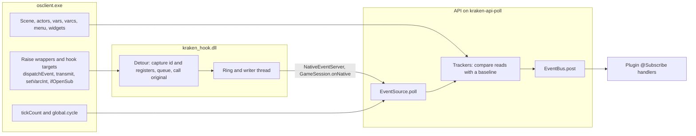
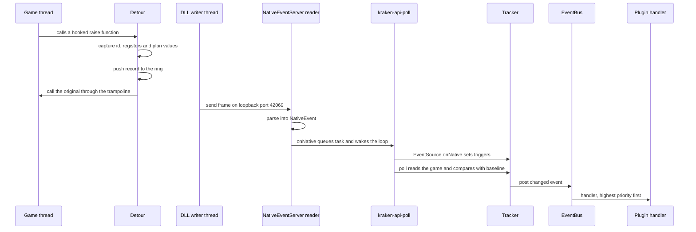
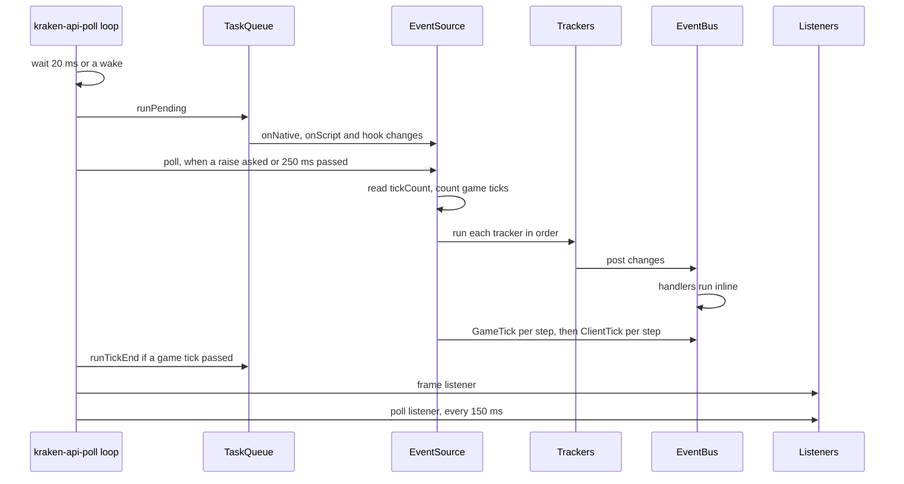
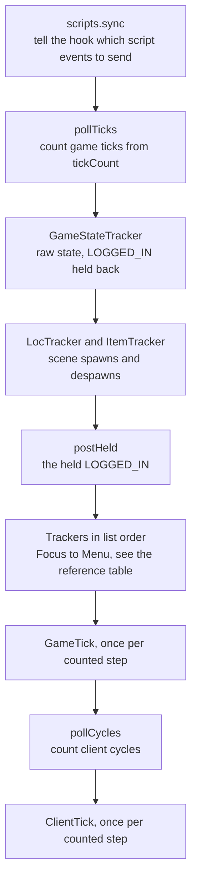
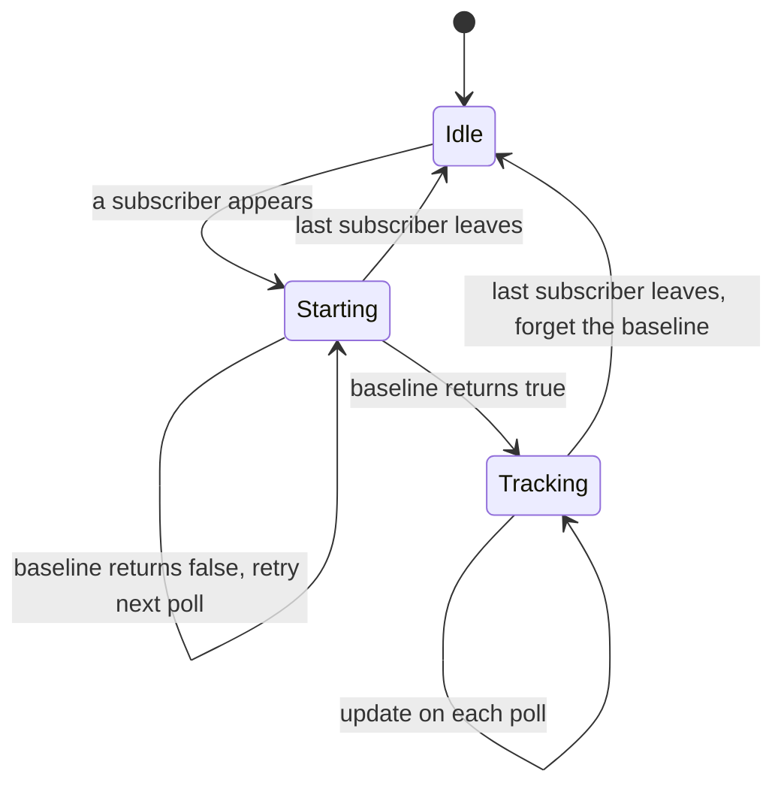

# Events

The event pipeline turns game state and the client's own raises into the `com.kraken.api.events` objects that plugins
subscribe to. Three parts make it up. The hook DLL, `kraken_hook.dll`, reports raises as the game makes them. The
client's `NativeEventServer` hands those reports to the API. The API's `EventSource` compares reads of the game on the
poll thread and posts what changed on the `EventBus`. The updater finds the raise sites and hook targets the DLL needs.
User-level behaviour (which event fires when) is in [Events](../events.md).

## The Model



There are two sources of change, and they feed the same events.

- **Polling diffs.** Each tracker keeps a baseline of one kind of state and compares a fresh read with it on every
  poll, or on the game's ticks. Every event can come from this path alone, so the hook is optional.
- **Native raises.** The DLL detours a set of client functions. Each call sends a message before the original runs.
  A raise carries no event. It says that the state it concerns may have changed, and the next poll reads it.

Three rules follow from that split.

1. Raises decide when trackers read. A raise asks for a poll, and a tracker reads on that poll when it is due.
2. Counters decide ticks. `GameTick` and `ClientTick` follow the game's tick and cycle counters, one event per step.
   The timing of polls and raises can't lose or double a tick.
3. Payloads only narrow a read. Each tracker can fall back to a whole read, so an unconfirmed payload or a dropped
   message costs latency. Where a diff can't see a change at all (interfaces and varcs that change and change back
   between two reads), the tracker also applies the hook's reports in order.

## Native Raises in the Client Binary

The client raises its plugin events (`osrs.Events`, the `ON_*` names in `enums.events`) through small wrapper
functions. Each wrapper passes the event to the client's Lua plugin runtime, which backs the `osrs` API, through sol2,
a C++ binding library for Lua. The hook works on the machine code of these wrappers, so a few terms first:

- **RVA** (relative virtual address): an address counted from the module's load address, the module base. `0xc44d0`
  is the same in every run of one build, so the mapping stores RVAs. The loaded address is the module base plus the RVA.
- **Detour and trampoline**: the DLL overwrites the first bytes of a function with a jump to its own code (the detour).
  The original bytes are copied to a trampoline, which the detour calls to run the original function.
- **Argument registers**: on x64 Windows the first four integer arguments arrive in RCX, RDX, R8 and R9. A function
  taking an event id as its first argument receives it in ECX.

The addresses below are 241.3 values, read from that build's analysis. The updater re-finds them for each build.

### The Wrapper Shape

`functions.dispatchEvent` (RVA `0xc44d0`) is the wrapper the server tick raises `ON_GAME_TICK` through. Its disassembly
from 241.3:

```text
0xc44d0  PUSH RBX
0xc44d6  MOV EBX,ECX                        ; the event id arrives in ECX, kept for later
0xc44d8  MOV RCX,qword ptr [0x140e98c18]    ; global.client
0xc44df  ADD RCX,0x418690                   ; Client.pluginGate
0xc44e6  CALL 0x140041cb0                   ; gate: CMP qword ptr [RCX],0 then SETNZ AL
0xc44eb  TEST AL,AL / JZ                    ; null gate: Lua plugins are off, nothing is raised
0xc44ef  MOV RCX,qword ptr [RCX]            ; the plugin manager
0xc44f2  CALL 0x140218cd0                   ; immediate runtime getter, MOV EDX,3
0xc44f7  MOV EDX,EBX                        ; the event id
0xc44f9  MOV RCX,RAX
0xc4501  JMP 0x1400ce6b0                    ; tail call into the fire function
```

Every wrapper has the same opening: read `global.client`, add `Client.pluginGate`, call the gate. The gate reads a
pointer, so a null slot means no Lua plugins. The DLL's detour sees a raise at the wrapper's entry, before the gate
test, so raises reach the DLL even with Lua plugins off.

Each wrapper then gets a runtime (one of two getters that share a core and differ in the `EDX` they set), and then
fires the event with its id. The id is either fixed in the wrapper (`MOV EDX, id` before the fire call) or passed in
ECX by the callers, which the updater reads from each call site. The mapping records which.

### Immediate and Deferred Raises

| Kind | Runtime getter | Fire step | Examples (241.3) | Payload |
|---|---|---|---|---|
| Immediate | `0x218cd0` (`MOV EDX,3`) | sol2 call, on the spot | `ON_GAME_TICK`, `ON_NPC_LOAD`, `ON_LOC_LOAD`, `ON_NPC_OP` | The raise's arguments |
| Deferred | `0x218ce0` (`MOV EDX,4`) | sets a pending flag; the client fires the Lua event later | `ON_VAR_TRANSMIT`, `ON_INV_TRANSMIT`, `ON_STAT_TRANSMIT`, `ON_CHAT_TRANSMIT` | None; the data is in the client's state |

The `*_TRANSMIT` wrappers mark that the server sent data (vars, an inventory, stats, a chat line). The tracker reads the
state the packet filled in. The deferred wrapper at `0x520b0` serves eleven events, and the chat wrapper at `0x63e70`
serves only `ON_CHAT_TRANSMIT`. Every other hooked Lua raise checked in the binary uses the immediate getter, among them
the wrappers at `0xc7930` (`ON_NPC_LOAD`), `0xc7b20` (`ON_LOC_LOAD`), `0xc6ca0` (`ON_VARBIT_UPDATE`), `0xc5550`
(`ON_GAME_STATE_CHANGED`) and `0x3924f0` (the op dispatch).

### Function Hooks

Some state changes are not Lua events. The updater finds these functions from the fields they touch or the functions
they call, and the DLL detours them the same way.

| Mapping key | RVA (241.3) | Why it's hooked |
|---|---|---|
| `functions.clientCycle` | `0x58b70` | The client cycle. It increments `global.cycle`, once per client cycle (20 ms) |
| `functions.setGameState` | `0x5b810` | Every write of `Client.gameState`, not only the login triggers Lua reports |
| `functions.playerAdd`, `playerRemove` | `0x1dbc20`, `0x9ce60` | A player entering or leaving the index list |
| `functions.npcInfoDecode`, `playerInfoDecode` | `0x97ff0`, `0x1dd530` | The packet handlers that apply actor updates |
| `functions.projectileCtor`, `projectileStep` | `0xa24a0`, `0xa2630` | A projectile being made, and a projectile being advanced each cycle (opt-in) |
| `functions.ifOpenSub`, `ifCloseSub` | `0x84fe0`, `0x851d0` | A group opening in or closing from a component |
| `functions.setVarcInt`, `setVarcString` | `0x33080`, `0x33340` | The two setters scripts call for varcs |
| `functions.setSequence` | `0x9fe50` | An animation being set on an NPC |

`functions.objAdd`, `objDel` and `objCount` are in the mapping but not hooked, because they take their item id and count
on the stack and the four-register detour can't forward those (see Known Gaps).

### How the Updater Finds Them

| Module | Finds | Keys |
|---|---|---|
| [`events.py`](../../updater/src/native_updater/events.py) | Raise wrappers and their ids | `events.<NAME>`, `functions.dispatchEvent`, `Client.pluginGate` |
| [`hooks.py`](../../updater/src/native_updater/hooks.py) | Player and ground item functions, from the struct fields they write | `functions.playerAdd`, `playerRemove`, `playerInfoDecode`, `objAdd`, `objDel`, `objCount` |
| [`scripts.py`](../../updater/src/native_updater/scripts.py) | The script runtime's four functions and the runner | `functions.executeScript`, `executeScriptInner`, `scriptLookup`, `scriptSwapLocals` |
| [`interfaces.py`](../../updater/src/native_updater/interfaces.py) | The open and close functions for sub-interfaces | `functions.ifOpenSub`, `ifCloseSub`, `Client.topLevelInterface` |
| [`varcs.py`](../../updater/src/native_updater/varcs.py) | The two varc setters, called only from the interpreter | `functions.setVarcInt`, `setVarcString` |
| [`chat.py`](../../updater/src/native_updater/chat.py) | The chat line function and the history's layout | `ChatLine.*`, `global.chatLines.*` (the function is internal) |
| [`hitmarks.py`](../../updater/src/native_updater/hitmarks.py), [`overhead.py`](../../updater/src/native_updater/overhead.py), [`spotanims.py`](../../updater/src/native_updater/spotanims.py) | Hitmark, overhead text and spot animation layouts on actors | `Actor.hitmarks`, `Actor.overheadText`, `Actor.spotAnims` and their structs |

`event_raisers` in `events.py` works in four steps:

1. **Seed.** Find the server tick site: an `INC dword ptr [client + Client.tickCount]`, then `MOV ECX, ON_GAME_TICK`
   and a call. The call's target is the dispatcher, `functions.dispatchEvent`.
2. **Anatomy.** Read the dispatcher's opening for the gate offset (`Client.pluginGate`), the gate test and the runtime
   getter. Each runtime getter is `MOV EDX, n; JMP core`, and the siblings share the core.
3. **Classify.** Every caller of the gate test is a raiser if it adds the gate offset and calls a getter with the same
   core. The raiser's event id is a fixed `MOV EDX, id` (or the stack pair of an inlined fire body), or else the
   immediate loaded into ECX before each call site, within 14 instructions.
4. **Count arguments.** The argument count is the position, from 1 to 4, of the highest of RCX, RDX, R8 and R9 that the
   wrapper reads before it writes it.

Every raiser the search classifies becomes a site under its event name. A function that raises several events appears
in each event's list with the same `fn`, and the server merges those into one slot. The golden corpus pins the 241.3
values (`updater/corpus/241.3.golden.json`).

### The Mapping Entries

The `events` section maps each event name to its raise sites. `enums.events` maps names to ids.

```json
"ON_GAME_TICK":  [{"fn": "0xc44d0", "idArg": 0, "args": 1}],
"ON_LOC_LOAD":   [{"fn": "0xc7b20", "id": 40, "args": 4}]
```

| Field | Meaning |
|---|---|
| `fn` | The raiser's RVA. The DLL detours it |
| `id` | The event id the raiser always fires. Present when the raiser is specific to one event |
| `idArg` | The argument register holding the id (0 is RCX) when the raiser takes ids from its caller |
| `args` | How many of RCX, RDX, R8 and R9 the raiser takes. The DLL stores this in the handshake and doesn't use it to limit forwarding |

Shared raisers are common on 241.3. `functions.dispatchEvent` is the raiser for `ON_GAME_TICK`, `ON_SCREEN_RESIZE`,
`ON_DIALOG_ABORT` and `ON_MINIMENU_REBUILD`, each with its id in ECX. The eleven `*_TRANSMIT` events share RVA `0x520b0`.
`ON_NPC_OP`, `ON_PLAYER_OP` and `ON_COMPONENT_OP` share `0x3924f0`. Each of these is one hook slot in the DLL.

`ON_OBJ_OP` is in the mapping but never hooked: its raiser takes two of its arguments on the stack.

## From the Binary to the API

### The Hook Server

[`NativeEventServer`](../../client/src/main/java/com/kraken/client/callback/NativeEventServer.java) owns the connection
to the DLL. It exists once the API attaches, and `KrakenClient` calls `install()` as an attach listener.

1. `install()` starts a thread named `kraken-hook-install` on the first attach. Later calls do nothing.
2. The DLL is extracted from the jar (`/native/kraken_hook.dll`) to a temporary file, because `LoadLibraryA` needs a
   path on disk. A missing DLL is logged, and the events come from the poll alone.
3. `build()` makes the slot table from the mapping and
   [`NativeEvents`](../../client/src/main/java/com/kraken/client/callback/NativeEvents.java). Each distinct raiser RVA
   gets one slot. Function hooks get synthetic ids from 1000 upward, in `NativeEvents.FUNCTIONS`
   order. `-Dkraken.hook.projectileStep=true` adds `projectileStep`.
4. The handshake is written in [`NativeProtocol`](../../client/src/main/java/com/kraken/client/callback/NativeProtocol.java):
   the magic `KRK5`, then per slot the RVA, the fixed id, the id register, the argument count and the capture plan.
   After the slots come the drawing functions and the script block (`scriptLayout`). Byte layouts are in
   [native-protocol.md](native-protocol.md).
5. The server binds the loopback port 42069 and starts `kraken-hook-server`. `CallbackInjector` then injects the DLL.
6. Each connection gets the handshake, and `session.setHookConnected(true)` follows. Messages are read until the
   connection closes, then the hook is marked disconnected. The DLL reconnects after a dropped socket.

On 241.3 the handshake has 23 slots: 11 raisers for the Lua events and 12 function hooks, with no overlap. The four
script hooks come from the script block, not from slots.

When the DLL reports its status (`STATUS_EVENT_ID`, -2), the server sets up the rest: the native invoker for
highlights and menu actions, the script hook, and the overlay surface. Those are documented in
[in-game-drawing.md](in-game-drawing.md), [menu-actions.md](menu-actions.md) and [native-hook.md](native-hook.md).

### Capture Plans

A plan says which argument registers to read, and how, when the DLL captures a raise. The DLL dereferences pointers with
an SEH guard, so a bad pointer drops that value and the raise still goes through.

| Op | Captured as | Meaning |
|---|---|---|
| `OP_RAW` (0) | `u64` | The register's value itself |
| `OP_I32` (1) | `i32` | The int32 at the address in the register |
| `OP_I64` (2) | `i64` | The int64 at the address |
| `OP_I32X2` (3) | two `i32` | A pair at the address, such as a varbit id and its old value |
| `OP_CSTR` (4) | length byte and bytes | A NUL-terminated string at the address, at most 64 bytes |

[`NativeEvents`](../../client/src/main/java/com/kraken/client/callback/NativeEvents.java) is the one place the client's
event contract is written. The plans below are the ones it declares.

| Lua event | Raiser (241.3) | Id | Plan | Consumer |
|---|---|---|---|---|
| `ON_GAME_TICK` | `dispatchEvent` | ECX (44) | none | Routed to no tracker. Its raise asks for a poll |
| `ON_SCREEN_RESIZE` | `dispatchEvent` | ECX (45) | none | `CanvasTracker` |
| `ON_GAME_STATE_CHANGED` | `0xc5550` | fixed 39 | RDX `i32` | `GameStateTracker` |
| `ON_NPC_LOAD`, `ON_NPC_UNLOAD` | `0xc7930` | ECX (42, 43) | R8 `i32` | NPC `ActorTracker`. The slot in the payload is not read |
| `ON_LOC_LOAD`, `ON_LOC_UNLOAD` | `0xc7b20`, `0xc7c80` | fixed 40, 41 | RDX `i32` (packed coord), R8 `cstr` (loc name), R9 `i32` | `LocTracker`, targeted read |
| `ON_VARBIT_UPDATE` | `0xc6ca0` | fixed 46 | RDX `i32x2`, R8 `i32` | `VarTracker` (the payload is not read) |
| `ON_VAR_TRANSMIT` | `0x520b0` | ECX (11) | none | `VarTracker` |
| `ON_INV_TRANSMIT` | `0x520b0` | ECX (12) | none | `ContainerTracker` |
| `ON_STAT_TRANSMIT` | `0x520b0` | ECX (13) | none | `StatTracker` |
| `ON_CHAT_TRANSMIT` | `0x63e70` | fixed 14 | none | `ChatTracker` |
| `ON_NPC_OP`, `ON_PLAYER_OP`, `ON_COMPONENT_OP` | `0x3924f0` | ECX (23, 26, 28) | none | `MenuClickTracker` |
| `ON_LOC_OP` | `0x3926e0` | fixed 24 | none | `MenuClickTracker` |
| `ON_TILE_OP` | `0x3922f0` | fixed 25 | none | `MenuClickTracker` |

| Function hook | Id (synthetic) | Plan | Consumer |
|---|---|---|---|
| `clientCycle` | 1000+ | none | `EventSource` counts the raises (see below). No tracker |
| `setGameState` | 1000+ | RDX `raw` | `GameStateTracker` |
| `playerAdd`, `playerRemove` | 1000+ | none | Player `ActorTracker` |
| `npcInfoDecode` | 1000+ | none | NPC `ActorTracker`, and every actor tracker that reads on updates |
| `playerInfoDecode` | 1000+ | none | Player `ActorTracker`, and every actor tracker that reads on updates |
| `projectileCtor`, `projectileStep` | 1000+ | none | `ProjectileTracker` (`projectileStep` opt-in) |
| `ifOpenSub` | 1000+ | none | `WidgetTracker`, which reads `RDX` (component), `R8` (group), `R9` (mode) |
| `ifCloseSub` | 1000+ | none | `WidgetTracker`, which reads `RDX`, `R8` and `R9` (unload flag in the low byte) |
| `setVarcInt` | 1000+ | none | `VarcTracker`, which reads `RDX` (varc id) and `R8` (value) |
| `setVarcString` | 1000+ | none | `VarcTracker`, which reads `RDX` (varc id) |
| `setSequence` | 1000+ | none | `AnimationTracker` |

Every message carries the four raw registers, so a plan only adds the values that need a memory read at the raise, such
as a pointer's target. Trackers read `NativeEvent.reg` for the rest.

`ON_OBJ_OP` is not in these lists because its raiser takes stack arguments, and the detour can't forward them.
`ON_DIALOG_ABORT` and `ON_MINIMENU_REBUILD` are not in them either. They still reach the server, because they share
`dispatchEvent` (see Known Gaps).

### Messages

The DLL sends each message as a 4-byte little-endian length and a body. The head is a sequence number, the event id,
and the four argument registers. A count and the captured values follow.

```text
u32 seq | i32 id | u64 RCX | u64 RDX | u64 R8 | u64 R9 | u8 n | n x (u8 arg, u8 op, payload)
```

Ids below zero are reserved. `-2` is status, `-3` a framebuffer, `-4` a batch of calls done, `-5` a frame rate
sample, `-6` a script event, and `-10` a frame the game presented while the overlay is drawn; the full list is in
[Native protocol](native-protocol.md#reserved-ids). A script event has its own layout, parsed by
`NativeProtocol.parseScript`. The sequence number climbs by one for each message that goes through the DLL's ring, so a
gap in the sequence is a dropped message; the messages the DLL's writer sends itself carry 0. The server logs a gap at
`FINE`.

`NativeProtocol.parse` turns a body into a
[`NativeEvent`](../../api/src/main/java/com/kraken/api/internal/event/NativeEvent.java) with the name looked up from the
id. Ids map to names through `enums.events` for the Lua events and through the synthetic ids for function hooks. An
unknown id has a null name and routes nowhere. The server's `taps` receive every event message, and the Event log dev
tool uses them. Status and script messages don't reach the taps.

The server reads on its own thread. For each event message it calls `GameSession.onNative(event)`, and for each script
message `GameSession.onScript(run)`. Neither reads the game there.

## GameSession and the Poll Thread

`GameSession` owns an `EventSource` and the `kraken-api-poll` thread, the client thread. The reader thread hands work
to that thread through `TaskQueue`:

- `onNative(event)` queues a task that calls `EventSource.onNative` and sets a flag asking for a poll, then wakes the
  loop.
- `onScript(run)` queues a task that posts the script event, then wakes the loop. It doesn't ask for a read.
- `setScriptHook` and `setNativeInvoker` queue their changes the same way.

`TaskQueue.invoke` runs the task at once on the client thread and otherwise queues it for the next poll. Queued tasks
run in order at the start of each loop iteration, so the raises that arrived during one iteration are applied together
by the poll that follows.

The loop, in order, from [`GameSession`](../../api/src/main/java/com/kraken/api/GameSession.java):

1. Wait up to 20 ms, or until a wake.
2. Run the queued tasks.
3. Poll the events if a raise asked for it, or if the safety interval has passed. The safety interval is 0 without a
   hook (every iteration) and 250 ms with one.
4. Run the tick-end tasks if the poll saw a game tick.
5. Run the frame listener, which draws overlays.
6. Run the poll listener, at most every 150 ms.

Every hooked function requests a poll when it fires. `clientCycle` is hooked, so with the hook connected a poll runs
once per client cycle, about every 20 ms, and the 250 ms interval only matters while no raise arrives. Any raise makes
the poll happen, including raises that no tracker routes.

Two sequence diagrams show the path from a raise to a plugin, and one loop iteration.





## EventSource

[`EventSource`](../../api/src/main/java/com/kraken/api/internal/event/EventSource.java) posts the events. It is the one
object that knows the trackers' order, and its `poll()` runs the whole event phase.



Notes on the phases:

- **Ticks.** `pollTicks` reads the tick counter first, so the trackers know whether a tick happened. The first reading is
  silent. A reading that goes backwards is the logout reset and counts the ticks since the reset. At most 10 `GameTick`s
  post in one poll, and a failed read posts none.
- **Cycles.** `pollCycles` reads `global.cycle` after the trackers. `clientCycle` raises count in `cycleRaises`. When the
  raises announce more steps than the counter shows, the poll spins for up to 2 ms waiting for the counter, because the
  hook fires before the client increments it. At most 50 `ClientTick`s post in one poll. A counter that goes back counts
  as one step.
- **Failures.** A `MemoryException` from a tracker is ignored, and the tracker compares again on the next poll. Any other
  `RuntimeException` is logged at `WARNING` once per run of failures.

### Trigger Routing

`EventSource` builds a map from each native name to the trackers whose `triggerNames()` include it. `onNative` calls
`onTrigger` on every tracker in that route, whether or not the tracker has subscribers. Trackers that take payloads
override `onTrigger`. The default sets a flag, which only the gated trackers check.

A name with no route does nothing except request a poll.

## Trackers

A [`Tracker`](../../api/src/main/java/com/kraken/api/internal/event/Tracker.java) owns one kind of state. Its
`run(ticked)` runs on every poll and decides, from the bus's subscriber counts, whether to read.

### Lifecycle



- `run` checks `bus.hasSubscribers` for each of the tracker's event classes. A tracker is wanted while any of them has a
  subscriber, including a subscriber to a supertype or an interface the event implements.
- The check happens on every poll. `EventBus.addSubscriptionListener` exists, but nothing in this repository calls it.
- When the tracker is wanted and not tracking, `baseline(replay)` reads the state. Tracking starts only when the baseline
  returns true.
- When the last subscriber leaves, `forget()` drops the baseline. A later subscriber takes a silent baseline.
- `replayPending` makes the replay one-time. It's cleared when a baseline succeeds, and also on any poll where the
  tracker isn't wanted. A poll with no subscribers before the first successful baseline ends the replay for good.

### Replay at Attach

The attach listeners load and start the plugins before `GameSession.start()` (`KrakenClient` and `ProcessAttacher`), so
the first poll already sees the plugins' subscribers. Trackers that replay then post the state as the events would have
been posted if the client had just logged in:

- `GameStateChanged` for the current state. A `LOGGED_IN` is held until the scene's spawns are posted.
- Spawns for every NPC, player, object, ground item and held inventory, plus every skill, every open interface and the
  top-level interface.
- Every actor's target, animation and spot animations, and every menu row as added.

Trackers that don't replay take a silent baseline. Vars, varcs, the canvas size, projectiles already in flight, graphics
objects already playing, NPC types, overhead texts, dead actors, held hitsplats, chat lines and the focus aren't replayed.
The reference table below gives each tracker's behaviour.

### Scene Loads

`SceneTracker` covers the object and ground item trackers. A new scene is read whole, and posts a spawn for each object
and item but no despawn for the old scene's. Plugins clear their lists on `GameStateChanged(LOADING)`.

- A poll that sees a state other than `LOGGED_IN` marks the next load as pending, except for `CONNECTION_LOST`, which keeps
  the scene. Loading, hopping or logging out all bring a new scene.
- A poll that sees `LOGGED_IN` loads the scene when a load is pending or the map base has moved.
- `GameStateTracker` posts `LOADING` and `LOGGED_IN` when the state stayed `LOGGED_IN` but the map base moved between
  two polls. That covers a load that finished between two polls.

### Tracker Reference

Every tracker in the poll, in the order `EventSource` runs them. "Gated" trackers read the whole state only on a game
tick, on the poll after one, or on a poll after a trigger. "Every poll" trackers read on every poll, whatever raised it.

| Tracker | Posts | Reads and compares | Triggers | Replay at attach |
|---|---|---|---|---|
| `GameStateTracker` | `GameStateChanged` | Raw state and map base every poll. Every raw change posts | `setGameState`, `ON_GAME_STATE_CHANGED` (poll only) | Current state |
| `LocTracker` | Game, wall, decorative and ground object spawns and despawns | Whole scene once per tick. On polls without that read, the tile at each `ON_LOC_LOAD` or `ON_LOC_UNLOAD` coord | `ON_LOC_LOAD`, `ON_LOC_UNLOAD` (targeted read) | Every object in the scene |
| `ItemTracker` | `ItemSpawned`, `ItemDespawned`, `ItemQuantityChanged` | Every pile, gated on tick, the poll after, or a trigger | `objAdd`, `objDel`, `objCount` (never hooked) | Every pile in the scene |
| `ActorTracker` (NPC) | `NpcSpawned`, `NpcDespawned` | The NPC index list every poll. Pins re-checked on index change or tick | `ON_NPC_LOAD`, `ON_NPC_UNLOAD`, `npcInfoDecode` (poll only) | Every NPC |
| `ActorTracker` (player) | `PlayerSpawned`, `PlayerDespawned` | The player index list every poll, as the NPC tracker | `playerAdd`, `playerRemove`, `playerInfoDecode` (poll only) | Every player |
| `FocusTracker` | `FocusChanged` | `GameFocus` (Win32 foreground window) every poll | None | No |
| `CanvasTracker` | `CanvasSizeChanged` | Canvas and screen sizes every poll | `ON_SCREEN_RESIZE` (poll only) | No |
| `StatTracker` | `StatChanged` | Every skill's XP, level and boosted level every poll | `ON_STAT_TRANSMIT` (poll only) | Every skill |
| `VarTracker` | `VarbitChanged` | The varp array every poll. A changed varp posts its varbits first, then itself | `ON_VAR_TRANSMIT`, `ON_VARBIT_UPDATE` (poll only) | No |
| `VarcTracker` | `VarClientIntChanged`, `VarClientStrChanged` | The varc store every poll, after the ordered reports | `setVarcInt`, `setVarcString` (ordered reports) | No |
| `ContainerTracker` | `ItemContainerChanged` | Every container every poll. A changed one posts whole | `ON_INV_TRANSMIT` (poll only) | Every container |
| `ChatTracker` | `ChatMessage` | The next line id every poll. New lines are the ids from the last reading to the new one, at most 200 | `ON_CHAT_TRANSMIT` (poll only) | No |
| `WidgetTracker` | `WidgetLoaded`, `WidgetClosed` | Top-level interface and component table every poll, after the ordered reports | `ifOpenSub`, `ifCloseSub` (ordered reports) | Top-level interface and every open group |
| `NpcChangeTracker` | `NpcChanged` | Every NPC's type id. Gated | `npcInfoDecode` | No |
| `InteractingTracker` | `InteractingChanged` | Every NPC's and player's target. Gated | `npcInfoDecode`, `playerInfoDecode` | Actors that have a target |
| `AnimationTracker` | `AnimationChanged` | Every actor's animation, gated. Actors playing one, every poll | `setSequence`, both info decoders | Actors playing one |
| `GraphicTracker` | `GraphicChanged` | Every actor's spot animations, gated. Actors showing one, every poll | Both info decoders | Actors showing one |
| `OverheadTextTracker` | `OverheadTextChanged` | Text and timer of every actor, gated. Uses `Client.actorSteps` to tell a new line from an old one | Both info decoders | No |
| `HitsplatTracker` | `HitsplatApplied` | Hitsplat slots of every actor, gated | Both info decoders | No |
| `DeathTracker` | `ActorDeath` | `Actor.isDead` of every actor, gated | Both info decoders | No |
| `ProjectileTracker` | `ProjectileSpawned`, `ProjectileMoved` | Listed and keyed projectile lists every poll | `projectileCtor`, `projectileStep` (poll only) | No |
| `GraphicsObjectTracker` | `GraphicsObjectCreated`, `GraphicsObjectDestroyed` | The graphics object list every poll | None | No |
| `MenuClickTracker` | `MenuOptionClicked` | The click counter and the minimenu copy every poll | `ON_NPC_OP`, `ON_LOC_OP`, `ON_TILE_OP`, `ON_PLAYER_OP`, `ON_COMPONENT_OP` (poll only) | No |
| `MenuTracker` | `MenuEntryAdded`, `MenuEntryRemoved`, `MenuOpened` | The rows and open flag every poll, as a multiset diff | None | Every row as added |

"Gated" means the tracker's full read returns early unless `ticked`, `afterTick()` or `triggered()` is true. The gated
trackers are `NpcChangeTracker`, `InteractingTracker`, `OverheadTextTracker`, `HitsplatTracker`, `DeathTracker` and
`ItemTracker`, and the full reads of `AnimationTracker` and `GraphicTracker`. `LocTracker` reads its whole scene on a
tick. The actor index lists, the menu, the chat counter and the varcs are read on every poll.

### Ordered Reports

Two trackers apply the hook's reports in the order the client made them, before they compare the read.

**WidgetTracker.** Each `ifOpenSub` or `ifCloseSub` report is queued. On the poll:

1. A new top-level interface queues a load.
2. Each report applies in order. An open of a group the component already holds does nothing. An open in a component
   that holds another group queues that group's close, then the open and load. A close of the held group removes it and
   queues a close with the unload flag from `R9`.
3. The table read compares with the held groups. A group gone from its component closes. A group that came into one
   loads. A group that moved from one component to another posts neither. A modal mode change updates the held node
   silently.
4. The queued events post in order. A `WidgetLoaded` waits, along with the events behind it, while the client doesn't
   hold the group's components. It waits up to 50 polls.

**VarcTracker.** An int report posts if its value differs from the last one the tracker knows, so each set that changes
the value posts, even several between two polls. A string report carries no value, so the tracker takes the value from the poll's read. Each varc a report
touched sits out the poll's comparison. Changes the reports don't cover post from the comparison, ints first, in id order.

The reports exist because a diff can't see a change that is undone before the next read, such as a dialogue's next line
closing and opening the same component. Both trackers keep up to 512 and 1024 queued reports. Past that, the comparison
covers the rest.

### Reads Between Ticks

A gated tracker reads its full state on three kinds of poll: a game tick, the poll after a tick, and a poll after a
trigger. Between those it reads nothing, except that `AnimationTracker` and `GraphicTracker` re-read the actors already
playing an animation or showing a spot animation. A change that an info decoder makes is seen on the poll its raise
triggers, or at the next tick, whichever comes first.

Triggers do nothing for an every-poll tracker. Any raise, of any name, asks for a poll, and every-poll trackers read on
that poll. Their trigger lists name the raises that matter to them, but the poll each raise causes is what they use.

## Script Events

Script events come from the DLL's four script hooks, which report the cs2 runtime's root runs, gosubs and returns. The
mechanics are in [native-hook.md](native-hook.md).

| Hook | Role |
|---|---|
| `executeScript` (request entry) | Marks the listener's request for the interpreter run it starts |
| `executeScriptInner` (interpreter loop) | Reports a root run as it starts (`PRE_ROOT`, with the request) and as it ends (`POST`) |
| `scriptLookup` | Reports a gosub as the callee is looked up (`PRE_GOSUB`) |
| `scriptSwapLocals` | Reports a return when the popped frame is cleared (`POST`) |

Each message carries the kind, script id, frame depth, the top of the int and object stacks as they were, the
components the engine's `cc_*` and `.cc_*` ops were acting on, and for a listener's request, the request's fields and
arguments.
[`ScriptRun`](../../api/src/main/java/com/kraken/api/internal/event/ScriptRun.java) holds one report.

[`ScriptEvents`](../../api/src/main/java/com/kraken/api/internal/event/ScriptEvents.java) sends the DLL what to report.
On every poll it compares the subscriber counts of `ScriptPreFired`, `ScriptPostFired` and `FakeXpDrop` with what it
last sent, and calls the [`ScriptHook`](../../api/src/main/java/com/kraken/api/internal/event/ScriptHook.java) only when
they differ. Bits 1, 2 and 4 mean starts, returns and the listed root scripts. The XP drop script (2091) is the one root
script listed, so the DLL reports its runs while `FakeXpDrop` has subscribers, even when nobody subscribes to
`ScriptPreFired`.

Each report is posted as its own event, on the poll thread after the queued task runs:

- `PRE_ROOT` and `PRE_GOSUB` post `ScriptPreFired`. A root run carries a `ScriptEvent` built from its request, or a
  request holding only the script id when a trigger started it. A gosub's `scriptEvent` is null.
- `POST` posts `ScriptPostFired`.
- A root run of script 2091 with the skill and XP as arguments also posts `FakeXpDrop`, after its `ScriptPreFired`.

While the handlers run, `Client.getIntStack()` and the other stack getters read the report's captured stacks from a
thread-local, and `Client.getScriptActiveWidget()` and `getScriptDotWidget()` look the captured components up again by
id ([Widget writes](widget-writes.md#the-active-component)). Outside those handlers they read the game again. The
stacks are as they were at the report, not as they are when the handler runs.

## Event Reference

Each event, its source and where it's produced. The sources are:

- **Counter**: follows the game's tick or cycle counter.
- **Poll**: a diff only. The hook is not needed.
- **Hook-accelerated**: a diff, read earlier when a raise arrives.
- **Ordered report**: applies the hook's reports in order, then compares.
- **Hook only**: the hook is the only source.

| Event | Source | Tracker or source | Notes |
|---|---|---|---|
| `GameTick` | Counter | `EventSource` | Per step of `Client.tickCount`. Posted after the poll's other events |
| `ClientTick` | Counter | `EventSource` | Per step of `global.cycle`. Posted after `GameTick` |
| `GameStateChanged` | Hook-accelerated | `GameStateTracker` | Every raw change. `LOGGED_IN` held until the scene's spawns |
| `CanvasSizeChanged` | Hook-accelerated | `CanvasTracker` | `ON_SCREEN_RESIZE` is raised on a periodic check, not only on a change |
| `FocusChanged` | Poll | `FocusTracker` | Windows' foreground check. The client keeps no focus state |
| `NpcSpawned`, `NpcDespawned` | Hook-accelerated | NPC `ActorTracker` | A new NPC in an old one's index despawns the old handle first |
| `PlayerSpawned`, `PlayerDespawned` | Hook-accelerated | Player `ActorTracker` | Same rule as NPCs |
| `NpcChanged` | Hook-accelerated | `NpcChangeTracker` | Type id changed on the same handle. Carries the old definition |
| `InteractingChanged` | Hook-accelerated | `InteractingTracker` | Target changed, or set for the first time |
| `AnimationChanged` | Hook-accelerated | `AnimationTracker` | Started, switched or ended. `-1` once it ends |
| `GraphicChanged` | Hook-accelerated | `GraphicTracker` | A spot animation set, cleared or finished |
| `OverheadTextChanged` | Hook-accelerated | `OverheadTextTracker` | A new line, or the same line set again with more time |
| `HitsplatApplied` | Hook-accelerated | `HitsplatTracker` | A slot holds a different hitsplat than at the last read |
| `ActorDeath` | Hook-accelerated | `DeathTracker` | Once per death, when `isDead` turns true |
| `GameObjectSpawned` and the three other object kinds | Hook-accelerated | `LocTracker` | Keyed by tile and layer, and by id for game objects. A changed slot posts despawn then spawn |
| `TileObjectSpawned`, `TileObjectDespawned` | Hook-accelerated | `LocTracker` | Interfaces the four object kinds implement. Delivered by the bus |
| `ItemSpawned`, `ItemDespawned`, `ItemQuantityChanged` | Poll | `ItemTracker` | Matched to the last read by item and quantity. Read on ticks, the poll after, and triggers |
| `StatChanged` | Hook-accelerated | `StatTracker` | Every skill whose XP, level or boosted level changed |
| `VarbitChanged` | Hook-accelerated | `VarTracker` | Diff of the varp array. The triggers are poll requests only |
| `VarClientIntChanged`, `VarClientStrChanged` | Ordered report | `VarcTracker` | Set reports from the cs2 runtime, then the read |
| `ItemContainerChanged` | Hook-accelerated | `ContainerTracker` | Whole container, when its slots changed or it first appeared |
| `ChatMessage` | Hook-accelerated | `ChatTracker` | One per new line, oldest first |
| `WidgetLoaded`, `WidgetClosed` | Ordered report | `WidgetTracker` | Reports applied in order, then the component table |
| `MenuOpened`, `MenuEntryAdded`, `MenuEntryRemoved` | Poll | `MenuTracker` | Rows compared as a multiset |
| `MenuOptionClicked` | Hook-accelerated | `MenuClickTracker` | Reads the minimenu copy the client makes when it runs an entry |
| `ProjectileSpawned`, `ProjectileMoved` | Poll | `ProjectileTracker` | Projectiles compared by what the server sent for them |
| `GraphicsObjectCreated`, `GraphicsObjectDestroyed` | Poll | `GraphicsObjectTracker` | Objects compared by address and what the server sent |
| `ScriptPreFired`, `ScriptPostFired` | Hook only | `ScriptEvents` | Each report is one event, with the captured stacks |
| `FakeXpDrop` | Hook only | `ScriptEvents` | The XP drop script's root run for a skill at 200M XP |

## The EventBus

[`EventBus`](../../api/src/main/java/com/kraken/api/eventbus/EventBus.java) is the event bus. Its public API is in
[`Subscribe`](../../api/src/main/java/com/kraken/api/eventbus/Subscribe.java) and
[`Subscriber`](../../api/src/main/java/com/kraken/api/eventbus/Subscriber.java).

- **Registration.** `register(Object)` scans the class and its superclasses for `@Subscribe` methods and makes a
  subscriber for each. Each method is called through a lambda from `LambdaMetafactory`, or through a method handle when
  the lambda can't be made. Registering the same object twice does nothing. Lambda handlers register through
  `register(Class, Consumer, priority)`.
- **Priority.** Higher priority runs first. Equal priorities run in registration order.
- **Supertypes and interfaces.** An event reaches subscribers to its class, its superclasses and every interface any of
  them implements. `hasSubscribers` uses the same resolution, which is why a subscriber to `TileObjectSpawned` keeps the
  object trackers reading, and a subscriber to `Object` keeps every tracker reading.
- **Dispatch cache.** Each event class's subscriber list is built on its first post and kept. Each change makes a new
  table, so a change takes effect from the next post.
- **Errors.** A subscriber that throws an `Exception` or a `LinkageError` is logged, at `WARNING` the first time and `FINE`
  after. The rest still run. Any other `Error` is not caught (see Known Gaps).
- **Subscription listeners.** `addSubscriptionListener` tells a listener each changed event type. Nothing in this
  repository uses it. The trackers ask `hasSubscribers` on every poll.

Handlers run inline on the thread that posts, which is the poll thread for every game event. A slow handler delays the
poll and everything behind it.

## Adding an Event

The full steps are in [cookbook.md](cookbook.md). In outline:

1. **Find the raise site.** If the client raises the event through the usual wrapper, `event_raisers` finds it, and
   `enums.events` already names it. If not, add a function hook with an extractor (the way `hooks.py` and
   `interfaces.py` find theirs) in a spec file under `updater/src/native_updater/spec/`.
2. **Regenerate the mapping.** `native-updater run` writes the `events` or `functions` key. Update
   `updater/corpus/<version>.golden.json` when a value legitimately moves.
3. **Declare the plan.** Add the event to `NativeEvents.LUA`, or the function to `NativeEvents.FUNCTIONS` with the
   values to capture. Add a name constant to `NativeEvent` for a function, so trackers can route on it.
4. **Route it.** Give the tracker a `triggerNames()` entry that names the event, and an `onTrigger` override if the
   payload matters. Add the tracker to `EventSource`'s list in the order its events should post, and update that
   Javadoc's order.
5. **Add the event class** in `com.kraken.api.events`, with the getters the tracker sets.
6. **Test it.** Write a tracker test with `GameFixture` (extend the fixture if the read needs memory it doesn't lay out),
   a routing case in `NativeTriggerTest`, and an updater unit test over a miniature program, as in `test_units.py`.
7. **Document it** in [docs/events.md](../events.md).

## Testing

- **`GameSessionTest`** builds a session with the package-private constructor, whose loop waits 60 seconds, so only a
  wake moves it. `setHookConnected(true)` and `start()`, then `onNative` wakes the loop and reads the game at once, and
  `onScript` posts a script event without a read.
- **`EventSourceTest`** drives `EventSource.poll()` directly. `recordLate` subscribes after the first poll, to test silent
  baselines. A `LateIncrement` memory wrapper steps the cycle counter just after a read, as a client cycle that a
  `clientCycle` raise woke would, to test the 2 ms wait.
- **`NativeTriggerTest`** checks that a trigger reads only the tile its coord names, decodes a world coord with the
  base subtracted, and ignores unknown names.
- **Per-tracker tests**: `SceneEventsTest`, `WidgetEventsTest`, `VarcEventsTest`, `ScriptEventsTest`, `MenuEventsTest`,
  `ChatEventsTest`, `HitsplatEventsTest`, `AnimationEventsTest`, `GraphicEventsTest` and others under
  `api/src/test/java/com/kraken/api/internal/`. Each uses `GameFixture` and `new Client(game.memory, game.map)`.
- **`EventBusTest`** covers registration, interface subscribers, priorities, throwing subscribers, changes during a
  post, duplicate registration, superclass methods, bad signatures and subscription listeners.
- **Updater.** `test_units.py` runs `event_raisers` over a miniature program. `test_chat.py`, `test_interfaces.py`,
  `test_scripts.py`, `test_varcs.py`, `test_hitmarks.py`, `test_overhead.py` and `test_spotanims.py` test the other
  extractors. `test_golden.py` pins the event and hook-target keys of 241.3, and skips unless the corpus build is cached.

Run the API tests with `./gradlew :api:test --tests 'com.kraken.api.internal.EventSourceTest'`. Run the updater tests from
WSL with `uv run python -m unittest discover -s tests -t .` (see [updater.md](updater.md)).

## Known Gaps and Live Checks

### Known Gaps

- **Object and item stack arguments.** `ON_OBJ_OP`, `objAdd`, `objDel` and `objCount` take stack arguments that the
  four-register detour can't forward. The item and ground item clicks come from the poll. `ItemTracker`'s `OBJ_*`
  triggers are wired and never fire.
- **Unrouted raises.** The dispatcher reports `ON_DIALOG_ABORT` and `ON_MINIMENU_REBUILD` because they share
  `functions.dispatchEvent` with `ON_GAME_TICK`. No tracker routes them, but each one still asks for a poll.
- **Dropped raises and gated trackers.** The 250 ms safety timer reads every tracker, but the gated trackers only read the
  full state on a tick, the poll after a tick, or a trigger. A dropped info-decoder raise is picked up at the next game
  tick, about 600 ms later, not within 250 ms.
- **Hooks run before the function.** Every raise detour sends its message before calling the original (the script
  `POST` reports are the exception, sent after the run), so a read that a raise wakes can land before the function has
  finished. The spec files' "post-hook" notes describe the state a tracker
  needs, not the order of the message. `WidgetTracker` and `VarcTracker` leave out the components and varcs their
  reports touch for that poll, and the other trackers pick the change up on a later read.
- **Loc coord.** The packing of `ON_LOC_LOAD`'s coord (`plane << 28 | x << 14 | z`), and whether it is a scene or world
  tile, is unconfirmed. `LocTracker` logs that once, and the whole-scene read per tick is the fallback.
- **Projectiles.** `ProjectileTracker` reads every poll whatever its triggers. `projectileStep` (opt-in, with
  `kraken.hook.projectileStep=true`) only makes polls more frequent, at a raise for each projectile each cycle.
- **Focus.** `FocusTracker` has no raise of its own. It is read on every poll, and while the hook delivers `clientCycle`
  raises, a poll runs about once per client cycle.
- **Diff blind spots.** A change that is undone between two reads is missed by any tracker that doesn't receive reports.
  Interfaces and varcs are covered by their reports. Other state isn't.
- **Errors in handlers.** `EventBus.post` catches `Exception` and `LinkageError`, and `GameSession`'s poll stages
  catch `RuntimeException`, `LinkageError` and `MemoryException`. Any other `Error` from a handler, such as a
  `StackOverflowError`, ends the `kraken-api-poll` thread. The uncaught-exception handler logs it and `start()` can run
  the loop again, but nothing in the client does, so no events post for the rest of the session.
- **Shared raise sites.** `NativeEventServer.build` merges entries that share an RVA. It keeps the first entry's id
  configuration and the longer plan, and doesn't check that the entries agree. The 241.3 mapping has no conflicting pairs,
  but a future build could hide one, and a function that shares an RVA with an event would lose its synthetic id.

### Live Checks

Each of these needs a running `osclient.exe`. The repository has no record of a live run for any of them, so they
are pending.

| Check | Pinned by | Status |
|---|---|---|
| The raise thread for every raise is the game's main thread | DLL ring is single producer | Pending |
| `ON_LOC_LOAD` coord packing and base | `LocTracker` log, `NativeEvents` "to confirm" | Pending |
| Script events: every root run reaches `executeScriptInner` on the game thread, and gosub ids and depths match a known proc | `scripts.cpp`, `ScriptEventsTest` | Pending |
| Script events: frame cost of both kinds on a busy interface (the bank) | Ring and poll keep up | Pending |
| Interface events: bank, dialogue and side panels each make one open or close call; a dialogue's next line closes without unloading and reopens in the same component; modes read 0, 1 or 3 | `WidgetEventsTest` | Pending |
| Varcs: typing in the chatbox reports `setVarcString` for `CHATINPUT`; a busy interface's set rate | `VarcEventsTest` | Pending |
| Chat: `ON_CHAT_TRANSMIT` fires once per line; a busy chat posts every line once | `ChatTracker` | Pending |
| Hitsplats: one hit posts one `HitsplatApplied` on the right actor with the shown amount | `HitsplatTracker` | Pending |
| Focus: `FocusChanged` on alt-tab and on returning to the game | `FocusTracker` | Pending |
| Fake XP drops: a skill at 200M XP gaining XP runs script 2091 as a root run with the skill and XP | `ScriptEvents` | Pending |
| Animations: chopping a tree posts `AnimationChanged` and then -1 when the client clears it; an NPC attack raises `setSequence` on the game thread | `AnimationTracker` | Pending |
| Deaths and NPC changes: one `ActorDeath` per kill; a transforming NPC keeps its handle and posts `NpcChanged` | `DeathTracker`, `NpcChangeTracker` | Pending |
| Spot animations and overhead text: start cycles, the 100 and 150 cycle timeouts, and the step counter standing still while loading | `GraphicTracker`, `OverheadTextTracker` | Pending |
| `ON_GAME_TICK` and `ON_SCREEN_RESIZE` cadence | Ticks come from the counter, and canvas size is compared | Not needed |
| `ON_NPC_LOAD`'s payload slot | No tracker reads it | Not needed |
| `objAdd` and `objDel` argument base and scene-rebuild calls | Not hooked | Blocked on a stack-preserving detour |

The updater's live probe (`native-updater probe`, run from Windows) reads the memory layouts behind `AnimationChanged`,
`HitsplatApplied`, `OverheadTextChanged`, `GraphicChanged` and `ChatMessage`. It checks the layouts, not the events.
