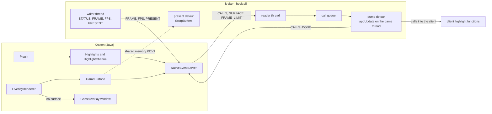
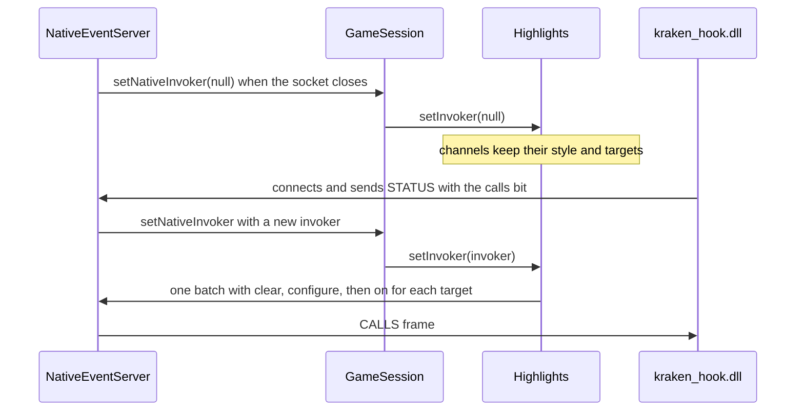
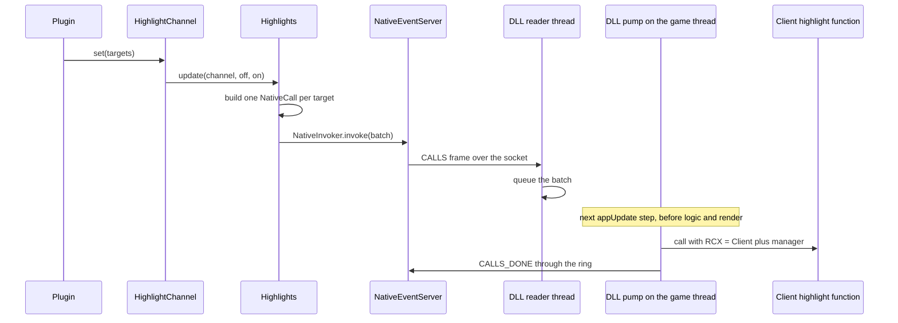
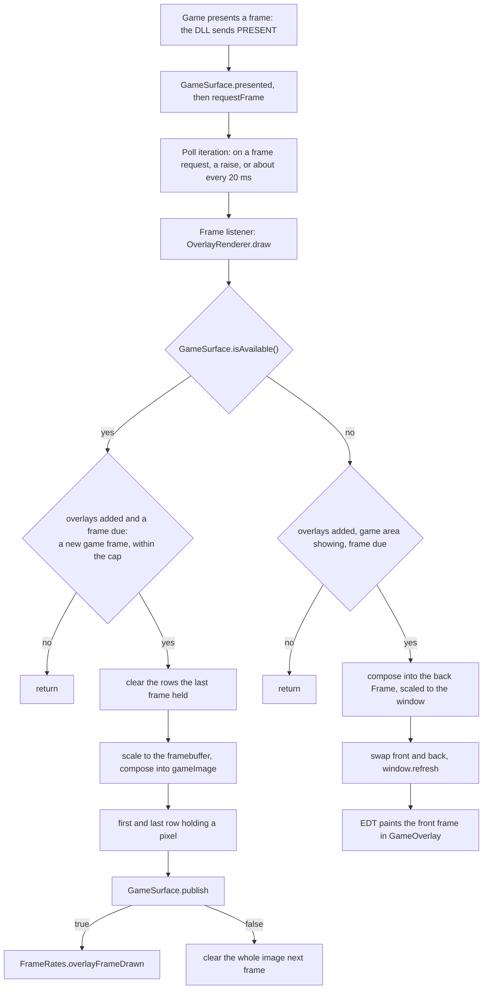
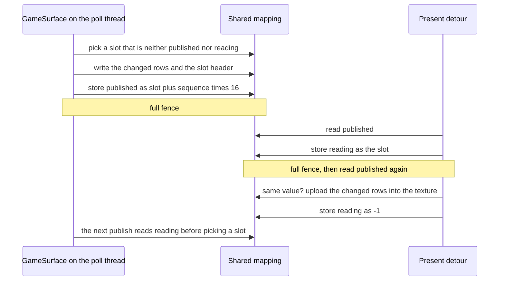
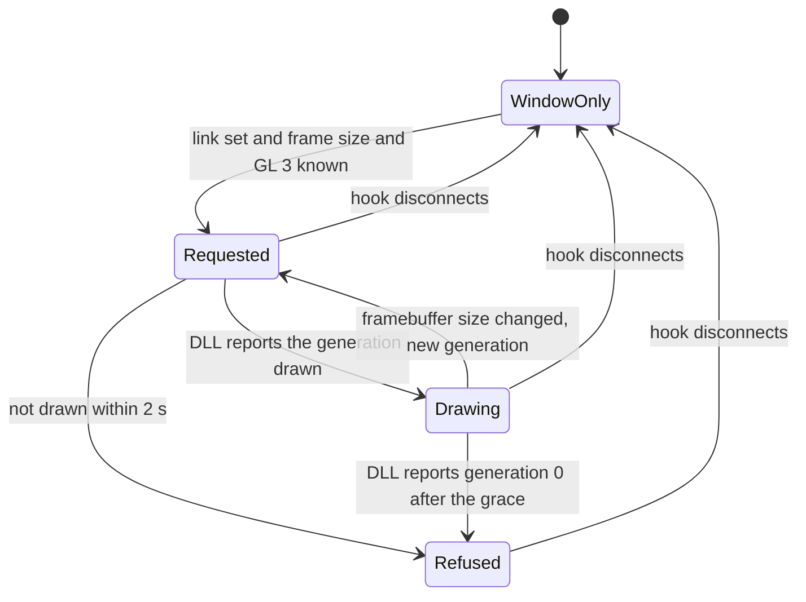
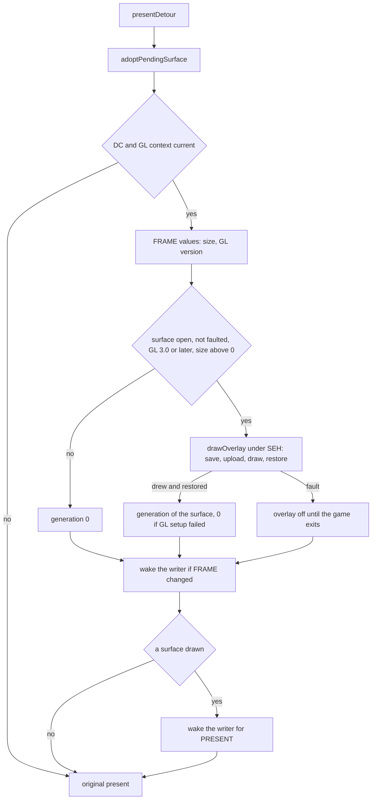

# In-Game Drawing

Two features run inside the game's process through the native hook. Highlights make the game outline models and tiles
in its own 3D scene: the DLL calls the client's highlight functions on the game thread. Overlays are Kraken's Java2D
frames, which the DLL composites into the game's OpenGL frame just before it is shown. Both use the hook's loopback
connection, described in [native-hook.md](native-hook.md) and [native-protocol.md](native-protocol.md). User-level
behaviour is in [the client guide](../client.md#overlays), [the API guide](../api.md#highlights) and
[writing plugins](../writing-plugins.md#overlays).



## Key Files

| Path | Role |
|---|---|
| [`Highlights.java`](../../api/src/main/java/com/kraken/api/highlight/Highlights.java) | Channel allocation, remembered state, reconnect re-apply, call building |
| [`HighlightChannel.java`](../../api/src/main/java/com/kraken/api/highlight/HighlightChannel.java) | A held channel: `configure`, `set`, `add`, `remove`, `clear`, `release` |
| [`HighlightTarget.java`](../../api/src/main/java/com/kraken/api/highlight/HighlightTarget.java) | The target records, one per kind, and which category each belongs to |
| [`HighlightConfig.java`](../../api/src/main/java/com/kraken/api/highlight/HighlightConfig.java) | The style record, encoded into the native struct |
| [`HighlightCategory.java`](../../api/src/main/java/com/kraken/api/highlight/HighlightCategory.java) | The eight categories and the mapping keys of their functions |
| [`NativeCall.java`](../../api/src/main/java/com/kraken/api/internal/invoke/NativeCall.java) | One call: RVA, argument kinds, data block |
| [`NativeInvoker.java`](../../api/src/main/java/com/kraken/api/internal/invoke/NativeInvoker.java) | The send interface the hook provides |
| [`GameSession.java`](../../api/src/main/java/com/kraken/api/GameSession.java) | `setNativeInvoker` hands the connection to highlights and menu actions |
| [`NativeEventServer.java`](../../client/src/main/java/com/kraken/client/callback/NativeEventServer.java) | Socket, handshake, status handling, `CALLS`, `SURFACE`, `FRAME_LIMIT` |
| [`NativeProtocol.java`](../../client/src/main/java/com/kraken/client/callback/NativeProtocol.java) | Byte framing of the commands and the status messages |
| [`OverlayRenderer.java`](../../client/src/main/java/com/kraken/client/ui/overlay/OverlayRenderer.java) | When frames are due (per game frame, or on the schedule), drawing into the game or the window |
| [`OverlayCompositor.java`](../../client/src/main/java/com/kraken/client/ui/overlay/OverlayCompositor.java) | Layout of one frame in canvas pixels |
| [`GameSurface.java`](../../client/src/main/java/com/kraken/client/ui/overlay/GameSurface.java) | The shared-memory surface and its handshake |
| [`GameOverlay.java`](../../client/src/main/java/com/kraken/client/ui/overlay/GameOverlay.java) | The click-through window used when the game isn't drawing the overlay |
| [`OverlayManager.java`](../../client/src/main/java/com/kraken/client/ui/overlay/OverlayManager.java) | Overlay order and saved placements |
| [`OverlayEditor.java`](../../client/src/main/java/com/kraken/client/ui/overlay/OverlayEditor.java) | Alt-drag move, resize and reset |
| [`FpsOverlay.java`](../../client/src/main/java/com/kraken/client/ui/overlay/FpsOverlay.java) | The Game and Overlays frame rate rows |
| [`FrameRates.java`](../../client/src/main/java/com/kraken/client/FrameRates.java) | The game's and the overlays' rates, and the unfocused cap |
| [`DevToolManager.java`](../../client/src/main/java/com/kraken/client/ui/devtools/DevToolManager.java) | Registers the dev tool painter on the window |
| [`protocol.h`](../../client/src/main/native/kraken_hook/src/protocol.h) | Every constant the two sides share |
| [`calls.cpp`](../../client/src/main/native/kraken_hook/src/calls.cpp) | Queues the batches, runs them in the pump, sends CALLS_DONE |
| [`pump.cpp`](../../client/src/main/native/kraken_hook/src/pump.cpp) | The `appUpdate` detour: frame cap, then calls |
| [`connection.cpp`](../../client/src/main/native/kraken_hook/src/connection.cpp) | Reader and writer threads, STATUS, FRAME, FPS, PRESENT |
| [`overlay.cpp`](../../client/src/main/native/kraken_hook/src/overlay/overlay.cpp) | The present detour, texture upload, the draw, FRAME values |
| [`surface.cpp`](../../client/src/main/native/kraken_hook/src/overlay/surface.cpp) | Opens the named mapping and hands it to the present thread |
| [`gl.cpp`](../../client/src/main/native/kraken_hook/src/overlay/gl.cpp), [`gl_state.cpp`](../../client/src/main/native/kraken_hook/src/overlay/gl_state.cpp) | GL entry points, saving and restoring the client's GL state |
| [`guard.h`](../../client/src/main/native/kraken_hook/src/core/guard.h) | The SEH guards around every call into the client and the GL draw |
| [`highlights.py`](../../updater/src/native_updater/highlights.py) | Finds the script-op dispatcher, the channel store and the config layout |
| [`90-draw.yaml`](../../updater/src/native_updater/spec/90-draw.yaml) | Fingerprints and keys for the highlight, present and frame-step functions |
| [`241.3.json`](../../api/src/main/resources/mappings/241.3.json) | The 241.3 values the API reads |

## Highlights

### The Game's Highlight System

The client's Lua API (`osrs.ClientOp`) has `highlight*` functions. A clientscript calls one to light an NPC, a player,
an object, a ground item or a tile. The lit things are kept in a `HighlightManager` that lives inside the `Client`
object, at `Client.highlightManager`. The game draws the outline or fill itself, in the 3D scene. The draw is part of
the scene, so it has depth, it follows moving actors and the camera, and it is hidden behind walls unless the style sets
`alwaysOnTop`.

| Term | Meaning |
|---|---|
| Category | What a highlight is keyed by. The API has eight (`HighlightCategory`). The native enum also has `OPGROUP` (8), which the API doesn't expose, and `NUM_CATEGORIES` (9) |
| Channel | 0 to 31 in each category (`HighlightManager.channelMax`). A channel holds one style and the things it lights. NPC channel 0 and tile channel 0 are different channels |
| Style | A `HighlightConfig` struct: colour, outline width and the on/off flags |
| Target | The key the store uses: an NPC by index and creation cycle, a type by id, a player by display name, an object by id and tile, or a tile |

The API's javadoc says that when several channels light the same thing, the lowest channel whose style is visible draws.
This page doesn't re-check that in the native code.

### Why the DLL Calls Native Functions

Each Lua handler reads its arguments from the script stack and calls one native function with
`RCX = Client + Client.highlightManager`. The DLL calls that native function directly, with the arguments already in
registers, so no clientscript runs.

Addresses are relative virtual addresses (RVAs): offsets from the executable's load address. The mapping stores them as
RVAs, so the same entry works wherever the executable is loaded. On x64 Windows the first four integer arguments go in
RCX, RDX, R8 and R9, and the rest go on the stack. The DLL passes eight, and a function that takes fewer ignores the
extra ones.

### Finding the Functions in the Mapping

The updater starts from the clientscript op dispatcher. Ops 7000 to 7044 (`HIGHLIGHT_*`) run through one function, a
jump table indexed by `opcode - 7000`. Each category owns five consecutive ops, in `enums.highlightCategory` order:
configure, on, off, active and clear. The loc and loc type functions have no Lua binding, so the dispatcher is the only
place they can be found.

[`highlights.py`](../../updater/src/native_updater/highlights.py) does this in order:

1. `_dispatcher` finds the one function that calls both the NPC on-function and the channel store.
2. `_jump_table` reads the table and checks that every entry falls inside the dispatcher.
3. `highlight_script_ops` checks each category: configure calls the channel store with the category as argument 1; on
   and off call the same function as the Lua handler, for NPC, NPC type, object type, player and tile; and clear calls
   `highlightChannelClear` with the category as argument 1. Loc and loc type on/off come from the script ops alone.

If any check fails, the script-op keys are left out of the mapping and a note goes into the session. The config layout
comes from `highlight_config_fields`, described below. The per-function keys come from the fingerprints in
[`90-draw.yaml`](../../updater/src/native_updater/spec/90-draw.yaml): each is the function a Lua handler calls with
`arg0` equal to `client`.

The 241.3 values, which the updater re-finds per build:

| Key | 241.3 | Found by |
|---|---|---|
| `functions.highlightNpcOn` / `Off` | `0x1b9ef0` / `0x1bbdf0` | Callee of the Lua handler, `arg0` = client + manager |
| `functions.highlightNpcTypeOn` / `Off` | `0x1ba460` / `0x1bc2e0` | Same |
| `functions.highlightPlayerOn` / `Off` | `0x1ba210` / `0x1bc070` | Same |
| `functions.highlightTileOn` / `Off` | `0x1ba2e0` / `0x1bc0d0` | Same |
| `functions.highlightObjOn` / `Off` | `0x1ba0e0` / `0x1bbf60` | Same, through the obj Lua handlers |
| `functions.highlightObjTypeOn` / `Off` | `0x1bae10` / `0x1bc380` | Same |
| `functions.highlightLocOn` / `Off` | `0x1b9fb0` / `0x1bbe50` | Script ops 7011 and 7012 |
| `functions.highlightLocTypeOn` / `Off` | `0x1ba780` / `0x1bc330` | Script ops 7016 and 7017 |
| `functions.highlightChannelClear` | `0x1b9550` | The clear case, ops 7004, 7009, ... 7044 |
| `functions.highlightChannelConfigure` | `0x3ad8c0` | The Lua function itself, a sol2 wrapper: `void(void*, int, int, const HighlightConfig*)` |
| `Client.highlightManager` | `0x89680` | Field of `Client`. Its address is the first argument of every on, off and clear call |
| `globals.client` | `0xe98c18` | The `Client*` slot the DLL reads for the CLIENT arguments |
| `HighlightManager.channelMax` | `0x1f` (31) | Constant argument 2 of the channel check inside configure |
| `HighlightManager.categoryCount` | `0x9` | Constant argument 1 of the same check |
| `enums.highlightCategory` | NPC 0 to TILE 7, OPGROUP 8, NUM_CATEGORIES 9 | Enum table match |
| `HighlightManager.npcs` / `npcTypes` / `players` / `objTypes` | `0x1258` / `0x12b8` / `0x1288` / `0x1318` | Hash maps the on and off functions write |

### The HighlightConfig Layout

`highlight_config_fields` reads the layout from the sol2 registration of `osrs.ClientOp.HighlightConfig`. It finds the
registration function from the type's name, then pairs each field's name with the member offset stored just before the
call that registers it, within eight instructions. The Lua field `highlightColour` is stored as `colour`.

| Field | Offset (241.3) | Bytes | Encoded by `ConfigLayout.encode` |
|---|---|---|---|
| `colour` | `0x0` | 4 | Red, green, blue, alpha; alpha is the fill's opacity |
| `outlineWidth` | `0x4` | 2 (u16) | Little-endian short, 0 to 65535 |
| `enableModelOutline` | `0x6` | 1 | 0 or 1 |
| `enableTileOutline` | `0x7` | 1 | 0 or 1 |
| `enableModelFill` | `0x8` | 1 | 0 or 1 |
| `enableTileFill` | `0x9` | 1 | 0 or 1 |
| `alwaysOnTop` | `0xa` | 1 | 0 or 1 |
| `showInsideEdges` | `0xb` | 1 | 0 or 1 |
| `saveToFile` | `0xc` | 1 | 0 or 1 |
| `snapToGrid` | `0xd` | 1 | 0 or 1 |
| `swOnly` | `0xe` | 1 | 0 or 1 |
| `ignoreRebuild` | `0xf` | 1 | 0 or 1 |
| `disableModel` | `0x10` | 1 | 0 or 1 (documented by the client as having no effect) |

The API reserves 32 bytes (`CONFIG_BYTES = 0x20`) and sends them as one `DATA` argument. `ConfigLayout.of` returns null
if a field is missing or falls outside the reserved bytes, which keeps highlights off. The configure call is
`highlightChannelConfigure(0, category, channel, &config)`. The client packs the colour into its 16-bit HSL form, so the
colour drawn can differ slightly from the one given.

### The Java Side

**`Highlights`** is built by the `Client` constructor from the mapping. It resolves the functions, the manager offset,
the channel maximum (default 31), the category ids and the config layout. Its public methods are:

| Method | Behaviour |
|---|---|
| `channel(category)` | The highest free channel. Starts at `channelMax` and counts down, so low channels stay free for callers that want precedence. Throws `IllegalStateException` when every channel is taken |
| `channel(category, n)` | A given channel. Throws `IllegalArgumentException` out of range and `IllegalStateException` when taken |
| `isAvailable()` | An invoker is set and the mapping has the manager, the config layout and the configure function |
| `isSupported(category)` | The mapping has both functions of that category. All eight are present in 241.3 |
| `setInvoker(invoker)` | Called by `GameSession.setNativeInvoker` as the connection comes up (or with null when it drops), then re-applies state |
| `releaseAll()` | Releases every channel. No code in the client calls it (see the gaps) |
| `heldChannels()` | The held channels, for diagnostics |

`send(calls)` drops null entries, which are the calls the mapping can't build. It sends nothing while unavailable. A
failed send logs `Could not send highlights to the native hook` once per connection, and `setInvoker` resets that flag.

**`HighlightChannel`** is one channel a caller holds. It is `AutoCloseable`. Methods that change state lock the
`Highlights` they came from.

| Method | Sends | Remembers |
|---|---|---|
| `configure(config)` | `highlightChannelConfigure`, only if the style changed | The style |
| `add(target)` | The on call, if the target is new | The target |
| `remove(target)` | The off call, if the target was held | |
| `set(targets)` | Off for targets no longer wanted, on for new ones. Nothing for the rest | The target set |
| `clear()` | `highlightChannelClear`, if anything was lit | Keeps the style |
| `release()`, `close()` | `highlightChannelClear`, if the channel is still registered. Frees the channel | Further use throws `IllegalStateException` |

A target of another category throws `IllegalArgumentException`. The plugins that use highlights take a channel in
`startUp`, call `set`, `add` or `remove` as things spawn and despawn, and release it in `shutDown`. The NPC Indicators
and Object Markers plugins use the NPC and LOC categories.

**Targets to calls.** Each `HighlightTarget` record maps to one pair of functions. The manager is always the first
argument, passed as `CLIENT` (`Client + 0x89680`).

| Target | Category | Functions (on / off) | Arguments after the manager |
|---|---|---|---|
| `Npc(index, creationCycle)` | `NPC` | `highlightNpcOn` / `highlightNpcOff` | index, creation cycle, channel |
| `NpcType(id)` | `NPC_TYPE` | `highlightNpcTypeOn` / `highlightNpcTypeOff` | id, channel, and a trailing false on the on call only |
| `Loc(id, tile)` | `LOC` | `highlightLocOn` / `highlightLocOff` | id, `&CoordGrid`, channel, false |
| `LocType(id)` | `LOC_TYPE` | `highlightLocTypeOn` / `highlightLocTypeOff` | id, channel, and a trailing false on the on call only |
| `Obj(id, tile)` | `OBJ` | `highlightObjOn` / `highlightObjOff` | id, `&CoordGrid`, channel, false |
| `ObjType(id)` | `OBJ_TYPE` | `highlightObjTypeOn` / `highlightObjTypeOff` | id, channel, and a trailing false on the on call only |
| `Player(name)` | `PLAYER` | `highlightPlayerOn` / `highlightPlayerOff` | `&name`, channel, and a trailing false on the on call only |
| `Tile(tile)` | `TILE` | `highlightTileOn` / `highlightTileOff` | `&CoordGrid`, channel, false |

The fifth argument of the loc and obj functions goes on the stack, which the eight-argument call covers. A
`CoordGrid` is 12 bytes, `{i32 level, i32 x, i32 z}`, in world tiles. Here `z` is north, which is the `WorldPoint` y. The
`false` is `useSourceCoord`. The client only changes tiles with x of 6400 and up (a sub-world's space). The API passes
false, which leaves the coordinates as given.

A player name is an `eastl::string` in its short form: the UTF-8 bytes inline and NUL-terminated, with the last byte
(offset 23) holding `23 - length`. That byte stays below the heap flag mask (`0x80`), so the string reads as inline. A
name longer than 23 bytes has no short form. Its target produces no call, and nothing is logged.

**Argument kinds.** Highlights use `IMM` (ids, the channel, the category, the booleans and the null `void*` of
configure), `CLIENT` (the manager) and `DATA` (coordinates, names and the config). `SCRATCH` and `INDIRECT` are used
only by [menu actions](menu-actions.md). `NativeCall.Builder.data` copies each block into the call, 8-byte aligned. The
DLL copies it again, 16-byte aligned, when it queues the batch.

### Remembered State and Reconnects

Each channel keeps its style and its targets whether or not the hook is connected. While the hook is down, changes update
that state and nothing is sent. When `setInvoker` receives a connection, it sends one batch: a clear for each channel released
while its own clear couldn't be sent, then a clear and a configure for each held channel and one on call per target, so
the game ends up in the state the channels describe.



The reconnect batch clears a channel before it re-lights it. Highlights already in the game from before the drop are
replaced, not stacked. A channel released while the hook was down is remembered in `unsentClears` and cleared in the
same batch, so the game stops showing what it lit.

### Running a Batch

The same path runs for a plugin's change and for the reconnect batch.



1. `NativeEventServer.sendCalls` numbers the batch (`batches`, starting at 1), frames it with `NativeProtocol.calls`
   and writes it under the connection's lock. `lastSent` records the batch.
2. The DLL's reader thread parses the frame in `calls::queue`. It keeps each call's RVA, argument kinds and values, and
   a copy of its data block. A batch that arrives while the pump isn't hooked is dropped without an answer. The API
   doesn't send calls until STATUS reports the pump, so this doesn't happen in practice.
3. The pump detour (`pumpDetour`) runs `paceFrame`, then `calls::runPending`, then the original `appUpdate`. The
   pending queue is taken with a try-lock, so a busy reader thread costs one frame's delay rather than a stall.
4. Each batch gets a zeroed 4096-byte scratch block, 16-byte aligned. `runCall` resolves the arguments. `CLIENT` reads
   the `Client*` from `globals.client` and skips the call if it is null. `DATA` points into the call's block. `SCRATCH`
   points into the scratch block. `INDIRECT` reads a pointer from the client. Then `guardedCall` calls `base + rva`
   under SEH. The result is 1 when the call ran, 0 when it was skipped, and -1 when it faulted.
5. `runPending` sends one `CALLS_DONE` per batch through the ring. `NativeEventServer.status` records `lastDone`. A
   batch with failed or skipped calls logs a warning.

`CALLS_DONE` regs:

| Reg | Value |
|---|---|
| RCX | Batch id |
| RDX | Calls that ran |
| R8 | Calls that faulted or were skipped |
| R9 | Return value of the last call that ran |

Logged on failure: `Native event hook: N of the calls in batch B faulted or were skipped (R ran)`.

On exit, `ExitHandler` stops the plugins first, so their `shutDown` releases the channels and sends the clears. Then its
exit task, `flushOnExit`, waits up to one second for the last `CALLS_DONE`, before the shutdown hooks close the game.
The DLL drops calls still queued when the connection closes, so the wait lets the clears run first.

## Overlays

Plugin overlays go to one of two places, chosen each frame. While `GameSurface.isAvailable()` is true, the frame is written
into shared memory, and the DLL draws it inside the game's frame. Otherwise the frame goes to the `GameOverlay` window
over the game.

### Frame Pipeline

Each frame starts on the API's poll thread (`kraken-api-poll`). `GameSession` runs its frame listener once per poll
iteration: about every 20 ms, as soon as a raise asks, and on each `GameSession.requestFrame`. The listener is
`OverlayRenderer.frame`, which the renderer registers with `ProcessAttacher`.



On the surface path, `draw` clears the window's last frame first, so the window hides. `drawInGame` then works at the
framebuffer's size. It reads the framebuffer size from `GameSurface`, which the DLL reports in FRAME, and the canvas size
from the client. The image is `TYPE_INT_ARGB_PRE`, so its pixels are premultiplied. The compositor draws in canvas
pixels, so the graphics are scaled by framebuffer over canvas. Only the rows that held pixels in the last frame are
cleared. Only the rows that hold pixels now, or that the target slot held before, are copied to the surface.

**When a frame is due.** On the surface path, the overlay follows the game's frames. While the DLL draws a surface,
it sends `PRESENT` for each frame the game presents, from the present detour just before the swap. The server hands the
count to `GameSurface.presented`, whose listener, `OverlayRenderer.presented`, calls `GameSession.requestFrame` when
any overlay is added. That wakes the poll loop at once, without an event read. `gameFrameDue` then draws one frame for
each new present count, so the overlay is redrawn once per game frame and is ready for the next present. Polls with no
new present draw nothing, since the DLL only shows the newest frame at each present. Before the first `PRESENT` of a
connection (while the DLL hasn't drawn the surface yet), frames are drawn on the schedule alone.

`FrameSchedule.due` caps both paths. One interval is one second divided by `overlayFrameRate` (240 by default, 1 to 240
in the settings), held to `OverlayRenderer.MAX_FRAME_RATE` (240) for the game and `WINDOW_MAX_FRAME_RATE` (50, one a
poll) for the window. A due frame moves the schedule on by one interval, so 30 fps on a 20 ms poll averages 30. Below
the game's frame rate, the cap skips game frames and the overlay lags the scene in steps. With no overlays nothing is
read or drawn, except one empty frame that clears the last one.

The overlay is drawn from the game's state as the game presents a frame, and the DLL shows it at the next present, so
it trails the scene by one game frame.

### Compositing Rules

[`OverlayCompositor`](../../client/src/main/java/com/kraken/client/ui/overlay/OverlayCompositor.java) draws one frame.

- **Layers** draw in this order: `ABOVE_SCENE`, `UNDER_WIDGETS` (the default), `ABOVE_WIDGETS`, `ALWAYS_ON_TOP`.
- **Order inside a layer** comes from `OverlayManager.getOverlays()`. It sorts by position first, in the order of the
  `OverlayPosition` enum. Within one position, anchored overlays draw higher priority first, so they sit nearest the
  corner. Dynamic overlays draw higher priority last, so they sit on top. Priorities are `PRIORITY_LOW` 0 up to
  `PRIORITY_HIGHEST` 1.
- **Positions.** `DYNAMIC` overlays draw over the whole canvas, at the positions they work out. The anchors are
  `TOP_LEFT` (below the game's hovered-option text, a 20 px top gap), `TOP_CENTER`, `TOP_RIGHT`, `CANVAS_TOP_RIGHT`
  (the same corner and stack as `TOP_RIGHT`), `BOTTOM_LEFT` and `BOTTOM_RIGHT`. The gap from the edge is 5 px.
- **Stacks.** Anchored overlays at one corner stack with 2 px between them, placed by the size each drew last frame
  (`lastSizes`). Top anchors stack downwards, `BOTTOM_LEFT` stacks rightwards and `BOTTOM_RIGHT` leftwards.
- **Preferred locations.** An overlay the user moved sits at its preferred location, kept on the canvas by its last
  size.
- **Failures.** Each overlay draws on its own clipped copy of the graphics. An overlay that throws is logged once until it
  draws again. An overlay that draws nothing in a frame keeps its last size, so it doesn't jump to the corner for one
  frame.
- **Editing.** While the user is moving overlays, every movable overlay is outlined over the rest.

Placements the user sets are saved by `OverlayManager.saveOverlay` in the `overlays` settings group, as
`<name>_preferredLocation` and `<name>_preferredSize`. `add` reads them back. `Overlay.getName()` defaults to the class's
simple name, so two overlays of one class share a saved placement.

### The Window Fallback

[`GameOverlay`](../../client/src/main/java/com/kraken/client/ui/overlay/GameOverlay.java) is a `JWindow` owned by the
Kraken frame and laid over the game view's bounds. Its extended style adds `WS_EX_LAYERED`, `WS_EX_TRANSPARENT` and
`WS_EX_NOACTIVATE`, so mouse clicks fall through to the game and the window never takes focus. It is shown only while a
painter is active. The overlay renderer's painter draws the `front` frame, and the dev tools' painters draw their own
content on the EDT.

The window path draws into two images, `front` and `back`. The renderer writes `back` on the poll thread, then swaps the
two and calls `window.refresh()`. The EDT then paints the finished `front` frame, scaled to the window. That keeps the
EDT from painting a half-drawn frame. `GameOverlay.Surface` gives the game area's size in UI pixels and its scale, and
`deviceWidth` is `ceil(width * scaleX)`.

### The Overlay Surface

The surface is a named file mapping that Java creates and the DLL maps. A file mapping is a region of memory backed by
the page file that two processes can map at once. Java creates it with `CreateFileMapping`, named
`Local\KrakenOverlay-<pid>-<generation>`. The `Local` namespace keeps the name inside the user's session. The generation
goes up each time Java opens a mapping: on a framebuffer size change, and again after each connection. Each mapping gets
its own name, so the DLL never confuses the old one with the new one.

Layout, from [`GameSurface`](../../client/src/main/java/com/kraken/client/ui/overlay/GameSurface.java) and
[`surface.cpp`](../../client/src/main/native/kraken_hook/src/overlay/surface.cpp):

```text
offset  size            field        writer  meaning
0       4               magic        Java    "KOV1", 0x31564F4B
4       4               width        Java    pixels per row (W)
8       4               height       Java    rows (H)
12      4               slots        Java    3
16      4               published    Java    slot in bits 0-3, sequence from bit 4; 0xFFFFFFFF = none yet
20      4               reading      DLL     slot being uploaded, -1 = none
24      40              (reserved)
64      3 x 16          slot headers Java    per slot: u32 top, u32 bottom (rows that may hold pixels), 8 unused
112     16              (reserved)
128     3 x W x H x 4   pixels       Java    slot 0, slot 1, slot 2: premultiplied BGRA, top row first
```

The total size is `128 + 3 * W * H * 4` bytes. A 1920 x 1080 surface takes about 24 MB, and a 3840 x 2160 surface takes
about 100 MB. The DLL checks the magic, that width and height are at most 16384, that the slot count is 1 to 3, and that
the mapping's region is at least the size the header implies (`VirtualQuery`).

The pixels are premultiplied. Each colour channel is already multiplied by its alpha, so a half-transparent white pixel is
stored as half-white at half alpha. `TYPE_INT_ARGB_PRE` produces this format in Java. Java writes each pixel as a
little-endian int, so the bytes come out as B, G, R, A, which is the `GL_BGRA` upload format.

### Writing a Frame

`GameSurface.publish(pixels, width, height, top, bottom)` runs on the poll thread:

1. It returns false unless `isAvailable()`. It also returns false for a bad size or a short pixel array.
2. If there is no mapping or the size changed, `open` makes a new mapping with a new generation, writes the header, and
   sends `SURFACE`.
3. It reads `published` and `reading`, and `freeSlot` picks the first of the three slots that is neither.
4. It copies rows from `min(top, tops[slot])` to `max(bottom, bottoms[slot])`. That is this frame's band plus the rows the
   slot held before, which this frame clears. If the slot was empty, only the new band is copied.
5. It writes the slot header (top and bottom), then `tops` and `bottoms`, and advances the sequence.
6. It stores `published` as `slot | sequence << 4` and runs a full fence.

The caller's image is zero outside the new band, and the copy covers the slot's old band. So each slot is zero outside its
own band. The DLL relies on that when it uploads only part of a slot.

A failure in `publish` logs `Could not hand the overlay to the game` once, until a publish succeeds.

### The Handshake Between Writer and Reader

Three slots let the writer fill one slot while the reader holds another, and the newest published slot waits. Neither
side takes a lock. Each side writes only its own word, `published` for Java and `reading` for the DLL.



The DLL's side is in `takeFrame`. It reads `published` and skips a sequence it has already taken. Otherwise it claims the
slot in `reading`, runs a full barrier, and reads `published` again. If the value moved, it releases `reading` and takes
the newer frame at the next present. Otherwise it reads the slot's band and uploads it. It then releases `reading` and
records the sequence as taken.

The two sides follow the Dekker pattern: each stores its word, puts a full fence between that store and its read of the
other word, and then reads. So a slot the DLL has claimed is never one Java picks, and a slot Java is writing is never
one the DLL uploads.

### Adoption, Refusal and Switching

`GameSurface` gives the DLL a surface in three steps:

1. **`SURFACE`**, `{u32 len, u8 2, u32 generation, u16 nameLen, name}`. Sent when `open` makes a mapping. An empty name
   stops drawing.
2. **Adoption.** `overlay::openSurface` on the reader thread checks the mapping and hands it to the present thread
   through an atomic exchange. The present thread takes it at its next present, in `adoptPendingSurface`. It unmaps the
   old view and marks the texture as needing a full upload.
3. **`FRAME`**, `{width, height, GL version, generation drawn}`. Sent by the writer thread whenever one of those values
   changes. The generation drawn is the surface the DLL drew in the last present, or 0.

`GameSurface.isAvailable()` is false unless a link exists, the surface isn't refused, the framebuffer is at least one
pixel each way, and the GL major version is 3 or more. The refusal check can also make it false. While it's true, the
renderer draws into the game and clears the window.



The rules behind the diagram, all from `GameSurface`:

- **The 2 s grace** runs from when `open` sent `SURFACE`. During it, `isAvailable` stays true, so frames go to the
  surface and the window stays hidden, even though nothing is drawing them yet.
- **Refusal.** After the grace, if the drawn generation still isn't the current one, `refused` is set. The log line
  `The native hook isn't drawing overlay surface N; overlays go back to the window over the game.` is written, and
  `SURFACE 0 ""` is sent so the DLL stops. `refused` stays set until the next `connected()`, so a refused connection
  never retries, even after the framebuffer changes size.
- **Falling back after adoption.** Once the DLL has drawn a generation, a later report of generation 0 (a GL fault, or a
  context the overlay can't draw with) refuses the surface on the next check. The grace has already passed, so there is
  no second wait.
- **A pause.** A framebuffer size of 0 (no window, or an empty client area) makes `isAvailable` false without refusing.
  So does a GL major version below 3. The mapping stays open. When the size returns and the DLL draws the same
  generation, drawing continues.
- **Disconnect.** `disconnected()` clears the link and the framebuffer size, and closes the mapping. The DLL's connection
  loop calls `stopSurface()` as the socket closes, so it stops drawing at its next present.

### The Present Hook

The present function is `present(GlContext*)`, which calls `SwapBuffers` on the context's device context. The DLL hooks
it once, from the handshake's `presentFn`. The DLL draws into the back buffer just before the original runs, so the
overlay is part of the frame the screen shows. Double buffering means the game draws into a back buffer while the front
one is on screen, and `SwapBuffers` swaps them. The present hook runs on whichever thread calls present. That is usually
the game thread, and it can be the GL device's render thread. The overlay's state is only touched on that thread.



What `drawOverlay` does, in order:

- **Context.** When the GL context changes, `overlayFrame` starts over, because the old objects belong to the old
  context. It reads the version from `glGetString(GL_VERSION)`, and `glGetIntegerv` for the profile mask on 3.2 and up.
- **Entry points.** `lookupGlFunctions` loads everything beyond GL 1.1 through `wglGetProcAddress`. Values 0, 1, 2, 3 and
  -1 count as missing. Below GL 3.0 the overlay is marked broken and draws nothing.
- **Shaders.** One program draws a full-screen triangle from `gl_VertexID`, and the fragment shader samples the texture
  with its v coordinate flipped, since rows run top down. The version line is `#version 330 core` on GL 3.3 and up,
  `150` on 3.2, and `130` on 3.0 and 3.1. The program has no vertex buffer; the vertex array object is empty.
- **Texture.** One `GL_RGBA8` texture the size of the surface. It is uploaded from `GL_BGRA`, with clamp to edge. Its
  filter is linear when the surface's size differs from the window's, and nearest otherwise.
- **Upload.** `takeFrame` runs the reader's handshake above. If the texture has no valid upload, it uploads the whole
  slot. Otherwise it uploads the union of the texture's old band and the slot's new band when the two overlap, and each
  band on its own when they don't. A header with `top > bottom` or `bottom > height` is treated as the whole slot.
- **Draw.** The draw binds framebuffer 0, sets the viewport to the window, turns off the switches the overlay doesn't
  want, and enables blending with `GL_ONE, GL_ONE_MINUS_SRC_ALPHA` for both colour and alpha. That is premultiplied
  "over": the result is `src + dst * (1 - src alpha)`. Then it draws three vertices. Nothing is drawn when the texture
  holds no rows, so an empty overlay costs no draw.

The client's GL state is saved first and restored after, under SEH guards. The table lists everything the draw changes.

| Saved and restored | Set for the draw |
|---|---|
| Current program, vertex array binding | The overlay's program, its empty VAO |
| Active texture unit, texture bound to unit 0, sampler on unit 0 | Texture on unit 0, sampler 0 unbound |
| Draw and read framebuffer bindings, draw buffer (only when it isn't `GL_BACK`) | Framebuffer 0, `GL_BACK` |
| Viewport | Full window |
| Scissor, depth, stencil, cull face, blend, sRGB, rasterizer discard, alpha to coverage, colour logic op | All off, except blend on |
| Blend functions and equations | Premultiplied over |
| Colour write mask | All channels |
| Polygon mode (only when it isn't fill) | Fill |
| Unpack alignment, row length, skip rows and pixels, pixel unpack buffer | 4, 0, 0, 0, no buffer |

A fault in the save, the draw or the restore turns the overlay off until the game process exits (`g_overlayFaulted`).
FRAME reports generation 0 from then on. A fault during the restore can leave some of the client's state unrestored.

`presentDetour` counts presents for FPS and PRESENT, runs `overlayFrame`, wakes the writer while a surface is drawn,
and then calls the trampoline to the original present. `overlayFrame` wakes the writer, through `ring::wakeWriter`,
when FRAME's values change. The writer sends `PRESENT` when the count moved and the generation drawn isn't 0, before it
drains the ring.

### Dev Tool Overlays

`DevToolManager` adds its painter to `GameOverlay` and never to `OverlayRenderer`. A dev tool's `paintOverlay` runs on
the EDT, from the latest snapshot the tool read on the poll thread. The surface only takes the renderer's frames, which
the poll thread composes. The code doesn't state why the dev tools stay in the window. Their EDT paint path is the likely
reason. They always draw in the window, and they can't be moved. The [dev tools guide](../dev-tools.md) describes the
behaviour for users.

### Frame Rates and the Cap

- **The game's rate.** The DLL counts presents when the present hook is live, and frame steps otherwise. About once a
  second, the writer sends `FPS`, with regs RCX = frames since the last one, RDX = microseconds since it, R8 = the cap in
  force and R9 = 1 if presents were counted. The writer's wait has a one-second timeout, so FPS goes out about once a
  second even when nothing else wakes it. `NativeEventServer` passes RCX and RDX to `FrameRates.gameFrames`.
- **Staleness.** `getGameFrameRate` is NaN after 3 s without a report, and after a disconnect. `FpsOverlay` shows a dash
  for NaN.
- **Presents.** While a surface is drawn, the writer sends `PRESENT` with the present count after each present it
  sees, so Java draws a frame per game frame (see the frame pipeline above).
- **The overlays' rate.** `FrameRates.overlayFrameDrawn` runs for each frame handed over. The `RateMeter` counts events
  over one-second windows, and resets after a pause of more than a second.
- **The readout.** `FpsOverlay` shows `Game` and `Overlays` rows at the top centre of the game, when `showFps` is on. It
  is off by default.
- **The cap.** `FrameRates.updateLimit` holds the game to `max(1, unfocusedFps)`, default 20, when no Kraken window is
  active and `limitUnfocusedFps` is on. Otherwise it runs free. Focus is read after a 250 ms settle timer, so moving
  between two Kraken windows doesn't count as unfocused.
- **Sending the cap.** Each change goes to every listener, and `NativeEventServer.sendFrameLimit` sends `FRAME_LIMIT`
  when the connection's STATUS reports the calls and frame-rate bits.
- **Pacing in the DLL.** `paceFrame` runs before the calls. Each frame step may start one interval (`frequency / fps`
  ticks) after the last one. It waits on a high-resolution waitable timer, where Windows has one, and on the cap-changed
  event, so lifting the cap takes effect at once. A step more than one interval late restarts the schedule, so frames
  don't bunch up. A cap above 1000, or 0, means no cap. Each connection starts uncapped, and a dropped socket lifts the
  cap.

### Moving Overlays

[`OverlayEditor`](../../client/src/main/java/com/kraken/client/ui/overlay/OverlayEditor.java) reads Alt every 30 ms on the
EDT. It starts editing when Alt is held, a Kraken window is active, the game view is showing, and at least one movable
overlay is drawn. Then it lays a nearly clear window (alpha 1) over the game, which catches the mouse where the movable
overlays are. The compositor outlines each movable overlay. The one under the pointer is outlined more strongly, and the
one being resized in magenta.

The editor learns where overlays were drawn from `frameDrawn`, which `OverlayRenderer.compose` calls after every frame. So
moving works the same on the surface path and the window path. A drag or resize is saved with
`OverlayManager.saveOverlay` when the button is released. Only panels can be resized. Dynamic overlays, such as labels
over NPCs, can't be moved.

## Failure Handling and Fallbacks

| Condition | What happens | Log |
|---|---|---|
| `kraken_hook.dll` not on the classpath | No hook. No highlights. Overlays go to the window | `kraken_hook.dll was not found on the classpath (build and bundle it with ./gradlew :client:buildNativeHook); events come from the timer poll alone.` (WARNING) |
| Mapping has no `appUpdate` | No calls, so no highlights (`isAvailable` false). Plugins outline tiles in their overlays | `Native event hook: no appUpdate in mapping <version>; highlights won't show in the game.` (INFO) |
| Mapping has no `present` | No overlay in the game. Overlays stay in the window | `Native event hook: no present in mapping <version>; overlays stay in the window over the game.` (INFO) |
| Mapping lacks the manager, the config fields or the configure function | `Highlights` stays unavailable and sends nothing | None |
| Hook connected, a batch has failed or skipped calls | Warning from `CALLS_DONE`. State is kept | `Native event hook: N of the calls in batch B faulted or were skipped (R ran)` (WARNING) |
| Send fails on the socket | State kept and re-applied on reconnect | `Could not send highlights to the native hook` (WARNING, once per connection) |
| Hook drops | Highlights stop (`invoker` null). Overlays go to the window at once. The DLL stops drawing at its next present | `Native event hook disconnected; back on the timer poll until it reconnects.` (INFO) |
| Surface can't be created or sent | `publish` returns false. Overlays go to the window | `Could not hand the overlay to the game` (WARNING, once until a publish succeeds) |
| The DLL doesn't draw a new surface within 2 s | Refused for the rest of the connection. Window | `The native hook isn't drawing overlay surface N; overlays go back to the window over the game.` (WARNING) |
| GL fault in the present hook | Overlay off until the game exits. Generation 0, so the surface is refused | Same refusal line as above. The DLL logs nothing |
| GL below 3.0 | Java never sends `SURFACE`, because the major version check fails. The window is used | None |
| GL 3.0 or 3.1 with a shader that doesn't compile | The DLL reports generation 0, so the surface is refused after the grace | Same refusal line as above |
| Overlay frame throws | Logged, and the next frame is tried | `Drawing the overlays failed` (WARNING, once until a frame succeeds) |
| One overlay throws | That overlay is skipped, the others draw | `Overlay <name> failed to draw` (WARNING, once until it draws again) |
| Window painter throws | That painter is skipped for the frame | `Overlay painter failed` (WARNING) |
| Native hook connection fails | The connection is dropped and the hook reconnects. Calls queued are dropped | `Native event hook connection failed` (WARNING) |

Under MinGW the SEH guards are no-ops ([`guard.h`](../../client/src/main/native/kraken_hook/src/core/guard.h)). A fault in
a client call or a GL draw then crashes the game instead of turning the feature off. Build with MSVC for anything beyond
local testing.

## Timing and Limits

| Value | Where | Meaning |
|---|---|---|
| 20 ms | `GameSession.POLL_INTERVAL_MS` | Poll loop period, which also runs the frame listener. The loop holds a 1 ms Windows timer (`TimerResolution`), so the wait isn't stretched to the default 15.6 ms tick (about 31 ms) |
| 250 ms | `GameSession.HOOKED_EVENT_POLL_MS` | Event read safety interval while the hook is connected |
| 150 ms | `GameSession.RENDER_INTERVAL_MS` | Poll listener period (dev tools) |
| 240 fps, 1 to 240 | `KrakenConfig.overlayFrameRate` | Overlay frame cap. In the game, frames follow the game's presents up to it (`OverlayRenderer.MAX_FRAME_RATE`, 240); in the window, at most `WINDOW_MAX_FRAME_RATE` (50) |
| 2 s | `GameSurface.ADOPT_GRACE_NANOS` | Time for the DLL to draw a new surface |
| 3 s | `FrameRates.GAME_STALE_NANOS` | Age at which the game's rate reads as unknown |
| 250 ms | `FrameRates.FOCUS_SETTLE_MS` | Focus settle before the cap follows it |
| 20 fps, 1 to 50 | `KrakenConfig.unfocusedFps` | Cap while unfocused |
| 30 ms | `OverlayEditor.POLL_MS` | Alt check period |
| 1 s | `NativeEventServer.EXIT_FLUSH_MS` | Wait for the last `CALLS_DONE` on exit |
| 4096 | `calls.cpp` `MAX_PENDING_CALLS`, `MAX_PENDING_BATCHES` | Queued calls and queued batches |
| 4096 bytes | `protocol.h` `SCRATCH_SIZE` | Scratch block each batch shares |
| 8 | `NativeCall.MAX_ARGS`, `MAX_ARGS` in `protocol.h` | Arguments per call |
| 65535 bytes | `NativeCall.MAX_DATA` | Data block per call |
| 16384 | `protocol.h` `SURFACE_MAX_SIDE` | Largest surface side the DLL opens |
| 1000 | `protocol.h` `MAX_FRAME_LIMIT` | Cap above this means no cap |
| 1000 ms | `ring.cpp` `waitForData` | Writer wakes at least once a second |

## Testing

Java tests, run with `./gradlew :api:test` and `./gradlew :client:test`:

| Test | Covers |
|---|---|
| [`HighlightsTest`](../../api/src/test/java/com/kraken/api/highlight/HighlightsTest.java) | Channel allocation, every style field's offset, each target's arguments, diffs in `set`, names as short strings, reconnect re-apply, broken connections, `releaseAll`, a mapping without the keys |
| [`NativeCallTest`](../../api/src/test/java/com/kraken/api/internal/invoke/NativeCallTest.java) | Aligned data copies in one block, scratch offsets, packing of indirect offsets, value semantics, the eight-argument limit |
| [`NativeProtocolTest`](../../client/src/test/java/com/kraken/client/callback/NativeProtocolTest.java) | The byte framing of `CALLS`, `SURFACE`, `FRAME_LIMIT` and the script block, and parsing of raised and script events |
| [`GameSurfaceTest`](../../client/src/test/java/com/kraken/client/ui/overlay/GameSurfaceTest.java) | GL 3 and framebuffer requirements, the first frame, slot choice, slot reuse clearing rows, a new size making a new generation, the 2 s refusal, a disconnect closing the mapping, present counts and their listener. Uses a fake `RegionFactory`, not Win32 |
| [`OverlayRendererTest`](../../client/src/test/java/com/kraken/client/ui/overlay/OverlayRendererTest.java) | Finding the rows with pixels, the frame schedule at poll and game frame rates, the cap, restarts, clearing rows |
| [`OverlayCompositorTest`](../../client/src/test/java/com/kraken/client/ui/overlay/OverlayCompositorTest.java) | Anchors and stacks, layers and priorities, failing overlays, editing outlines, the shared top-right stack |
| [`OverlayManagerTest`](../../client/src/test/java/com/kraken/client/ui/overlay/OverlayManagerTest.java), `OverlayDragTest` | Saved placements, reset, drag and resize geometry |
| [`FrameRatesTest`](../../client/src/test/java/com/kraken/client/FrameRatesTest.java) | The one-second meter, the game rate, the unfocused cap |

Updater tests, run from `updater/` with `uv run python -m unittest discover -s tests -t .` under WSL:

- `DrawTests` in [`test_units.py`](../../updater/tests/test_units.py) runs `highlight_script_ops` and
  `highlight_config_fields` over miniature code. It checks the script-op names, a refused case that disagrees with the
  Lua handler, and the config field offsets.
- `tests/test_golden.py` checks the accepted 241.3 values in [`241.3.golden.json`](../../updater/corpus/241.3.golden.json).
  It skips unless the build's binary and `program.db` are cached. A skip isn't a pass.

Not covered by any automated test: the DLL (there are no C++ tests), the GL draw, the present hook, the Win32 mapping
calls in `MappedRegion`, `GameOverlay`'s click-through window, `FpsOverlay`, and the Alt editor's window. To test a new
surface behaviour, pass a fake `RegionFactory` and a clock to `GameSurface`, as `GameSurfaceTest` does.

## Known Gaps and Live Checks

Code gaps, found by reading the code against this page:

1. **A batch dropped by the batch limit gets no `CALLS_DONE`.** `calls::queue` skips the push when 4096 batches are
   already queued, and the batch isn't counted as skipped either. A batch over the call-count limit is still answered.
2. **A batch that alone exceeds 4096 pending calls is refused whole.** `queue` checks the queued total plus the batch,
   and Java never splits a batch. `setInvoker` sends the whole reconnect as one batch, so a very large set of highlights
   is refused on reconnect. Java logs the skipped count from `CALLS_DONE`. Reaching the limit takes a very large set of
   targets.
3. **Overlays are hidden for up to 2 s while a new surface waits.** During the grace, `isAvailable` stays true, so the
   window is cleared and the surface isn't drawn yet. The overlay shows in neither place until the refusal or the first
   draw.
4. **A refusal lasts the whole connection**, even if the framebuffer later changes size.
5. **`Highlights.releaseAll()` has no caller.** Its Javadoc says the client calls it as it shuts down. Shutdown relies on
   the plugins releasing their channels, followed by the one-second flush.
6. **The protocol names differ.** `protocol.h` calls the bits `FEATURE_PUMP` and `FEATURE_PRESENT`. Java calls them
   `FEATURE_CALLS` and `FEATURE_OVERLAY`. The values match.
7. **The overlay trails the scene by one game frame.** It is drawn from the state the game presented and shown at the
   next present. Matching the scene exactly would need the present to wait for Java's frame.

Live checks still pending. Each of these needs a running client, and none is covered by a test:

- Highlights appear on the next frame, on the login screen too. Each category lights the right thing: NPCs by index and
  creation cycle, players by name, locs and objs by id and tile. Styles change live. `ignoreRebuild` survives a map
  rebuild. Logout clears or keeps them as expected.
- The present hook runs with the context current on both the direct path and the render-thread path. The overlay lines
  up in fixed, resizable and stretched windows, and with UI scaling.
- The GL 3.0, 3.1 and 3.2 shader paths. A 3.2 context uses the `150` shader, and 3.0 and 3.1 use `130`.
  Each should either draw the overlay or refuse cleanly after the grace.
- Surface cost: upload time per frame at 1080p and 4K, and that an empty overlay costs nothing.
- Frames per present: with Show FPS on, Overlays matches Game up to the cap, and a moving camera shows no judder.
- The Game FPS readout matches the game's own counter, and the cap holds the game at the rate asked, lifts on focus,
  and leaves logic and highlights working while held.
- Alt-drag with the surface: Alt is seen while the game has the keyboard, a click on an overlay leaves the game focused,
  and a dragged overlay stays under the pointer with UI scaling.
- The refusal path: a DLL that doesn't draw should produce the refusal line after 2 s and bring the overlay back in the
  window.
