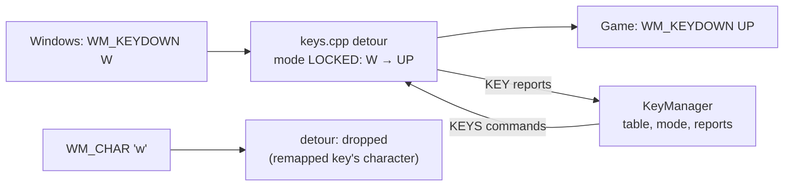

# Key Interception

The game takes its keys from the `WM_KEYDOWN`, `WM_KEYUP` and `WM_CHAR` messages that reach the render view's window
procedure; it doesn't poll held keys. So a detour on that procedure that rewrites or drops those messages changes what
the game sees, with no round trip: the native hook holds a **table of modes** the Kraken client sends, each a list of
key rules, applies the mode in force to every message, and can move to another mode by itself as a key goes down.
This page covers the window procedure, the detour, the table, the Java side and the recipes.

Plugin authors start with [`KeyManager`](../../client/src/main/java/com/kraken/client/input/KeyManager.java)'s
remapping methods. The wire format is in [Native protocol](native-protocol.md#keys).

## Key Files

| Path | Role |
|---|---|
| [`keys.cpp`](../../client/src/main/native/kraken_hook/src/keys.cpp) | The window procedure detour, the table, KEYS commands and KEY reports |
| [`KeyManager`](../../client/src/main/java/com/kraken/client/input/KeyManager.java) | `setRemapTable`, `setRemapMode`, key report listeners; converts Java key codes to virtual-key codes |
| [`KeyRemapMode`](../../client/src/main/java/com/kraken/client/input/KeyRemapMode.java), [`KeyRemap`](../../client/src/main/java/com/kraken/client/input/KeyRemap.java), [`KeyReport`](../../client/src/main/java/com/kraken/client/input/KeyReport.java) | The table plugins build and the reports they get |
| [`KeyHook`](../../client/src/main/java/com/kraken/client/input/KeyHook.java) | The wire-level table the hook server sends |
| [`NativeProtocol`](../../client/src/main/java/com/kraken/client/callback/NativeProtocol.java) | The key block of the handshake, KEYS commands, KEY parsing |
| [`keyboard.py`](../../updater/src/native_updater/keyboard.py), [`72-keyboard.yaml`](../../updater/src/native_updater/spec/72-keyboard.yaml) | Finds the window procedure and the component key listener |
| [`KeyRemappingPlugin`](../../client/src/main/java/com/kraken/client/plugins/keyremapping/KeyRemappingPlugin.java) | The first plugin built on it |

## The Window Procedure

The client draws into a child window of the class `JagRenderView`. The function that registers the class stores its
window procedure into the `WNDCLASSEXA` it hands `RegisterClassExA`; that procedure (`functions.renderViewWndProc`,
`0x6d1e00` in 241.3) hands every message to the client's input device, which turns the key messages into the key
pressed, released and typed calls the game thread consumes. The hook detours it with MinHook, like any other function,
from the first handshake whose key block names it.

## The Detour

For each message, by the mode in force:

| Message | What happens |
|---|---|
| `WM_KEYDOWN`, `WM_SYSKEYDOWN` | The first rule of the mode whose key is this one and whose modifier bits (Shift, Ctrl, Alt, read with `GetKeyState`) agree under its mask fires. A rule's next mode, if any, is taken. Then the key is dropped (`KEY_TO_BLOCK`), becomes another key (the message's `wParam` is rewritten, and the key is remembered as remapped until it goes up), or passes. A key already remapped keeps its mapping as it repeats |
| `WM_KEYUP`, `WM_SYSKEYUP` | A remapped key goes up as the key it became; a dropped key doesn't go up |
| `WM_CHAR` | The character of a key that was just remapped or dropped is dropped. In a mode with `KEY_MODE_BLOCK_TYPING`, every printable character (0x20 and up) is dropped, so nothing reaches the chat while it is locked; Enter, Backspace and Escape still arrive |

Everything else passes through. A dropped message returns 0 without reaching the client. While the Kraken client asks
(`KEYS_REPORT`), each handled message is reported as `KEY {message, key, action << 16 | key it became, mode before |
mode after << 8}`.

The table is replaced whole (a shared pointer swapped under a lock), so the window thread reads one table or the next.
A dropped connection clears the table and goes back to mode 0, passing everything.

## The Table

A table has up to 8 modes. Mode 0 is the one in force until the Kraken client says otherwise. A mode has a flag
(block typing) and rules `{key, modifiers, modifier mask, key it becomes, next mode}`; `KeyHook.STAY` keeps the mode,
`KeyHook.BLOCK` drops the key. Rules are matched in order, the first match winning.

Key Remapping's table, as an example: mode 0 passes everything (the chat doesn't have the keyboard); the locked modes
(1 to 3) block typing and remap W, A, S, D to the arrows (and the number keys to the F-keys, when on), with Enter and
the slash passing through and moving to the typing mode; the typing mode (4) blocks nothing, with Escape dropped and
Enter passed, both moving back to locked. Java picks which locked mode is in force from what the chat shows (a dialog
taking number keys turns the F-key rules off) and follows the hook's own moves through the KEY reports.

## The Java Side

`KeyManager` keeps the table and mode a plugin set and sends them when the hook connects (`setKeyHook`, from the hook
server once STATUS reports `FEATURE_KEYS`); `isRemappingAvailable()` says whether they reach the hook now. Java key
codes become Windows virtual-key codes with `toWindows` (and back with `toJava` for reports); a rule whose key has no
Windows code is left out. A `Keybind` with no key and a modifier remaps the modifier key itself, matched whatever else
is held, as a `ModifierlessKeybind` is.

Reports are delivered on the client thread to the listeners of `addKeyReportListener`; the hook only sends them while
one is registered.

What isn't covered: the game's own key state (a key the game polls, if any, isn't changed); changing the text the chat
shows, so a locked chat looks as it always does; and the client's focused text field, which the API can't yet read, so
a plugin can't lift the remapping for one.

## Recipes

`keyboard.py` finds two things:

* **The window procedure** (`render_view_wndproc`): the function that stores `sizeof(WNDCLASSEXA)` (0x50) into a
  stack slot and the address of a function 8 bytes after it, among the functions referencing `"JagRenderView"`.
* **The component key listener** (`component_listeners`): the cs2 handler of ops 1400 to 1499 (`cc_setonclick` to
  `cc_setonkey`), found by its `- 1400` and case table; case 19 (`cc_setonkey`, op 1419) points its slot register at
  `component + IfType.onKey`, the shared tail's first call on the slot is the resize that reads
  `IfListener.count`, and the load after it names `IfListener.args`. `Widget.getOnKeyListener()` reads them.

`tests/test_keyboard.py` runs both over miniatures of that code.
