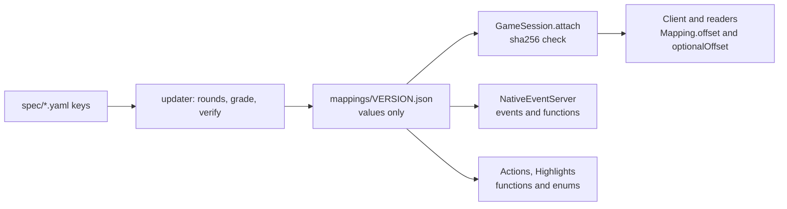
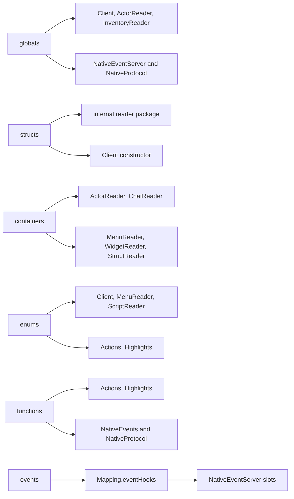
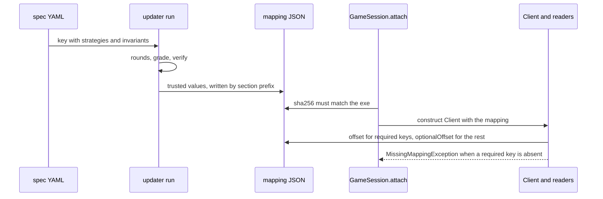

# Mapping Format

The mapping is the file the updater and the API share. Each client build has one, at
`api/src/main/resources/mappings/<version>.json`, and it holds only values: byte offsets, global and function
addresses, enum values, and native event hook sites. The updater writes it ([updater.md](updater.md)). The API and the
client read it through [`Mapping`](../../api/src/main/java/com/kraken/api/mapping/Mapping.java). The bundled 241.3 file
is the reference example below. Its values are 241.3 values, and the updater re-finds them for each build.



## Top-Level Shape

```json
{
  "version": "241.3",
  "sha256": "166231c8f6bd05c7542b8f0d35eb64b0aad701a87ba6ba41f60c4706de946944",
  "globals":    { "client": "0xe98c18", "cycle": "0xe98c14", ... },
  "structs":    { "Client": { "gameState": "0x2160", ... }, "Actor": { "pathX": "0x3f0", ... } },
  "containers": { "hash_map": { "node.value": "0x10", ... }, ... },
  "enums":      { "gameState": { "LOGGED_IN": 30 }, ... },
  "functions":  { "worldToScreen": "0x21eb80", ... },
  "events":     { "ON_NPC_LOAD": [ { "fn": "0xc7930", "idArg": 0, "args": 3 } ], ... }
}
```

| Section | Holds | 241.3 entries | Read by |
|---|---|---|---|
| `version` | the client's `major.minor` file version | `"241.3"` | `GameSession.attach`, `Mapping.version()`, the attach log |
| `sha256` | SHA-256 of the exe the mapping was made from | 64 hex digits | `GameSession.attach`, the probe |
| `globals` | global RVAs, relative to the module base | 15 | `Mapping.global`, `GameReader`, `NativeEventServer` |
| `structs` | byte offsets of struct fields | 56 structs, 409 fields | the readers in `api/.../internal/reader` and `Client` |
| `containers` | layouts of the EASTL containers and `jag::shared_ptr` | 5 groups, 18 values | `Mapping.container`, `containerOr`, `StructReader`, `ActorReader` |
| `enums` | enum tables and single enum values, as integers | 9 groups, 103 values | `enumValue`, `enumTable`, `Client`, `MenuReader` |
| `functions` | function RVAs | 73 | `hasFunction`, `function`, `Actions`, `Highlights`, `NativeEventServer` |
| `events` | hook sites per native event | 33 events, 35 sites | `eventHooks`, `NativeEventServer.build` |

The file is written with `emit.build_mapping`. The sections are listed in the same order.

## Value Formats

| Kind | JSON | Example | How it is read |
|---|---|---|---|
| Offset, RVA, address | string, lowercase hex with `0x` | `"0xe98c18"` | `Long.decode`, which reads the `0x` prefix. A decimal string also parses |
| Enum value | number | `30`, `-1`, `2147483646` | `getAsInt` |
| Hook site `fn` | string, hex | `"0xc44d0"` | `Long.decode` |
| Hook site `idArg`, `id`, `args` | number | `0`, `14`, `3` | `getAsInt`; `idArg` is absent when `id` is fixed |
| `version`, `sha256` | string | `"241.3"` | `getAsString` |

Keep offsets and RVAs as strings. A bare JSON number in an offset position is read as decimal, because JSON cannot
hold hex. `emit.fmt` writes every offset as `f"{v:#x}"`.

## Sections

### globals

```json
"globals": { "client": "0xe98c18", "cycle": "0xe98c14", "varps": "0x155e528",
             "inventories.buckets": "0x154fab8", "inventories.bucketCount": "0x154fac0", "scriptRunner": "0x154fe50" }
```

The key is the spec key without `global.`. A dotted name stays one flat key, so `inventories.buckets` is a single
entry and not a path. `Mapping.global("inventories.buckets")` reads it directly.

A global is the RVA of an 8-byte slot in the exe's data. The slot holds a pointer to a heap object, so `globals.client`
points at the slot that holds the `Client*`. The chain `[[client] + 0x3198]` reads that pointer, then the 4-byte value at
`+0x3198` of the object it points to. That value is `Client.tickCount` at 241.3.

| Global | Consumers at 241.3 |
|---|---|
| `client` | `Actions`, `GameReader.clientBase`, `NativeEventServer.drawing` (the `Client*` slot the DLL reads) |
| `cycle` | `ActorReader`, `Client`, `ProjectileReader` (the client cycle counter, 20 ms units) |
| `varps`, `varpsBits`, `varpCount` | `Client`, `ActorReader` |
| `configCache` | `ConfigArchive` |
| `inventories.*`, `chatLines.*` | `InventoryReader`, `ChatReader` |
| `scriptRunner` | `ScriptReader`, `NativeProtocol` (the script block of the handshake) |
| `varbitMaskTable` | no reader yet |

### structs

```json
"structs": {
  "Client": { "gameState": "0x2160", "tickCount": "0x3198", "worlds": "0xc9b8", "localPlayerIndex": "0xcc4c",
              "camera.pos": "0x895c8", "renderer": "0x90" },
  "Actor": { "pathX": "0x3f0" }
}
```

A key is `Struct.field`. `Mapping.split` cuts at the first dot, so `Client.camera.pos` is the struct `Client` with
field `camera.pos`. Field names can contain dots, and a field can be a struct's sub-object field such as `worlds.map`.
The value is the field's offset from the start of the struct.

Readers copy the offsets they need in their constructors. Each offset is looked up once per attach, not on every poll.
The [readers](../../api/src/main/java/com/kraken/api/internal/reader) hold the results.

### containers

```json
"containers": {
  "hash_map": { "buckets": "0x8", "bucketCount": "0x10", "node.key": "0x0", "node.value": "0x10", "node.next": "0x18" },
  "list":     { "node.next": "0x0", "node.prev": "0x8", "node.value": "0x18" },
  "shared_ptr": { "ptr": "0x8" },
  "string":   { "size": "0x18", "ssoCapacity": "0x17", "heapFlagByte": "0x17", "heapFlagMask": "0x80" },
  "minimenu": { "node.list": "0x0", "node.index": "0x8", "node.children": "0x10", "node.size": "0x18", "list.entries": "0x18" }
}
```

A container value is the layout of a library type as the client embeds it in its structs. The key is
`container.<group>.<name>`, and `Mapping.container("hash_map.node.value")` reads `containers.hash_map["node.value"]`.

| Group | Layout it describes |
|---|---|
| `hash_map` | EASTL `hash_map` header: the bucket array pointer at `+0x8`, the bucket count at `+0x10`. A node holds the key at `+0`, the value at `+0x10` and the chain pointer at `+0x18` |
| `list` | EASTL intrusive list node: the next and previous pointers, then the value at `+0x18` |
| `shared_ptr` | `jag::shared_ptr`: the object pointer at `+0x8`, next to a control block pointer |
| `string` | EASTL `string`, 24 bytes. When the byte at `+0x17` has the bit `heapFlagMask` (0x80) set, the text is on the heap: the pointer is at `+0` and the length, a u64, at `+8`. Otherwise the text is inline and its length is `ssoCapacity - flag` |
| `minimenu` | the right-click menu's node: `list`, `index`, `children` and `size`, plus the entries list at `+0x18` |

`StructReader` decodes an EASTL string with `heapFlagByte`, `heapFlagMask` and `ssoCapacity`. A reader needs all three:
the flag byte says where the text is, and the capacity gives the length of inline text.

### enums

```json
"enums": {
  "gameState": { "LOGGED_IN": 30 },
  "minimenuOp": { "TARGET": -1, "EXAMINE": 2147483646 },
  "events": { "ON_GAME_TICK": 44, "ON_NPC_LOAD": 42, "ON_FRIEND_TRANSMIT": 15, "NULL_EVENT": -1 }
}
```

Enum values are JSON integers, not strings. The `events` table has 65 entries, the ids of the `osrs.Events` raises. Two
kinds of spec key write here. A whole table (`enums.events`, `enums.minimenuOp`) writes every member. A single member
(`enums.gameState.LOGGED_IN`) writes one entry under its table.

| Table | Used by |
|---|---|
| `events` | `NativeEventServer.build` (the id to name map), `Mapping.eventHooks` lookups, the dev tools' event log |
| `gameState` | `Client` (`LOGGED_IN`) |
| `minimenuSubject`, `minimenuOp` | `MenuReader` |
| `clientProt` | `Actions` (the packet opcodes, looked up by name) |
| `varValueType` | `ScriptReader`, `NativeProtocol` |
| `highlightCategory` | `Highlights` |
| `gameStateTrigger`, `profileType` | no reader yet |

`Mapping.enumValue(table, name, fallback)` returns the fallback when the table or the name is missing. `enumTable(table)`
returns an empty map.

### functions

```json
"functions": { "worldToScreen": "0x21eb80", "dispatchEvent": "0xc44d0", "appUpdate": "0x918950",
               "present": "0xa555c0", "setSequence": "0x9fe50", "npcLookup": "0x1878b0" }
```

A function entry is the RVA of a function the API or the hook DLL calls or detours. There are 73 at 241.3. Consumers:

| Who | Functions |
|---|---|
| `NativeEventServer.drawing` | `appUpdate` (the per-frame step where DLL calls run), `present` (where the overlay is drawn) |
| `NativeEvents.FUNCTIONS` | `clientCycle`, `setGameState`, `playerAdd`, `playerRemove`, `npcInfoDecode`, `playerInfoDecode`, `projectileCtor`, `ifOpenSub`, `ifCloseSub`, `setVarcInt`, `setVarcString`, `setSequence`, and `projectileStep` when the property is set |
| `NativeProtocol.scriptLayout` | `executeScript`, `executeScriptInner`, `scriptLookup`, `scriptSwapLocals`. The script block is left out if any is missing |
| `Actions` | the `menu*` row bodies and the `packet*` helpers. Each action checks `functions.containsKey` for what it needs and is unavailable without it |
| `Highlights` | `highlight*On` and `highlight*Off` (built from the category name), `highlightChannelConfigure`, `highlightChannelClear` |

Some functions have no reader yet: `worldToScreen`, `npcLookup`, `playerLookup`, the type loaders and `varbitRead`. They
are mapped for the planned in-process backend ([`60-functions.yaml`](../../updater/src/native_updater/spec/60-functions.yaml)).

### events

```json
"events": {
  "ON_NPC_LOAD":        [ { "fn": "0xc7930", "idArg": 0, "args": 3 } ],
  "ON_CHAT_TRANSMIT":   [ { "fn": "0x63e70", "id": 14, "args": 1 } ],
  "ON_FRIEND_TRANSMIT": [ { "fn": "0x520b0", "idArg": 0, "args": 1 }, { "fn": "0x64320", "id": 15, "args": 1 } ]
}
```

Each event lists the functions the client calls to raise it. Each site has three fields:

| Field | Meaning |
|---|---|
| `fn` | the raiser's RVA. The hook DLL detours it |
| `idArg` or `id` | the event id. `idArg` names the argument register (`0` is RCX) that carries it. `id` is the fixed id the raiser always fires |
| `args` | how many integer argument registers the DLL forwards, from RCX, RDX, R8 and R9 (1 to 4) |

At 241.3 there are 35 sites for 33 events. 13 sites have a fixed `id` and 22 take the id from `idArg: 0`. Two events have
two sites each: `ON_FRIEND_TRANSMIT` and `ON_CLAN_RECORD_TRANSMIT`. Both list the raiser at `0x520b0`, which takes the id
in RCX and serves the two events. Their second sites are fixed-id raisers at `0x64320` (id 15) and `0x643c0` (id 18).
The updater checks that the first site of `ON_GAME_TICK` is `functions.dispatchEvent`.

`Mapping.eventHooks(name)` returns an `EventHook(fn, idArg, id, args)` record for each site. `idFixed()` is true when
`idArg` is negative, which is what a site without `idArg` gives. `NativeEventServer.build` turns each site into a hook
slot. Sites that share an `fn` merge into one slot, which the DLL detours once. The per-event capture plans are in
[`NativeEvents`](../../client/src/main/java/com/kraken/client/callback/NativeEvents.java), and the handshake encoding is
in [`NativeProtocol`](../../client/src/main/java/com/kraken/client/callback/NativeProtocol.java). The
[events page](events.md) covers the full pipeline. The events the mapping lacks log a line and fall back to polling.

## Build Identity

The API picks a mapping by the exe's version, then checks the mapping's sha256 against the exe. The updater writes both
values from the same exe, and the API computes them from the running exe.

| Check | Updater | API |
|---|---|---|
| version | `pe.file_version`: the `dwFileVersionMS` of `VS_FIXEDFILEINFO`, major and minor | `ClientBuild.version`: the same bytes, the same two halves |
| sha256 | `identity.sha256_of` over the exe | `ClientBuild.of` hashes the exe bytes |
| match | `sha256` written into the mapping | `GameSession.attach` requires `mapping.sha256()` to equal `build.sha256()`, ignoring case |

The API looks for the file by version. The default source is the classpath resource `mappings/<version>.json`, read by
`Mapping.bundled`. `ProcessAttacher` checks the system property `kraken.mappings`. When set, it reads
`<dir>/<version>.json` through `GameSession.mappingFor(build, dir)`. `GameSession.attach(pid, exe, mappingsDir)` does the
same for code that calls the API directly. Only the client reads the property. The API does not.

Each failure has a fixed outcome in `ProcessAttacher`:

| Situation | Exception | Outcome |
|---|---|---|
| no file for the version | `UnsupportedBuildException` ("no bundled mappings/241.4.json") | status `UNSUPPORTED`: "No mapping for client 241.4. Run the updater for it." Not retried |
| sha256 differs | `UnsupportedBuildException` ("made from a different binary") | the same status and text. The console log gives the reason. Not retried |
| a required key missing | `Mapping.MissingMappingException` | retried 20 times at 500 ms, then `FAILED`: "Could not attach to osclient.exe" |
| the mapping file cannot be read | `IOException` | `FAILED`: "Could not read the client's build or mapping" |

The retry count means a mapping that lacks a required key takes about 10 seconds to report. A missing required key does
not change between tries, so the console log, which holds the `MissingMappingException`, is where the key's name appears.

## Reading the Mapping

### Methods

[`Mapping`](../../api/src/main/java/com/kraken/api/mapping/Mapping.java) parses the mapping file. Each accessor throws
`MissingMappingException` (a nested class of `Mapping`) unless it has a fallback or a `has` form.

| Method | Reads | Missing key |
|---|---|---|
| `offset(key)` | `structs.Struct.field`, as `int` | throws |
| `offsetOr(key, fallback)` | the same | the fallback |
| `has(key)` | whether a struct field exists | `false` |
| `global(key)`, `hasGlobal(key)` | `globals.key` | throws, or `false` |
| `function(key)`, `hasFunction(key)` | `functions.key` | throws, or `false` |
| `container(key)` | `containers.group.name` | throws |
| `enumValue(table, name, fallback)` | `enums.table.name`, as `int` | the fallback |
| `enumTable(table)` | `enums.table`, as a map | an empty map |
| `eventHooks(name)`, `hasEventHooks(name)` | `events.NAME` | an empty list, or `false` |
| `version()`, `sha256()` | the two identity fields | not applicable |
| `bundled(version)`, `load(path)` | the classpath resource, or a file | `bundled` returns `null` |

`GameReader` adds the helpers readers use. `optionalOffset(key)` and `optionalGlobal(key)` return `-1` when the mapping
lacks the key. `containerOr(key, fallback)` returns the fallback.

### Required and Optional Reads

A reader decides per key whether the key is required:

- A **required** key is one every supported build has, and one the reader cannot work without. It is read with
  `mapping.offset`, so the reader's constructor throws `MissingMappingException` and the attach fails.
- An **optional** key is one an older mapping may lack, or one a feature needs only sometimes. It is read with
  `optionalOffset`, which gives `-1`. The reader then falls back: its `safe*` helpers return `-1`, an empty string, an
  empty array or `null`, so the feature reads nothing.

`ActorReader`'s constructor mixes the two. Core fields are required:

```java
this.cTopWorld = mapping.offset("Client.topLevelWorld");
this.wPlane = mapping.offset("World.plane");
this.cWorldsMap = optionalOffset("Client.worlds.map");
this.wScene = optionalOffset("World.scene");
```

At 241.3 the API makes about 60 direct `mapping.offset` calls, most in the readers and `Client`, and about 220
`optionalOffset` calls. A reader that adds a key picks the form by what the reader does without it. Required keys are
the ones `Client`'s constructor and the core reader paths use. A new key that is used for one feature is optional.

## What Is Left Out

The mapping holds a key only if its verdict is `PROVEN`, `ANCHORED` or `INFERRED` and the key is not `internal`.

| Left out because | What the API sees |
|---|---|
| `NEEDS_REVIEW` (strategies disagree or a check failed) | the key is missing, so a required one fails the attach and an optional one reads `-1` |
| `FAILED` (nothing found) | the same |
| `internal: true` in the spec | the same. Internal keys are helpers: `Actor.nameSsoFlag` is the input `Actor.name` is derived from, `Actor.listHeads` is the list of sentinel offsets a `member_of` check uses, `functions.addHitmark` is the anchor the hitmark layout is found from, and `container.shared_ptr.ctrl.useCount` is a layout value of the shared_ptr control block |

The 241.3 mapping has no `NEEDS_REVIEW` or `FAILED` keys. It has 651 values, which is the count the updater prints.

## Consumers by Section



## Lifecycle of a Key

From a spec entry to a field a reader holds:



The spec key is the only name that exists before the file is written. After that, the mapping key is what the Java side
uses. A rename in the spec therefore has to be a rename in the emitted key, the reader and the API tests.

## Changing the Format Safely

The format is a contract between two programs, so a change touches both sides. Make the following changes together:

| Change | Touch |
|---|---|
| a new key in an existing section | the spec entry, the reader's accessor (`offset` or `optionalOffset`), a test in `api/src/test` that reads it through `GameFixture` |
| a new top-level section | `emit.build_mapping` and `emit.flatten`, `Mapping.java`, the updater's `tests/test_golden.py` (it checks the exact top-level key set), and the API's `MappingTest` |
| a new value shape (for example, a new `events` field) | `emit.fmt`, `Mapping.EventHook` or the accessor that reads it, `NativeEventServer.build`, and the client's `NativeProtocolTest` |
| a renamed or moved key | the spec key, the mapping key, the reader, `GameFixture` (the fake memory uses the seed offsets), and any probe check that names the key |
| a value that moves in a new build | regenerate `mappings/241.3.json` with the updater, and update `updater/corpus/241.3.golden.json` in the same change |

The rules that keep the contract simple:

- The file holds values only. Keep reasons, evidence and verdicts in `analysis.json` (see [updater.md](updater.md#outputs-and-exit-codes)).
- Keep offsets and RVAs as hex strings. Keep enum values as JSON integers.
- Add a new key as optional on the Java side. Use `optionalOffset`, `offsetOr` or `has`, so an older mapping still attaches.
  Make a key required only when every reader path that uses it cannot run without it.
- Tests for the API read the bundled 241.3 mapping (`TestSupport.seedMapping`). They use the same offsets the fake game
  is built with, so a change in the mapping shows up as a test failure, not as a silent wrong read.
