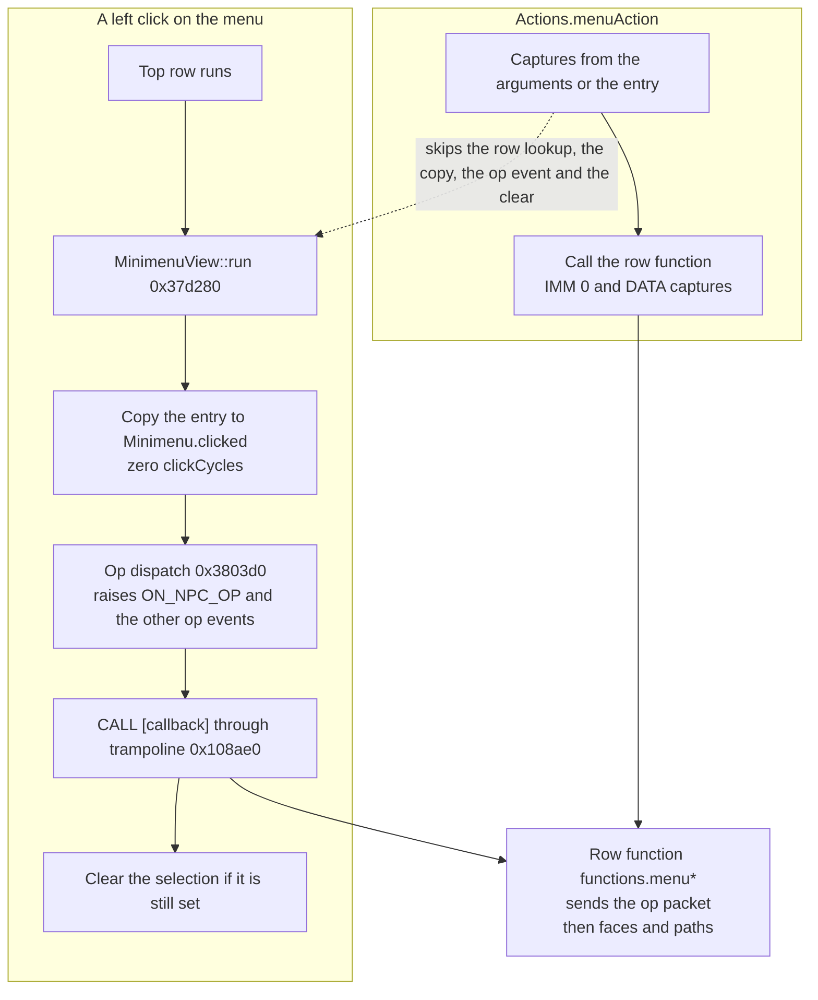
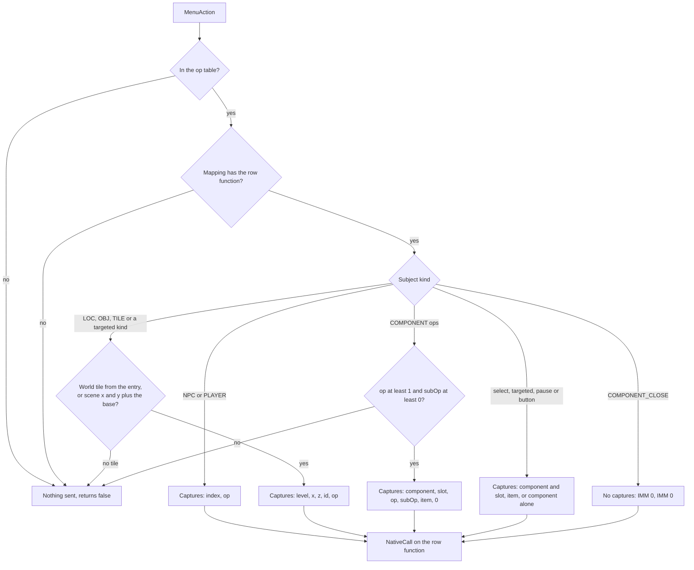
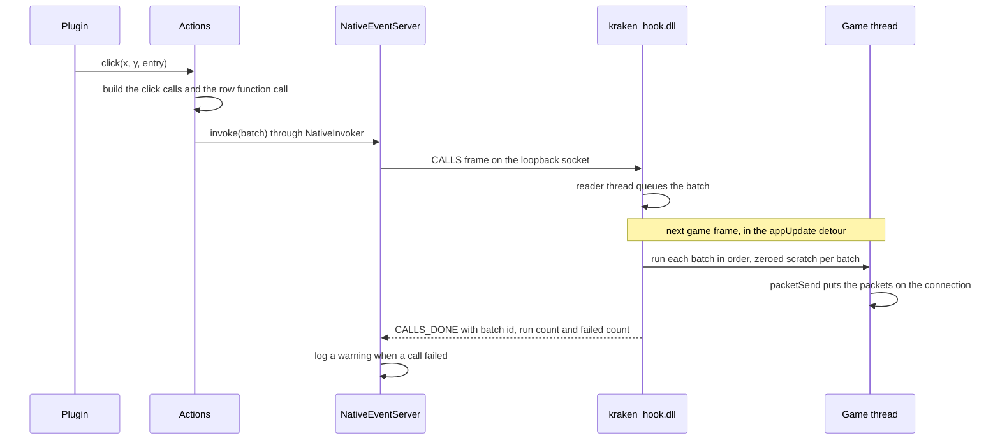
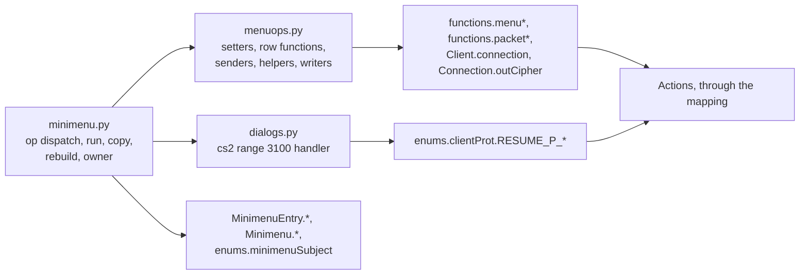

# Menu Actions

A menu action runs one row of the right-click menu without the menu being open. `Actions` fills in the arguments the
row would have captured, and the native hook calls the client's own row function on the game thread, so the packets
and the walking or facing that follow are the client's. This page covers the minimenu and its rows, the row functions
and what each one sends, the packet helpers behind the mouse click and the dialog answers, the Java side, the path
from a call to the game thread, the updater recipes that find all of it, and the Action Tester.

Plugin authors start with [Interacting](../api.md#interacting), [Menu Actions](../api.md#menu-actions) and the
[Action Tester](../plugins.md#action-tester). The interaction methods are a layer above `Actions`; see
[The Layer Above: Interactions](#the-layer-above-interactions).
New to x64 or the native hook? The [walkthrough](menu-action-walkthrough.md) follows one action end to end first.



## Key Files

| Path | Role |
|---|---|
| [`Actions`](../../api/src/main/java/com/kraken/api/action/Actions.java) | Builds the calls for each action, the mouse click and the dialog answers |
| [`Interactions`](../../api/src/main/java/com/kraken/api/internal/action/Interactions.java) | The rules behind `interact`, `click` and `useOn`: options, rows, `GONE` checks, the click policy |
| [`NativeCall`](../../api/src/main/java/com/kraken/api/internal/invoke/NativeCall.java) | One call: the function's RVA, its arguments by kind, and a data block |
| [`NativeInvoker`](../../api/src/main/java/com/kraken/api/internal/invoke/NativeInvoker.java) | The sender a connection gives the API to send a batch |
| [`MenuAction`](../../api/src/main/java/com/kraken/api/MenuAction.java) | What an entry does when it runs |
| [`MenuEntry`](../../api/src/main/java/com/kraken/api/MenuEntry.java) | A snapshot of one minimenu row |
| [`MenuReader`](../../api/src/main/java/com/kraken/api/internal/reader/MenuReader.java) | Reads the rows, the open flag and the copy of the last run |
| [`Client`](../../api/src/main/java/com/kraken/api/Client.java) | `getMenuEntries`, `isMenuOpen`, `getActions` and `menuAction` |
| [`GameSession`](../../api/src/main/java/com/kraken/api/GameSession.java) | `setNativeInvoker` hands the connection to `Actions` |
| [`NativeEventServer`](../../client/src/main/java/com/kraken/client/callback/NativeEventServer.java) | `sendCalls` writes a batch; `status` logs `CALLS_DONE` |
| [`NativeProtocol`](../../client/src/main/java/com/kraken/client/callback/NativeProtocol.java) | Frames a batch of calls |
| [`calls.cpp`](../../client/src/main/native/kraken_hook/src/calls.cpp) | The DLL's call queue, argument resolution, guarded calls and `CALLS_DONE` |
| [`pump.cpp`](../../client/src/main/native/kraken_hook/src/pump.cpp) | The per-frame detour that runs the queue |
| [`minimenu.py`](../../updater/src/native_updater/minimenu.py) | Finds the minimenu's owner, view, entry layout, op dispatch, run and rebuild |
| [`menuops.py`](../../updater/src/native_updater/menuops.py) | Finds the row functions, senders, packet helpers, writers and selection getter |
| [`dialogs.py`](../../updater/src/native_updater/dialogs.py) | Finds the four dialog packets in the cs2 range handler |
| [`56-minimenu.yaml`](../../updater/src/native_updater/spec/56-minimenu.yaml) | Minimenu keys and their fingerprints |
| [`62-menu-actions.yaml`](../../updater/src/native_updater/spec/62-menu-actions.yaml) | Row function, helper and opcode keys |
| [`63-dialog-packets.yaml`](../../updater/src/native_updater/spec/63-dialog-packets.yaml) | Dialog opcode keys |
| [`ActionTesterPlugin`](../../client/src/main/java/com/kraken/client/plugins/actiontester/ActionTesterPlugin.java) | The Action Tester: runs one test per Run press |

## What a Click Does

The minimenu is one object, reached through the `Client` field `Client.minimenu` (`0x4133f0` in 241.3). The object
holds a view of the rows the menu shows and the copy of the last entry the client ran. While the menu is closed, the
client rebuilds the view every cycle from what the mouse is over, and raises `ON_MINIMENU_REBUILD` when it does. While
the menu is open, the view stays as it was opened. The top row is the one a left click runs.

RVA means relative virtual address: an offset from the start of the loaded `osclient.exe` image. The 241.3 program
database has the image at `0x140000000`, so the address of an RVA is that base plus the RVA. Function addresses on this
page are RVAs.

### The Rows and Their Callbacks

Every row has three parts: a node, an entry and a callback. The node points at a list that holds the entries and the
callbacks side by side, and both are indexed by the node's index.

| Part | 241.3 offsets | Holds |
|---|---|---|
| Owner `Minimenu` | `Minimenu.view` `+0x140`, `Minimenu.open` `+0x7c0`, selection `+0x7d0` | The view, the open pointer (non-null while a menu is open) and the selected item or spell |
| View rows | `Minimenu.rows` `0x280` (view `+0x140`) | A vector of 24-byte nodes, top row first |
| Node | `container.minimenu.node.*`, 24 bytes | `{list, index, children}`: the list is null for a submenu group; children are the group's nodes or a component op's sub-menu rows |
| List | `+0`: callbacks, `+0x18`: entries | The callbacks vector (stride `0xa0`) and the entries vector (stride `MinimenuEntry.size`, `0x150`) |
| Entry | `MinimenuEntry.*` | Option and target text, type id, subject index, op index, world tile, subject kind |

A callback is a 0xa0-byte object. Its first qword is a function pointer, the trampoline at `0x108ae0`, which `run`
calls. A trampoline is a short stub that moves its arguments into place and jumps to the real function. The object the
trampoline gets starts at `+0x10` of the callback:

```text
callback (0xa0 bytes, index n in the list's callbacks vector)
  +0x00  trampoline pointer 0x108ae0, the function MinimenuView::run calls
  +0x10  object X, passed in RCX
           X+0x00  captures pointer: the struct the row's builder saved
           X+0x08  context: first argument of the row function
           X+0x10  row function pointer
```

The row's builder fills in the captures (for an NPC row, `{index, op, flag}`) and the function pointer when it adds the
row. The trampoline calls the row function with the context as its first argument and the captures as its second.

### MinimenuView::run

`MinimenuView::run` (`0x37d280`) is what a left click calls. In order, it:

1. Reads the selection through the getter `0x83c70`, which returns the owner plus `0x7d0`, and records its serial.
2. Looks the path up in the view's rows (`0x38de80`), then descends into submenu groups' children until it reaches a
   node that has a list.
3. Computes the entry as `[list + 0x18] + index * 0x150` and copies it into `Minimenu.clicked` (copy at `0x37d090`).
   The copy also zeroes `Minimenu.clickCycles`, which counts the client cycles since an entry last ran.
4. Calls the op dispatch (`0x3803d0`), which switches on the entry's subject kind and raises that kind's op event:
   `ON_NPC_OP`, `ON_LOC_OP`, `ON_TILE_OP`, `ON_OBJ_OP`, `ON_PLAYER_OP` or `ON_COMPONENT_OP`.
5. Calls the callback through its trampoline, which runs the row function.
6. Clears the selection (`0x372af0`) if the selection flag is still set and the serial hasn't changed during the run.

Steps 3 and 4 tell the rest of the client what ran, and step 6 clears the selection. Step 5 is what sends the packets.

### Why the API Calls the Row Functions

The row functions do everything a click does to the game after the op event: the op packet, and the client's own
interaction (facing and pathing to the target, the destination marker of a walk). The API calls them directly with the
captures a row would hold. That needs no open menu, no row lookup and no copy of the entry.

The consequences matter for plugins and for live checks:

- Steps 3, 4 and 6 don't happen for an action sent through `Actions`. The copy isn't made, so `Minimenu.clicked` and
  `clickCycles` don't change, which means no `MenuOptionClicked` is posted. No op event is raised either, since only
  `run` calls the dispatch.
- The selection is not cleared after the action. See [Selecting an Item or Spell](#selecting-an-item-or-spell).

## The Row Functions

Each action goes to one row function. The table gives the function, its key in `functions` (the 241.3 RVA), the
captures it reads and what it sends. Captures are little-endian i32 fields. The first argument is unused, and `Actions`
passes 0 for it. The opcodes are 241.3 values, and the updater re-finds the functions for each build.

| Action | Key (241.3 RVA) | Captures | What the row function sends |
|---|---|---|---|
| `NPC_FIRST_OPTION` to `NPC_FIFTH_OPTION` | `menuNpcOp` (`0x388870`) | `{index, op, flag}`, 12 bytes | Looks the NPC up by index, then the NPC op packet for op 1 to 5. A stale index sends nothing. |
| `GAME_OBJECT_FIRST_OPTION` to `GAME_OBJECT_FIFTH_OPTION` | `menuLocOp` (`0x387cd0`) | `{level, x, z, locId, op, flag}`, 24 bytes | The op packet for op 1 to 5 on the loc with that id at the tile. |
| `GROUND_ITEM_FIRST_OPTION` to `GROUND_ITEM_FIFTH_OPTION` | `menuObjOp` (`0x3893d0`) | `{level, x, z, objId, count, op, flag}`, 28 bytes | The op packet for op 1 to 5 on the item with that id at the tile. The API always sends `count` as 0. |
| `PLAYER_FIRST_OPTION` to `PLAYER_EIGHTH_OPTION` | `menuPlayerOp` (`0x38a0f0`) | `{index, op}`, 8 bytes | Looks the player up by index, then the op packet for op 1 to 8. |
| `WALK` | `menuWalk` (`0x387610`, a jump to `0x387620`) | `{level, x, z}`, 12 bytes | Skips the tile when it equals the last walk target (three globals at `0x155e590`). Otherwise the walk packet (opcode `0x37`) and the destination marker. |
| `WIDGET_TARGET_ON_NPC` | `menuNpcTargetOp` (`0x388630`) | `{index}`, 4 bytes | Reads the selection, then the targeted NPC packet (`0x3e`). |
| `WIDGET_TARGET_ON_GAME_OBJECT` | `menuLocTargetOp` (`0x387b30`) | `{level, x, z, locId}`, 16 bytes | Reads the selection, then the targeted loc packet (`0x08`). |
| `WIDGET_TARGET_ON_GROUND_ITEM` | `menuObjTargetOp` (`0x389240`) | `{level, x, z, objId}`, 16 bytes | Reads the selection, then the targeted item packet (`0x5e`). |
| `WIDGET_TARGET_ON_PLAYER` | `menuPlayerTargetOp` (`0x389ef0`) | `{index}`, 4 bytes | Reads the selection, then the targeted player packet (`0x3d`). |
| `CC_OP`, `CC_OP_LOW_PRIORITY` | `menuComponentOp` (`0x38d360`) | `{component, slot, op, subOp, objId, flag}`, 24 bytes | Looks the component up and checks the op is enabled. Sends the component op packet: `0x26` for the op itself, `0x42` for a sub-option. |
| `WIDGET_TARGET_ON_WIDGET` | `menuComponentTargetOp` (`0x38cf70`) | `{component, slot, objId}`, 12 bytes | Reads the selection, then the 16-byte targeted component packet (`0x0f`). |
| `WIDGET_TARGET` | `menuComponentSelect` (`0x38c810`) | `{component, slot, objId}`, 12 bytes | Stores the selection and the "Use X ->" text. Sends nothing. |
| `WIDGET_CONTINUE` | `menuComponentPause` (`0x38ce20`, tail-jumps to `0x38ce50`) | `{component, slot}`, 8 bytes | The pause packet (`0x10`, six bytes) while no answer is pending. |
| `WIDGET_TYPE_1` | `menuComponentButton` (`0x38c730`) | `{component}`, 4 bytes | The button packet (`0x4e`) with the packed id. Stores nothing after. |
| `WIDGET_TYPE_4` | `menuComponentToggle` (`0x38cc10`) | `{component}`, 4 bytes | Packet `0x4e`, then stores `1 - value` into the var the component's first op names. |
| `WIDGET_TYPE_5` | `menuComponentSet` (`0x38cd10`) | `{component}`, 4 bytes | Packet `0x4e`, then stores the component's own value into that var. |
| `WIDGET_CLOSE` | `menuComponentClose` (`0x38cc00`, tail-jumps to `0x84e40`) | none | Tail-jumps to the client's close function, which sends the size-0 close packet (`0x29`) and closes the modal interface. |

A tail jump ends a function with a jump rather than a call, so the callee returns straight to the original caller with
the same arguments. The close and pause rows use it.

The NPC, loc, item and player senders each create one packet per op: 5, 5, 5 and 8 creates in 241.3. An op value
outside that range has no create, which is why Examine sends nothing (per the RE notes). The NPC, loc, item and player
rows look their subject up first: an NPC or player by index, a loc or item by its id at the world tile.

### How Actions Picks a Row Function



`Actions.actionCall` builds the captures. The subject kinds are the private `Subject` enum, which holds each kind's
function key and capture size. The op number is the action's position in its subject: `NPC_SECOND_OPTION` is op 2.

## Selecting an Item or Spell

Using an item on something, and casting a spell, are two steps in the client. The first step selects the item or spell;
the second clicks the target.

1. The select row (`menuComponentSelect`) stores the selection at `Minimenu + 0x7d0`: the component, its slot and its
   item. The store (`0x372870`) sets the flag at `+0x9f`, bumps the u16 serial at `+0x9c` and records the "Use X ->"
   text (per the RE notes). The select row sends nothing.
2. A targeted row function reads the selection through the getter `0x83c70` and builds its packet from the selection's
   component, slot and item. The NPC, loc, item and player targeted functions send the targeted packets listed above;
   the component targeted function sends the 16-byte component packet.

`Actions.useItemOn` and `useItemOnItem` run the select call and then the targeted call in one batch. A spell's select
call passes slot `-1` and item `-1`, since the spellbook row selects the spell's component alone. `castSpellOn` is the
same with the spell's component. The `ActionsTest` cases check these batches call by call.

The selection is not cleared after the batch. In the client, `run` clears it (step 6 above), and the menu reset at
`0x18f2d0` clears it too. The targeted functions don't call the clear (`0x372af0`), and `Actions` doesn't call `run`.
So as far as the static read goes, the selection stays set after `useItemOn` or `castSpellOn`. Whether the menu keeps
showing the "Use X ->" rows until the next click is a [live check](#known-gaps-and-live-checks).

## The Mouse Clicks

A real click sends two packets. The client queues two input events for one click, and each fills its own pending
click in the input listener: the first holds the position, the right button flag and the event's time, the second the
position, the time, a button code and a flag. In the same cycle the network step sends `EVENT_MOUSE_CLICK` (opcode 7
in 241.3) from the first, then `EVENT_MOUSE_CLICK_V2` (opcode 27) from the second, each with the milliseconds since
its own previous click, capped at 32767. A read-only probe of a live 243.1 client saw both sent for every click, with
the second click's event 5 to 23 ms earlier than the first's.

| Packet | Bytes | Body |
|---|---|---|
| `EVENT_MOUSE_CLICK` | 6 | Three shorts through `packetWriteShort`: `(delay << 1) \| right button`, the canvas x, the canvas y |
| `EVENT_MOUSE_CLICK_V2` | 7 | Stored inline: x and y as shorts, the button byte `(flag & 1) \| (button << 1)`, `delay << 1` as a short |

The second packet's byte order and byte transforms change between builds, so the mapping carries them. Its source
bytes are `X_LOW`, `X_HIGH`, `Y_LOW`, `Y_HIGH`, `BUTTONS`, `DELAY_LOW` and `DELAY_HIGH`; `enums.mouseClickV2` gives
each one's index in the packet, and `enums.mouseClickV2Transform` what the client does to it: 0 as is, 1 plus 128, 2
negated, 3 subtracted from 128, all modulo 256.

| Build | Opcode | The seven bytes in order |
|---|---|---|
| 241.3, 241.4 | 27 | y low + 128, y high, x low + 128, x high, delay high, delay low + 128, buttons negated |
| 242.1, 242.3 | 77 | buttons negated, delay low + 128, delay high, y low, y high, x low + 128, x high |
| 243.1 | 17 | x low, x high, y high, y low + 128, buttons + 128, delay high, delay low + 128 |

`Actions.mouseClick` sends both packets through the client's helpers: the first with create, three short writes, send
and release; the second with create, seven byte writes (`packetWriteByte`) in the mapping's order, send and release.
`Actions.click(x, y, ...)` puts the sixteen click calls in the same batch as the action, ahead of it, so both packets
are written and sent before the row function runs. A mapping without the second packet's opcode or layout sends no
click at all, which `isMouseClickSupported()` reports, rather than half of one. Details of the Java side:

- Both packets carry the same delay, which counts only the clicks `Actions` sent. A first click reports 32767.
- The second packet's button is 1 for the left button and 4 for the right, and its flag is 0, as real clicks on a
  live 243.1 client carried them. The button looks like a mask of the buttons held. The client's movement handler
  writes the same field, and a real left click sometimes went out with 0, probably when a movement was processed after
  it in the same cycle. `Actions` sends no movement, so it always sends 1.
- The canvas coordinates are masked to 16 bits without a range check.

## Packet Helpers

The row functions and the client's scripts build packets with a small set of helpers. The updater reads them from the
senders. `Actions` calls the same helpers with its own arguments.

| Helper | Key (241.3 RVA) | Call in a batch |
|---|---|---|
| Create | `packetCreate` (`0x6795c0`) | `(SCRATCH 0, IMM opcode, INDIRECT Client.connection + Connection.outCipher)` |
| Write byte, short, int | `packetWriteByte` (`0x45b30`), `packetWriteShort` (`0x45c20`), `packetWriteInt` (`0x45b50`) | `(SCRATCH 8, IMM value)` |
| Write string | `packetWriteString` (`0x3eb20`) | `(SCRATCH 8, DATA utf8, IMM length, IMM 0)`. The last argument is "versioned", 0 in every packet. |
| Send | `packetSend` (`0x202600`) | `(INDIRECT Client.connection + 0, SCRATCH 0)` |
| Release | `packetRelease` (`0x679720`) | `(SCRATCH 8)` |

`Client.connection` is at `0x31a0` and `Connection.outCipher` at `0xa08` (241.3). A packet is one message the client
sends the server, and its opcode is the number that names the message. The create helper encodes the opcode with the
connection's outgoing ISAAC cipher, which is why the create call needs the connection.

Each batch has its own zeroed 4096-byte scratch block. A packet lives at scratch offset 0, and its buffer, which the
writers append to, at offset 8. Each packet is released in the same batch after it is sent, so the next packet can
reuse the scratch.

A mouse click is sixteen calls: six for the first packet and ten for the second. A click with an action adds the
action's calls. A count or item dialog answer is four calls
(create, one writer, send, release), and a text answer is five (create, the size byte, the string, send, release).

## Dialog Answers

The server asks the player for an amount, a name, a text or an item with a dialog. The cs2 runtime (the client's script
interpreter) answers it with one of four packets. `Actions` builds the same packets.

| Method | cs2 op | Packet (241.3 opcode) | Body |
|---|---|---|---|
| `resumeCountDialog(int)` | 3104 | `RESUME_P_COUNTDIALOG` (68) | `packetWriteInt(count)` |
| `resumeNameDialog(String)` | 3105 | `RESUME_P_NAMEDIALOG` (33) | `packetWriteByte(characters + 1)`, then the string |
| `resumeStringDialog(String)` | 3106 | `RESUME_P_STRINGDIALOG` (58) | Same as the name dialog |
| `resumeObjDialog(int)` | 3115 | `RESUME_P_OBJDIALOG` (3) | `packetWriteShort(item & 0xffff)` |

A text answer holds at most 254 code points, so the size byte (characters plus the terminator) fits in one byte. A
character above U+FFFF is refused. The code doesn't give a reason for the limit, and it isn't checked against the
string writer. The string writer transcodes the UTF-8 into the game's code page and appends a zero.

The updater finds the four opcodes in the cs2 handler for the 3100 op range. `dialogs.py` finds the one function that
subtracts 3100 and jumps through a case table. From each case's entry it follows the control flow to the one
`packetCreate` with a stack packet, and checks that the only buffer write is the expected writer. The text cases write
the size byte with `packetWriteByte` and copy the characters inline, so the check requires that byte writer to be the
only buffer write. `Actions` writes the characters with `packetWriteString` instead. For ASCII text the two should give
the same bytes, which isn't checked here. Non-ASCII text is a [live check](#known-gaps-and-live-checks).

`Actions` doesn't check that the server has asked a dialog. A call sends the packet whether or not a dialog is open.

## Sub-Options

An op can open a sub-menu, such as a bank's withdraw amounts or an item's drop amounts. The op's row builder
(`0x38bfe0`) adds the op's row, then one row per name in the op's sub-option list when the op is below
`IfType.subOpCount` (`0x2f8`). The names are in `IfType.subOpNames` (`0x300`), an array of string vectors indexed by
the 0-based op. Each sub-option row carries `subOp` = index + 1.

The op row function picks the packet by the sub-option: opcode `0x26` for `subOp` 0 and `0x42` for any other value.
That is the `LEA EDX,[RDI + 0x26]` and the `TEST EDI,EDI` branch in the 241.3 sender. The sub-option is part of the
`0x42` packet. The RE notes give it as `subOp - 1` in one byte; that isn't re-verified here.

In the minimenu, the sub-option rows are children of the op's node. Each child's entry holds the sub-option index as
its op index. `MenuReader` reads each as an entry of the op with `subOp` set, placed right after the op's own row. In
the Java API, `subOp` is 1-based, and 0 means the op itself. A negative value is refused.

## Old-Style Buttons, Pause and Close

The button builder (`0x38b5c0`) chooses the row function by the component's button type, which is `IfType.event`:

| Type (`IfType.event`) | Row function | Action |
|---|---|---|
| 1 | `menuComponentButton` | `WIDGET_TYPE_1`, a plain button |
| 2 | `menuComponentSelect` | `WIDGET_TARGET`, the select row |
| 3 | `menuComponentClose` | `WIDGET_CLOSE` |
| 4 | `menuComponentToggle` | `WIDGET_TYPE_4`, a toggle |
| 5 | `menuComponentSet` | `WIDGET_TYPE_5`, a set |
| 6 | `menuComponentPause` | `WIDGET_CONTINUE`, click to continue |

The plain, toggle and set buttons send `0x4e` with the packed id. The toggle and set then store into a var, as the
table above says. The close row tail-jumps to the client's close function (`0x84e40`), which sends `CLOSE_MODAL`
(`0x29`, size zero). The pause row sends `0x10`, a six-byte packet of component and slot, while no answer is pending.

`Actions.resumePause(component, slot)` calls the pause row. `Actions.closeInterface()` calls the close row with two
zero immediates. The close row reads no captures.

## What Is Not Supported

| Entry or action | Why it is not sent |
|---|---|
| `EXAMINE_OBJECT`, `EXAMINE_NPC`, `EXAMINE_ITEM_GROUND` | No row function is mapped. Examine is an op value the senders don't build a packet for. |
| `CANCEL` | No row function is mapped. |
| The minimap walk | It isn't a row. The minimap click handler (`0xef460`) calls `packetCreate` with opcode `0x1c`, stores the four coordinate bytes inline, then sends and releases the packet. It takes a minimap pixel, not a tile, and no row function sends it. |
| World entity and set-heading actions, RuneLite's own menus | Not `MenuAction` values. `MenuAction` documents why. |
| Entries of a subject kind the mapping doesn't name | Kind 9 has its own setter (`0x3802d0`), but the dispatch's jump table doesn't map it to an op event. `MenuReader` reads these entries as `UNKNOWN`. |

## The Java Side

### Actions

`Actions` is the one entry point. `Client.getActions()` returns it, and `GameSession.setNativeInvoker` gives it the
hook's connection.

| Method | Calls in the batch |
|---|---|
| `mouseClick(x, y, right)` | The sixteen click calls |
| `walk(WorldPoint)`, `walk(x, y, plane)` | `menuWalk` with `{level, x, z}` |
| `menuAction(MenuEntry)` | The row function for the entry (see the next table) |
| `menuAction(param0, param1, action, identifier[, itemId[, subOp]])` | The row function for the action |
| `click(x, y, MenuEntry)` and the `click(x, y, ...)` overloads | The click, then the row function |
| `useItemOnItem(component, slot, item, targetSlot, targetItem)` | Select, then `menuComponentTargetOp` |
| `useItemOn(component, slot, item, MenuEntry)` and the parameter overload | Select, then the subject's targeted row function |
| `castSpellOn(spellComponent, MenuEntry)` and the parameter overload | Select with slot and item `-1`, then the targeted row function |
| `closeInterface()` | `menuComponentClose` with two zero immediates |
| `resumePause(component, slot)` | `menuComponentPause` |
| `resumeCountDialog(int)` | Create, `packetWriteInt`, send, release |
| `resumeNameDialog(String)`, `resumeStringDialog(String)` | Create, `packetWriteByte`, `packetWriteString`, send, release |
| `resumeObjDialog(int)` | Create, `packetWriteShort`, send, release |

A subject's targeted action is the one the menu shows while an item or spell is selected (`WIDGET_TARGET_ON_*`).
`useItemOn` and `castSpellOn` accept a plain entry of the subject and take its targeted action.

The entry overloads take the entry's fields as the reader made them:

| Entry kind | `param0`, `param1` | `identifier` | Captures |
|---|---|---|---|
| NPC or player op | 0, 0 | index | `{index, op}` (NPC adds a flag) |
| Loc or ground item op | scene x, scene y | id | From the entry's world tile when it has one, else scene x and y plus the map base on the top-level plane |
| Walk here | scene x, scene y | 0 | From the tile, as above |
| Component op (`CC_OP`, `CC_OP_LOW_PRIORITY`) | slot or -1, packed id | op 1 to 10 | `{component, slot, op, subOp, item, 0}`, with the item read from the widget when `itemId` is -1 |
| Targeted on a component | slot or -1, packed id | 0 | `{component, slot, item}` |
| Old-style button (types 1, 4, 5) | sub id, packed id | 0 | `{component}`, the packed id |
| Close | sub id, packed id | 0 | None |

`MenuEntry.getItemId()` reads the item from the entry's widget at call time, and returns -1 for an entry on no
component.

The methods that send are `synchronized` on the `Actions` instance, and so is `setInvoker`. The lock covers the send
too, so `setInvoker(null)` on a disconnect waits for a send in progress.

### Validation and Return Values

A method returns `false` and sends nothing when any of these holds:

- No connection: `isAvailable()` is false. Nothing is queued for later.
- The action isn't in the op table, or its row function isn't in the mapping.
- A loc, item or walk has no world tile. `sceneToWorld` returns null while the map base can't be read.
- A component op has an identifier below 1, or a sub-option below 0.
- The mapping lacks the packet helpers, the writer or the opcode a packet needs.
- A dialog text is longer than 254 code points or has a code point above U+FFFF.

`isSupported(action)` says whether the mapping has the row function for an action. `isMouseClickSupported()` and
`isDialogSupported()` say the same for both click packets and the four dialog answers.

A `true` return means the batch was handed to the connection. It doesn't mean the game ran the calls. `NativeInvoker`
returns once the batch is sent. A send that throws a `RuntimeException` is logged once per connection with
`Could not send an action to the native hook`, and the method returns `false`.

### Client.menuAction

`Client.menuAction(p0, p1, action, id, itemId, option, target)` passes its first five arguments to
`Actions.menuAction`. `option` and `target` are unused, since a native entry carries neither.

### The Layer Above: Interactions

The interaction methods (`npc.interact("Attack")`, `widget.useOn(npc)` and the services such as `Inventory` and
`Magic`; see [Interacting](../api.md#interacting)) never build a call themselves. They work out a row's arguments and
hand them to two internal entry points of `Actions`, which build the calls as above and return an `ActionResult`
rather than a `boolean`:

| Entry point | Batch |
|---|---|
| `run(ActionRequest)` | The click calls when the request names a click point, then the row function |
| `useOn(ActionRequest source, ActionRequest target)` | The source's click and the select, then the target's click and its targeted row function |

`ActionRequest` is a record of one row: the `MenuAction`, `param0`, `param1`, the identifier, the item, the
sub-option, the world tile and the click point. `run` returns `UNSUPPORTED` when the mapping lacks the row function or
the arguments can't be built, and `NOT_CONNECTED` without a connection or when the send throws.

The rules live in one internal class, [`Interactions`](../../api/src/main/java/com/kraken/api/internal/action/Interactions.java),
one per `Client` (`client.getInteractions()`); the entity methods are one-line calls into it.

| Subject | Options matched against | Row | Arguments | `GONE` when |
|---|---|---|---|---|
| `NPC` | The shown (transformed) type's actions, else the base type's | `NPC_*_OPTION` | identifier = index | Its address reads 0, or its transform shows no NPC |
| `Player` | `Client.getPlayerOptions()` | `PLAYER_*_OPTION` | identifier = index | Its address reads 0 |
| `TileObject` | The impostor's actions (`ObjectComposition.getImpostor()`) | `GAME_OBJECT_*_OPTION` | identifier = the base id; tile = the tile it was placed on, on its own plane | Its tile no longer holds the same loc, or the impostor shows nothing |
| `TileItem` | The item's ground actions | `GROUND_ITEM_*_OPTION` | identifier = item id; tile = its tile | Its tile's pile no longer holds the item |
| `Widget` | Its ops; for an item slot with none, Use then the item's inventory actions | `CC_OP` | param0 = slot, param1 = packed id, identifier = op, item, sub-option | `WidgetReader.lookup(id, slot)` finds nothing, or the slot holds another item |
| `Widget.click()` with no named op | | `WIDGET_CONTINUE` for a pause button (button type 6 or the click mask's pause bit), else `WIDGET_TYPE_1/4/5` or `WIDGET_CLOSE` by button type | param0 = slot, param1 = packed id | As above |

[`OptionMatcher`](../../api/src/main/java/com/kraken/api/internal/action/OptionMatcher.java) turns text into an op:
markup removed (the `<lt>` and `<gt>` escapes kept as brackets), case ignored, runs of spaces, `-` and `_` counted as
one; the first match in op order wins; empty and "null" slots never match. A number must be in range and, when the
options can be read, name a non-empty slot.

`useOn` checks the source's target mask (bits 11-16 of `Widget.getClickMask()`, named by `WidgetConfig`) for the
target's kind, and for a widget target that the target takes selections (`WIDGET_USE_TARGET`), as the client's menu
does before it builds a targeted row. A spellbook component is a static widget with no item, so it selects with slot
and item -1, which is what the spellbook's own row selects.

The click point comes from the policy (`ClickPolicy`): `ON_SCREEN` asks
[`ClickPoints`](../../api/src/main/java/com/kraken/api/internal/action/ClickPoints.java) for the subject's canvas point
(100 units above an actor's tile, a loc's centre, a tile's centre, a widget's centre) and falls back to the static
point when it is off the canvas; `STATIC` always uses the static point; `NONE` sends no click. The point is worked out
only under `ON_SCREEN`, since a projection costs reads.

[`Toggle`](../../api/src/main/java/com/kraken/api/internal/action/Toggle.java) backs the setters that flip a var-kept
state (run, prayers, quick prayers): it remembers the state it last sent and takes it as the state until the var
changes or two ticks pass.

The services in `com.kraken.api.action` (`Movement`, `Dialogue`, `Inventory`, `Magic`, `Prayers`, `Bank`,
`Equipment`) find the widget or subject by id or name and call the entity methods; `Client` makes one of each and the
client's `SessionModule` binds them for injection. `Bank`'s Withdraw-X queues its count answer through
`Client.queueTask`, which `GameSession` points at its client thread.

## Sending the Calls



The CALLS frame is `{u32 length, u8 1, u32 batch, u16 count, calls}`. Each call is `{u64 rva, u8 argc, argc times
{u8 kind, i64 value}, u16 dataLength, data}`. The kind is the ordinal of `NativeCall.Kind`:

| Kind | Value means | DLL passes |
|---|---|---|
| 0 `IMM` | The value | The value |
| 1 `CLIENT` | Offset from the client | `Client*` plus the value. Skipped while `Client*` is null. |
| 2 `DATA` | Offset into the call's data | A pointer to the data plus the offset |
| 3 `SCRATCH` | Offset into the batch's scratch | A pointer to the scratch plus the offset (below 4096) |
| 4 `INDIRECT` | Low 32 bits: field offset in the client. High 32 bits: signed add. | The pointer read from `Client*` plus the add. Skipped while either pointer is null. |

On the DLL side:

1. The reader thread parses a CALLS command into a batch and appends it to the queue. Nothing is queued while no pump
   is hooked.
2. In the `appUpdate` detour, once per frame, the pump takes the whole queue with a try-lock. If the reader holds the
   lock, the batches wait a frame.
3. Each batch gets a fresh zeroed scratch block, 16-byte aligned. Its calls run in order. A call is skipped when its
   RVA is outside the image, its argument count is above 8, or an argument can't be resolved (a null pointer, a bad
   offset). A skipped call counts as failed.
4. Each call runs through `guardedCall`, an 8-argument call under `GUARD_BEGIN` and `GUARD_END`. Under MSVC these are
   `__try` and `__except`, so a faulting call sets `faulted` and the game goes on. Under MinGW both expand to a plain
   block, so a faulting call takes `osclient.exe` down.
5. After the batch, the pump pushes `CALLS_DONE` with `{batch, run, failed, last return value}` into the message ring.
   `NativeEventServer.status` logs a warning with the batch number and the failed count, and records the batch as done.
   The log doesn't say which call failed.

A disconnect drops the queued calls with `calls::clear`. On exit, `NativeEventServer` waits up to a second for the last
batch to be reported done, so the plugins can turn their highlights off first.

## Reading the Menu

`MenuReader` builds the rows that `Client.getMenuEntries()` returns and the copy `MenuClickTracker` reads. It reads the
view's rows, follows submenu groups to their first child, and reads each entry in one block of `MinimenuEntry.size`
bytes. It caps reads at 500 rows, 8 levels of group and 64 sub-option rows.

The reader maps the entry's subject kind, op index and type id to a `MenuAction`:

- Op index `-1`: the subject's targeted action, `WIDGET_TARGET_ON_*`.
- Op index `0x7ffffffe`: the subject's Examine action.
- Other op indices: the subject's numbered op, 1-based. An op the subject doesn't have is `UNKNOWN`.
- A component op index from 0 to 4 is `CC_OP` with identifier op + 1; from 5 to 9 it is `CC_OP_LOW_PRIORITY`.
- Any other component op index reads the widget's `IfType.event` as a button type, using the table in
  Old-Style Buttons, Pause and Close.
- A tile is `WALK`. A subject kind the reader doesn't name is `CANCEL` if its option text is "Cancel", else `UNKNOWN`.

`getMenuEntries()` returns the rows bottom row first, so the top row, the one a left click runs, is the last element.
The Action Tester reverses the array again to list top row first.

Menu events come from the same reads. `MenuTracker` posts `MenuOpened` and `MenuEntryAdded` or `MenuEntryRemoved` by
comparing the rows each poll. `MenuClickTracker` posts `MenuOptionClicked` when the copy changes or the cycle counter
goes down. Its triggers are the op events `ON_NPC_OP`, `ON_LOC_OP`, `ON_TILE_OP`, `ON_PLAYER_OP` and
`ON_COMPONENT_OP`, which the hook raises. `ON_OBJ_OP` isn't hooked, so ground item runs are seen on the poll. The event
pipeline is on [events](events.md). An action sent through `Actions` changes neither the copy nor the counter, so it
posts no `MenuOptionClicked`.

## How the Updater Finds It



### minimenu.py

It starts from the op event raisers, which the events recipe finds. The one function that calls all three of the NPC,
loc and tile raisers is the op dispatch. Each raiser's arguments give an entry field: the NPC raiser's last argument
is `subjectIndex`, the loc raiser's second is `typeId`, and the tile raiser's coord gives `level`, `x` and `z`. The
dispatch's jump table gives `subjectType` and `enums.minimenuSubject`. The compare with `-1` gives `opIndex` and
`enums.minimenuOp`. The one caller of the dispatch is `run`, which gives the entry layout, the copy into
`MinimenuView.clicked`, `clickCycles`, and the list fields. The `(level` trim function gives `MinimenuEntry.target`.
The rebuild raise gives `Minimenu.open`, `Minimenu.view` and `Client.minimenu`.

### menuops.py

It works in these steps:

1. `_builders`: the callers of each subject setter, which store a kind into `subjectType`. The NPC, loc, item and player
   builders have one caller each; the component rows come from several builders.
2. `_bodies`: every function address a builder, or a callee, takes with `lea`. Those are the row functions.
3. `_sender`: the function a body reaches that creates at least four packets with distinct opcodes. `_hands_captures`
   checks the body passes its captures to the sender field by field, in order.
4. `_packet_helpers`: `create`, `send` and `release` from the sender's calls. The create's third argument gives
   `Client.connection` and the cipher offset.
5. `_mouse_click`: in the network step, the six-byte packet created with a constant opcode and written three times by
   one function.
6. `_writers`: the buffer calls that advance the position field by one (byte), four (int), or are called with a zero
   fourth argument at least five times (string).
7. `_walk_body`: the row that compares its captures with three consecutive globals, the last walk target.
8. `_selection_getter`: a short function that calls a function loading `Client.minimenu`, called from the targeted
   bodies of at least two kinds.
9. `_component_bodies` and `_button_key`: each component row by what it does, and the buttons by the var they store.
10. `_sub_ops`: `IfType.subOpCount` and `IfType.subOpNames`, from the component op row builder.

### dialogs.py

`_range_handler` finds the function that adds `-3100` to the op and compares the result with a case count before a
table jump. `_reach` follows each case's control flow without entering another case. Each case must create one packet
and write it with exactly the expected writer.

### clicks.py

The second click packet is the network step's first packet created after the six-byte click. It must have a constant
opcode, seven bytes in the packet size table, and a gate: a 4-byte client field compared with `-1` between the first
packet's send and its create (the pending click's x). Its bytes are stored inline, so the recipe runs the stretch from
the gate's first read to the send through `analysis/emulate.py`, a small concrete x86 interpreter, sixteen times with
random clicks. The run gives the pending x, y and time, the previous click's time (every other client qword), random
bytes for every other client read (the button and the flag) and a canvas larger than any click (every read through
another pointer). `_fit` then matches each stored byte to exactly one source byte and transform that hold in every
run, and requires each source byte once. A last run gives a click beyond the canvas, so the clamps return canvas
fields: the gated field must come back clamped by a canvas field before the one that clamps the next field (the width
before the height), or the build is refused rather than mapped with x and y swapped. The emulator stops, and the
recipe refuses the build, on anything it can't execute faithfully: an unknown instruction, a call other than the
create, a branch out of the stretch, a condition on a flag left undefined, or a read of memory stored only in part.
The note on `enums.mouseClickV2` names the button and flag fields.

Each recipe writes a note to the analysis when it can't find something, such as `menu ops: 2 NPC row bodies look like
the op sender` or `dialogs: op 3105 writes its packet with ...`. Those notes are in the `notes` list of
`~/.kraken-native/cache/<sha256>/analysis.json`, along with the evidence for each key. The golden corpus
(`updater/corpus/241.3.golden.json`) pins 62 keys in this area: the minimenu, the row functions, the packet helpers,
the dialog opcodes and the second click packet.

To fix a recipe, read the note, then the evidence for the key, then the function it names. If a new row kind appears,
add it to `KINDS` or `TARGET_KINDS` in `menuops.py` and to the matching `Subject` in `Actions` together, since the
captures must agree.

## Safety

The Java side and the DLL check these before anything is sent:

- Unmapped actions, missing helpers and a missing world tile send nothing (see Validation and Return Values).
- A stale NPC or player index is handled by the row function, which looks the actor up and sends nothing when it's gone.
- A null `Client*` or a null pointer read through `INDIRECT` skips the call. A bad offset into the data or the scratch
  skips it too.
- A faulting call is caught under MSVC and reported in `CALLS_DONE`.

The API doesn't check these, and the server sees them as they come:

- The NPC or loc still exists, or a dialog is open.
- A walk tile is in the loaded scene. The Action Tester checks this for its own walk; `Actions.walk` doesn't.
- The op number and sub-option are within the range the component has. Only the lower bounds are checked.
- The canvas coordinates of a click fall on the canvas.

The row functions send the packets the client's own rows send, so the server gets the same packet for the same row.
The mouse clicks and the dialog answers are built by the API from the client's helpers and opcodes. The API decides
when they go out, not their contents beyond the arguments it passes.

## Testing

- [`ActionsTest`](../../api/src/test/java/com/kraken/api/action/ActionsTest.java) uses a `GameFixture` and a fake invoker
  that records the batches. It checks the exact calls for each kind of action: both click packets' sixteen calls,
  the second packet's bytes in the seed build's layout and in others, the shared delay, no click without the layout,
  NPC and player ops, loc and item ops from an entry and from parameters, walk, component ops and
  sub-options, the old-style buttons and close, select and targeted batches for items and spells, the pause row, the
  four dialog answers and the text limits, click then action, the refusals (unsupported actions, no connection) and
  that `Client.menuAction` passes its arguments on.
- [`InteractionsTest`](../../api/src/test/java/com/kraken/api/internal/action/InteractionsTest.java) checks that each
  interaction sends the batch the matching `Actions` call sends (recorded with a second client over the same fixture),
  so it holds across builds; then each `ActionResult` per kind of subject, the target mask, and the click policies.
  [`OptionMatcherTest`](../../api/src/test/java/com/kraken/api/internal/action/OptionMatcherTest.java) and
  [`ToggleTest`](../../api/src/test/java/com/kraken/api/internal/action/ToggleTest.java) cover the matching and the
  tick lag; each service has its own test in `api/src/test/java/com/kraken/api/action/`.
- [`MenuTest`](../../api/src/test/java/com/kraken/api/MenuTest.java) reads the rows of a fixture menu: bottom first, NPC
  and player entries, loc, item and walk tiles, component ops, sub-menu rows, submenu groups, the open flag and entry
  equality.
- [`MenuEventsTest`](../../api/src/test/java/com/kraken/api/internal/MenuEventsTest.java) covers the menu events.
- [`SubjectsTest`](../../client/src/test/java/com/kraken/client/plugins/actiontester/SubjectsTest.java) covers the Action
  Tester's lookups: component op kinds, first op, menu entries by row or text, and markup removal.
- The updater tests are [`test_menuops.py`](../../updater/tests/test_menuops.py) (row functions, helpers, writers, walk,
  component bodies, buttons, sub-option tables), [`test_dialogs.py`](../../updater/tests/test_dialogs.py) (the four
  opcodes, the handler, a wrong writer refused), [`test_clicks.py`](../../updater/tests/test_clicks.py) (the 243.1
  and 241.3 layouts, swapped registers, a gated field clamped by the height, a wrong size, an unexplained byte, a call
  in the stretch, and the emulator's register, flag and stop rules) and the `MinimenuTests` class in
  [`test_units.py`](../../updater/tests/test_units.py), which runs `_run_layout` over a miniature of the run function.
- The [Action Tester](../plugins.md#action-tester) is the live test bench. Its Run button sends one action from its
  settings page and logs what was sent in the console. The Menu group lists the current entries and their types, which
  shows which are not runnable.

## Known Gaps and Live Checks

Live checks pending, against the 241.3 client:

- The selection after `useItemOn` and `castSpellOn`. The static read says the game keeps it set. The check is whether
  the menu still shows the "Use X ->" rows after the batch, and what clears it.
- Whether an action sent through `Actions` posts no `MenuOptionClicked`, as the static read says. A plugin that expects
  one after an API action would see none.
- An NPC attack by index, a loc and a ground item at their tiles, a player by index, and a walk to a tile. The walk
  check includes walking to the same tile twice, which should send once.
- A component op on an inventory item (eat or drop) with its item id from the widget, and with a sub-option.
- The old-style buttons of each type, the close button with a modal open and with none, and the pause button.
- The four dialog answers at their prompts, including a text with non-ASCII characters, since the Java side and the cs2
  case reach the same packet by different writes.
- Both mouse click packets before an action, accepted by the server.
- `packetRelease` leaves no buffers behind after many clicks.
- Calls while logged out or on the login screen. The RE notes say the send drops the packet while the connection isn't
  up. That isn't re-verified here.

For the interaction layer (see the design's live checks):

- The inventory's op numbering when a slot has no ops of its own: Use as op 1, then the item's inventory actions.
- The tile the client's loc row captures for an object three or more tiles across: the placed tile, as the interaction
  methods send, or the centre.
- `Chatmenu.OPTIONS`: whether an option's slot is its child index, and that the title row has no pause bit.
- Withdraw-X: the count prompt answered by the follow-up task.
- The inventory panel picked while the bank, a shop or the deposit box is open.
- The values of varbit `SPELLBOOK` for the four spellbooks (0 standard, 1 ancient, 2 lunar, 3 arceuus), which every
  `Magic` cast checks first.
- A prayer book component's first op turns its prayer on and off, as `Prayers.setActive` clicks it, also while the
  prayer tab isn't the one shown.
- The bank's deposit buttons (`Bankmain.DEPOSITINV`, `DEPOSITWORN`) carry the op `Widget.click()` runs.
- The worn-items slot components (`Wornitems.SLOT<n>`) carry the worn item's id, which their op rows capture.

Known gaps in the code:

- Deadeye and Mystic Vigour share the prayer book components of Eagle Eye and Mystic Might, so `Prayer` leaves them
  out, and `Prayer` doesn't cover the Ruinous prayer book. `Prayerbook.PRAYER30` names no prayer in this build's data.

- The minimap walk and Examine aren't sent. See What Is Not Supported.
- `Actions.walk` takes any world tile, and the upper bounds of op and sub-option aren't checked.
- The Java API never calls the op dispatch, so a plugin that wants the op event for an API action has no event to read.
