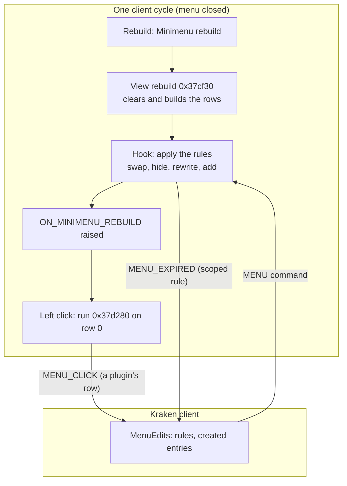

# Menu Edits

Menu edits change the right-click menu the client builds: which option is the left click, what a row says, which rows
show, and rows of a plugin's own. The client rebuilds the menu every client cycle while it is closed, and handles the
cycle's left click after the rebuild, so an edit has to be in place inside that same cycle. A round trip to Java is
too slow for that, so the native hook holds rules the Kraken client sends and applies them itself, right after each
rebuild. This page covers the client's menu, the hooks and what they do, the rule model, the Java side, the clicks and
expiries that come back, and the updater recipes that find the functions.

Plugin authors start with [Menu edits](../api.md#menu-edits) in the API guide. The wire format is in
[Native protocol](native-protocol.md#menu).

## Key Files

| Path | Role |
|---|---|
| [`menus.cpp`](../../client/src/main/native/kraken_hook/src/menus.cpp) | The three hooks, the rule engine, the rows of Kraken's own, MENU commands and MENU_CLICK/MENU_EXPIRED |
| [`protocol.h`](../../client/src/main/native/kraken_hook/src/protocol.h) | The rule, match, edit, swap and add constants |
| [`MenuEdits`](../../api/src/main/java/com/kraken/api/menu/MenuEdits.java) | Keeps the rules, compiles them, sends them, maps clicks back |
| [`MenuRule`](../../api/src/main/java/com/kraken/api/menu/MenuRule.java), [`MenuMatch`](../../api/src/main/java/com/kraken/api/menu/MenuMatch.java), [`MenuRow`](../../api/src/main/java/com/kraken/api/menu/MenuRow.java), [`TextMatch`](../../api/src/main/java/com/kraken/api/menu/TextMatch.java) | The rule model plugins use |
| [`MenuEntry`](../../api/src/main/java/com/kraken/api/MenuEntry.java), [`Menu`](../../api/src/main/java/com/kraken/api/Menu.java) | The setters, created entries and their sub-menus |
| [`WireRule`](../../api/src/main/java/com/kraken/api/internal/menu/WireRule.java), [`MenuHook`](../../api/src/main/java/com/kraken/api/internal/menu/MenuHook.java), [`MenuClick`](../../api/src/main/java/com/kraken/api/internal/menu/MenuClick.java) | What crosses from the API to the client's protocol |
| [`NativeProtocol`](../../client/src/main/java/com/kraken/client/callback/NativeProtocol.java) | The menu block of the handshake, MENU commands, MENU_CLICK parsing |
| [`menuedits.py`](../../updater/src/native_updater/menuedits.py), [`61-menu-edits.yaml`](../../updater/src/native_updater/spec/61-menu-edits.yaml) | Finds the five functions |
| [`MenuEntrySwapperPlugin`](../../client/src/main/java/com/kraken/client/plugins/menuentryswapper/MenuEntrySwapperPlugin.java) | The first plugin built on it |

## The Client's Menu

The minimenu is reached through `Client.minimenu`. Its rows (`Minimenu.rows`) are an `eastl::vector` of 24-byte
nodes `{list, index, children}`, top row first: a row's entry is `[list + 0x18] + index * MinimenuEntry.size`, and a
node with children shows them as a sub-menu when the mouse rests on it (a component op's sub-options). An entry
(0x150 bytes in 241.3) holds the option and target texts as fixed-capacity strings (a 24-byte eastl string header,
the pool pointer and overflow allocator, then the text's own buffer, 64 and 72 characters long), the subject kind,
type id, index, op index and world tile.

Five functions matter, all found by the updater ([Recipes](#recipes)):

| Function | Key | What it does | What the hook does with it |
|---|---|---|---|
| View rebuild | `functions.minimenuViewRebuild` | Clears the rows (destroying each node's children) and builds them again from the entry lists, every cycle while the menu is closed | Hooked: takes Kraken's rows out before it, applies the rules after it |
| Run | `functions.minimenuRun` | Runs the row at a path (the row index, then child indices): copies its entry into `Minimenu.clicked`, raises the op event, calls the row's callback | Hooked: a click on a row of Kraken's own is reported instead of run |
| Node destroy | `functions.minimenuNodeDestroy` | Frees a node's children vector, calling itself for theirs | Hooked: a children vector of Kraken's own is left alone; also called on the rows the hook hides |
| Node reserve | `functions.minimenuNodeReserve` | Grows a node vector's capacity with the client's allocator | Called before rows are inserted |
| Text assign | `functions.minimenuTextAssign` | Assigns a string to an entry's option or target, overflowing to the client's heap when it doesn't fit | Called to rewrite a client row's texts |

## The Rebuild Hook

`rebuildDetour` in `menus.cpp` runs on the game thread:

1. **Remove Kraken's rows.** Any node whose list is Kraken's own is taken out of the rows vector, so the client's clear
   never sees it. The node destroy hook is the safety net for any other path that clears rows.
2. **Run the client's rebuild.** The rows are now the client's own.
3. **Drain the commands** the reader thread queued (a try-lock, so a reader holding it costs one rebuild's delay).
4. **Read the rows:** each node and its entry, with the texts normalised (colour tags removed, lower-cased), and the
   sub-menu rows when any rule looks at them.
5. **Apply every rule in order** on a working order of slots (a client row, a copied sub row or a row of Kraken's own),
   reading the Shift key once with `GetAsyncKeyState`. A rule counts as *matched* when any row matches its primary
   match, shift aside; a scoped rule that goes unmatched for 25 rebuilds (about half a second) is dropped and
   reported with MENU_EXPIRED.
6. **Write the rows back:** hidden client rows are destroyed (their children through the client's own destroy),
   deprioritized rows move to the bottom above a Cancel row, the vector is grown with the node reserve if needed, and
   the nodes are written in the new order with the vector's end updated.

Rules see the rows as the client built them, before any edit, so a rule that rewrote a row's target still matches it
on the next rebuild. The order of application matters: a swap moves rows, and a later edit's `PROMOTE` sees the moved
order. `MenuEdits` keeps rules in the order they were added.

### Rows of Kraken's Own

The hook owns a list block whose entries pointer names a pool of entries, and a pool of child nodes and children
vectors. An added row is a node `{Kraken's list, slot, children vector or 0}`; its entry is filled in from a template
read off the client's last-run copy (`Minimenu.clicked`, always a valid entry): the strings are laid out in the heap
form over the entry's own buffer, as the client's constructor does, with the text cut to the buffer; the subject kind
is 0, the op index `MENU_ROW_OP` (`"NKRK"`), the type id the row id and the subject index the parent's row id. The
reader turns such an entry back into the plugin's `MenuEntry` ([`MenuReader`](../../api/src/main/java/com/kraken/api/internal/reader/MenuReader.java)).

A click on one goes through the run hook: the path names the row and, for a sub row, the child; the hook reports
`MENU_CLICK {CLICK_ROW, row id, parent id, mouse}` and returns without running anything in the client.

## Rules

A rule is one of three kinds, each with a `MenuMatch` naming the rows it is about, a shift state (any, held, not
held) and whether it is scoped (expires once nothing matches it):

| Kind | What it does |
|---|---|
| `Edit` | For each matching row: hide it, deprioritize it, promote it (swap with the top row; a sub-menu row is copied to the top), promote it within its subject (swap with the highest row on the same NPC, loc, item or component), write its option or target, report its clicks. `finalRow` keeps the row from later swaps |
| `Swap` | For each row matching the trigger, swap it with the first row matching the swapped match: below it, with the same target or on the same subject when asked, or swap the found row with the top row. A row takes one swap per rebuild |
| `Add` | Put a row of the plugin's own (with up to 32 sub rows) above, below or at the top, next to the highest matching row, once per rebuild |

A match compares any of: the subject kind, the action (which gives the kind and op index; a component op with its op
number), the type id, the index, a component's interface, the world tile, and the option and target texts (exact,
contains, prefix, suffix or glob, on the normalised text). `MenuMatch.of(entry)` is a row's identity, the subject and
op without the texts, so an edit keeps matching after its own rewrite. `inSubMenus()` matches the rows of component
ops' sub-menus instead of the top rows.

The hook keeps at most 1,024 rules, 128 top rows per menu, 64 rows of Kraken's own per menu and 96 bytes of each
text for matching.

## The Java Side

`MenuEdits` (`Client.getMenuEdits()`) keeps every rule, numbered, in order, and compiles each into a `WireRule` with
the mapping's numbers (the subject kinds from `enums.minimenuSubject`, the op index from the action, the EXAMINE and
TARGET ops from `enums.minimenuOp`). Three things make rules:

* `add(MenuRule)`: a plugin's own rule, kept until `remove`. Menu Entry Swapper builds its swaps this way.
* The entry setters: `setOption`, `setTarget`, `setDeprioritized` and `onClick` on an entry read from the client make
  (or extend) one scoped `Edit` on that row's identity. `Client.setMenuEntries` turns rows left out into hides and a
  new top row into a promote.
* `Client.createMenuEntry(idx)`: a scoped `Add` anchored to the row at `idx` (below it; `-1` is above the top row).
  The entry's texts, callback and sub-menu (`createSubMenu()`, `Menu.createMenuEntry`) are set after, so the rule is
  sent at the end of the client thread's pass.

Changes are collected and sent by `flush()`, which the poll loop calls after the tasks and after the event poll; a rule
compiled to what the hook already holds isn't sent again. `setHook` (as the connection comes up) sends every rule in a
`MENU_REPLACE`; a dropped connection makes the hook drop everything, and the next handshake brings it all back.

Clicks come back as `MenuClick`s: a row of a plugin's own runs its callback and is posted as `MenuOptionClicked` with
the created entry; a client row an `Edit` with `REPORT` claimed runs the `onClick` callback, and the click tracker
posts the run as it does for any client row. An expiry drops the rule's bookkeeping, including the rows it owned.

### Timing

An edit made from `MenuEntryAdded` is in place for the rebuild after the one that showed the row: about one client
cycle (20 ms) after the mouse reaches something. A persistent rule is in place from the first rebuild, which is why the
swapper's settings are rules rather than per-entry edits. An open menu isn't rebuilt, so an edit or a created entry
made from `MenuOpened` shows on the next menu, not the open one.

## Recipes

`menuedits.py` hangs everything off the two functions the minimenu recipe found, the rebuild (`MinimenuRebuild`, which
raises `ON_MINIMENU_REBUILD`) and the run (`MinimenuRun`):

* **View rebuild:** the rebuild's one call handed `owner + Minimenu.view`.
* **Node destroy:** among the view rebuild's callees taking `view + rows`, the one that does `LEA RCX,[node +
  children]; CALL f` with `f` calling itself.
* **Node reserve:** among the other callees' callees, the short function that multiplies by the node size's magic,
  shifts, reads the vector's capacity and tail-jumps to the reallocation.
* **Text assign:** in the run's copy (the call handed the view), the function called with
  `clicked + target, entry + target` and again with the options.

`tests/test_menuedits.py` runs them over a miniature of that code.
