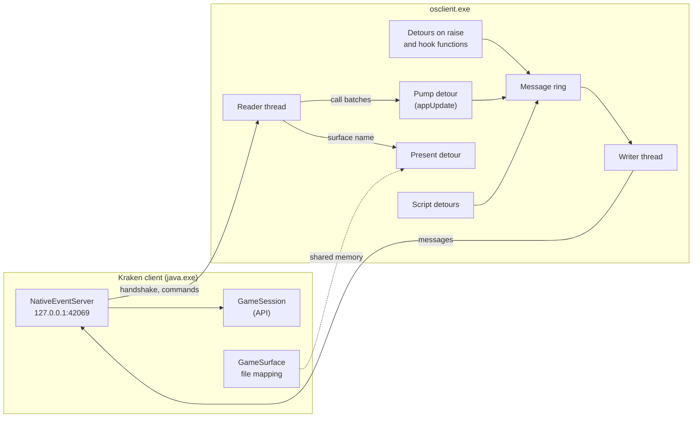
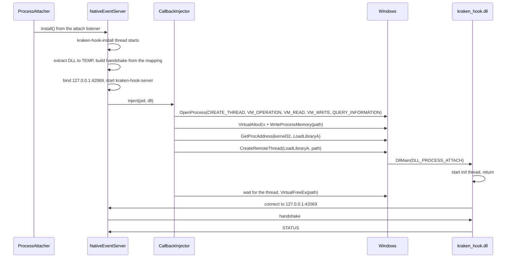
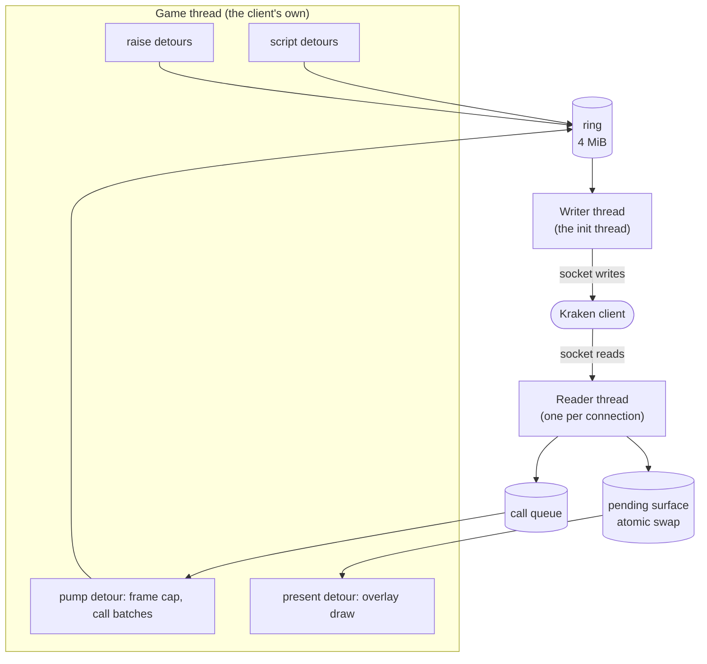
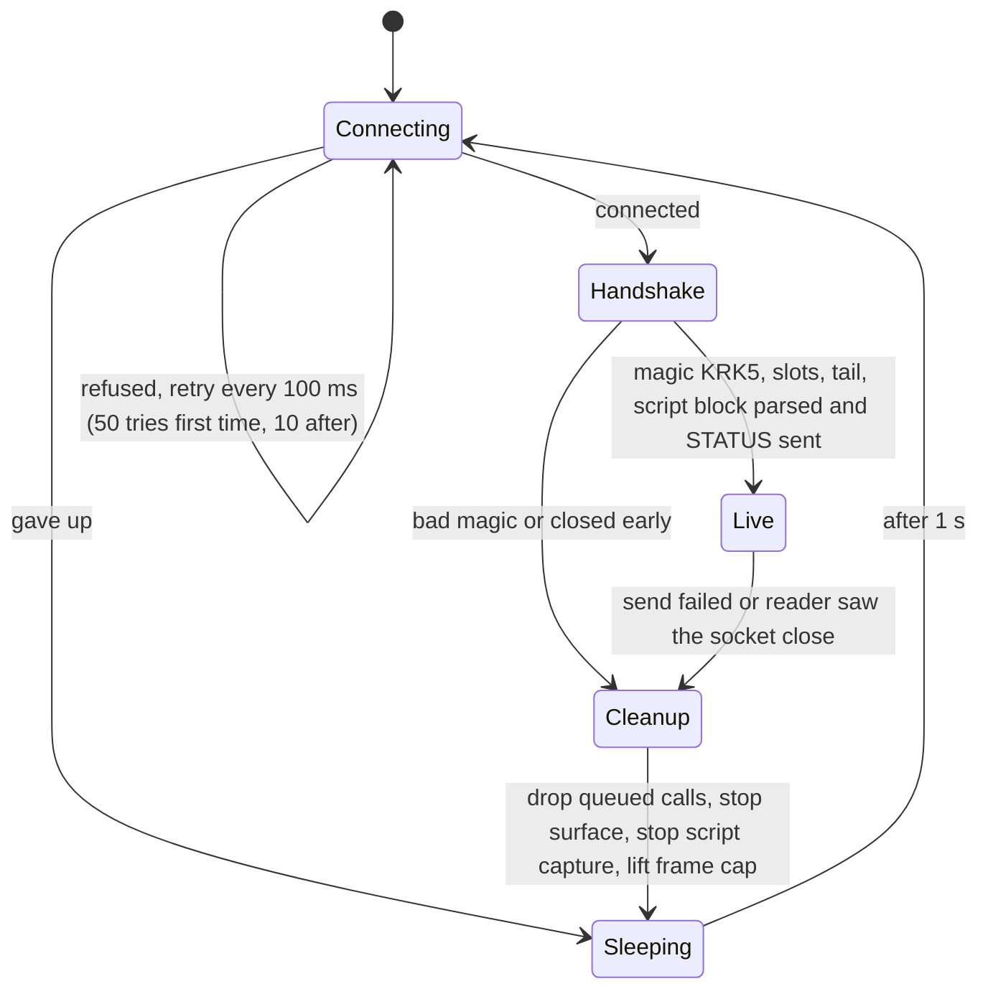
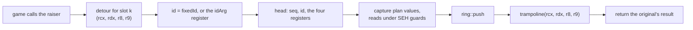
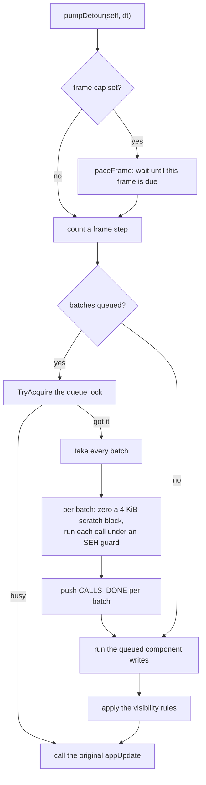
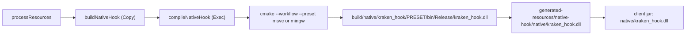

# The Native Hook

`kraken_hook.dll` is a small C++ library the Kraken client loads into `osclient.exe`. It is the only Kraken code that
runs inside the game process. The API reads the game from outside; the hook covers what reading can't: knowing the
moment something happens, running the client's own functions on its thread, and drawing inside its frame.



It has eight jobs:

| Job | How | Read more |
|---|---|---|
| Report events as they happen | Detours on the client's event raise functions and a few plain functions push a message per call | [Events](events.md) |
| Run client functions on the game thread | A detour on the client's per-frame step runs queued call batches before each frame | [In-game drawing](in-game-drawing.md), [Menu actions](menu-actions.md) |
| Draw overlays in the game's frame | A detour on the frame's present draws the latest overlay frame over it | [In-game drawing](in-game-drawing.md) |
| Report scripts as they run | Detours on four script runtime functions report starts, gosubs and returns | [Events](events.md#script-events) |
| Edit the right-click menu | Detours on the menu's rebuild, run and node destroy apply rules to the fresh rows every cycle | [Menu edits](menu-edits.md) |
| Remap and block keys | A detour on the game window's procedure rewrites or drops key messages by a table of modes | [Key interception](key-interception.md) |
| Hide entities | The per-frame step applies visibility rules to every player, NPC, projectile and graphics object | [Entity visibility](entity-visibility.md) |
| Write interface components | The per-frame step looks components up by id and writes a field, clears a listener or sets a text | [Widget writes](widget-writes.md) |

Nothing in the DLL is specific to a build. Every function address, event id, capture plan and struct offset comes from
the mapping, which the Java side sends in a handshake. A new game build needs the updater re-run, not a new DLL.

The wire format is in [Native protocol](native-protocol.md). User-facing behaviour, such as what works without the
hook, is in [Using the client](../client.md#the-native-hook).

## Key Files

| Path | Role |
|---|---|
| [`src/dllmain.cpp`](../../client/src/main/native/kraken_hook/src/dllmain.cpp) | `DllMain`: refuses a second load, starts the init thread |
| [`src/protocol.h`](../../client/src/main/native/kraken_hook/src/protocol.h) | Every constant the Java side must match |
| [`src/connection.cpp`](../../client/src/main/native/kraken_hook/src/connection.cpp) | Connecting back, the handshake, the reader thread, the writer loop, STATUS/FRAME/FPS/DRAW |
| [`src/raises.cpp`](../../client/src/main/native/kraken_hook/src/raises.cpp) | The generic raise detours and capture plans |
| [`src/calls.cpp`](../../client/src/main/native/kraken_hook/src/calls.cpp) | The call queue and running calls under a guard |
| [`src/pump.cpp`](../../client/src/main/native/kraken_hook/src/pump.cpp) | The per-frame detour: the frame cap, then the queued calls, component writes and visibility rules |
| [`src/scripts.cpp`](../../client/src/main/native/kraken_hook/src/scripts.cpp) | The four script detours and SCRIPT messages |
| [`src/menus.cpp`](../../client/src/main/native/kraken_hook/src/menus.cpp) | The menu detours, the rule engine, MENU commands, MENU_CLICK and MENU_EXPIRED |
| [`src/keys.cpp`](../../client/src/main/native/kraken_hook/src/keys.cpp) | The window procedure detour, the key table, KEYS commands and KEY reports |
| [`src/visibility.cpp`](../../client/src/main/native/kraken_hook/src/visibility.cpp) | VISIBILITY commands and the per-frame walk that hides and shows entities |
| [`src/components.cpp`](../../client/src/main/native/kraken_hook/src/components.cpp) | COMPONENTS commands, the component lookup and the writes |
| [`src/frames.cpp`](../../client/src/main/native/kraken_hook/src/frames.cpp) | Frame sync: the endFrame detour, frame tags, FRAME_SYNC and FRAME_DONE, the waits |
| [`src/overlay/overlay.cpp`](../../client/src/main/native/kraken_hook/src/overlay/overlay.cpp) | The present detour: uploading and drawing the overlay |
| [`src/overlay/surface.cpp`](../../client/src/main/native/kraken_hook/src/overlay/surface.cpp) | Opening the shared-memory surface a SURFACE command names |
| [`src/overlay/gl.cpp`](../../client/src/main/native/kraken_hook/src/overlay/gl.cpp), [`gl_state.cpp`](../../client/src/main/native/kraken_hook/src/overlay/gl_state.cpp) | GL entry points beyond 1.1; saving and restoring the client's GL state |
| [`src/core/ring.cpp`](../../client/src/main/native/kraken_hook/src/core/ring.cpp) | The lock-free message ring between the game thread and the writer thread |
| [`src/core/hooks.cpp`](../../client/src/main/native/kraken_hook/src/core/hooks.cpp) | MinHook setup and `installOnce` |
| [`src/core/memory.cpp`](../../client/src/main/native/kraken_hook/src/core/memory.cpp), [`guard.h`](../../client/src/main/native/kraken_hook/src/core/guard.h) | Guarded reads and writes of game memory; the SEH guard macros |
| [`src/core/process.cpp`](../../client/src/main/native/kraken_hook/src/core/process.cpp) | `osclient.exe`'s base address and image size, the performance counter frequency |
| [`CallbackInjector`](../../client/src/main/java/com/kraken/client/callback/CallbackInjector.java) | Java: loads the DLL into the game |
| [`NativeEventServer`](../../client/src/main/java/com/kraken/client/callback/NativeEventServer.java) | Java: the server socket, handshake, message reader and command sender |
| [`NativeProtocol`](../../client/src/main/java/com/kraken/client/callback/NativeProtocol.java) | Java: encodes and decodes the wire format |
| [`NativeEvents`](../../client/src/main/java/com/kraken/client/callback/NativeEvents.java) | Java: which events and functions to hook, with their capture plans |
| [`client/native-hook.gradle`](../../client/native-hook.gradle) | Builds the DLL with CMake and bundles it into the client jar |

## Why a Socket

A JNA or JNI callback is a function pointer into the JVM's address space. The DLL runs in a different process, with no
JVM, so such a pointer means nothing there. The DLL and the client talk over a TCP connection on the loopback
interface instead: the client listens on `127.0.0.1:42069`, and the DLL connects to it. Overlay pixels, which are too
large to stream, go through shared memory (a named file mapping both processes map).

## Getting Into the Game

**DLL injection** means making another process load a library it never asked for. Windows has no API for that
directly, so `CallbackInjector` uses the classic technique: write the DLL's path into the target's memory, then start
a thread in the target whose entry point is `LoadLibraryA`, with that path as its argument. The Windows loader then
maps the DLL and runs its `DllMain`, exactly as if the game had loaded it.



Step by step:

1. **When.** After the API attaches, `KrakenClient` registers an attach listener that calls
   `NativeEventServer.install()`. Only the first call does anything; the work runs on a thread named
   `kraken-hook-install`.
2. **Which DLL.** The client jar carries the DLL as the resource `native/kraken_hook.dll`, staged there by the
   `buildNativeHook` Gradle task. `LoadLibraryA` needs a file, so the server copies it to
   `%TEMP%\kraken_hook<random>.dll`, marked for deletion on exit. `-Dkraken.hook.dll=<path>` injects a DLL on disk
   instead; a path that doesn't exist is logged and the bundled DLL is used.
3. **The handshake comes first.** The server builds the handshake bytes from the mapping (see
   [The Java Side](#the-java-side)), binds its server socket and starts the accept thread `kraken-hook-server` *before*
   injecting, so the DLL has something to connect to.
4. **The injection.** `CallbackInjector.inject` opens the game with `PROCESS_CREATE_THREAD | PROCESS_VM_OPERATION |
   PROCESS_VM_READ | PROCESS_VM_WRITE | PROCESS_QUERY_INFORMATION`, allocates a read-write buffer in it with
   `VirtualAllocEx`, writes the NUL-terminated path with `WriteProcessMemory`, looks up `LoadLibraryA` in its own
   `kernel32.dll` (kernel32 loads at the same address in every process for a boot, so the address is valid in the
   game too), and runs `CreateRemoteThread` with it. It waits for that thread to finish, then frees the buffer.

This is the only place the client writes into the game's memory from outside. Everything after it happens inside the
DLL.

## Inside the DLL

### Start-Up

`DllMain` runs under the Windows *loader lock*, during which most APIs are unsafe, so it does almost nothing:

1. Creates the named mutex `Local\KrakenHookInstance`. If it already exists, the DLL is already loaded in this game, so
   it returns without starting anything. A second injection is harmless.
2. Starts the init thread and returns.

The init thread sets up every module, then becomes the writer thread for the life of the process:

| Step | Function | What it does |
|---|---|---|
| 1 | `connection::init` | `WSAStartup` |
| 2 | `process::init` | Finds `osclient.exe`'s base address and `SizeOfImage`, reads the performance counter frequency |
| 3 | `raises::init` | Fills the table of 64 generic detours |
| 4 | `ring::init` | Creates the event that wakes the writer |
| 5 | `pump::init` | Creates the event that wakes a pump waiting out the frame cap |
| 6 | `frames::init` | Creates the events that wake a game thread and a present waiting for an overlay frame |
| 7 | `hooks::init` | `MH_Initialize` (MinHook) |
| 8 | `connection::run` | Connects, handshakes, drains the ring; never returns |

An address in the mapping is an **RVA** (relative virtual address): an offset from the start of the loaded image. The
DLL turns it into a real address by adding the module base it found in step 2, and `process::inImage(rva)` checks an
RVA lies inside the image before anything is hooked or called there.

### Threads



| Thread | Runs | Rules |
|---|---|---|
| Game thread | Every detour: raises, scripts, the pump and the present | Never blocks on Kraken: pushes into the ring, takes the call queue with a try-lock |
| Writer thread | `connection::run`: connect, handshake, drain the ring, send STATUS/FRAME/FPS/DRAW | The only thread that writes to the socket |
| Reader thread | `readerThread`: reads command frames and hands them on | Queues calls, hands over surfaces, sets the frame cap and script filter |

The ring has one producer (the game thread) and one consumer (the writer). The present detour runs on the game thread
too, which is why it never touches the ring itself: it publishes FRAME values and the present count in atomics and
wakes the writer.

### The Connection



* The writer reads the handshake itself, installing each hook as it parses it, then sends STATUS. A slot whose RVA is
  already hooked is skipped, so the handshake the Java side re-sends on every reconnect only adds what's new.
* The socket has Nagle's algorithm off (`TCP_NODELAY`), so each message goes out as it is sent.
* It then starts a reader thread for the connection and loops: send DRAW for a frame endFrame tagged, or (without
  frame sync) if the game presented while a surface is drawn, send everything queued in the ring, send FRAME if the
  framebuffer, GL version or drawn surface changed, send FPS if a second has passed, then wait up to a second for more.
* When the socket drops, the hooks stay installed for the life of the process. What depended on Kraken being there is
  undone: queued calls are dropped, the overlay stops (nothing would keep it current), script capture stops and the
  frame cap is lifted.

### Hooks and Trampolines

A **detour** replaces the first instructions of a function with a jump to code of ours. [MinHook](https://github.com/TsudaKageyu/minhook)
does the patching: it copies the instructions it overwrites into a **trampoline**, followed by a jump back into the
rest of the original. Calling the trampoline therefore runs the original function unchanged. Every detour here does its
work and then calls the trampoline with the same arguments, so the game behaves exactly as before.

`hooks::installOnce(rva, detour, &trampoline, flag)` hooks a single function once per process (the pump, the present
and the script functions). Raise hooks use their own table, below.

## Raise Hooks

The client raises its plugin events (`osrs.Events`) through small wrapper functions, and the updater lists each event's
raisers in the mapping's `events` section (see [Events](events.md)). The handshake gives the DLL a **slot** per raiser:

| Field | Meaning |
|---|---|
| `rva` | The function to hook |
| `fixedId` | The event id this function always carries, or -1 to read it from a register |
| `idArg` | The argument register holding the id when `fixedId` is -1 (0 = RCX … 3 = R9) |
| `args` | How many argument registers to forward (informational: all four are always forwarded) |
| `plan` | Up to 8 capture-plan entries: which register to read, and how |

Under the Windows x64 **calling convention** a function's first four integer or pointer arguments arrive in the
registers RCX, RDX, R8 and R9, and further ones on the stack. Every raiser hooked here takes its arguments in those
four registers and none on the stack or in XMM (floating point) registers. That's what lets one generic detour shape,
`int64_t detour(int64_t, int64_t, int64_t, int64_t)`, stand in for all of them.



* MinHook needs a distinct detour per target, so the DLL instantiates a template `detourK<K>` for K = 0…63 and gives
  slot K the K-th one. At most 64 distinct functions can be hooked.
* A capture plan entry `{arg, op}` reads register `arg` as: `RAW` (the register's value), `I32`, `I64`, `I32X2`
  (that many bytes at the address in the register) or `CSTR` (a NUL-terminated string at that address, up to 64
  bytes). Dereferences run under an SEH guard, so a bad pointer gives zeros instead of a crash.
* A message body is at most 512 bytes; plan values that wouldn't fit are dropped.
* The detour costs about a microsecond on the game thread: no locks, no system calls, unless the writer is asleep and
  needs waking.

Functions whose arguments don't fit the shape are left out. The ground item functions `objAdd`, `objDel` and
`objCount` pass the item id and count on the stack, and so does the raiser of `ON_OBJ_OP`; forwarding only four
registers would corrupt those calls. The API reads ground items and their clicks on its poll instead.

Besides the Lua event raisers, [`NativeEvents.FUNCTIONS`](../../client/src/main/java/com/kraken/client/callback/NativeEvents.java)
hooks plain client functions whose calls make good wake-ups, such as `setGameState`, `ifOpenSub` or `setSequence`.
They have no event id of their own, so the Java side gives each a synthetic one from 1000 up, as a fixed id.

## The Message Ring

The ring decouples the game thread from the socket: a detour only copies its message into memory, and the writer
thread sends it.

```text
g_ring: 4 MiB, positions only grow and are taken modulo the size

 head (writer)                         tail (game thread)
   v                                     v
 | len | body ... | len | body ...  |   free ...   | PAD | (unused end)
   ^ each record: u32 length, body, padded to 4 bytes; never wraps
```

* A record is the wire framing itself, `{u32 length, body}`, so the writer sends records as they are.
* A record that doesn't fit before the end of the buffer starts at the beginning, behind a `RING_PAD` (`0xffffffff`)
  length that tells the writer to skip to the start.
* A full ring drops the new message. Every ring message takes a sequence number in `ring::writeHead` first, so the
  Java side sees the drop as a gap in `seq`. The writer's own messages (STATUS, FRAME, FPS, DRAW) carry 0 and take
  none.
* The game thread only signals the writer's event when the writer has said it is about to wait
  (`g_writerWaiting`), so a burst of messages costs no system call each. Both sides use sequentially consistent atomics
  for that flag and the tail, so a message is never left unsent while the writer sleeps; the writer also wakes every
  second regardless.

## The Pump Hook

`functions.appUpdate` is the client's per-frame step, `void(App*, float)`, called on the game thread before each frame's
logic and rendering. Its detour is where Kraken's calls run, because that's the one moment Kraken knows the game thread
is between frames and safe to call into.



**The frame cap.** `FRAME_LIMIT` sets frames per second (0 for none). `paceFrame` lets each frame start one interval
after the last and waits out the rest, on a high-resolution waitable timer where Windows has one. A frame that runs more
than an interval late restarts the schedule instead of letting later frames run back to back. The client times its
own logic cycles, so a held frame runs more of them; the game slows its drawing, not its clock. A new cap wakes a
waiting pump at once. The client uses this to save power while it isn't focused.

**The call queue.** The reader thread parses each `CALLS` command into a batch and appends it under an SRW lock. The
pump takes the whole queue with `TryAcquireSRWLockExclusive`: if the reader holds the lock, the calls wait one frame
rather than the game waiting for the reader. Limits: 4,096 queued calls and 4,096 queued batches; a batch that would go
over the call limit is reported with every call skipped.

**Running a call.** `runCall` resolves each argument by its kind (the immediate value, the `Client*` plus an offset,
a pointer into the call's data or the batch's scratch block, or a pointer read from the `Client` object; see
[Native protocol](native-protocol.md#calls)), skips the call if its RVA is outside the image or a pointer it needs is
null, and calls the function with eight integer arguments under an SEH guard. Passing eight when the function takes
fewer is safe in the x64 convention, where the caller owns the stack slots. After a batch, the pump pushes
`CALLS_DONE` with the batch id, the calls run, the calls skipped or faulted, and the last return value.

**Component writes and visibility.** After the calls, the pump runs the component writes `COMPONENTS` queued (taken
with a try-lock like the calls), each component looked up by id first ([Widget writes](widget-writes.md)), then walks
the entities and applies the visibility rules ([Entity visibility](entity-visibility.md)). With no rules and nothing
hidden, the walk returns at once.

## The Present Hook

`functions.present` is the client's frame present, `void(GlContext*)`, which ends in `SwapBuffers`. Its detour runs
`overlayFrame()` and then the original, so the overlay lands on the finished frame just before it is shown:

1. Take a surface the reader thread opened since the last present (an atomic swap), or a request to stop drawing.
2. Find the current GL context and the window's client size. A new context starts the overlay's GL objects over.
3. Take the draw list's batch for the frame being presented (the one endFrame resolved for its frame object).
4. If a surface is open or the batch has triangles, and the context is GL 3.0 or newer: save the client's GL state,
   draw the batch, upload the overlay frame for this present into a texture (only the rows that changed): with frame
   sync, the slot tagged for the frame being presented, after waiting for it if Java is still drawing it; otherwise
   the newest published one. Then draw it over the batch as one full-screen triangle with premultiplied alpha
   blending, and restore the state. The shaders are GLSL 330 core on GL 3.3 and up, 150 on 3.2, and 130 on 3.0 and
   3.1.
5. Publish the framebuffer size, GL version and the surface generation drawn, and wake the writer if they changed, so
   it sends FRAME.
6. While a surface is drawn without frame sync, wake the writer so it sends DRAW. Java then draws the overlay's next
   frame while the game waits on the swap, so the overlay is redrawn once per game frame.

Saving, drawing and restoring each run under an SEH guard. A fault turns the overlay off for the rest of the session,
since a half-restored GL state would be worse than no overlay. The surface's memory layout and its triple-buffer
handshake are in [In-game drawing](in-game-drawing.md).

The present detour also counts presents for the FPS and DRAW messages. While it isn't hooked, the pump's frame steps
are counted instead.

## The endFrame Hook

`functions.renderEndFrame` is the GL device's end of frame, `void(GlDevice*, Task*)`: the game thread calls it from
appUpdate once it has recorded a frame, and it queues the frame for the render thread that presents it. Its detour
first resolves the draw list against the frame's state, into a batch keyed by the frame object at
`[device + GlDevice.recordingFrame]` ([In-game drawing](in-game-drawing.md#the-anchored-draw-list)), on every frame.
Then it does frame sync ([In-game drawing](in-game-drawing.md#frame-sync)): while `FRAME_SYNC` is on and a surface is drawn, it
tags the frame object at `[device + GlDevice.recordingFrame]`, has the writer send `DRAW` with the tag, runs the
original, and holds the game thread until `FRAME_DONE` reports the tag, for at most 10 ms. The present detour reads
the frame object it presents at `[device + GlDevice.renderingFrame]`, where the device is its argument minus
`GlDevice.context`, and draws the slot tagged for it. The frame block of the handshake names the RVA and the three
offsets; the hook installs once.

## The Script Hooks

The client's scripts (CS2, its interface scripting language) run in an interpreter. Four detours report what it does,
from the functions and layout in the handshake's script block:

| Function key | Signature | The detour |
|---|---|---|
| `functions.executeScript` | `(runner, request, maxOps, int)` | Runs a listener's request (a click, a timer…). Remembers the request for the interpreter run it starts |
| `functions.executeScriptInner` | `(runner, scriptSlot, maxOps, int)` | The interpreter loop. Reads the root script's id, reports a **root start** with the request (if any), runs, then reports its **return** |
| `functions.scriptLookup` | `(id)` | Finds a script by id. Inside an interpreter run, that's a **gosub**: notes the callee's id at its depth and reports it |
| `functions.scriptSwapLocals` | `(frame, ints, longs, objects)` | Swaps a frame's locals. Called on a frame whose script slot was cleared, it's a **return** of the script one level deeper |

* A return can't see which script is returning, so the DLL keeps each running script's id by frame depth (up to 64).
* The detours only report while an interpreter run they saw start is on the stack. The interpreter is hooked last for
  the same reason: a script already running while the hooks install is passed over instead of half reported.
* Each report carries the top of the int stack (up to 64 entries) and the object stack (up to 16), and for a root run
  started by a listener, the request: source and target components, op, mouse and key fields, and arguments.
* Nothing is sent until a `SCRIPTS` command asks: for starts, for returns, and/or for root runs of up to 8 listed
  scripts. The API sends it as subscriptions to the script events come and go.

## Every Place Kraken Changes the Game

The complete list of what Kraken does to the game process, for review and debugging. The API's own reads
(`ReadProcessMemory` from outside) change nothing and are left out.

| Where | What Kraken does | Mapping key |
|---|---|---|
| Process memory | Writes the DLL path into a buffer, starts a thread on `LoadLibraryA`, frees the buffer | none |
| Loader | Loads `kraken_hook.dll`; creates the `Local\KrakenHookInstance` mutex, the init (writer) thread and a reader thread per connection | none |
| Event raisers | Detour per raiser of `ON_GAME_TICK`, `ON_SCREEN_RESIZE`, `ON_GAME_STATE_CHANGED`, `ON_NPC_LOAD`, `ON_NPC_UNLOAD`, `ON_LOC_LOAD`, `ON_LOC_UNLOAD`, `ON_VARBIT_UPDATE`, `ON_VAR_TRANSMIT`, `ON_STAT_TRANSMIT`, `ON_INV_TRANSMIT`, `ON_CHAT_TRANSMIT`, `ON_NPC_OP`, `ON_LOC_OP`, `ON_TILE_OP`, `ON_PLAYER_OP`, `ON_COMPONENT_OP` | `events.*` |
| Hook functions | Detours on `clientCycle`, `setGameState`, `playerAdd`, `playerRemove`, `npcInfoDecode`, `playerInfoDecode`, `projectileCtor`, `ifOpenSub`, `ifCloseSub`, `setVarcInt`, `setVarcString`, `setSequence`, and `projectileStep` with `-Dkraken.hook.projectileStep=true` | `functions.*` |
| Per-frame step | Detour that may delay the frame (frame cap) and runs call batches | `functions.appUpdate` |
| Frame present | Detour that draws the overlay with its own GL program, texture and VAO, restoring the client's GL state | `functions.present` |
| Script runtime | Detours on the four script functions | `functions.executeScript`, `executeScriptInner`, `scriptLookup`, `scriptSwapLocals` |
| Minimenu | Detours on the view rebuild, the run and the node destroy; after each rebuild, reorders the rows vector, frees hidden rows' children through the client's own destroy, rewrites entry texts through the client's assignment, grows the vector through its reserve and inserts nodes pointing at the DLL's own entries | `functions.minimenuViewRebuild`, `minimenuRun`, `minimenuNodeDestroy`, `minimenuNodeReserve`, `minimenuTextAssign` |
| Window procedure | Detour that rewrites or drops `WM_KEYDOWN`, `WM_KEYUP` and `WM_CHAR` by the key table | `functions.renderViewWndProc` |
| Entities | Each frame, sets and clears the hidden byte of players, NPCs, projectiles, keyed projectiles and graphics objects, and the 2D byte of players and NPCs, by the visibility rules; only clears what it set | `Actor.hidden`, `Actor.render2D`, `Projectile.hidden`, `KeyedProjectile.hidden`, `GraphicsObject.hidden` |
| Components | Writes a component's drag dead time or dead zone, clears its mouse-repeat listener through the client's own clear, and sets its text through the client's string assignment and invalidate | `IfType.dragDeadTime`, `IfType.dragDeadZone`, `IfType.onMouseRepeat`, `functions.ifListenerClear`, `IfType.text`, `functions.stringAssign`, `functions.ifInvalidate` |
| Calls | Calls the client's highlight functions, minimenu row bodies and packet helpers, with arguments and data from Kraken | `functions.highlight*`, `functions.menu*`, `functions.packet*` |
| Shared memory | Maps Kraken's overlay surface and writes its `reading` word | none |

Every detour forwards to the original with the arguments unchanged and returns its result, except the menu run (a
click on a row of Kraken's own returns without running anything) and the window procedure (a dropped or remapped key
message). The other behaviour changes are the calls Kraken asks for, the menu rows the rules change, the entities the
visibility rules hide, the component fields Kraken writes and the frame cap.

## The Java Side

[`NativeEventServer`](../../client/src/main/java/com/kraken/client/callback/NativeEventServer.java) is a session
singleton (bound in `SessionModule`), so it exists once the API has attached and the build's mapping is known.

**Building the handshake.** `build()` walks [`NativeEvents`](../../client/src/main/java/com/kraken/client/callback/NativeEvents.java):

* `NativeEvents.LUA` lists the `osrs.Events` to hook and the capture plan for each. For every raiser the mapping lists
  under `events.<NAME>`, it adds a slot with the mapping's fixed id or id register.
* `NativeEvents.FUNCTIONS` lists the plain functions, each given a synthetic id from 1000 and four forwarded registers.
* A function that raises several wanted events gets one slot; the longer plan and larger argument count win.
* Events or functions the mapping lacks are logged (`no raise site for … it falls back to the poll`) and skipped.

`drawing()` adds the `Client` global, `functions.appUpdate` and `functions.present` (0 when missing), and
`NativeProtocol.scriptLayout(mapping)` adds the script block (empty unless every key it needs is mapped); the menu,
key, visibility and component blocks follow the same way.

**Serving.** `serve()` accepts one connection at a time. On each it sends the handshake, marks the session hooked
with `GameSession.setHookConnected(true)` (reads now follow the raises, and the API's timer read becomes a 250 ms
safety net), and reads messages until the socket closes. On STATUS it switches on what the DLL reports:

| STATUS feature bit | Java turns on |
|---|---|
| `FEATURE_CALLS` (1, the pump) | `session.setNativeInvoker(...)`: highlights and actions can send `CALLS` |
| `FEATURE_OVERLAY` (2, the present) | `GameSurface.connected(...)`: overlay frames go to shared memory |
| `FEATURE_FRAME_RATE` (4) with `FEATURE_CALLS` | Sends the current frame cap, and every change after |
| `FEATURE_SCRIPTS` (8) | `session.setScriptHook(...)`: the API can send `SCRIPTS` |
| `FEATURE_MENU` (16) | `session.setMenuHook(...)`: the menu edits send `MENU` |
| `FEATURE_KEYS` (32) | `keyManager.setKeyHook(...)`: the key remapping sends `KEYS` |
| `FEATURE_VISIBILITY` (64) | `session.setVisibilityHook(...)`: the entity visibility sends `VISIBILITY` |
| `FEATURE_COMPONENTS` (128) | `session.setComponentHook(...)`: the widget setters' writes send `COMPONENTS` |
| `FEATURE_FRAME_SYNC` (256) | `GameSurface.connected(..., true)`: the surface can turn frame sync on |
| `FEATURE_DRAW_LIST` (512) | `session.setDrawHook(...)`: the draw list sends `DRAW_SPRITES` and `DRAW_LIST` |

Raise messages go to `GameSession.onNative`, script messages to `GameSession.onScript`, FPS to `FrameRates`, FRAME to
`GameSurface.frame`, DRAW to `GameSurface.drawRequested` (which wakes the client thread to draw the overlay's next
frame), and CALLS_DONE is logged when calls failed. `onEvent(name, consumer)` taps raw messages on the
reader thread for diagnostics; nothing calls it yet. When the connection ends, everything above is switched off again and the API
goes back to its 20 ms poll until the DLL reconnects.

**Status.** `getStatus()` says where the hook has got to: `NOT_INSTALLED` until `install`, `INJECTING` until the DLL
connects, `CONNECTED`, `DISCONNECTED` after a dropped connection, and `UNAVAILABLE` when the DLL can't be found or
injected, the mapping gives it nothing to hook, or the server socket fails. `getReport()` holds the last STATUS (hooks
installed and requested, protocol, and `NativeProtocol.featureNames` of the feature bits) while connected, and null
otherwise. The Kraken page shows both.

**Sending.** `Connection.send` is synchronized, so whole frames from different threads (plugins' highlight calls, the
overlay surface, the frame cap) never interleave. On exit, `flushOnExit` waits up to a second for the last call batch's
CALLS_DONE, so highlights that plugins switched off as they stopped are cleared in the game. It runs as an
`ExitHandler` exit task, after the plugins stop and before the shutdown hooks close the game, and again as a shutdown
hook for exits that skip `ExitHandler`.

## Failure Handling

| Situation | What happens | Console |
|---|---|---|
| The client was built without the DLL | No injection; events come from the poll | `kraken_hook.dll was not found on the classpath (build and bundle it with ./gradlew :client:buildNativeHook); events come from the timer poll alone.` |
| The DLL can't be extracted | No injection | `Native event hook: could not extract kraken_hook.dll from the classpath` |
| The mapping names nothing to hook | No injection | `Native event hook: mapping <v> has no hookable events or drawing functions; continuing on the timer poll.` |
| No `appUpdate` / `present` in the mapping | No calls / overlay stays in the window | `Native event hook: no appUpdate in mapping …`, `… no present in mapping …` |
| Bind or injection fails | No hook | `Could not install the native event hook` with a stack trace |
| Some hooks don't install | The rest work | `Native event hook installed <n> of <m> requested hooks (…)` |
| The connection drops | Back on the 20 ms poll; the DLL reconnects every second | `Native event hook disconnected; back on the timer poll until it reconnects.` |
| A malformed message | The connection is dropped and re-established | `Native event hook connection failed` |
| Calls skipped or faulted | Logged per batch | `Native event hook: <n> of the calls in batch <b> faulted or were skipped (<r> ran)` |
| Messages dropped (ring full) | The trackers' whole-read fallback covers them | `… message(s) dropped before seq …` (FINE) |

## Building

The DLL is a CMake project in [`client/src/main/native/kraken_hook`](../../client/src/main/native/kraken_hook), built
by Gradle on every client build:



* **Toolchain.** The preset is `msvc` when `vswhere` finds Visual Studio with the x64 C++ tools, else `mingw` when
  `g++.exe` is on `PATH`; `-PnativeHookPreset=<name>` overrides it. With neither, the build fails with
  `No C++ toolchain found to build kraken_hook.dll`. CMake comes from `PATH`, else from Visual Studio's bundled copy.
* **Presets** ([`CMakePresets.json`](../../client/src/main/native/kraken_hook/CMakePresets.json)): `msvc` (Release),
  `msvc-debug`, `mingw`. Only MSVC compiles the SEH guards; under MinGW the calls, capture plans and GL drawing run
  unguarded, so use it for local testing only. MSVC refuses `__try` in a function holding objects with destructors,
  which is why each guard sits in a small function of its own.
* **MinHook** is downloaded on the first configure, pinned by commit in the URL and checked against its SHA-256. To build
  offline, pass `-DFETCHCONTENT_SOURCE_DIR_MINHOOK=<path>`.
* **Incremental.** Gradle skips the compile while `src/`, `CMakeLists.txt` and `CMakePresets.json` are unchanged.
  `-x buildNativeHook` leaves the DLL out of the jar.

## Debugging

* An MSVC build records where its `.pdb` is, so attaching Visual Studio to `osclient.exe` (Debug > Attach to Process)
  shows the DLL's own functions and lines.
* `./gradlew :client:run` recompiles and restages a changed DLL; Gradle builds the Release DLL of the `msvc` or
  `mingw` workflow preset. To run another build, such as the `msvc-debug` preset's, point `-Dkraken.hook.dll` at it:
  `"-Dkraken.hook.dll=client/build/native/kraken_hook/msvc/bin/Debug/kraken_hook.dll"`.
* The DLL can't be unloaded or replaced in a running game: restart the game to load a new build of it.
* The **Event log** dev tool shows the API's events as they're posted, so it shows whether hook-driven events arrive.

## Adding a Command

1. Add a `CMD_*` constant to `protocol.h` and the matching `COMMAND_*` to `NativeProtocol`, with an encoder there.
2. Write a handler in the module it belongs to that reads its body from a `FrameReader`, and add a `case` for it in
   `readerThread` in `connection.cpp`. Unknown commands are skipped, so an older DLL ignores a new one.
3. If the game thread must act on it, hand it over without blocking the game thread (an atomic, or a try-lock as the
   call queue does).
4. Undo its effect when the connection drops, in `connection::run`'s cleanup.
5. Document it in [Native protocol](native-protocol.md).

## Adding a Hook

* **An event raiser or a plain function with four register arguments:** add its name and capture plan to
  `NativeEvents`, make sure the mapping has it (a spec key, see [Updater](updater.md)), and handle the message in the
  API (see [Events](events.md)). No DLL change is needed.
* **Anything else** needs a dedicated detour in the DLL: an `installOnce` call from the handshake, a detour with the
  function's real signature that forwards to the trampoline, and a way to get its result to Java (a ring message from
  the game thread). Keep the detour short and non-blocking, guard every pointer it follows, and report the new hook in
  STATUS if the Java side needs to know it's live.
* New source files go in `add_library` in `CMakeLists.txt`.

## Known Gaps

* x64 only.
* The detours for the ground item functions and `ON_OBJ_OP` need a stack-preserving detour shape, which doesn't exist
  yet.
* `raises::install` doesn't check `process::inImage` before hooking; a bad RVA fails inside MinHook and that slot stays
  uninstalled.
* The pump, calls, overlay, script, menu, key, visibility and component hooks have not all been checked against a
  running client yet; the API's trackers keep their whole-read fallback, so an unconfirmed payload costs latency, not
  a missed event.
* The menu hook builds its own entries from a template read off the client's last-run copy and leaves the entry's other
  fields zero; the window procedure's messages are pushed into the single-producer ring on the assumption that the
  window's thread is the game thread. Both are to confirm live.
