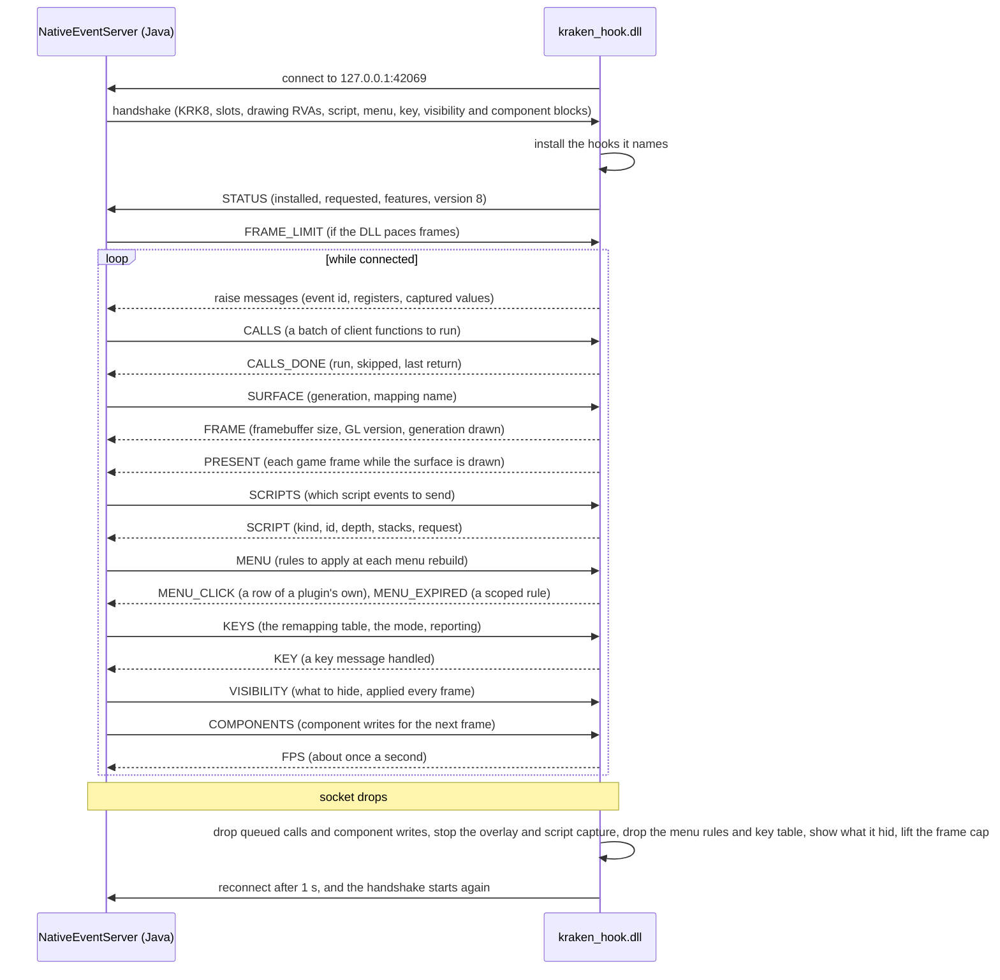

# The Native Protocol

The Kraken client and `kraken_hook.dll` talk over one TCP connection on the loopback interface, using protocol v8.
This page is the byte-level reference. [The native hook](native-hook.md) explains what each side does with the
messages.

* **Transport.** The client listens on `127.0.0.1:42069`; the DLL connects. One connection at a time. If it drops, the
  DLL reconnects every second and the client sends the handshake again. Both ends turn Nagle's algorithm off
  (`TCP_NODELAY`), so a small message goes out at once instead of waiting for the last one's acknowledgement.
* **Byte order.** Little-endian throughout. `u8`/`u16`/`u32`/`u64` are unsigned, `i32`/`i64` signed.
* **Framing.** After the handshake, everything is length-framed: a `u32` length, then that many bytes.
* **Shared memory.** Overlay pixels don't go over the socket. A `SURFACE` command names a file mapping both processes
  map; its layout is in [In-game drawing](in-game-drawing.md).

## A Session

## The Handshake

Java → DLL, sent once per connection as soon as it's accepted. It is **not** length-framed: the DLL reads it field by
field.

| Field | Type | Meaning |
|---|---|---|
| magic | 4 bytes | `KRK8`. Any other value makes the DLL drop the connection |
| slot count | `u16` | The number of raise slots that follow |
| slots | | Each as below |
| client global | `u64` | RVA of the global holding the `Client*`, for `CLIENT` and `INDIRECT` call arguments; 0 for none |
| pump function | `u64` | RVA of `functions.appUpdate`, where calls run; 0 for none (no calls) |
| present function | `u64` | RVA of `functions.present`, where the overlay is drawn; 0 for none (no overlay) |
| script block length | `u16` | 0 for no script hooks |
| script block | bytes | See [The Script Block](#the-script-block) |
| menu block length | `u16` | 0 for no menu hooks |
| menu block | bytes | See [The Menu Block](#the-menu-block) |
| key block length | `u16` | 0 for no key hook |
| key block | bytes | See [The Key Block](#the-key-block) |
| visibility block length | `u16` | 0 for no entity hiding |
| visibility block | bytes | See [The Visibility Block](#the-visibility-block) |
| component block length | `u16` | 0 for no component writes |
| component block | bytes | See [The Component Block](#the-component-block) |

An **RVA** is an address relative to the start of the loaded `osclient.exe`; the DLL adds the module base to it.

### A Slot

| Field | Type | Meaning |
|---|---|---|
| rva | `u64` | The function to hook |
| fixed id | `i32` | The event id the function always carries, or -1 to read it from a register |
| id register | `u8` | When the fixed id is -1, the argument register holding the id: 0 RCX, 1 RDX, 2 R8, 3 R9 |
| args | `u8` | Argument registers to forward (0 to 4). The detour always forwards all four |
| plan length | `u8` | Capture-plan entries that follow, at most 8. More makes the DLL drop the connection |
| plan | `plan length` × 2 bytes | Each `{u8 register, u8 op}` |

Capture-plan ops say how to read the named register into the message:

| Op | Value | Reads | Payload in the message |
|---|---|---|---|
| `RAW` | 0 | The register's value | 8 bytes |
| `I32` | 1 | An `i32` at the address in the register | 4 bytes |
| `I64` | 2 | An `i64` at the address | 8 bytes |
| `I32X2` | 3 | Two `i32`s at the address | 8 bytes |
| `CSTR` | 4 | A NUL-terminated string at the address, at most 64 bytes | `u8` length, then the bytes |

Reads through an address are guarded; a bad address gives zeros (or an empty string).

Event ids are the mapping's `enums.events` values for the client's Lua event raisers. Plain function hooks have no id
of their own: the Java side numbers them from 1000 in the order it adds them, sends each as a fixed id, and keeps the
id-to-name table itself.

### The Script Block

155 bytes, built by `NativeProtocol.scriptLayout` and parsed by `parseScriptLayout` in `scripts.cpp`. The Java side
sends an empty block unless the mapping has `globals.scriptRunner`, all four script functions and every offset below
up to 147; the last two are `0xffffffff` when the mapping lacks them, and the SCRIPT messages then carry no
components.

| Offset | Type | Field | Mapping key |
|---|---|---|---|
| 0 | `u64` | executeScript | `functions.executeScript` |
| 8 | `u64` | executeScriptInner | `functions.executeScriptInner` |
| 16 | `u64` | scriptLookup | `functions.scriptLookup` |
| 24 | `u64` | scriptSwapLocals | `functions.scriptSwapLocals` |
| 32 | `u64` | runner | `globals.scriptRunner` |
| 40 | `u32` | intStack | `ScriptRunner.intStack` |
| 44 | `u32` | intStackSize | `ScriptRunner.intStackSize` |
| 48 | `u32` | objStack | `ScriptRunner.objStack` |
| 52 | `u32` | objStackSize | `ScriptRunner.objStackSize` |
| 56 | `u32` | frameCount | `ScriptRunner.frameCount` |
| 60 | `u32` | frameScript | `ScriptFrame.script` |
| 64 | `u32` | sharedPtr | `containers.shared_ptr.ptr` |
| 68 | `u32` | scriptId | `ClientScript.id` |
| 72 | `u32` | valueSize | `VarValue.size` |
| 76 | `u32` | valueType | `VarValue.type` |
| 80 | `u8` | kindInt | `enums.varValueType.INT` (0xff if missing) |
| 81 | `u8` | kindString | `enums.varValueType.STRING` |
| 82 | `u8` | kindLong | `enums.varValueType.LONG` |
| 83 | `u32` | argCount | `HookReq.argCount` |
| 87 | `u32` | args | `HookReq.args` |
| 91 | `u32` | source | `HookReq.source` |
| 95 | `u32` | target | `HookReq.target` |
| 99 | `u32` | op | `HookReq.op` |
| 103 | `u32` | subOp | `HookReq.subOp` |
| 107 | `u32` | mouseX | `HookReq.mouseX` |
| 111 | `u32` | mouseY | `HookReq.mouseY` |
| 115 | `u32` | keyCode | `HookReq.keyCode` |
| 119 | `u32` | keyChar | `HookReq.keyChar` |
| 123 | `u32` | opbase | `HookReq.opbase` |
| 127 | `u32` | componentId | `IfType.packedId` |
| 131 | `u32` | componentIndex | `IfType.subId` |
| 135 | `u32` | stringFlagByte | `containers.string.heapFlagByte` |
| 139 | `u32` | stringFlagMask | `containers.string.heapFlagMask` |
| 143 | `u32` | stringSsoCapacity | `containers.string.ssoCapacity` |
| 147 | `u32` | activeComponent | `ScriptRunner.activeComponent` |
| 151 | `u32` | dotComponent | `ScriptRunner.dotComponent` |

The first handshake whose block is complete fixes the layout for the life of the process; later ones only retry hooks
that failed to install.

### The Menu Block

142 bytes, built by `NativeProtocol.menuLayout` and parsed by `parseLayout` in `menus.cpp`. The Java side sends an
empty block unless the mapping has all five functions, every offset, every subject kind and both ops.

| Offset | Type | Field | Mapping key |
|---|---|---|---|
| 0 | `u64` | viewRebuild | `functions.minimenuViewRebuild` |
| 8 | `u64` | run | `functions.minimenuRun` |
| 16 | `u64` | nodeDestroy | `functions.minimenuNodeDestroy` |
| 24 | `u64` | nodeReserve | `functions.minimenuNodeReserve` |
| 32 | `u64` | textAssign | `functions.minimenuTextAssign` |
| 40 | `u32` | clientMinimenu | `Client.minimenu` |
| 44 | `u32` | rows | `Minimenu.rows` |
| 48 | `u32` | open | `Minimenu.open` |
| 52 | `u32` | clicked | `Minimenu.clicked` |
| 56 | `u32` | nodeList | `containers.minimenu.node.list` |
| 60 | `u32` | nodeIndex | `containers.minimenu.node.index` |
| 64 | `u32` | nodeChildren | `containers.minimenu.node.children` |
| 68 | `u32` | nodeSize | `containers.minimenu.node.size` |
| 72 | `u32` | listEntries | `containers.minimenu.list.entries` |
| 76 | `u32` | entrySize | `MinimenuEntry.size` |
| 80 | `u32` | option | `MinimenuEntry.option` |
| 84 | `u32` | target | `MinimenuEntry.target` |
| 88 | `u32` | typeId | `MinimenuEntry.typeId` |
| 92 | `u32` | subjectIndex | `MinimenuEntry.subjectIndex` |
| 96 | `u32` | opIndex | `MinimenuEntry.opIndex` |
| 100 | `u32` | level | `MinimenuEntry.level` |
| 104 | `u32` | x | `MinimenuEntry.x` |
| 108 | `u32` | z | `MinimenuEntry.z` |
| 112 | `u32` | subjectType | `MinimenuEntry.subjectType` |
| 116 | 6 × `u8` | kinds | `enums.minimenuSubject.TILE`, `NPC`, `LOC`, `OBJ`, `PLAYER`, `COMPONENT` |
| 122 | `i32` | opExamine | `enums.minimenuOp.EXAMINE` |
| 126 | `i32` | opTarget | `enums.minimenuOp.TARGET` |
| 130 | `u32` | stringFlagByte | `containers.string.heapFlagByte` |
| 134 | `u32` | stringFlagMask | `containers.string.heapFlagMask` |
| 138 | `u32` | stringSsoCapacity | `containers.string.ssoCapacity` |

The DLL installs the node destroy hook first, then the run hook, then the view rebuild hook, and only counts the
feature live when all three are: without the first, the client could free a row of Kraken's own; without the second,
a click on one would run its empty entry.

### The Key Block

8 bytes: the RVA of the game window's procedure, `functions.renderViewWndProc` (`u64`), built by
`NativeProtocol.keyLayout`.

### The Visibility Block

84 bytes of `u32` offsets, built by `NativeProtocol.visibilityLayout` and parsed by `install` in `visibility.cpp`
([Entity visibility](entity-visibility.md)). The Java side sends an empty block unless the mapping has the starred
keys; any other missing one is sent as `0xffffffff`, which leaves that kind of entity alone.

| Offset | Field | Mapping key |
|---|---|---|
| 0 | topLevelWorld * | `Client.topLevelWorld` |
| 4 | worlds | `Client.worlds.map` |
| 8 | localPlayerIndex * | `Client.localPlayerIndex` |
| 12 | players * | `World.players` |
| 16 | npcs * | `World.npcs` |
| 20 | graphicsObjects | `World.graphicsObjects` |
| 24 | projectiles | `Client.projectiles` |
| 28 | keyedProjectiles | `Client.keyedProjectiles` |
| 32 | actorHidden * | `Actor.hidden` |
| 36 | actor2D * | `Actor.render2D` |
| 40 | projectileHidden | `Projectile.hidden` |
| 44 | keyedHidden | `KeyedProjectile.hidden` |
| 48 | graphicsHidden | `GraphicsObject.hidden` |
| 52 | graphicsId | `GraphicsObject.spotAnimId` |
| 56 | mapBuckets * | `containers.hash_map.buckets` |
| 60 | mapBucketCount * | `containers.hash_map.bucketCount` |
| 64 | nodeKey * | `containers.hash_map.node.key` |
| 68 | nodeValue * | `containers.hash_map.node.value` |
| 72 | nodeNext * | `containers.hash_map.node.next` |
| 76 | listNext | `containers.list.node.next` |
| 80 | listValue | `containers.list.node.value` |

The first handshake with a complete block fixes the layout for the life of the process. VISIBILITY commands take
effect while the layout is known and the pump is hooked (`FEATURE_VISIBILITY`).

### The Component Block

84 bytes, built by `NativeProtocol.componentLayout` and parsed by `install` in `components.cpp`
([Widget writes](widget-writes.md)). The Java side sends an empty block unless the mapping has every offset. A
function's RVA is 0 when the mapping lacks it: without the listener clear, listener clears are skipped; without the
string assignment or the invalidate, text writes are.

| Offset | Type | Field | Mapping key |
|---|---|---|---|
| 0 | `u64` | listenerClear | `functions.ifListenerClear` |
| 8 | `u64` | textAssign | `functions.stringAssign` |
| 16 | `u64` | invalidate | `functions.ifInvalidate` |
| 24 | `u32` | interfaceStore | `Client.interfaceStore` |
| 28 | `u32` | groupCount | `IfStore.groupCount` |
| 32 | `u32` | groups | `IfStore.groups` |
| 36 | `u32` | groupStride | `IfStoreGroup.stride` |
| 40 | `u32` | slotCount | `IfStoreGroup.count` |
| 44 | `u32` | slots | `IfStoreGroup.slots` |
| 48 | `u32` | slotStride | `IfStoreGroup.slotStride` |
| 52 | `u32` | slotObject | `containers.shared_ptr.ptr` |
| 56 | `u32` | dynCount | `IfType.dynCount` |
| 60 | `u32` | dynSlots | `IfType.dynSlots` |
| 64 | `u32` | packedId | `IfType.packedId` |
| 68 | `u32` | subId | `IfType.subId` |
| 72 | `u32` | stringFlagByte | `containers.string.heapFlagByte` |
| 76 | `u32` | stringFlagMask | `containers.string.heapFlagMask` |
| 80 | `u32` | stringSsoCapacity | `containers.string.ssoCapacity` |

The first handshake with a complete block fixes the layout. COMPONENTS commands take effect while the layout is known
and the pump is hooked (`FEATURE_COMPONENTS`).

## Messages

DLL → Java. Each is `{u32 length, body}`; the body is:

| Offset | Type | Field |
|---|---|---|
| 0 | `u32` | seq: a sequence number, one per message |
| 4 | `i32` | event id: an `enums.events` id, a function hook's id (1000 up) or a reserved id below |
| 8 | `u64` | RCX at the call (or the first value of a reserved message) |
| 16 | `u64` | RDX |
| 24 | `u64` | R8 |
| 32 | `u64` | R9 |
| 40 | `u8` | value count |
| 41 | | values, each `{u8 register, u8 op, payload}` with the payload from the op table above |

A raise message's body is at most 512 bytes; plan values that wouldn't fit are left off and the count says how many
came.

### Reserved Ids

| Id | Name | RCX | RDX | R8 | R9 | Sent |
|---|---|---|---|---|---|---|
| -2 | `STATUS` | Slots installed (total) | Slots requested by this handshake | Feature bits | Protocol version (8) | Once per handshake |
| -3 | `FRAME` | Framebuffer width | Height | GL version, `major << 16 \| minor` | Surface generation drawn, 0 for none | When any of them changes |
| -4 | `CALLS_DONE` | Batch id | Calls run | Calls skipped or faulted | Last call's return value | After each batch |
| -5 | `FPS` | Frames since the last FPS | Microseconds since it | Frame cap in force | 1 if presents were counted, 0 for frame steps | About once a second |
| -6 | `SCRIPT` | Kind: 0 root start, 1 gosub, 2 return | Script id | Frame depth (0 for a root) | 0 | Per script event asked for |
| -7 | `MENU_CLICK` | 0 for a row of a plugin's own, 1 for a client row a rule reports | The row id, or the rule id | The parent row id of a sub row, `0xffffffff` for none | Mouse `x \| y << 32` | Per click |
| -8 | `MENU_EXPIRED` | Rule id | 0 | 0 | 0 | When a scoped rule goes unmatched for 25 rebuilds |
| -9 | `KEY` | Window message (`0x100` key down, `0x101` up, `0x102` char, `0x104`/`0x105` the Alt variants) | The key or character it carried | `action << 16 \| the key it became` (action 0 passed, 1 remapped, 2 blocked) | `mode before \| mode after << 8` | Per key message handled, while asked |
| -10 | `PRESENT` | Presents so far | 0 | 0 | 0 | When the game presented a frame since the last one, while the overlay draws a surface (generation drawn not 0). Presents close together can come as one |

Feature bits in STATUS:

| Bit | DLL name | Java name | Meaning |
|---|---|---|---|
| 1 | `FEATURE_PUMP` | `FEATURE_CALLS` | The per-frame step is hooked: `CALLS` run |
| 2 | `FEATURE_PRESENT` | `FEATURE_OVERLAY` | The present is hooked: `SURFACE` is drawn |
| 4 | `FEATURE_FRAME_RATE` | `FEATURE_FRAME_RATE` | FPS is sent, and `FRAME_LIMIT` is honoured while the pump is hooked |
| 8 | `FEATURE_SCRIPTS` | `FEATURE_SCRIPTS` | All four script hooks are live: `SCRIPTS` is honoured |
| 16 | `FEATURE_MENU` | `FEATURE_MENU` | The three minimenu hooks are live: `MENU` is honoured |
| 32 | `FEATURE_KEYS` | `FEATURE_KEYS` | The window procedure is hooked: `KEYS` is honoured |
| 64 | `FEATURE_VISIBILITY` | `FEATURE_VISIBILITY` | The pump is hooked and the visibility block was complete: `VISIBILITY` is honoured |
| 128 | `FEATURE_COMPONENTS` | `FEATURE_COMPONENTS` | The pump is hooked and the component block was complete: `COMPONENTS` is honoured |

### The SCRIPT Payload

A SCRIPT message has a value count of 0, followed by:

| Field | Type |
|---|---|
| int stack size | `i32` |
| ints sent | `u16` n, then n × `i32`: the top n entries, oldest first (at most 64) |
| object stack size | `i32` |
| objects | a value run: the top entries (at most 16) |
| active component | `i32` packed id, `i32` index (-1, -1 for none, or when the script block named no offset) |
| dot component | `i32` packed id, `i32` index |
| has request | `u8`: 0, or 1 for a root run a listener started, followed by: |
| source component | `i32` packed id, `i32` index (-1, -1 for none) |
| target component | `i32` packed id, `i32` index |
| op, sub-op, mouse x, mouse y, key code, key char | 6 × `i32` |
| base op name | `u16` length, then the bytes (at most 256) |
| arguments | a value run (at most 24), the script id first, placeholders unreplaced |

A **value run** is a `u16` count, then each value as a kind byte and its payload:

| Kind | Value | Payload |
|---|---|---|
| `VALUE_OTHER` | 0 | none (a kind the mapping doesn't name) |
| `VALUE_INT` | 1 | `i32` |
| `VALUE_STRING` | 2 | `u16` length, then the bytes (at most 256) |
| `VALUE_LONG` | 3 | `i64` |

A SCRIPT body is at most 16 KiB. Java rebuilds each stack as an array as long as the reported size (when that's
sane, at most 1,000), with the entries below the captured top left 0 or null.

## Commands

Java → DLL, after the handshake. Each is `{u32 length, u8 type, body}`, the length counting the type byte and the
body. A length of 0 or over 4 MiB ends the connection; an unknown type is skipped, so a newer client can talk to an
older DLL.

| Type | Name | Body |
|---|---|---|
| 1 | `CALLS` | A batch of client function calls for the game thread |
| 2 | `SURFACE` | The overlay surface to draw |
| 3 | `FRAME_LIMIT` | The frame cap |
| 4 | `SCRIPTS` | Which script events to send |
| 5 | `MENU` | The menu rules: replace, add or remove |
| 6 | `KEYS` | The key remapping: the table, the mode, reporting |
| 7 | `VISIBILITY` | What to hide, replacing the rules held |
| 8 | `COMPONENTS` | A batch of component writes for the next frame |

### CALLS

| Field | Type |
|---|---|
| batch id | `u32` |
| call count | `u16` |
| calls | each as below, run in order |

A call:

| Field | Type | Meaning |
|---|---|---|
| rva | `u64` | The function to call |
| argc | `u8` | Arguments, at most 8 |
| args | argc × `{u8 kind, i64 value}` | Resolved as below, in register and stack order |
| data length | `u16` | Bytes of data that follow |
| data | bytes | Copied to a 16-byte aligned buffer that `DATA` arguments point into |

| Kind | Value | The argument passed |
|---|---|---|
| `IMM` | 0 | The value |
| `CLIENT` | 1 | The `Client*` read from `base + client global`, plus the value. Skipped while the pointer is null |
| `DATA` | 2 | A pointer to the call's data plus the value (0 to the data length) |
| `SCRATCH` | 3 | A pointer to the batch's scratch block plus the value (0 to 4095). The block is 4,096 zeroed bytes, 16-byte aligned, shared by every call in the batch, so one call can build an object another uses |
| `INDIRECT` | 4 | The pointer stored at `Client* + (value & 0xffffffff)`, plus `value >> 32` (signed). Skipped while either pointer is null |

The kinds are the ordinals of [`NativeCall.Kind`](../../api/src/main/java/com/kraken/api/internal/invoke/NativeCall.java).

What the DLL does with a batch:

* A call whose RVA lies outside the image, whose argc is over 8, whose kind is unknown, or whose `DATA`/`SCRATCH`
  offset is out of range, is skipped. So is one whose `CLIENT` or `INDIRECT` pointer is null.
* A frame that doesn't parse is answered with every call skipped. So is a batch that would take the queue past 4,096
  calls.
* Each call runs under an SEH guard; a fault counts as skipped and the batch carries on.
* After the batch, the DLL sends `CALLS_DONE`.
* A batch arriving while the pump isn't hooked, or while 4,096 batches are already queued, is dropped without a
  `CALLS_DONE`. Batches still queued when the connection drops are dropped too.

### SURFACE

| Field | Type | Meaning |
|---|---|---|
| generation | `u32` | Kraken's number for this surface; FRAME reports it back once drawn |
| name length | `u16` | 0 to stop drawing; under 512 |
| name | ASCII | The file mapping's name, such as `Local\KrakenOverlay-<pid>-<n>` |

The reader thread opens the mapping read-write and checks its header (magic `KOV1`, width and height 1 to 16,384, 1
to 3 slots, and a region large enough for them). A mapping that's missing or fails the check, an empty name, or a
present that isn't hooked, stops drawing. The present thread takes the surface over at its next present.

### FRAME_LIMIT

| Field | Type | Meaning |
|---|---|---|
| fps | `u32` | Frames per second to hold the game to; 0, or over 1,000, for none |

### SCRIPTS

| Field | Type | Meaning |
|---|---|---|
| flags | `u8` | Bit 0: send root starts and gosubs. Bit 1: send returns. Bit 2: send root starts of the listed scripts |
| count | `u8` | Script ids that follow |
| ids | count × `i32` | Root scripts for bit 2; the DLL keeps the first 8 |

Ignored until the script hooks are live. A dropped connection clears it.

### MENU

| Field | Type | Meaning |
|---|---|---|
| op | `u8` | 0 replace every rule, 1 add or replace rules by id, 2 remove rules by id |
| count | `u16` | Rules, or ids, that follow |
| rules or ids | | For op 2, count × `u32` id; otherwise count × rule |

A rule:

| Field | Type | Meaning |
|---|---|---|
| id | `u32` | The rule's id, which `MENU_EXPIRED` and `MENU_CLICK` name |
| type | `u8` | 1 edit, 2 swap, 3 add |
| flags | `u8` | 1 only while Shift is held, 2 only while it isn't, 4 scoped (expires once nothing matches it for 25 rebuilds), 8 final (the rows it matches take no swaps from later rules) |
| match | | The rows it is about |
| payload | | By type, below |

A match:

| Field | Type | Meaning |
|---|---|---|
| mask | `u16` | Which fields count: 1 kind, 2 type id, 4 index, 8 op, 16 tile, 32 option, 64 target, 128 match sub-menu rows instead of top rows, 256 group |
| kind | `u8` | The subject kind (`enums.minimenuSubject`; 0 for none) |
| typeId, index, op, group, level, x, z | 7 × `i32` | The type id, subject index, op index, component interface (`type id >> 16`), and world tile |
| option, target | text each | Patterns |

A text is `{u8 mode, u8 length, bytes}`: mode 0 none, 1 exact, 2 contains, 3 prefix, 4 suffix, 5 wildcard (`*`, `?`),
at most 64 bytes, lower-cased and with colour tags removed, as the DLL normalises a row's text before comparing.

The payloads:

| Type | Fields |
|---|---|
| Edit | `u8` actions: 1 hide, 2 deprioritize, 4 promote (swap with the top row; a sub-menu row is copied to the top), 8 promote within the subject, 16 set option, 32 set target, 64 report clicks; then `str` option and `str` target |
| Swap | `u8` flags: 1 same target, 2 same subject, 4 below the trigger, 8 swap with the top row; then the swapped match |
| Add | `u8` position: 0 above the match, 1 below, 2 at the top; then a row |

A `str` is `{u16 length, bytes}`, at most 256 bytes. A row is `{u32 id, str option, str target, u8 children,
children}`, each child a row whose own children count is 0 (one level of sub-menu); at most 32 children.

What the DLL does with it: a malformed command changes nothing; a replace drops every rule first; the DLL keeps at most
1,024 rules; the rules are applied in the order they are held, at each rebuild, on the game thread; the command takes
effect at the next rebuild. Ignored until the menu hooks are live. A dropped connection drops every rule.

### KEYS

| Field | Type | Meaning |
|---|---|---|
| op | `u8` | 0 the table, 1 the mode in force, 2 reporting |
| body | | By op, below |

| Op | Body |
|---|---|
| 0 table | `u8` modes (at most 8), each `{u8 flags, u16 count, count × rule}`; flags 1 blocks typed printable characters. A rule is `{u16 vk, u8 modifiers, u8 mask, u16 to, u8 next}`: the virtual-key code, the Shift (1), Ctrl (2) and Alt (4) bits that must be held among those in the mask, the key it becomes (`0xffff` drops it; itself passes it), and the mode to move to (`0xff` stays). An empty table passes every key |
| 1 mode | `u8` mode |
| 2 report | `u8` on |

Ignored until the window procedure is hooked. A dropped connection drops the table, goes back to mode 0 and stops
reporting.

### VISIBILITY

| Field | Type | Meaning |
|---|---|---|
| kinds | `u8` | Bits: 1 the local player's model, 2 its 2D elements, 4 other players' models, 8 their 2D elements, 16 NPCs' models, 32 their 2D elements, 64 every projectile (keyed or not) |
| actor count | `u16` | Actors decided apart, at most 4,096; more makes the command change nothing |
| actors | count × `{u64 address, u8 decided, u8 hidden}` | An actor by address; the layers it decides (1 the model, 2 the 2D elements) and which of those it hides |
| graphics count | `u8` | At most 64; more makes the command change nothing |
| graphics | count × `i32` | Spot anim ids of graphics objects to hide |

The rules replace the ones held and are applied at the start of every frame, on the game thread, to every world's
players, NPCs and graphics objects and to the projectiles; an actor's decision, where it has one, overrides its kind's.
The DLL shows again what it hid once no rule hides it, and leaves alone what it didn't hide. A malformed command
changes nothing; an actor address the walk doesn't meet does nothing. Ignored until `FEATURE_VISIBILITY`. A dropped
connection empties the rules, so the next frame shows everything the DLL hid.

### COMPONENTS

| Field | Type | Meaning |
|---|---|---|
| count | `u16` | Writes that follow |
| writes | count × `{i32 packedId, i32 subId, u8 op, u16 offset, i32 value}` | The component by id and dynamic child index (-1 for a static one), what to do, where in it, and the value. A `SET_TEXT` write's value is its text's length, at most 4,096, and that many bytes of UTF-8 text follow it |

| Op | Value | What the DLL does with the component found |
|---|---|---|
| `SET_I32` | 0 | Writes the value as an `i32` at the offset |
| `CLEAR_LISTENER` | 1 | Calls the listener clear on the listener slot at the offset; skipped when the block named none |
| `SET_TEXT` | 2 | Unless the string at the offset already holds the text, assigns it with the string assignment and calls the invalidate with the client and the component's slot, as `cc_settext` does; skipped when the block named either function as 0 |

Writes are queued and made in order at the start of the next frame, on the game thread, each component looked up by
id first; a component the client doesn't hold, or whose ids differ, is skipped, and each write runs under an SEH
guard. At most 4,096 writes wait; more are dropped. A malformed command queues nothing. Ignored until
`FEATURE_COMPONENTS`. A dropped connection drops the writes waiting.

## Ordering and Delivery

* Every ring message takes a sequence number from one counter. The writer's own messages (`STATUS`, `FRAME`, `FPS`,
  `PRESENT`) carry 0 and take none.
* Raise, `SCRIPT`, `CALLS_DONE`, `MENU_CLICK`, `MENU_EXPIRED` and `KEY` messages are written by the game thread into the
  DLL's ring and sent in order by the writer thread (`KEY` from the window's thread, which the DLL takes to be the
  game thread). `STATUS`, `FRAME`, `FPS` and `PRESENT` are written straight to the socket by the writer between ring
  drains, so they can arrive out of order with ring messages. `PRESENT` goes out before the ring is drained, since
  the overlay's next frame waits on it.
* A full ring drops new messages; the gap in `seq` shows it. The Java side checks the sequence of the ring's messages
  and logs gaps at FINE.
* The API never depends on a message arriving: a raise only makes a tracker read sooner, and the trackers' own reads
  catch what a dropped message would have said (see [Events](events.md)).
* Java writes each command as one synchronized write, so frames from different threads never interleave.

## Versioning

The protocol version lives in two places: the handshake magic (`KRK8`) and `PROTOCOL_VERSION` (8), which STATUS
reports and the client logs. A DLL that gets a magic it doesn't know drops the connection, and reconnects a second
later to the same result, so a client and DLL of different versions never talk. The client always starts a fresh game and
injects the DLL it was built with, so they only disagree when `-Dkraken.hook.dll` points at a DLL built from other
sources.

To change the format:

1. Change both sides together: [`protocol.h`](../../client/src/main/native/kraken_hook/src/protocol.h) and the
   handshake parser in `connection.cpp`, and [`NativeProtocol`](../../client/src/main/java/com/kraken/client/callback/NativeProtocol.java)
   and [`NativeEventServer`](../../client/src/main/java/com/kraken/client/callback/NativeEventServer.java).
2. For a breaking change, bump the magic and `PROTOCOL_VERSION`. Adding a command type doesn't need it: older DLLs skip
   unknown commands.
3. Update this page.

## Constants That Must Match

| What | DLL (`protocol.h` unless noted) | Java |
|---|---|---|
| Port | `KRAKEN_PORT` = 42069 | `NativeEventServer.PORT` |
| Magic | `"KRK8"` in `connection.cpp` | `NativeProtocol.MAGIC` |
| Capture-plan ops | `OP_RAW` … `OP_CSTR` | `NativeProtocol.OP_*` |
| Plan length | `MAX_PLAN` = 8 | `NativeEvents` plans stay within it |
| Reserved ids | `STATUS_EVENT_ID` … `PRESENT_EVENT_ID` | `NativeProtocol.*_EVENT_ID` |
| Feature bits | `FEATURE_PUMP`, `FEATURE_PRESENT`, `FEATURE_FRAME_RATE`, `FEATURE_SCRIPTS`, `FEATURE_MENU`, `FEATURE_KEYS`, `FEATURE_VISIBILITY`, `FEATURE_COMPONENTS` | `FEATURE_CALLS`, `FEATURE_OVERLAY`, `FEATURE_FRAME_RATE`, `FEATURE_SCRIPTS`, `FEATURE_MENU`, `FEATURE_KEYS`, `FEATURE_VISIBILITY`, `FEATURE_COMPONENTS` |
| Command types | `CMD_CALLS` … `CMD_COMPONENTS` | `NativeProtocol.COMMAND_*` |
| Argument kinds | `ARG_IMM` … `ARG_INDIRECT` | `NativeCall.Kind` ordinals |
| Call limits | `MAX_ARGS` = 8, `SCRATCH_SIZE` = 4096 | `NativeCall.MAX_ARGS`, `NativeCall.SCRATCH_SIZE`, `NativeCall.MAX_DATA` |
| Script capture bits | `SCRIPT_CAPTURE_PRE`, `_POST`, `_ROOTS` | `NativeProtocol.scriptCapture` |
| Root scripts | `MAX_SCRIPT_ROOTS` = 8 | `NativeProtocol.MAX_SCRIPT_ROOTS` |
| Value kinds | `VALUE_OTHER` … `VALUE_LONG`, `NO_KIND` = 0xff | `NativeProtocol.VALUE_*`, the `0xff` fallback in `scriptLayout` |
| Script block order | `ScriptLayout` and `parseScriptLayout` in `scripts.cpp` | `SCRIPT_FUNCTIONS`, `SCRIPT_OFFSETS`, `SCRIPT_KINDS`, `SCRIPT_FIELDS`, `SCRIPT_COMPONENTS` |
| Visibility block order | `Layout` and `install` in `visibility.cpp` | `VISIBILITY_OFFSETS`, `VISIBILITY_REQUIRED` |
| Component block order | `Layout` and `install` in `components.cpp` | `COMPONENT_FUNCTIONS`, `COMPONENT_OFFSETS` |
| Visibility constants | `HIDE_*`, `LAYER_*`, `MAX_VISIBILITY_OVERRIDES`, `MAX_HIDDEN_GRAPHICS` | `WireVisibility.HIDE_*`, `LAYER_*`; `EntityVisibility.MAX_ACTORS`, `MAX_GRAPHICS` |
| Component ops | `COMPONENT_SET_I32`, `COMPONENT_CLEAR_LISTENER`, `COMPONENT_SET_TEXT`, `MAX_COMPONENT_OPS`, `MAX_COMPONENT_TEXT` | `ComponentOp.Op` ordinals, `ComponentWrites.MAX_BATCH`, `ComponentOp.MAX_TEXT` |
| Missing offset | `NONE` (`0xffffffff`) in `scripts.cpp` and `visibility.cpp` | `NativeProtocol.NO_OFFSET` |
| Menu block order | `MenuLayout` and `parseLayout` in `menus.cpp` | `MENU_FUNCTIONS`, `MENU_OFFSETS`, `MENU_KINDS`, `MENU_OPS`, `MENU_STRING` |
| Menu rule constants | `MENU_*`, `RULE_*`, `MATCH_*`, `TEXT_*`, `EDIT_*`, `SWAP_*`, `ADD_*`, `MENU_ROW_OP`, `NO_ROW`, `MENU_GRACE`, `CLICK_*` | `NativeProtocol.MENU_*`, `RULE_*`, `MATCH_*`, `EDIT_*`, `SWAP_*`; `MenuEdits.ROW_OP`; the enums' ordinals for text modes and positions |
| Key constants | `KEYS_*`, `KEY_MODE_BLOCK_TYPING`, `KEY_SHIFT`/`CTRL`/`ALT`, `KEY_TO_BLOCK`, `KEY_STAY`, `MAX_KEY_MODES`, `KEY_PASSED`/`REMAPPED`/`BLOCKED` | `NativeProtocol.KEYS_*`, `KeyHook.SHIFT`/`CTRL`/`ALT`/`BLOCK`/`STAY`/`MAX_MODES`, `KeyReport.Action` ordinals |
| Surface layout | `SURFACE_MAGIC`, `SURFACE_PUBLISHED` … `SURFACE_PIXELS`, `SURFACE_MAX_SLOTS`, `PUBLISHED_NONE` | `GameSurface.MAGIC`, `OFFSET_*`, `SLOTS`, `NONE_PUBLISHED` |
