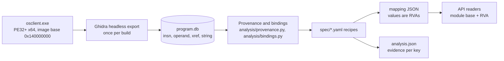
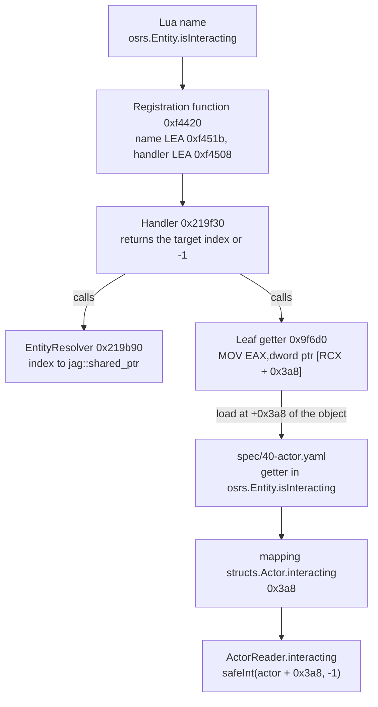
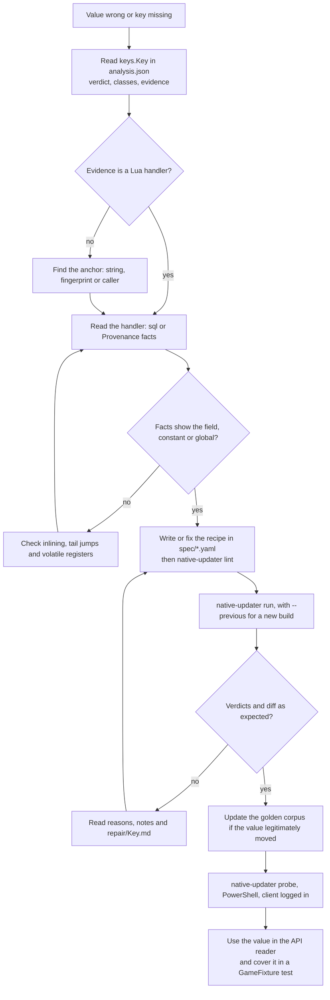

# Reverse Engineering a Build

This page is for contributors who need a value the updater did not map, or one it mapped wrongly. It explains the
ideas behind the recipes, follows one value from a Lua name to the Java reader, and lists the tools for querying a
build's `program.db` and `analysis.json`. The pipeline and the recipe syntax are in [`updater.md`](updater.md); the
user-level run is in [`docs/updater.md`](../updater.md).



## Start With the Symptom

| Symptom | Start with |
|---|---|
| A key is missing from the mapping | `verdict` and `reasons` for the key in `analysis.json`, then the run's list of left-out keys |
| A value is wrong | `evidence` for the key: the instruction (`insn`) and function (`fn`) it came from |
| A feature needs a value that has no key | The Lua name or string the feature uses; see [the Rosetta stone](#the-rosetta-stone-sol2-lua-bindings) |
| A value moved after a game update | `diff` in `analysis.json` and any `repair/<key>.md` from a run with `--previous` |

## The Primer

### The Binary and Its Addresses

`osclient.exe` is a Windows PE file for x64. Its optional header is `PE32+` (magic `0x20b`) and its machine type is
`0x8664`. The preferred load address, the **image base**, is `0x140000000`. Ghidra shows absolute addresses such as
`0x140219f30`. The updater subtracts the image base and stores the rest, a **relative virtual address** (RVA):
`0x219f30`.

Windows loads a module at a different address on each run, so a mapping cannot store absolute addresses. An RVA stays
the same across runs of one build. At runtime the API asks the OS where the module is loaded and adds the RVA:

```text
Ghidra address            0x140219F30   what Ghidra and analysis.json show
  - image base            0x140000000
  = RVA                   0x219F30      what program.db and the mapping store
  + module base           <chosen by Windows for this run>
  = runtime address                     what ReadProcessMemory reads
```

Ghidra's placeholder names carry the absolute address: `FUN_140219f30` is the function at RVA `0x219f30`. `DAT_`
names mark data by address, and `param_1` is an argument position, not a name from the source.

The shape of build 241.3:

| Item | Value | Where to read it |
|---|---|---|
| Sections | `.text` (code), `.rdata` (read-only data and strings), `.data` (globals and heap pointers), `.pdata` (unwind info) | `section` table |
| Functions | 45,922; Ghidra marks 5,314 of them as thunks | `function` table |
| Instructions | 2,734,275 | `insn` table |
| Image base | `0x140000000` | `meta` table, key `image_base` |

### Globals, Pointers and Struct Offsets

A **global** is a variable at a fixed RVA, in `.data`. The root `Client` object is reached through one:
`globals.client` in the mapping is `0xe98c18`. Code loads it with a RIP-relative operand, which Ghidra prints as an
absolute address, `MOV RCX,qword ptr [0x140e98c18]`. This build has 835 memory operands that address that global: loads, stores and `LEA`s.

A **struct** is a block of memory whose fields sit at fixed offsets from its start. A C++ expression such
as `client->topLevelWorld` can compile to `[RCX + 0xCA80]`, so the offset is the only record of where the field sits. A
**pointer chain** is a series of loads, each one starting from a pointer the previous load produced:

```text
module base + 0xE98C18            global.client: 8 bytes holding a Client*
        |
        v
Client                            structs.Client
  +0xCA80  topLevelWorld --------> World                          structs.World
                                    +0x060  players   eastl::hash_map, object inline
                                    +0x090  npcs      eastl::hash_map, object inline
```

The mapping stores each offset relative to its own struct (`World.npcs` is `0x90`). The layout of a container is stored
once, in `containers` (`hash_map.buckets` is `0x8`, `hash_map.bucketCount` is `0x10`), so the bucket array of
`World.npcs` is at `World + 0x98`.

### Reading an Instruction

```text
MOV EAX,dword ptr [RCX + 0x3a8]
```

| Part | Meaning |
|---|---|
| `MOV` | Copy a value. Intel syntax, which Ghidra uses, writes the destination first. |
| `EAX` | The low 32 bits of RAX. Writing EAX also clears the high half of RAX. |
| `dword ptr` | The memory operand is 4 bytes wide. |
| `[RCX + 0x3a8]` | The address is the value in RCX plus the displacement `0x3a8`. |

Read the line as "load the 4-byte field at offset `0x3a8` of the object RCX points to, into EAX". A store puts the
memory operand first: `MOV qword ptr [RCX + 0x3a8],RDI` writes RDI into an 8-byte field.

The registers that matter most, under the Microsoft x64 calling convention:

| Register | Role |
|---|---|
| `RCX`, `RDX`, `R8`, `R9` | First four integer or pointer arguments. In a member function, RCX is `this`. |
| `[RSP + 0x28]`, `[RSP + 0x30]`, ... | Fifth and later arguments, on the caller's stack. The updater calls these `Arg(4)`, `Arg(5)`, ... |
| `RAX` | Integer or pointer return value. Floats come back in `XMM0`. |
| `RAX`, `RCX`, `RDX`, `R8`-`R11`, `XMM0`-`XMM5` | Volatile: a call may change them. |
| `RBX`, `RBP`, `RSI`, `RDI`, `R12`-`R15` | Callee-saved: a function that changes one restores it before `RET`. |

A value too large for RAX comes back through a pointer the caller provides. In the example below, the caller passes the
address of a local in RDX and the callee writes two words into it. The updater calls this an **out-parameter**
(`Out(call, argN)` in [`provenance.py`](../../updater/src/native_updater/analysis/provenance.py)).

### Calls, Leaf Getters and Inlining

- A **leaf** function calls nothing. `0x9f6d0` is one: `MOV EAX,dword ptr [RCX + 0x3a8]` then `RET`, 7 bytes. Its
  `.pdata` column is 0, so it has no unwind entry; leaf functions that use no stack frame usually have none.
- **Inlining** pastes the callee's body into the caller. The load then sits in the caller and no `CALL` remains, so search
  for the displacement (`[reg + 0x3a8]`), not for the call. This build keeps some getters as calls, as the worked
  example shows.
- A **tail call** is a `JMP` at the end of a function. The target runs and its `RET` returns to the first function's
  caller. `0x1010` loads a function pointer into RCX and ends with `JMP 0x140affa34`, which Ghidra names `atexit`.
  The listing has no `RET` after the jump. `ProgramModel.resolve()` follows single-jump stubs and thunks, and
  Provenance treats a tail jump as a call.
- **Identity helpers** return their first argument. `0x42b90` is `MOV RAX,RCX` then `RET`, with 7,634 direct call
  sites. After such a call, follow the argument's register rather than RAX.

The updater's `Provenance.summary` inlines leaves of up to 14 instructions that contain no calls, so a getter's load
shows up in the facts of each caller.

### Containers in Memory

The client's C++ uses EASTL containers. Their offsets are in `containers` in the mapping, and [`api.md`](api.md) covers
the layouts the API reads.

| Type | Layout |
|---|---|
| `eastl::string` (24 bytes) | Byte `0x17` is a flag. If its top bit (`0x80`) is set, the text is on the heap: pointer at `+0x0`, length at `+0x8`. Otherwise the text is inline (small-string optimisation) and its length is `0x17` minus the flag. |
| `eastl::hash_map` | The object holds the bucket array pointer at `+0x8` and the bucket count at `+0x10`. Each node holds the key at `+0x0`, the value at `+0x10` and the next node at `+0x18`. |
| `jag::shared_ptr` (16 bytes) | Two words: a pointer to a reference-counting control block at `+0x0`, and the object at `+0x8`. |

A hash lookup divides the key by the bucket count (`DIV`, the remainder selects the bucket) and walks the chain
comparing keys. A `DIV` by a loaded count, followed by a key compare loop, is the signature to look for.

### What Survives Compilation

Stripping a build removes most names and types, but some things have to stay in the file:

| Survives | Why it stays | Example in 241.3 |
|---|---|---|
| Lua names | The Lua API is registered by name at startup | `"isInteracting"` at string RVA `0xb9c168` |
| Strings | Messages and names are read at runtime | 20,412 entries in the `string` table |
| Field offsets | Every access carries its offset as a displacement | 93 memory operands use `+0x3a8` |
| Constants | Comparisons and arguments keep literal values | The `const` strategy reads the value a compare uses, such as `Client.gameState` against 30 |
| Call graph shape | Callers and callees do not depend on names | `EntityResolver` (0x219b90) is called by the handlers of `isInteracting`, `isHealthbarRendered` and `isHeadbarEmpty` |

Local variable names, C++ types and most function names are lost. An **anchor** is something a recipe can search for
that the compiler cannot remove. A Lua name must stay for scripts to call it, and a field offset must appear in every
instruction that reads the field. Recipes start from a name, a string or a constant, then follow the code they lead to.

## The Rosetta Stone: sol2 Lua Bindings

The client's Lua API (`osrs.*`, `ClientOp`, `ClientState` and others) is built with the sol2 C++ library. At startup, the
registration code hands sol2 each Lua name with its target. For a function, the target is the C++ handler's address.
For a property, it is a data member's offset. The name and the handler sit close together in the registration code,
and each handler is the native code of one Lua function. Reading the handler shows what the Lua function reads.

[`bindings.py`](../../updater/src/native_updater/analysis/bindings.py) pairs names with handlers in five steps:

1. **Find the registration function.** Each `tables:` entry in
   [`spec/00-tables.yaml`](../../updater/src/native_updater/spec/00-tables.yaml) lists anchor names, such as
   `osrs.Entity: { anchors: [osrs.Entity] }`. The function that references the anchors is the registration function.
2. **Collect events in order.** Name strings (`N`, a `LEA` of an identifier-like string), handler addresses (`H`, a `LEA`
   of code) and member offsets (`M`, a 4-byte immediate stored to a stack slot).
3. **Pair names with partners.** Maximum matching pairs each name with an adjacent `H` or `M`. A pair that straddles a
   register call is penalised, because such a call (its RCX is not a stack temporary) separates registrations.
4. **Follow through.** A name left unpaired can resolve through a one-off factory the registration calls (`factory`),
   or through a property's setter template to its getter (`property`).
5. **Enum tables.** Tables such as `osrs.Events` are arrays of `{int32 value, char* name, size_t len}` records in `.rdata`.

List one table with the CLI (the same command runs from WSL through `uv run`):

```text
$ native-updater bindings --binary <osclient.exe> --table osrs.Entity
osrs.Entity.isRendered3D                                  0xf2f00 direct
osrs.Entity.isRendered2D                                  0xf2f10 direct
osrs.Entity.render3D                                     0x219db0 direct
osrs.Entity.render2D                                     0x219ea0 direct
osrs.Entity.isInteracting                                0x219f30 direct
osrs.Entity.isDead                                       0x219fd0 direct
osrs.Entity.isHealthbarRendered                          0x21a000 direct
osrs.Entity.isHeadbarEmpty                               0x21a0e0 direct
osrs.Entity.getName                                      0x17121c direct
```

`analysis.json` holds the same pairs under `bindings`:

```json
"osrs.Entity.isInteracting": {"handler": "0x219f30", "member": null, "kind": "direct"}
```

For 241.3 the 262 bindings split into 138 `direct`, 63 `member`, 23 `factory`, 23 `property` and 15 `unpaired`.

The registration site for `isInteracting` (the function at RVA `0xf4420`). The first column is the RVA; operands are
Ghidra's absolute addresses:

```text
0xf4508  LEA RAX,[0x140219f30]        the handler's address, stored into a sol2 object on the stack
0xf450f  MOV qword ptr [RBP + 0x20],RAX
0xf451b  LEA RAX,[0x140b9c168]        the name string "isInteracting"
0xf4522  MOV qword ptr [RBP + -0x38],RAX
0xf4526  CALL 0x140114ab0             a register call: the name's window ends here
```

## Worked Example: `Actor.interacting`

This walk follows the key from its Lua name to the Java reader. Every value can be checked with the commands shown.



### Step 1: The Key in analysis.json

```json
"Actor.interacting": {
  "value": "0x3a8",
  "verdict": "ANCHORED",
  "classes": "A",
  "evidence": [
    {"strategy": "getter", "cls": "A", "insn": "0x9f6d0", "fn": "0x9f6d0",
     "text": "MOV EAX,dword ptr [RCX + 0x3a8]", "slot": "disp"}
  ]
}
```

`ANCHORED` means one strong class of evidence (A, a Lua name) and its invariants hold. `PROVEN` needs a second class
that agrees. The evidence points into `0x9f6d0`, not the handler, because the updater's inlined facts keep the address
of the instruction the load came from.

### Step 2: The Recipe

From [`spec/40-actor.yaml`](../../updater/src/native_updater/spec/40-actor.yaml), lines 52 to 59:

```yaml
  - key: Actor.interacting
    type: i32
    priority: P0
    live: interacting
    strategies:
      - getter: { in: osrs.Entity.isInteracting, base: sp_result, load: i32, select: { returned: true } }
    invariants:
      - adjacent: { key: Actor.interactingType, delta: -1 }
```

- `in:` names the handler through the binding table.
- `base: sp_result` says the load hangs off the object in a `jag::shared_ptr` that a call returns through an out-parameter.
- `load: i32` is a 4-byte load.
- `select: { returned: true }` keeps only loads that feed the handler's return value.
- The invariant checks that `Actor.interactingType` sits one byte below (`0x3a7`).

### Step 3: The Handler

The first lines of the handler at `0x219f30`, as listed from `program.db` (column one is the RVA):

```text
0x219f30  MOV qword ptr [RSP + 0x10],RSI
0x219f35  PUSH RDI
0x219f36  SUB RSP,0x30
0x219f3a  LEA RDX,[RSP + 0x20]
0x219f3f  CALL 0x140219b90
0x219f44  MOV RCX,qword ptr [RSP + 0x28]
0x219f49  MOV ESI,0xffffffff
0x219f4e  TEST RCX,RCX
0x219f51  JZ 0x140219f65
0x219f53  CALL 0x14009f6c0
0x219f58  TEST AL,AL
0x219f5a  JZ 0x140219f65
0x219f5c  CALL 0x14009f6d0
0x219f61  MOV EDI,EAX
0x219f63  JMP 0x140219f67
```

| Lines | What happens |
|---|---|
| `0x219f30`-`0x219f36` | Prologue. Saves RSI and RDI (callee-saved) and reserves `0x30` bytes. `[RSP+0x20]` to `[RSP+0x2F]` is a local for the out-parameter. |
| `0x219f3a`-`0x219f3f` | RDX gets the local's address. The call to `0x219b90` (EntityResolver) fills it with a `jag::shared_ptr`. RCX still holds the handler's first argument. |
| `0x219f44` | Loads the object pointer, the second word of the local (`+0x8`), into RCX. |
| `0x219f49`-`0x219f51` | ESI = -1, the "no target" result. A null object returns -1. |
| `0x219f53`-`0x219f58` | Calls `0x9f6c0`, which is `MOVZX EAX,byte ptr [RCX + 0x3a7]` then `RET`. A zero type byte returns -1. |
| `0x219f5c`-`0x219f63` | Calls the getter `0x9f6d0`, which loads `[RCX + 0x3a8]`, and keeps the result in EDI. |
| `0x219f67`-`0x219fc6` | Releases the `shared_ptr`. `XADD.LOCK` is the atomic decrement of its count. Then `MOV EAX,EDI` and `RET`. |

The helper `0x219b90` (EntityResolver, 147 instructions) reads a flag from its argument to choose between the
`World.players` and `World.npcs` hash maps, which it reaches through `Client.topLevelWorld` (`0xca80`). It looks the
index up with the `DIV` pattern above and writes the result to its out-parameter. The `spec/30-world.yaml` recipes for
`World.players` and `World.npcs` read that same helper.

### Step 4: The Fact a Recipe Matches

```python
facts = Provenance(m).facts(0x219F30)
for r in facts.returns:
    print(hex(r.rva), r.value)
```

```text
0x219fc6 {[[Out(0x219b90, arg1) + 0x8]8 + 0x3a8]4 | 0xffffffff}
```

The braces hold the handler's two possible return values: the 4-byte load at `+0x3a8` of the object in the out-parameter's
second word, or `0xffffffff`. `Out(0x219b90, arg1)` is the out-parameter the call at `0x219b90` wrote through argument 1
(RDX). The `]8` marks an 8-byte load. Provenance walks the handler in order, and it substitutes each leaf call with the
leaf's return value.

### Step 5: The Strategy Output

```python
from native_updater.session import Session
from native_updater.spec import load
from native_updater import strategies

s = Session(m, load(), print)
s.parse_bindings()
cands = strategies.getter(s, {"in": "osrs.Entity.isInteracting", "base": "sp_result", "load": "i32",
                              "select": {"returned": True}}, "Actor.interacting")
print([hex(c.value) for c in cands])   # ['0x3a8']
```

`Session` and the spec loader need PyYAML. The model and `Provenance` do not.

### Step 6: The Mapping and the Golden Corpus

In `structs.Actor` of [`api/src/main/resources/mappings/241.3.json`](../../api/src/main/resources/mappings/241.3.json)
the mapping holds:

```json
"Actor": { "interacting": "0x3a8", "interactingType": "0x3a7", "pathX": "0x3f0", "pathZ": "0x418" }
```

[`updater/corpus/241.3.golden.json`](../../updater/corpus/241.3.golden.json) holds `Actor.interacting: 0x3a8` as an
accepted value. The golden test fails when a recipe change moves it.

### Step 7: The Java Reader

[`ActorReader.java`](../../api/src/main/java/com/kraken/api/internal/reader/ActorReader.java) reads the offsets in its
constructor (`optionalOffset("Actor.interacting")`), and its `interacting` method repeats the handler's logic:

```java
/** {@code isInteracting}: the target's index if the target type is set, else -1. */
public int interacting(long actor) {
    if (actor == 0 || aInteractingType < 0 || aInteracting < 0) {
        return -1;
    }
    return safeU8(actor + aInteractingType, 0) != 0 ? safeInt(actor + aInteracting, -1) : -1;
}
```

[`Actor.isInteracting()`](../../api/src/main/java/com/kraken/api/actor/Actor.java) calls it. The type byte at `+0x3a7` gates
the index at `+0x3a8`, as the Lua handler does.

## Tools

### Ghidra Project and Headless Export

Ghidra opens a project in `cache/<sha256>/ghidra/`, where the import leaves `osclient.gpr`. This machine's cache for
241.3 has no project folder: only `export/`, `program.db` and `analysis.json` remain. Running the import again creates one.

`native-updater export` runs the same export when `--ghidra` or `GHIDRA_INSTALL_DIR` is set, and prints the command when
neither is. The command, as the updater builds it in [`ghidra.py`](../../updater/src/native_updater/ghidra.py):

```powershell
& "C:\Tools\ghidra_12.1_PUBLIC\support\analyzeHeadless.bat" "$env:USERPROFILE\.kraken-native\cache\<sha256>\ghidra" osclient -import "<path>\osclient.exe" -scriptPath "<repo>\updater\ghidra" -postScript ExportProgramModel.java "$env:USERPROFILE\.kraken-native\cache\<sha256>\export" -analysisTimeoutPerFile 7200
```

The first import takes 10 to 15 minutes and up to 12 GB of memory (`MAXMEM` defaults to `12G` in the updater).
Once the project exists, the updater re-runs only the export. To open the project in Ghidra, use File, Open Project
and choose `osclient.gpr`.

Use the Listing view for offsets. The decompiler merges registers and names variables, so the register and stack details
that the updater matches are harder to see there. Use it to follow control flow.

### Reading program.db

[`model.py`](../../updater/src/native_updater/model.py) builds the database. Addresses are RVAs, except in the text of
`insn`, which keeps Ghidra's absolute addresses.

| Table | Columns | Holds |
|---|---|---|
| `meta` | `key`, `value` | `image_base`, `sha256`, `ghidra_version`, counts |
| `section` | `name`, `rva`, `vsize`, `raw_off`, `raw_size`, `perms` | PE sections, read from the file |
| `function` | `entry`, `name`, `end`, `size`, `is_thunk`, `thunk_target`, `pdata`, `body` | One row per function. `body` lists address ranges (`start-end`), since a function can have several |
| `insn` | `rva`, `fn`, `len`, `bytes`, `mnem`, `text`, `target`, `fallthrough`, `flows` | Every instruction and its function. `text` is Ghidra's text with absolute addresses; `target` and `flows` are RVAs |
| `operand` | `rva`, `idx`, `kind`, `base`, `idxreg`, `scale`, `disp`, `size`, `imm` | Memory and immediate operands. For image-relative operands `base` is `RIP` and `disp` is an RVA |
| `string` | `rva`, `value` | C strings, including strings referenced from the middle of a longer one |
| `xref` | `src`, `dst`, `kind`, `fn` | `call`, `jump`, `lea` (address taken), `read` or `write`. `src` is the instruction and `fn` its function |

Indexes: `insn_fn (fn, rva)`, `insn_target (target)`, `operand_disp (disp) WHERE kind = 'mem'`, `operand_imm (imm)
WHERE kind = 'imm'`, `operand_rva (rva)`, `string_value (value)`, `xref_dst (dst, kind)` and `xref_src (src)`.

The two operand indexes are partial. A query uses them only when it repeats the condition, so write `kind = 'mem'` next
to `disp`. Timings below are warm, on this machine.

```sql
-- Listing of one function (insn_fn): under 1 ms
SELECT rva, text FROM insn WHERE fn = 0x219f30 ORDER BY rva;

-- Who references an address (xref_dst): about 1 ms
SELECT src, fn, kind FROM xref WHERE dst = 0x219f30;

-- Memory operands with displacement 0x3a8 (operand_disp): under 1 ms
SELECT i.rva, i.fn, i.text FROM operand o JOIN insn i ON i.rva = o.rva
WHERE o.kind = 'mem' AND o.disp = 0x3a8;

-- Every access to the global client pointer (RIP-relative, disp is the RVA): 835 rows
SELECT i.rva, i.fn, i.text FROM operand o JOIN insn i ON i.rva = o.rva
WHERE o.kind = 'mem' AND o.base = 'RIP' AND o.disp = 0xe98c18;

-- A string by exact text (string_value): under 1 ms
SELECT rva FROM string WHERE value = 'isInteracting';

-- Callers of a function (xref_dst): about 1 ms; ProgramModel.callers() also follows thunks
SELECT DISTINCT fn FROM xref WHERE dst = 0x42b90 AND kind = 'call';
```

These are slow, because they scan a whole table:

```sql
-- Substring search on instruction text: a full scan of insn, about 310 ms
SELECT rva, text FROM insn WHERE text LIKE '%0x3a8%';

-- No kind condition, so operand_disp is not used: a scan of operand, about 130 ms
SELECT rva FROM operand WHERE disp = 0x3a8;
```

Use `=` on `string.value` when the text is known, and use `LIKE` only for exploration.

### native-updater Commands

[`cli.py`](../../updater/src/native_updater/cli.py) provides the commands. From WSL, run them as
`uv run native-updater ...` in `updater/` with the shell function from [`updater/README.md`](../../updater/README.md).
From Windows, the read-only commands also run as `python -m native_updater ...` in `updater\src`, with no `uv` and
no venv.

| Command | Use |
|---|---|
| `bindings --table <Table>` | The Lua names of one table and their handlers |
| `sql "<query>"` | Any read-only query on `program.db`, tab-separated, with integers above 9 printed in hex |
| `lint` | Checks the spec YAML |
| `run [--previous <old>.json] [--out DIR]` | Writes the mapping and `analysis.json`. Without `--out` it overwrites the bundled mapping for that version |
| `probe --mapping <file> --display-name <name>` | Live read-only check, see below |

A query from Windows:

```text
> python -m native_updater sql --binary <osclient.exe> "SELECT i.rva, i.fn, i.text FROM operand o JOIN insn i USING(rva) WHERE o.kind='mem' AND o.disp=0x3a8 AND i.mnem='MOV' LIMIT 3"
0x2b1d9  0x2af10  MOV qword ptr [RCX + 0x3a8],RDI
0x565b9  0x56210  MOV dword ptr [RSI + 0x3a8],0x15
0x7f4be  0x7deb0  MOV dword ptr [RBP + 0x3a8],EAX
```

These rows write other fields that share the displacement. The base register and the function's role say which struct a
displacement belongs to.

### Provenance in a Python Session

[`provenance.py`](../../updater/src/native_updater/analysis/provenance.py) runs a forward interpretation of one function
and records what each load, store, call, compare and return uses. Set it up from the Windows Python, with `updater\src`
on the path (no `uv` and no venv):

```python
import sys
from pathlib import Path

sys.path.insert(0, r"<repo>\updater\src")
from native_updater import model
from native_updater.analysis.provenance import Provenance
from native_updater.ghidra import paths

root = Path.home() / ".kraken-native"
sha = "166231c8f6bd05c7542b8f0d35eb64b0aad701a87ba6ba41f60c4706de946944"
m = model.ProgramModel(paths(root, sha)["db"], str(root / "store" / sha / "osclient.exe"))
facts = Provenance(m).facts(0x219F30)
```

`facts` has lists `loads`, `stores`, `calls` (with `rva`, `target` and `args`), `cmps`, `returns` and `addrs`. The values
in them are:

| Value | Meaning |
|---|---|
| `Const(n)`, `Global(rva)` | An integer constant; the address of a global |
| `Arg(i)`, `StackAddr(off)` | Argument `i` at entry; a stack slot, relative to entry RSP |
| `Ret(rva, target)`, `Out(rva, i)` | The value a call returned; an out-parameter that call wrote through argument `i` |
| `Deref(base, off, size, index, scale)` | A load from `[base + off + index*scale]` |
| `Add`, `Mul`, `Many`, `Unknown` | Offset arithmetic, a product, one of several values at a join (at most four), and no information |

### Reading analysis.json

`analysis.json` sits next to `program.db`, in `cache/<sha256>/`. It is rewritten on every run of the same build.

| Field | Content |
|---|---|
| `version`, `sha256`, `linked`, `generatedAt`, `updater`, `ghidra` | Build identity and tool versions |
| `verdicts` | Count per verdict. For 241.3: 5 PROVEN, 551 ANCHORED, 14 INFERRED, 0 NEEDS_REVIEW, 0 FAILED |
| `keys` | One entry per spec key, internal ones included: `value`, `verdict`, `classes`, up to four `evidence` records (`strategy`, `cls`, `insn`, `fn`, `text`, `slot`), and `note` |
| `keys.<Key>.reasons` | Present for keys the mapping leaves out, such as `blocked by fingerprint X not found` or `strategies disagree` |
| `fingerprints` | `rva`, `status` (MATCHED or not) and the rule that matched |
| `bindings` | `handler`, `member` and `kind` (`direct`, `member`, `factory`, `property`, `unpaired`, `ambiguous`) per Lua name |
| `diff` | With `--previous`: `key`, `old`, `new` and `kind` (`moved`, `new`, `gone`). `null` otherwise |
| `carryForward` | With `--previous`: counts of matched functions and carried values, and the repair folder. `null` otherwise |
| `notes` | Problems in the run's own inputs, such as a binding table with no registration function |

The `fingerprints` entry for the helper used above reads:

```json
"EntityResolver": {"rva": "0x219b90", "status": "MATCHED",
  "note": "1 match; rule {'common_callee_of': ['osrs.Entity.isInteracting', 'osrs.Entity.isHealthbarRendered', 'osrs.Entity.isHeadbarEmpty']}"}
```

### Repair Bundles and --previous

`run --previous <old>.json` needs the old build's `program.db` and `analysis.json` in the cache, which is why the old build
should be mapped on the same machine. Carry-forward matches old functions to new ones by identical binding names,
fingerprints and unique anchor strings, then follows aligned call sequences. It re-reads each old evidence instruction
in its matched function (class F), and delta propagation (class G) fills struct fields whose neighbours moved by the same
amount.

For each key still FAILED or NEEDS_REVIEW, the run writes `cache/<sha256>/repair/<key>.md`. The file has the old
function around the evidence (12 instructions either side) and the first 60 instructions of the matched new function.
Compare the two with the sql queries above.

### debug/ Symbol Dumps

The `debug/` folder holds dumps of a macOS debug build of client 216, which is a different platform and version.

| File | Holds |
|---|---|
| `symbols_table_demangled.txt` (83 MB) | `address<TAB>demangled name` |
| `symbols_table.txt` (32 MB) | `address<TAB>mangled name` |
| `symbols.txt` (4.5 MB) | Demangled names, mostly without addresses |
| `constants.txt` (190 KB) | Data symbols, with `s` (local) or `S` (global) and imported `U` symbols |
| `strings.txt` (1.7 MB) | Section entries with string and base64 data |

Names carry over between builds, and offsets do not. The 216 names give you the class and member names to search for in
241.3, and the 241.3 code gives you the offsets:

```bash
grep -m 12 "jag::game::Entity::" debug/symbols_table_demangled.txt | cut -f2 | cut -c1-120
grep -m 10 "NotifyInteracted" debug/symbols.txt
```

Addresses in `symbols_table_demangled.txt` are unreliable. Seven `jag::game::Entity::` lines list the same address,
`0x100009e70`, so read the names and ignore the addresses.

### Prior Notes in findings/

`~/.kraken-native/findings/` holds notes from an earlier pass against this build, outside the repo. Each API area has a
`.md` file and a `.tsv` table of members with their status, and a `.members.tsv` list of members. The event ids in these
notes are one higher than the current `enums.events`: `state.md` gives `ON_INV_TRANSMIT = 13` and `ON_STAT_TRANSMIT = 14`,
and the mapping now has 12 and 13. Take ids from [`mapping-format.md`](mapping-format.md) and the mapping, not from the notes.

`~/.kraken-native/scripts/rq.py` answers the common questions on `program.db` from the command line (`fn`, `callers`,
`callees`, `str`, `disp`, `imm`, `refs`, `at`). It has a fixed path to this machine's database.

### Live Checks With probe

`native-updater probe --mapping <mapping.json> --display-name <name>` runs from PowerShell against the running
`osclient.exe`. It refuses to run when the process's SHA-256 differs from the mapping's, and it never writes. It prints PASS,
FAIL or SKIP for each check, and exits with `2` if any check fails. Check names are the spec `live:` names, for example
`interacting`, `fineVsPath`, `hashMap` and `localPlayerName`. The docstring in
[`probe.py`](../../updater/src/native_updater/probe.py) says it has not run against a logged-in client, so treat a
failure as a lead to investigate.

## Workflow: From Symptom to Verified Value



1. Read the key's `evidence` in `analysis.json`. Evidence from a binding handler leads to step 2. A recipe whose `in:` is
   a string (`{string: "..."}`) or a fingerprint (`@Name`) starts from the function that anchor resolves to.
2. Read the handler's listing and its Provenance facts. Decide whether the value is a field load, a constant from a
   compare, a global or a call's result.
3. Write the recipe with the strategy that matches the fact (`getter`, `const`, `global-load`, `hash-map`, and so on). Name
   offset parameters `offset`, because YAML reads a bare `off` as `false`. Run `native-updater lint`.
4. Run `native-updater run` into a scratch directory with `--out` while you iterate. Check `diff`, `verdicts` and the
   `reasons` of any key left out. [`updater.md`](updater.md) covers the strategies and the spec format.
5. Run the unit and golden tests from WSL: `uv run python -m unittest discover -s tests -t .` in `updater/`. The golden test
   skips when the build is not cached, and a skip is not a pass.
6. Run `probe` with the client logged in, then check the value in the API reader.

## Pitfalls

1. **Arrays of offsets.** `Actor.pathX` (`0x3f0`) and `Actor.pathZ` (`0x418`) are `i32[10]` arrays, 0x28 bytes apart.
   A single 4-byte load cannot tell which array a recipe found, so the spec states `Actor.pathZ` equals
   `Actor.pathX + 0x28`. Keep that `equals` invariant when you change either recipe.
2. **Axes.** The client keeps height in `y` and north in `z`, and the API swaps them. `Actor.fineZ` (`0x26c`) is north, and
   the height comes from the ground: `FineCoord(x, height, z)` in `ActorReader`. `WorldPoint.y` is north. Check the Lua
   name's axis before you copy a component into a field.
3. **Strings are not pointers.** A short `eastl::string` keeps its text inline. `Actor.name` (`0x710`) is derived from the
   flag byte of the name string, `Actor.nameSsoFlag` (`0x727`) minus `0x17`. `Actor.overheadText` is read with `load: xmm`,
   a 16-byte move, because the Lua handler copies the whole string with one. An 8-byte load reads the first eight
   characters or a heap pointer.
4. **Folded constants.** The compiler can keep a value only as an immediate in a `CMP`. Search the compares as well as the
   loads, as the `const` strategy does.
5. **Tail jumps and thunks.** A `JMP` at a function's end hands control on, so the instruction that matters may belong to
   the target. `ProgramModel.resolve()` follows single-jump stubs. Provenance treats a tail jump as a call.
6. **Volatile registers after a call.** `Provenance` clears only RAX and XMM0 at a call (`CALL_CLOBBERS`). RCX, RDX and
   R8-R11 keep their pre-call values in the model. That matches a leaf callee that leaves them alone and is wrong for a
   non-leaf callee that writes them. When a fact reads a volatile register after a call, check the listing first.
7. **Displacements without a base.** `+0x3a8` appears in 93 memory operands. Filter by the base register and the
   function's role before you attach a displacement to a struct.
8. **Three address forms.** Ghidra's text and `FUN_` names use absolute addresses, the database and the mapping use RVAs,
   and `analysis.json` uses hex RVAs. Convert with the image base before you compare them.
9. **Tests share the mapping's offsets.** `GameFixture` writes fields with `map.offset(...)`, the same offsets the reader
   uses, so a wrong offset reads back correctly in a test. Only the live probe and the golden corpus check the offsets.
10. **`run` overwrites.** Without `--out`, `run` writes the bundled mapping for that version and replaces the build's
    `analysis.json`. Use a scratch `--out` directory while you experiment.
11. **One venv per platform.** `updater/.venv` belongs to one platform. Running `uv` from the other one rebuilds it, so
    use the WSL shell function from [`updater/README.md`](../../updater/README.md) for WSL runs.
12. **Old notes.** The `findings/` event ids are one higher than `enums.events`, and the `debug/` addresses repeat across
    unrelated names. Use the notes and dumps for names and ideas, and check every value against the current build.

## See Also

- [`updater.md`](updater.md): the pipeline, strategies, spec format and provenance internals
- [`mapping-format.md`](mapping-format.md): what each mapping section means and which code reads it
- [`api.md`](api.md): the readers, containers, identity rules and memory layouts
- [`cookbook.md`](cookbook.md): step-by-step changes, including adding a Lua read
- [`docs/updater.md`](../updater.md): running the updater on a new client build
- [`updater/README.md`](../../updater/README.md): commands, recipe syntax and anchor classes
