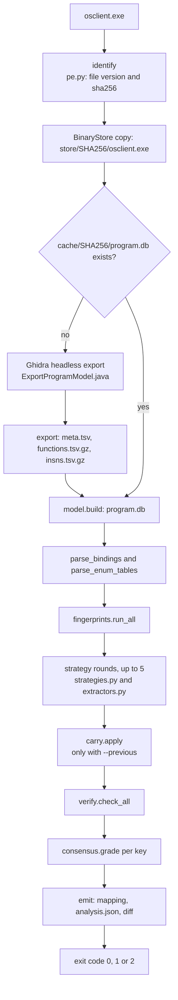
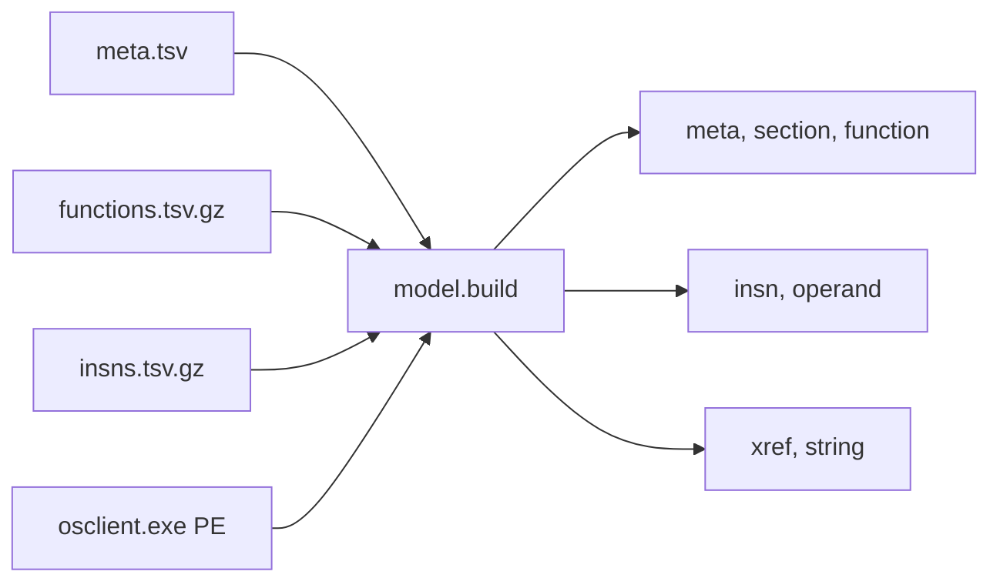
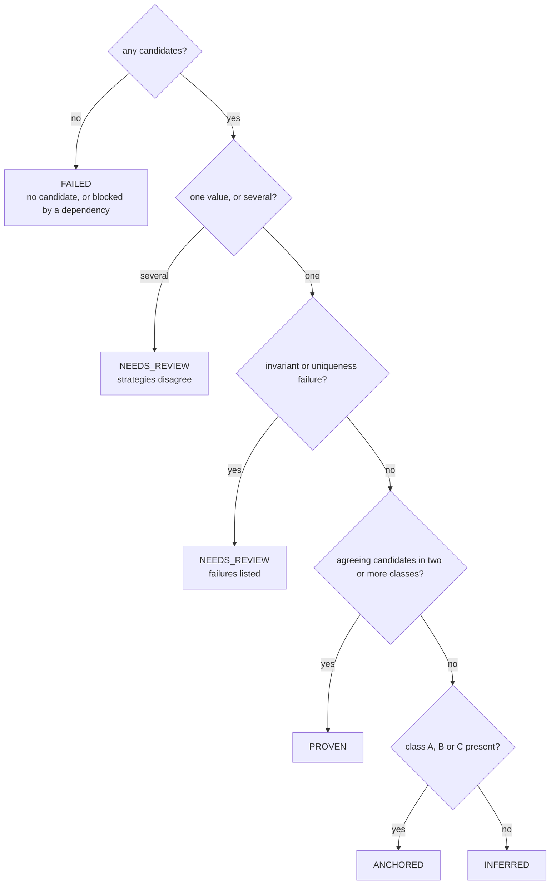
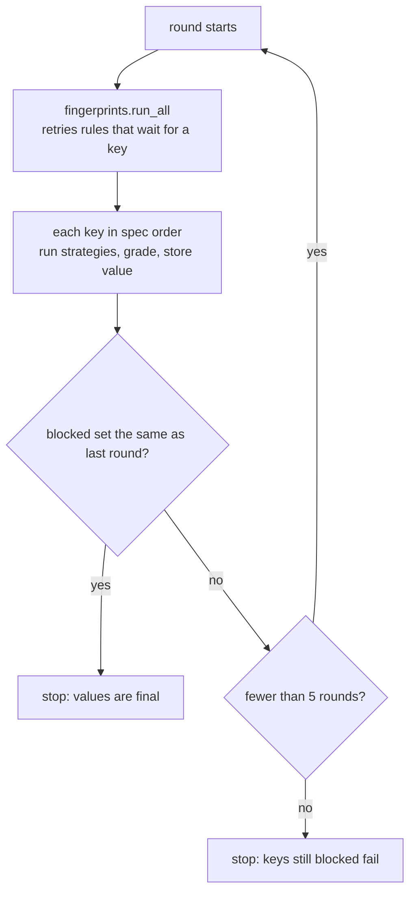
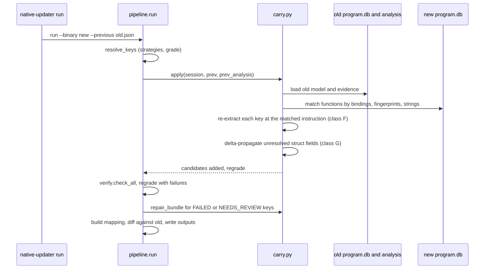

# Updater

The updater (`updater/`, Python) reads one `osclient.exe` build without running it and writes that build's mapping,
`api/src/main/resources/mappings/<version>.json`. It disassembles the binary once with Ghidra, loads the result into a
SQLite database, and runs a set of recipes over it. Each recipe proposes candidate values. A key is written when its
candidates agree and pass the static checks, and its verdict records how strong the evidence is. The output format is in
[mapping-format.md](mapping-format.md). Steps for running the updater are in [the user guide](../updater.md).

## Pipeline



`pipeline.run` does the work in this order. It grades every key after each strategy round, again after carry-forward,
and again after the static checks, so a verdict can change between those steps.

| Stage | Module | Reads | Writes |
|---|---|---|---|
| Identify | [`pe.py`](../../updater/src/native_updater/pe.py), [`identity.py`](../../updater/src/native_updater/identity.py) | the exe | version, sha256, link time, a copy in `store/` |
| Export | [`ghidra.py`](../../updater/src/native_updater/ghidra.py), [`ExportProgramModel.java`](../../updater/ghidra/ExportProgramModel.java) | the exe | `cache/SHA256/export/` |
| Program model | [`model.py`](../../updater/src/native_updater/model.py) | export, PE sections | `cache/SHA256/program.db` |
| Bindings and enums | [`analysis/bindings.py`](../../updater/src/native_updater/analysis/bindings.py), [`session.py`](../../updater/src/native_updater/session.py) | program model | bindings, enum tables |
| Fingerprints | [`fingerprints.py`](../../updater/src/native_updater/fingerprints.py) | program model | function RVAs by name |
| Strategies | [`strategies.py`](../../updater/src/native_updater/strategies.py), [`extractors.py`](../../updater/src/native_updater/extractors.py) | spec, program model, provenance | candidates per key |
| Carry-forward | [`carry.py`](../../updater/src/native_updater/carry.py) | previous mapping and its cache | more candidates, repair bundles |
| Static checks | [`verify.py`](../../updater/src/native_updater/verify.py) | values | failures per key |
| Grade | [`consensus.py`](../../updater/src/native_updater/consensus.py) | candidates, failures | verdict per key |
| Emit | [`emit.py`](../../updater/src/native_updater/emit.py) | verdicts, values | mapping, `analysis.json`, diff, summary |

[`pipeline.py`](../../updater/src/native_updater/pipeline.py) holds the sequence. [`cli.py`](../../updater/src/native_updater/cli.py)
parses the subcommands. Any uncaught exception prints a traceback and exits `1`.

## Build Identity and the Store

A build is named by its SHA-256. The version comes from the exe's file version resource.

[`pe.py`](../../updater/src/native_updater/pe.py) is a small PE32+ reader (headers, sections, the `.pdata` exception
table, and reads by RVA). An RVA (relative virtual address) is an address measured from the image base, which is where
the exe is loaded. Ghidra and the updater both use RVAs, so a value is the same whatever base the game loads at.

`file_version()` finds the `VS_FIXEDFILEINFO` block by its signature (`0xFEEF04BD`) and reads `dwFileVersionMS`. The
major version is the high word and the minor the low word, so a file version of 241.3 gives `"241.3"`. The Java side reads
the same bytes in [`ClientBuild`](../../api/src/main/java/com/kraken/api/ClientBuild.java), and the two must stay in
step.

[`identity.py`](../../updater/src/native_updater/identity.py) holds the build identity and `BinaryStore`. The cache
root is `KRAKEN_NATIVE_HOME` if set, otherwise `.kraken-native` in the Windows profile. Under WSL the profile is found
through `cmd.exe`, so Windows and WSL share one cache.

```text
~/.kraken-native/
  store/SHA256/osclient.exe          a copy of every exe the updater has mapped
  cache/SHA256/ghidra/               Ghidra project (osclient.gpr)
  cache/SHA256/export/               Ghidra export: meta.tsv, functions.tsv.gz, insns.tsv.gz
  cache/SHA256/program.db            program model (SQLite, about 360 MB for 241.3)
  cache/SHA256/analysis.json         verdicts, evidence and notes for the build
  cache/SHA256/repair/KEY.md         repair bundles, written with --previous
```

Every run calls `BinaryStore.archive`, which makes sure the exe has a copy in `store/`. A copy is made only when the
folder is missing. The stored exe is what a later `--previous` run needs to load the old build's model.

## Ghidra Export

Ghidra's headless analyser builds the disassembly and the function list. The updater drives it and reads the result.
[`ghidra.py`](../../updater/src/native_updater/ghidra.py) `ensure_model` picks one of four paths:

1. `cache/SHA256/program.db` exists: return it.
2. The export folder has `insns.tsv.gz`: build the model from it.
3. Ghidra is not configured (`GHIDRA_INSTALL_DIR` unset, no `--ghidra`): print the exact command, then return `None`.
   `run` exits `1`.
4. Otherwise run `analyzeHeadless`. The first run imports the exe (`-import`). Later runs reuse the project with
   `-process osclient.exe -noanalysis`. Both pass `-postScript ExportProgramModel.java <export dir>` and
   `-analysisTimeoutPerFile 7200`. `MAXMEM` defaults to `12G`. The run takes 10 to 15 minutes on a new build.

[`ExportProgramModel.java`](../../updater/ghidra/ExportProgramModel.java) writes three files. Every address is an RVA in
lowercase hex without `0x`.

| File | Columns |
|---|---|
| `meta.tsv` | `ghidra_version`, `image_base`, `sha256`, `functions`, `functions_created`, `insns` |
| `functions.tsv.gz` | entry, name, is_thunk, thunk target, body as `start-end` ranges (end exclusive) |
| `insns.tsv.gz` | rva, owning function entry or `-`, length, bytes as hex, Ghidra's text, flows, fallthrough |

Before writing, the script gives each run of code that has no function a function of its own. Ghidra leaves some code
without one, mostly sol2 lambdas reached only through a `LEA`, and the instruction table needs an owner for them. On
241.3 this created 6,169 of the 45,922 functions.

## The Program Model

[`model.py`](../../updater/src/native_updater/model.py) imports the export into SQLite once per build. Opening it is
read-only (`mode=ro`), so any number of queries can run against one file. The schema is in `_SCHEMA`, the indexes in
`_INDEXES`. The row counts below are the 241.3 values.

| Table | Columns | Rows (241.3) | Notes |
|---|---|---|---|
| `meta` | key, value | 8 | the export's `meta.tsv` plus `schema` and `binary` |
| `section` | name, rva, vsize, raw_off, raw_size, perms | 7 | from the PE section table |
| `function` | entry (PK), name, end, size, is_thunk, thunk_target, pdata, body | 45,922 | `pdata` is set when `.pdata` has the entry |
| `insn` | rva (PK), fn, len, bytes, mnem, text, target, fallthrough, flows | 2,734,275 | `flows` holds the extra targets of a jump table |
| `operand` | rva, idx, kind, base, idxreg, scale, disp, size, imm | 2,129,710 | memory (1,217,224) and immediate (912,486) operands only |
| `string` | rva (PK), value | 20,412 | printable runs in data sections, plus C strings that `LEA` or reads point at |
| `xref` | src, dst, kind, fn | 631,568 | `call` 183,199, `jump` 320,523, `lea` 70,838, `read` 47,064, `write` 9,944 |

The indexes are `insn_fn (fn, rva)`, `insn_target (target)`, `operand_disp` and `operand_imm` (partial, one per
operand kind), `operand_rva`, `string_value`, `xref_dst (dst, kind)` and `xref_src (src)`. The
`operand_disp` index is what makes `sql` queries like "every instruction that uses displacement 0xCC70" fast.



`build` parses each instruction with [`x86.py`](../../updater/src/native_updater/x86.py). Memory operands go to
`operand`. A `RIP`-relative memory operand becomes an `xref`: `lea` for `LEA`, `write` when it is the destination of a
memory write, and `read` otherwise. Direct call and jump targets become `call` and `jump` xrefs. The image base must
match the PE, or the build stops.

### Queries

`ProgramModel` is the read API. Most recipes use these methods:

| Method | Returns |
|---|---|
| `function(entry)`, `function_containing(rva)` | the function row, or the entry of the function holding an address |
| `resolve(rva)` | the real target after following thunks and single-`JMP` stubs (at most 8 hops) |
| `insns(fn)`, `insn(rva)`, `insn_bytes(rva)` | parsed instructions of a function, one instruction, or its raw bytes |
| `callers(fn)`, `call_sites(fn)`, `callees(fn)` | direct callers, including through thunks; call instructions with their caller; resolved callees |
| `string_at(rva)`, `strings_equal(text)`, `strings_like(pattern)` | strings by address or by text |
| `xrefs_to(rva, kinds)`, `string_refs(text)` | references to an address; `(instruction, function)` pairs for every function using an exact string |
| `insns_with_disp(disp, mnem)`, `insns_with_imm(imm, mnem)` | instructions with a memory displacement or an immediate |

For an ad hoc question, use the `sql` subcommand. It prints rows from `program.db`:

```text
native-updater sql --binary <osclient.exe> "SELECT i.rva, i.fn, i.text FROM operand o JOIN insn i USING (rva) WHERE o.kind = 'mem' AND o.disp = 0xcc70"
```

## Parsing Instructions

[`x86.py`](../../updater/src/native_updater/x86.py) turns Ghidra's instruction text into `Op` and `Insn` values. The
register table maps every alias to its 64-bit register, so `EAX` is `RAX` with size 4. An operand is one of three kinds:
`reg`, `imm`, or `mem` (base, index, scale, displacement, size).

```text
MOV EAX,dword ptr [RCX + RAX*0x4 + 0x3350]
  -> mem: base RCX, index RAX, scale 4, disp 0x3350, size 4
```

Ghidra prints a `RIP`-relative operand as an absolute address (`[0x140e98c18]`). `_rebase` converts it to base `RIP`
with the displacement as an RVA. Direct call and jump targets are rebased the same way. `Insn.target` is the target of a
direct call or jump, and `flows` holds the extra targets Ghidra resolved from a jump table.

## Lua Bindings

The client registers its Lua API with sol2, a C++ binding library. Each Lua name is a string in `.rdata`, and each
handler is a function address. The compiler lays these out in the registration function as a sequence of `LEA`s and
calls, so nothing ties a name to its handler except its position.
[`analysis/bindings.py`](../../updater/src/native_updater/analysis/bindings.py) recovers the pairs.

`BindingTableParser.parse` reads the registration function in order and writes one event per interesting instruction:

| Event | Found as | Meaning |
|---|---|---|
| `N` | `LEA` of an identifier-like string | a Lua name |
| `H` | `LEA` of code that is a function | a handler |
| `M` | `MOV dword [RSP+x], imm` whose stack slot is later taken with `LEA` | a data member's offset (a property) |
| cut | a call whose `RCX` is not a stack temporary | a register call, such as a sol2 `set` on the table |

Names used three or more times in one function are dropped, as are the table's own namespace names. A name repeated
back to back, such as a length loop and a constructor that both read the same string, is recorded once.

The `N` events are paired with an adjacent `H` or `M` by a dynamic-programming maximum matching. A pair scores 1000,
less 10 when it straddles a cut, so a name pairs with the handler registered next to it, not one across a register
call. The result is one `Binding` per name with a `kind`:

| Kind | Meaning |
|---|---|
| `direct` | paired with a handler in the same registration |
| `member` | paired with a member offset (a data member of a usertype) |
| `factory` | no handler, but the call next to the name runs a one-off factory that stores exactly one handler |
| `property` | a `sol::property` whose getter lambda is reached through the setter the name's window calls |
| `unpaired` | none of the above (15 on 241.3) |
| `ambiguous` | a factory with more than one candidate handler |

`parse_enum_tables` finds enum arrays in `.rdata`. Each record is 24 bytes: the value (int32, padded to 8), a pointer to
a name, and the name's length. A run of at least three records is a table. The enum tables feed `enums.*` keys.

The tables are declared in [`spec/00-tables.yaml`](../../updater/src/native_updater/spec/00-tables.yaml) by a set of
anchor names. The registration function is the one that references every anchor string. On 241.3, 15 tables gave 262
bindings. Of those, 138 were `direct`, 63 `member`, 23 `factory`, 23 `property`, and 15 `unpaired`. 247 resolved to a
handler or an offset.

## Fingerprints

A fingerprint is a named function the recipes need but that has no Lua name. Each is a small rule over the program
model, declared in `spec/*.yaml` under `fingerprints:` and resolved by
[`fingerprints.py`](../../updater/src/native_updater/fingerprints.py).

| Rule | Finds | Anchor class |
|---|---|---|
| `binding: "Table.name"` | the handler of a Lua binding | A |
| `callee_of: REF` | a function called by `REF` | A when `REF` is a binding, the class of the fingerprint when `REF` is one, C when an `imm` filter is used |
| `common_callee_of: [REF, ...]` | a function called by all of them | as `callee_of` |
| `caller_of: REF` | a function that calls `REF` | as `callee_of` |
| `references: "text"` | the function that uses an exact string, typically a log line | B |
| `extractor: name` | the output of an extractor | the rule's `cls` (default E) |

Filters narrow the matches: `imm` (the function uses an immediate), `string`, `calls` (the candidate calls another
function), `refs_global` (the candidate reads or addresses a global the run has resolved), `min_size` and `max_size`,
`min_args` (the call passes at least N arguments), `arg0` (the first argument has a role, see below), `include_self`,
and `unique` (default true). `unique` makes several matches an `AMBIGUOUS` result, which resolves to nothing.

A rule that needs a key or another fingerprint raises `Blocked` until that value exists. `run_all` runs at the start of
every key round and makes up to six passes within the round, so a fingerprint can depend on a key that resolves later
in the same round. On 241.3 all 101 fingerprints matched.

## Provenance

Recipes ask questions such as "which 4-byte load has the Actor pointer as its base?" They do not match bytes. The
questions are answered from [`analysis/provenance.py`](../../updater/src/native_updater/analysis/provenance.py), a
forward abstract interpreter. It walks one function from its entry and records, for every register and stack slot, a
symbolic value saying where the value came from.

### Values

| Form | Meaning | Written as |
|---|---|---|
| `Const(n)` | an integer | `0x10` |
| `Global(rva)` | the address of a global | `Global(0xe98c18)` |
| `Arg(i)` | the i-th integer argument at entry: RCX, RDX, R8, R9, then the stack | `Arg0` |
| `StackAddr(off)` | an address on the stack, relative to the entry `RSP` | `Stack(0x20)` |
| `Deref(base, off, size, index, scale)` | a load of `size` bytes from `base + off + index*scale` | `[Arg0 + 0x3a8]4` |
| `Add(base, off)` | an address, `base + off` | `(Arg0 + 0x10)` |
| `Mul`, `Bin` | a scaled index, or an unfolded `+`/`-` of two values | `(Arg1 * 8)`, `(Arg0 + Arg1)` |
| `Ret(rva, target)` | the return value of the call at `rva` | `Ret(0xc44d0)` |
| `Out(rva, i)` | an out-parameter the call filled through argument `i` | `Out(0xc44d0, arg0)` |
| `Many(values)` | one of several values, from a control-flow join (at most 4) | `{Arg0 \| Arg1}` |
| `Unknown` | not known | `?` |

A `Deref` prints as `[base + off]size`. So `[[Global(0xe98c18)]8 + 0x3a8]4` is "the 4-byte value at offset 0x3a8 of
the object whose pointer is the 8-byte value stored at `Global(0xe98c18)`". For 241.3 that global is `client`, so the
value is `[[client] + 0x3A8]`.

### What a Fact Is

Each instruction that reads memory, writes memory, compares, calls, returns or computes an address adds a fact to the
function's `Facts`. The fact keeps the instruction's RVA and the function that holds it:

| Fact | Created by | Holds |
|---|---|---|
| `Load` | a memory read into a register, or read by an arithmetic or compare instruction | the `Deref` read |
| `Store` | a memory write | the target `Deref` and the value written |
| `Call` | `CALL`, or a `JMP` out of the function (a tail call) | the target, the value called through, and the argument values |
| `Cmp` | `CMP`, `TEST`, or a float compare | both operands |
| `Return` | `RET` | the value of `RAX` |
| `Addr` | `LEA` or an `ADD`/`IMUL` that makes an address | the address value |
| `Cmp` in `divs` | `DIV`, `IDIV`, `MUL` | the divisor (used for hash-bucket recognition) |

### A Worked Example

The unit tests run this sequence through `FakeModel` (see [Testing](#testing)). The caller is at `0x1000`, and the
leaf getter at `0x2000` returns one field of its first argument.

```text
0x1000  MOV RCX,qword ptr [0x140e98c18]    ; RCX = the 8-byte value at global.client
0x1004  CALL 0x140002000                   ; leaf getter, below
0x1008  MOV EDX,dword ptr [RAX + 0x10]
0x100c  RET
0x2000  MOV EAX,dword ptr [RCX + 0x3a8]    ; returns [Arg0 + 0x3a8]
0x2004  RET
```

Running `Provenance(model).facts(0x1000)` gives these results:

| Question | Answer |
|---|---|
| value of `RCX` after `0x1000` | `[Global(0xe98c18)]8` |
| is `0x2000` inlined? | yes: it has 2 instructions, no calls, and returns a value built from `Arg0` |
| the leaf's summary | `[Arg0 + 0x3a8]4` |
| the call's argument 0 | `[Global(0xe98c18)]8` |
| `RAX` after the call | `[[Global(0xe98c18)]8 + 0x3a8]4` |
| loads recorded | `0x1000` (into RCX), `0x2000` (the leaf's own load, with `fn` 0x2000), `0x1008` (into RDX, base `[[Global]8 + 0x3a8]4`) |
| `RCX` after the call | still `[Global(0xe98c18)]8` |

The leaf's load is recorded at its own RVA, `0x2000`, with `fn` set to the leaf. That is how a recipe can match
`CALL actor_interacting` as a load of `[actor + 0x3A8]` and still report the instruction that does the load. The caller
keeps `RCX` after the call, because a call clobbers only `RAX` and `XMM0` (see the next section).

### Rules That Shape the Facts

- **Inlining.** A callee with at most 14 instructions, no calls, and a return value containing an `Arg` is summarised.
  Its value is substituted into the caller, and its loads and compares are added to the caller's facts. Larger
  callees become `Ret(target)`, an opaque value.
- **Tail jumps.** A `JMP` to another function is a call followed by a return.
- **Calls.** `CALL_CLOBBERS` is `RAX` and `XMM0`. The client is built with whole-program optimisation, and its code reads
  other registers after calls when the callee preserves them, so the other registers survive. The fifth and later
  arguments are read from `[RSP+0x20]` upward, as far as the caller stored them.
- **Out-parameters.** A stack address passed to a call may be filled by the callee. The 0x40 bytes from that address
  become `Out` values, so a later load from them is a fact about the callee.
- **Joins.** At a join, `many()` merges the values of the incoming paths. It drops `Unknown` members, and collapses to
  `Unknown` above four distinct values.
- **No alias analysis.** Facts are per function, apart from inlined summaries. A load from an address the function just
  stored to is still a `Deref` of that address, not the stored value.

## Roles

A role names the pointer a load is based on, so a recipe can say `base: sp_result` rather than a register. The
definitions are in [`roles.py`](../../updater/src/native_updater/roles.py).

| Role | Matches |
|---|---|
| `client` | `[global.client]`: the `Deref` of the `client` global (needs `global.client` resolved) |
| `arg0` .. `arg5` | the function's argument `i` |
| `sp_result` | the object inside a `jag::shared_ptr` a call returned: `Deref(Ret or Out, 8)` |
| `node_value` | the value slot of a hash-map node: a load at `+0x10` from a bucket walk |
| `sol_self` | the object a sol2 property getter reads: a pointer passed on the stack |
| `global` | a pointer held in a global |
| `hash_node` | an element of a pointer array indexed with scale 8 |
| `any` | anything |

Dict forms narrow a role: `{sp_result: "@F"}` (the call is a call of fingerprint `F`), `{ret: "@F"}` (the raw return
value of `F`), `{ret_indirect: "@F"}` (the return of an indirect call inside `F`), `{addr: ROLE}` (the address of a
role), and `{field: {of: ROLE, key: K}}` or `{field: {of: ROLE, offset: N}}` (a load at a field offset from a role).
`key` takes another key's value, so the recipe waits for that key.

## Strategies

[`strategies.py`](../../updater/src/native_updater/strategies.py) holds the generic recipe kinds. The spec names each
one in a key's `strategies:` list. `strategies.run` looks the kind up in `STRATEGIES`.

| Kind | Parameters | What it matches | Class |
|---|---|---|---|
| `getter` | `in`, `base`, `load` (or `size`), `kind`, `select`, `add` | a load of `load` bytes from a base that matches the role; `kind` also allows `global`, `global_addr`, `addr` and `stride` | A; B when `in` is a string |
| `global-load` | `in`, `size` (default `ptr`) | the first RIP-relative pointer each handler loads; the majority wins | A |
| `hash-map` | `in`, `base`, `nth`, `part` | an EASTL `hash_map`: an indexed load (scale 8) from a bucket array, and a count field in the same header | A |
| `const` | `in`, `load`, `base`, `offset_of`, `arg` | the constant a load is compared with, such as `CMP dword [client + gameState], 30` | A |
| `member` | `in` (a binding key) | the data-member offset a sol2 property was registered with | A |
| `binding` | `in` | the handler of a binding (function keys) | A |
| `fingerprint` | `name` | a fingerprint's function (function keys) | the fingerprint's class |
| `enum-table` | `match`, `only_matching` | an enum table whose names match the regex | A |
| `extractor` | `name`, `field`, `cls` | one field of an extractor's output | `cls`, default E |
| `derive` | `expr`, `cls` | arithmetic over other keys, such as `Actor.nameSsoFlag - container.string.heapFlagByte` | `cls`, default A |

`hash-map` recognises a table by its code. The bucket array pointer is loaded from the header, and the bucket is indexed
with scale 8. The bucket count is a 4- or 8-byte field of the same header, 1 to 16 bytes past the bucket pointer. Node
fields come from loads through the bucket: the key at `+0`, the chain pointer (compared with itself, with a backward
jump) at `+0x18` on 241.3, and the value at `+0x10`. `part` picks one of `map` (the header), `buckets`, `count`,
`node_key`, `node_next`, `node_value` or `base_off`.

`getter` takes a `select` block that narrows the matches by how the value is used. The selectors:

| Selector | Keeps a value that |
|---|---|
| `nth` | is the Nth match, in RVA order |
| `stored_to: {arg, offset}` | is stored to the given offset of an argument |
| `returned` | is returned |
| `passed_to: {fn, arg, indirect}` | is passed as the given argument of a call |
| `compared_with: N`, `used_in_cmp` | is compared with a constant, or compared at all |
| `cmp_with: {arg}` or `{key}` | is compared with an argument, or with another field of the same base |
| `used_as_base`, `used_as_index_base`, `deref_off` | is used as a pointer, as an indexed base, or dereferenced at an offset |
| `indexed`, `index_scale: N`, `index_uses: {arg}` | is part of an indexed access, with a given scale, or whose index uses an argument |
| `combined_with: {key}` | is added to another field of the same base |
| `min`, `max` | has an offset in a range |
| `lowest` | is the lowest of a run of 4-byte fields (an `f32[N]` array) |
| `div_operand`, `sentinel` | is a divisor, or the head of an empty intrusive list (`[base+off]` compared with `base+off`) |

The `add` parameter adds a constant to the offset read. It is used when the base is a sub-object of the struct the recipe
reports: the rescaler is called with `renderer + 0x10`, so `add` is that base's offset in the renderer.

## Extractors and Feature Modules

Some recipes need more than one selector. They are written as Python functions in
[`extractors.py`](../../updater/src/native_updater/extractors.py) and the feature modules it imports. An extractor takes
`(session, params)` and returns `{field: (value, evidence, note)}`. A spec key or fingerprint picks one field with
`extractor: {name, field, cls}`. The 37 extractors are in `EXTRACTORS`, and every one is used by a spec entry.

| Module | What it finds | Spec file |
|---|---|---|
| [`events.py`](../../updater/src/native_updater/events.py) | the raise sites of every native event. It starts from the server tick's `INC [client+tickCount]; MOV ECX, ON_GAME_TICK; CALL`, which pins `functions.dispatchEvent`. It reads the plugin gate offset, the gate test and the runtime getter from that function, then classifies every caller of the gate test as a raiser: its fixed id or the id in `ECX`. | `65-events.yaml` |
| [`hooks.py`](../../updater/src/native_updater/hooks.py) | ground item add, delete and count (`ObjAdd`, `ObjDel`, `ObjCount`), player add and remove, and the player info decoder, from the fields each one writes | `65-events.yaml` |
| [`minimenu.py`](../../updater/src/native_updater/minimenu.py) | the minimenu view and its rows, the open flag, the entry that last ran and its layout. It uses the op dispatch that raises `ON_NPC_OP`, `ON_LOC_OP` and the others, and the `ON_MINIMENU_REBUILD` raiser. | `56-minimenu.yaml` |
| [`menuops.py`](../../updater/src/native_updater/menuops.py) | the row bodies a click calls (NPC, loc, obj, player, tile walk, component ops and sub-options, buttons, toggles) and the packet helpers (`create`, the writers, `send`, `release`) | `62-menu-actions.yaml` |
| [`dialogs.py`](../../updater/src/native_updater/dialogs.py) | the cs2 op range 3100 cases that answer count, name, string and item dialogs, and their client protocol opcodes | `63-dialog-packets.yaml` |
| [`highlights.py`](../../updater/src/native_updater/highlights.py) | the script op dispatcher for ops 7000..7044, its loc, loc type and clear functions, and the `HighlightConfig` layout from its sol2 registration | `90-draw.yaml` |
| [`scripts.py`](../../updater/src/native_updater/scripts.py) | the cs2 runner: the request entry, the gosub (op 40) and return (op 21) cases, the script lookup, the locals swap, and the structs they use | `66-scripts.yaml` |
| [`interfaces.py`](../../updater/src/native_updater/interfaces.py) | `ifOpenSub` and `ifCloseSub`, the sub-interface map, the `ON_IF_LOAD` raiser, and the top-level interface field | `67-interfaces.yaml` |
| [`chat.py`](../../updater/src/native_updater/chat.py) | `chatAddLine` (the one caller of the `ON_CHAT_TRANSMIT` wrapper), the `ChatLine` fields, and the id counter | `68-chat.yaml` |
| [`hitmarks.py`](../../updater/src/native_updater/hitmarks.py) | `addHitmark`, the actor's hitmark vector and the `Hitmark` entry layout | `69-hitmarks.yaml` |
| [`overhead.py`](../../updater/src/native_updater/overhead.py) | the overhead text field and the timer countdown that the client steps once per cycle, which gives `Client.actorSteps` | `41-overhead.yaml` |
| [`spotanims.py`](../../updater/src/native_updater/spotanims.py) | the spot animation setter, the actor's `vector_map` of slots, and the `SpotAnimSlot` and `ActorSpotAnim` layouts | `42-spotanims.yaml` |
| [`varcs.py`](../../updater/src/native_updater/varcs.py) | the setters for varc ints and strings, reached from the interpreter's cases for ops 43 and 50 | `64-varcs.yaml` |

The extractors, grouped by what they measure:

| Group | Extractors |
|---|---|
| Event and hook targets | `event_raisers`, `cycle_function`, `game_state_setter`, `obj_pile_ops`, `player_lifecycle`, `minimenu`, `menu_ops`, `dialog_packets`, `script_runner`, `sub_interfaces`, `chat_history`, `actor_hitmarks`, `actor_spot_anims`, `overhead_countdown`, `varc_setters` |
| Layouts and allocations | `shared_layouts` (the `shared_ptr`, `hash_map`, `list`, and `string` contracts), `string_sso`, `actor_ctor`, `alloc_sizes`, `operator_new`, `set_sequence` |
| Scene and world | `scene_grid`, `tile_game_objects`, `obj_pile_grid`, `loc_tag_kind`, `collision_record`, `renderer_layout` |
| Projectiles and graphics | `projectiles`, `keyed_projectiles`, `graphics_objects`, `graphics_object_ctor` |
| Config and packets | `config_loader_core`, `config_archive`, `packet_layout`, `player_name_pair` |
| Highlights | `highlight_script_ops`, `highlight_config_fields` |

## Spec Files

The spec is the set of YAML files in [`spec/`](../../updater/src/native_updater/spec). `spec.load` reads them in name
order. Each file can have four top-level sections:

| Section | Holds |
|---|---|
| `tables` | a binding table name and its `anchors` (Lua names that identify the registration function) |
| `member_tables` | a usertype whose data members become keys: `{table, struct, priority, live}` |
| `fingerprints` | a named function rule (see [Fingerprints](#fingerprints)) |
| `keys` | the key entries |

Keys are evaluated in file order, and within a round a key sees the values of the keys before it. Put a key after the
keys it reads when that avoids a second round.

### Key Entry Fields

```yaml
- key: Actor.interacting
  type: i32
  priority: P0
  live: interacting
  strategies:
    - getter: { in: osrs.Entity.isInteracting, base: sp_result, load: i32, select: { returned: true } }
  invariants:
    - adjacent: { key: Actor.interactingType, delta: -1 }
```

| Field | Default | Meaning |
|---|---|---|
| `key` | required | `Struct.field`, `global.name`, `functions.name`, `enums.name` (a whole table), `enums.name.MEMBER`, `container.group.name` or `events.ON_NAME` |
| `type` | `i32` | free text. Integer and float types from `i16` to `f64` are checked for alignment, and a `ptr` outside a struct must be 8-aligned. `table`, `const`, `hook` and `eastl.string` are informative |
| `priority` | `P1` | `P0`, `P1` or `P2`. `P0` requires `live` and affects the exit code |
| `strategies` | required | a list of one-entry maps `{kind: params}`. A bare string is a kind with no parameters |
| `invariants` | none | checks that run after the rounds (see [Invariants](#invariants)) |
| `live` | none | the name of a probe check. Every `P0` key needs one |
| `doc` | none | free text |
| `alias` | `false` | the field may share its offset with another field of the struct |
| `internal` | `false` | resolved and checked, but not written to the mapping. Used for inputs to other keys |

The key prefix picks the mapping section, in [`emit.py`](../../updater/src/native_updater/emit.py) `build_mapping`:

| Prefix | Section | Written as |
|---|---|---|
| `Struct.field` | `structs` | `structs.Struct.field` (the field keeps its dots, as in `camera.pos`) |
| `global.x` | `globals` | `globals.x` |
| `functions.x` | `functions` | `functions.x` |
| `enums.x` | `enums` | `enums.x` as a whole table, or `enums.x.NAME` as one member |
| `container.x.y` | `containers` | `containers.x.y` (the group is `x`) |
| `events.ON_X` | `events` | `events.ON_X`, a list of hook sites |

`struct` is every prefix that is not `global`, `functions`, `enums`, `container` or `events`. An `alias` flag and the
duplicate-offset check depend on that.

### Strategy References

Parameters refer to other things in four forms:

| Form | Refers to |
|---|---|
| `Table.name` | a Lua binding's handler (the handler of an `in:` name) |
| `Table.*` | every handler of a binding table, with a majority vote on the result (for `getter`) |
| `"@Name"` | a fingerprint's function |
| `fn:functions.x` | the value of a function key the run has already resolved. The fingerprint or recipe waits until it is set |
| `{string: "text"}` | the function that uses the exact string (class B) |

### Invariants

Invariants are checked by [`verify.py`](../../updater/src/native_updater/verify.py) after the rounds. A failure makes
the key `NEEDS_REVIEW`.

| Form | Example | Passes when |
|---|---|---|
| `equals: "expr"` | `equals: "World.npcs + 8"` | the value equals the expression over other keys (`+ - *`, hex or decimal) |
| `adjacent: {key, delta}` | `adjacent: {key: Actor.interactingType, delta: -1}` | the other key equals the value minus `delta` |
| `range: {min, max}` | `range: {min: 0, max: 0x10000}` | the value is in the range |
| `align: N` | `align: 4` | the value is a multiple of N |
| `less_than: Key` | `less_than: Projectile.size` | the value is below another key's value |
| `member_of: Key` | `member_of: Actor.listHeads` | the value is one of the list the other key holds |
| `first_fn_equals: functions.x` | `first_fn_equals: functions.dispatchEvent` | the first hook site of an `events.*` key is that function |

### Lint

`native-updater lint` runs `spec.lint` and prints each problem. It exits `2` if there is any. The checks are:

1. a duplicate key
2. a priority other than `P0`, `P1` or `P2`
3. a strategy kind that is not in `CLASS_OF`
4. no strategy with an anchor class (A to E). `carry-forward` and `delta-propagation` alone do not count.
5. a `P0` key with no `live`
6. a reference to an unknown fingerprint (`@Name`), in a key or a fingerprint rule
7. a reference to an unknown function key (`fn:x`)

Lint accepts any kind in `CLASS_OF`, including kinds `STRATEGIES` does not run. See [Known Gaps](#known-gaps).

### YAML Gotcha

Never name a key or a parameter `off`. YAML 1.1 reads a bare `off` as the boolean `false`, so a parameter named `off`
arrives under the key `False` and the recipe never sees it. Use `offset`.
[`roles.py`](../../updater/src/native_updater/roles.py) documents the same rule.

### Spec Files

Counts are from the current spec: 522 keys in total, of which 104 are `P0`, 383 `P1` and 35 `P2`. The `internal` column
counts keys with `internal: true`.

| File | Keys (P0/P1/P2) | Internal | Covers |
|---|---|---|---|
| `00-tables.yaml` | no keys; 15 tables, 2 member tables, 101 fingerprints | | binding tables, member tables and fingerprint rules |
| `10-globals.yaml` | 9 (5/4/0) | 0 | `global.*`: `client`, `cycle`, `varps`, `configCache` and the other global RVAs |
| `20-client.yaml` | 44 (24/19/1) | 1 | `Client`, `Renderer`, `Viewport`, `Varcs`, `VarcEntry`, `enums.gameState.LOGGED_IN` |
| `30-world.yaml` | 13 (13/0/0) | 0 | `World`, starting with `World.scene` |
| `40-actor.yaml` | 65 (16/46/3) | 11 | `Actor`, `Npc`, `NpcType`, `Player`, `PlayerName`, `SeqType`, the friend lists (`FriendManager`, `Friend`, `NameList`, `NameNode`) and head bars (`Headbar`, `HeadbarType`, `HeadbarEntry`) |
| `41-overhead.yaml` | 2 (0/2/0) | 0 | `Actor.overheadText`, `Client.actorSteps` |
| `42-spotanims.yaml` | 11 (0/11/0) | 2 | `Actor` spot animation fields, `SpotAnimSlot`, `ActorSpotAnim`, `functions.setSpotAnim` |
| `50-scene.yaml` | 26 (19/7/0) | 1 | `Scene`, `Tile`, `Loc`, `GameObject`, `GroundItem`, `LocType` |
| `55-inventories-widgets-collision.yaml` | 59 (12/40/7) | 0 | `Inventory`, `IfType` (20 keys), `IfStore`, `IfStoreGroup`, `IfGroupNode`, `SubInterfaceNode`, `CollisionMapRecord`, `MapLoader`, and a few `Client`, `Scene` and `inventories.*` fields |
| `56-minimenu.yaml` | 26 (0/26/0) | 4 | `Minimenu`, `MinimenuView`, `MinimenuEntry`, `container.minimenu.*`, `enums.minimenuSubject`, `enums.minimenuOp` |
| `57-projectiles.yaml` | 23 (0/23/0) | 0 | `Projectile` and the projectile list on `Client` |
| `58-graphics-objects.yaml` | 10 (0/10/0) | 1 | `World.graphicsObjects` and `GraphicsObject` |
| `59-keyed-projectiles.yaml` | 24 (0/24/0) | 0 | `KeyedProjectile` and the keyed projectile map on `Client` |
| `60-functions.yaml` | 8 (4/4/0) | 0 | `functions.worldToScreen`, `npcLookup`, `playerLookup`, `setSequence`, the type loaders and `varbitRead` |
| `62-menu-actions.yaml` | 29 (0/29/0) | 0 | `functions.menu*` row bodies and `functions.packet*` helpers, `Client.connection`, `Connection.outCipher`, `enums.clientProt` |
| `63-dialog-packets.yaml` | 4 (0/4/0) | 0 | `enums.clientProt.RESUME_P_*`: count, name, string and item dialog packets |
| `64-varcs.yaml` | 2 (0/2/0) | 0 | `functions.setVarcInt`, `functions.setVarcString` |
| `65-events.yaml` | 47 (0/23/24) | 0 | `events.ON_*` (33 keys), `functions.*` hook targets (13), `Client.pluginGate` |
| `66-scripts.yaml` | 26 (0/26/0) | 0 | the cs2 runner: `ScriptRunner`, `ScriptFrame`, `ClientScript`, `HookReq`, `VarValue`, the script functions, `global.scriptRunner`, `enums.varValueType` |
| `67-interfaces.yaml` | 4 (0/4/0) | 0 | `SubInterfaceNode`, `Client.subInterfaces`, `functions.ifOpenSub` and `ifCloseSub` |
| `68-chat.yaml` | 9 (0/9/0) | 1 | `ChatLine`, `functions.chatAddLine`, `global.chatLines.*` |
| `69-hitmarks.yaml` | 7 (0/7/0) | 1 | `Actor.hitmarks` and `Hitmark`, `functions.addHitmark` |
| `70-containers-enums.yaml` | 17 (11/6/0) | 1 | `container.*` (14 keys), `enums.events`, `enums.gameStateTrigger`, `enums.profileType` |
| `80-config.yaml` | 12 (0/12/0) | 1 | the config archive and loaders: `Js5Archive`, `Js5Group`, `Js5File`, `Packet`, `global.configCache` |
| `90-draw.yaml` | 45 (0/45/0) | 0 | highlights: `HighlightManager`, `HighlightConfig` (13 fields), the name and id nodes, `enums.highlightCategory`, the `functions.highlight*` hooks, `functions.present`, `functions.appUpdate` |

## Verdicts and Anchor Classes

Every strategy candidate carries an anchor class, which says what kind of evidence the candidate is. The classes of the
agreeing candidates set the verdict.

| Class | Evidence | Assigned by |
|---|---|---|
| A | a Lua name, type or registration: the game's own API says what the value is | `getter`, `global-load`, `hash-map`, `const`, `member`, `binding`, `enum-table`, `derive` (default), and extractors or fingerprints with `cls: A` |
| B | a diagnostic string the code logs | a `getter` on a string anchor, a `references` fingerprint |
| C | a cache constant, such as a group id the loader compares | an `imm` filter on a fingerprint, extractors with `cls: C` |
| D | a constructor's default values | extractors with `cls: D` (`actor_ctor`) |
| E | call-graph shape, or an extractor's own reasoning | `extractor` and `fingerprint` by default |
| F | the previous build's evidence, re-extracted at the matching instruction | `carry.py` (`carry-forward`) |
| G | a struct neighbour moved by the same delta as the previous build | `carry.py` (`delta-propagation`) |

`CLASS_OF` in [`session.py`](../../updater/src/native_updater/session.py) maps each strategy kind to its class.
`STRONG_CLASSES` is `{A, B, C}`. Three entries in `CLASS_OF` (`loader-caller`, `ctor-signature`, `member-table`) are not
used by any recipe.

`consensus.grade` decides each key from its candidates:



The value that wins is the group with the most distinct classes, and then the most candidates. It is stored for dependent
keys even when the key is `NEEDS_REVIEW` (see [Known Gaps](#known-gaps)). Any second value at all makes the key
`NEEDS_REVIEW`, whatever class the second candidate comes from. `PROVEN` needs two different classes, so two `A`
candidates are only `ANCHORED`, while an `A` and an `F` agreeing are `PROVEN`.

Only `PROVEN`, `ANCHORED` and `INFERRED` values are written. `FAILED` and `NEEDS_REVIEW` keys are kept in
`analysis.json` with their reasons.

## Static Checks

[`verify.py`](../../updater/src/native_updater/verify.py) `check_all` runs over every resolved key:

- **Type and alignment.** Integer types `i16` to `f64` must be aligned to their size. A `ptr` outside a struct must be
  8-aligned, except `global.*`.
- **Plausible range.** A struct field must be between 0 and 0x1000000.
- **Invariants.** The forms in [Invariants](#invariants).
- **Uniqueness.** Two fields of one struct may not share an offset, unless one is `alias` or its type is `const`.

A failed check makes the key `NEEDS_REVIEW` through `consensus.grade`. The failure text is kept in the key's `reasons`.

## Key Rounds

A key can depend on another key or on a fingerprint. Those dependencies are resolved by repeating the strategy pass,
up to five rounds. `resolve_keys` in [`pipeline.py`](../../updater/src/native_updater/pipeline.py) does the loop.



A strategy that needs an unresolved value raises `Blocked`, and the key records the reason. An example in the spec: the
fingerprint `TileCornerHeight` has `arg0: {field: {of: arg0, key: World.scene}}`, so it waits until `World.scene` has a
value. In round 1 it is blocked. Keys are graded as soon as they are processed, so `World.scene` is set in round 1, and
`TileCornerHeight` matches at the start of round 2.

A recipe that raises another error does not stop the run. The exception goes to `notes` in `analysis.json` and the key
gets whatever other candidates it has.

## Carry-Forward and Delta Propagation

`--previous <old>.json` adds two kinds of candidate from the previous build. It needs the old mapping, the old
`analysis.json` in the cache, and the old `program.db` and exe. If the old model is missing, only delta propagation
runs.



The steps inside `carry.apply`:

1. **Function matching** (`match_functions`). Seeds are bindings with the same name, fingerprints with the same name, and
   strings of at least 12 characters that exactly one function references in each build. Matches spread to callees of matched
   callers, by aligning their call sequences with `difflib` on a coarse shape (instruction count and the four most
   common mnemonics). Up to four passes run, and the set is capped at 2,000 functions.
2. **Re-extraction** (`reextract`). The old evidence instruction is found in the matched function. The two bodies must
   align by mnemonic (ratio at least 0.6), the instruction must have the same operand kinds, and the value it encodes must
   still be the old value. The new value is class F. Its note names the old and new instructions.
3. **Delta propagation.** For each struct, fields are sorted by old offset. A field with no resolved value whose nearest
   resolved neighbours both moved by the same delta gets `old + delta`, as class G.
4. **Repair bundles** (`repair_bundle`). For each `FAILED` or `NEEDS_REVIEW` key with old evidence, the bundle
   `cache/SHA256/repair/KEY.md` holds the old value, the old disassembly around the evidence, the matched new function
   and its first 60 instructions. The bundle's text points at REA's `compare_functions` for the next step.

Carry-forward runs for every key with old evidence, including keys the anchors already resolved, so it works as a
cross-check. A disagreement makes the key `NEEDS_REVIEW`. Delta propagation skips keys that already have a value. The
golden test `test_carry_forward_reproduces_seed` depends on carry-forward alone (see [Testing](#testing)).

## Outputs and Exit Codes

`emit.py` writes three things, and [`cli.py`](../../updater/src/native_updater/cli.py) and the run summary report the result:

- **The mapping** (`mappings/VERSION.json`). It has the values of every `PROVEN`, `ANCHORED` and `INFERRED` key that
  is not `internal`, in the shape [mapping-format.md](mapping-format.md) describes.
- **`analysis.json`** in `cache/SHA256/`. Its top level has `version`, `sha256`, `linked` (the PE link time),
  `generatedAt`, `updater`, `ghidra`, `verdicts`, `keys`, `diff`, `carryForward`, `notes`, `fingerprints` and
  `bindings`. Each entry in `keys` has `value`, `verdict`, `classes`, up to four `evidence` records (strategy, class,
  instruction, function, text, slot), a `note`, and `reasons` when the key is not clean.
- **The diff** against `--previous`, as `moved`, `new` or `gone` records, in `diff` in `analysis.json`, and as lines in the
  run output.

`summarize` prints the verdict counts. It then lists each `FAILED` or `NEEDS_REVIEW` key with its reasons, and the diff.
`INFERRED` keys are written to the mapping but not listed. The exit code comes from `consensus.exit_code`:

| Exit | Meaning |
|---|---|
| `0` | every `P0` key is `PROVEN` or `ANCHORED`, and no key in the spec is `FAILED` or `NEEDS_REVIEW` |
| `1` | no mapping was written: the export is missing and Ghidra is not configured, or the run raised an exception |
| `2` | the mapping was written, but a key is `FAILED` or `NEEDS_REVIEW` (so it is left out), or a `P0` key is only `INFERRED` |

The exit code looks at every spec key, internal ones included. An internal key that is `NEEDS_REVIEW` makes the run exit
`2` even though it is not written.

## Live Probe

[`probe.py`](../../updater/src/native_updater/probe.py) checks a mapping against a running client. It is opt-in and
read-only, and it runs only from Windows:

```text
native-updater probe --mapping ../api/src/main/resources/mappings/241.3.json --display-name NAME
```

- **Identity.** It finds the one `osclient.exe` process. It hashes the running exe's path and refuses to run unless the
  sha256 matches the mapping's.
- **Access.** It opens the process with `PROCESS_VM_READ` and `PROCESS_QUERY_INFORMATION`. It never requests write
  access. Reads go to a `PssCaptureSnapshot` clone of the address space when the clone can be made, and otherwise to the
  live process. Each read is bounded to 1 MiB and must fall between 0x10000 and 0x7FFFFFFFFFFF.
- **Checks.** Each check prints `PASS`, `FAIL` or `SKIP`. The check names match the spec's `live:` names. Every `live:`
  name in the spec has a check, and so does `poseAnims`, which is always skipped. `varbits` and `projection` are skipped
  because they need the cache decoders or in-process calls.

Most checks read game state and expect a logged-in character: `gameState` reports a `FAIL` until the character is in the
game. Some checks report `SKIP` when nothing is happening, for example `projectiles` with no projectile in the air.

`main` returns `2` if any check fails. The probe has not yet been run against a logged-in client, so a failure means
"look into it", not "the mapping is wrong".

## Testing

Run the tests from WSL, through the `uv` shell function in [`updater/README.md`](../../updater/README.md):

```bash
cd updater
uv run python -m unittest discover -s tests -t .
uv run python -m unittest tests.test_units.ProvenanceTests           # one class
uv run python -m unittest tests.test_units.ProvenanceTests.test_tail_call_and_shift
```

[`tests/test_units.py`](../../updater/tests/test_units.py) has most of the unit tests. The per-feature modules have their
own files (`test_chat.py`, `test_dialogs.py`, `test_hitmarks.py`, `test_interfaces.py`, `test_menuops.py`,
`test_overhead.py`, `test_scripts.py`, `test_spotanims.py`, `test_varcs.py`). Together they run in under a second and need
neither Ghidra nor the exe.

[`tests/fake_model.py`](../../updater/tests/fake_model.py) is the stand-in for `ProgramModel`. A test gives it a dict of
function entries to instruction text, each instruction 4 bytes long, and optionally strings and data blocks:

```python
model = FakeModel({0x1000: ["MOV RAX,qword ptr [0x140e98c18]", "MOV EAX,dword ptr [RAX + 0x3198]", "RET"]})
facts = Provenance(model).facts(0x1000)
```

[`tests/test_golden.py`](../../updater/tests/test_golden.py) runs the whole pipeline on each build in
[`corpus/`](../../updater/corpus). It needs the build's exe and `program.db` in the cache, and skips the test when either
is missing. A skip is reported as a skip, not a pass. `test_seed_build` checks that the mapping holds exactly the trusted,
non-internal values and no other top-level keys, and that every golden key, fingerprint and binding matches. Each golden
test runs the full pipeline, so both together take about 12 minutes on the cached 241.3 build. `test_carry_forward_reproduces_seed` maps a
build, then maps it again from its own result with anchors off, and requires that carry-forward recovers at least half
of the trusted values. The 241.3 golden file holds 509 keys, 85 fingerprints and 38 bindings.

The golden file's `source` field describes where each value came from. When a recipe change moves a golden value
legitimately, update the file in the same change.

## Extension Points

### Writing a Recipe

A recipe is a key entry with a `strategies:` list. Most keys need one getter or one extractor. The steps:

1. Find the handler. Use `native-updater bindings --table <name>` for a Lua name, or `sql` for an instruction.
2. Read the facts a recipe can match, with `Provenance(model).facts(fn)` in a `uv run python` session. Or run `sql`.
3. Write the entry in the right spec file. Give it `live:` if it is `P0`.
4. Run `native-updater lint`, then `run`. Read the key's `evidence` and `reasons` in `analysis.json`.
5. Add a unit test, and update `corpus/241.3.golden.json` if a golden value moves.

[The cookbook](cookbook.md) has the full sequence for each kind of change.

### Adding a Feature Module or Extractor

1. Write `def name(session, p)` in a module under `native_updater/`. Return `{field: (value, evidence, note)}`. Evidence
   comes from `session.evidence(rva, fn, slot)`.
2. Register the function in `EXTRACTORS` in [`extractors.py`](../../updater/src/native_updater/extractors.py).
3. Reference it from a spec file as `extractor: {name, field, cls}`. Choose `cls` by the evidence the extractor uses.
4. If the mapping needs a new key, add it to the mapping section described in [mapping-format.md](mapping-format.md).
5. Test it with `FakeModel` in its own test file.

### Adding a Strategy Kind

1. Write `def kind(session, params, key)` returning a list of `Candidate`s. Register it in `STRATEGIES` in
   [`strategies.py`](../../updater/src/native_updater/strategies.py).
2. Add the kind to `CLASS_OF` in [`session.py`](../../updater/src/native_updater/session.py). Lint rejects kinds that
   are not in it.
3. Add a test in `RecipeTests` in `test_units.py`.

### Adding an Invariant Form

Add a branch to `check_all` in `verify.py`, and document it in the Invariants table above and in `verify.py`'s docstring.

## Known Gaps

Checked against the current code and spec, not just the module README:

- **The README's graphics-object gap is stale.** `updater/README.md` lists graphics objects (P1) as unmapped. The
  241.3 mapping has `World.graphicsObjects` and the `GraphicsObject` fields.
- **Still unmapped on 241.3:** the combat level (no key), `IfType.isIf3` (no key), and the meaning of the collision flag
  bits. Pose animation slot order, pitch versus yaw, and the viewport's x/y pair order need the live probe.
- **The live probe has not been run against a logged-in client.**
- **`NEEDS_REVIEW` values still feed dependent keys.** `resolve_keys` and `regrade` store every grade's value in
  `session.values`, whatever the verdict. A `derive`, a field reference or a `fn:` reference uses a disputed value. The
  disputed key is kept out of the mapping, but the keys built on it are not.
- **Delta propagation skips resolved keys.** The module docstring says it also runs for keys the anchors resolved. The
  code only runs it for keys with no resolved value. Carry-forward does run for every key with old evidence.
- **Some kinds are accepted but cannot run.** `CLASS_OF` lists `loader-caller`, `ctor-signature` and `member-table`. None is
  used by a recipe, and `STRATEGIES` has no entry for any of them. Lint accepts them, and a spec that used one would fail
  at run time with `unknown strategy`, which is recorded in `notes`.
- **`PINNED_GHIDRA` is not enforced.** `ghidra.py` defines `PINNED_GHIDRA = "12.1"`, and nothing reads it. The
  `ghidra_version` in `meta.tsv` is recorded but not checked.
- **`derive` evidence uses a substring match.** The evidence keys are picked with `k in expr`, so `Actor.name` matches
  inside `Actor.nameSsoFlag`. The value is unaffected, but the evidence can name the wrong key.
- **A `{string: ...}` reference takes the lowest-RVA user without a warning.** When several functions use the string,
  `Session.fn` returns the first in RVA order, and nothing records that the choice was made.
- **`provenance.VOLATILE` is unused.** `highlights.py` takes its `VOLATILE` set from `x86.py` instead.
- **Some documented selectors and invariants are missing from their docstrings.** The `getter` selectors `div_operand`
  and `sentinel` and the invariant forms `member_of` and `first_fn_equals` are in the code, and the docstrings of
  `strategies.py` and `verify.py` do not list them. `strategies.py` also describes `hash-map` as recognised from a
  `DIV`. The code recognises the indexed bucket load and the count field, and does not look for a `DIV`.
