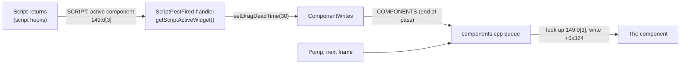

# Widget Writes

A few of an interface component's fields can be changed: its drag dead time and dead zone, and its mouse-repeat
listener, which can be cleared. The API names a component by its packed id and its index among its static parent's
dynamic children, never by address, because the object behind them can be freed and replaced whenever the game closes
an interface or a script rebuilds a layer's children. The native hook looks each component up by id on the game
thread at the start of the next frame, the way the client's own lookup does, and only then writes, so a write to a
component that has gone does nothing. The script hooks also report the components the script engine's ops act on,
which is how a plugin finds the item slot a drawing script just drew. This page covers the fields, the lookup, the
active component, the Java side and the recipes.

Plugin authors start with the [`Widget`](../../api/src/main/java/com/kraken/api/widgets/Widget.java) setters and
`Client.getScriptActiveWidget()`. The wire format is in [Native protocol](native-protocol.md#components).

## Key Files

| Path | Role |
|---|---|
| [`components.cpp`](../../client/src/main/native/kraken_hook/src/components.cpp) | The component block, COMPONENTS commands, the lookup and the writes the pump makes |
| [`scripts.cpp`](../../client/src/main/native/kraken_hook/src/scripts.cpp) | Adds the runner's active and dot components to every SCRIPT message |
| [`Widget`](../../api/src/main/java/com/kraken/api/widgets/Widget.java) | `setDragDeadTime`, `setDragDeadZone`, `setOnMouseRepeatListener` and their getters |
| [`ComponentWrites`](../../api/src/main/java/com/kraken/api/internal/widget/ComponentWrites.java), [`ComponentOp`](../../api/src/main/java/com/kraken/api/internal/widget/ComponentOp.java), [`ComponentHook`](../../api/src/main/java/com/kraken/api/internal/widget/ComponentHook.java) | The writes waiting to be sent, one write, and the sender |
| [`Client`](../../api/src/main/java/com/kraken/api/Client.java) | `getScriptActiveWidget()`, `getScriptDotWidget()` |
| [`ScriptComponents`](../../api/src/main/java/com/kraken/api/internal/ScriptComponents.java) | The two components a script event captured |
| [`NativeProtocol`](../../client/src/main/java/com/kraken/client/callback/NativeProtocol.java) | The component block, the COMPONENTS command, the script block's and SCRIPT payload's components |
| [`AntiDragPlugin`](../../client/src/main/java/com/kraken/client/plugins/antidrag/AntiDragPlugin.java) | The plugin built on it |

## The Fields

The cs2 runtime's component ops are dispatched by `0x19bbd0` in 241.3, which sends ops 2000 to 2499 (`if_*`, the
component popped from the stack) to the same handlers as ops 1000 to 1499 (`cc_*`, the engine's active component).

| Field | 241.3 | Set by | Meaning |
|---|---|---|---|
| `IfType.dragDeadZone` | `0x320` | `cc_setdragdeadzone` (op 1303) | Pixels the mouse must move, along either axis, before a held component drags |
| `IfType.dragDeadTime` | `0x324` | `cc_setdragdeadtime` (op 1304) | Client cycles (20 ms) the mouse must be held before it drags |
| `IfType.onMouseRepeat` | `0x470` | `cc_setonmouserepeat` (op 1412) | The listener run every client cycle while the mouse is over the component |

The drag check (`0x83d70`) counts the cycles the mouse has been held (`Client + 0x413c64`) and starts a drag once the
count passes the clicked component's dead time and the mouse has left its dead zone, as the Java client does.

A listener slot is an `IfListener`: an argument count and an array of `VarValue`s, the script id first. The client
runs a mouse-repeat listener only while its count is nonzero (`0x7fc2f`). The arguments are heap-allocated, so
clearing a listener can't just zero the count: it calls the client's own clear (`functions.ifListenerClear`,
`0x443f0`), which destroys the arguments, frees the array and zeroes the count and the pointer, the same function the
slot's resize uses when a script sets a listener with no arguments.

## The Lookup

The hook looks a component up as the client's `0x5af750` and `0x5af860` do, without their loading of a group that
isn't loaded: `Client.interfaceStore`, the group's entry (`IfStore.groups`, `IfStoreGroup.stride`), its slot
(`IfStoreGroup.slots`, `slotStride`, a shared pointer), and for a dynamic child the child's slot under the static
component (`IfType.dynSlots`, `dynCount`). It then checks the object found carries the packed id and index asked for
(`IfType.packedId`, `IfType.subId`). A group that isn't loaded, an index past the end, or an object with other ids
skips the write. Each write and each call runs under an SEH guard.

## The Active Component

`cc_*` ops act on the engine's **active component**, which `cc_find` and `cc_create` point elsewhere, and `.cc_*` ops on
the **dot component**. The handlers get theirs from `0x19c360`, which for a `cc_*` op returns
`runner + 0xded8 + dot * 16`: two shared pointers in the static runner, `ScriptRunner.activeComponent` (`0xded8`) and
`ScriptRunner.dotComponent` (`0xdee8`). The engine keeps them between scripts, so when a script that draws one item
slot returns, the active component is still that slot.

The script hooks read both when they build each SCRIPT message and send each as a packed id and an index (-1, -1 for
none). While a `ScriptPreFired` or `ScriptPostFired` handler runs, `Client.getScriptActiveWidget()` and
`getScriptDotWidget()` give the captured components, read again by id; otherwise they read the runner now.

## The Java Side

The `Widget` setters queue a `ComponentOp` in the client's `ComponentWrites` and change the snapshot, so its getter
shows the new value at once. The writes waiting go out together at the end of each pass of the client thread, so the
writes one handler makes reach the game in the same frame. A write is a one-off: one made while no hook that writes
components is connected (`GameSession.setComponentHook`, from the hook server once STATUS reports
`FEATURE_COMPONENTS`) is dropped rather than kept for the next connection.

`setOnMouseRepeatListener` only clears: called with null or no arguments it queues a listener clear; with arguments it
throws, since the API can't build a script's arguments in the game.

## Recipes

[`73-components.yaml`](../../updater/src/native_updater/spec/73-components.yaml) holds the keys; two extractors find
them:

* **`cs2_components`** ([`components.py`](../../updater/src/native_updater/components.py)): the handler of ops 1300 to
  1399, found by its `- 1300` and its byte table of case indices. The cases of ops 1303 and 1304 store the popped int
  to a field of the component the resolver returned: `IfType.dragDeadZone` and `IfType.dragDeadTime` (an invariant
  keeps the dead time 4 after the dead zone). The resolver's return, `runner + offset + operand * stride`, gives
  `ScriptRunner.activeComponent` (operand 0) and `ScriptRunner.dotComponent` (operand 1, an invariant keeps it 0x10
  after).
* **`component_listeners`** ([`keyboard.py`](../../updater/src/native_updater/keyboard.py)), which also gives
  `IfType.onKey`: case 12 of the handler of ops 1400 to 1499 (`cc_setonmouserepeat`) points its slot register at
  `IfType.onMouseRepeat`, and `functions.ifListenerClear` is the one function the slot's resize calls with the slot
  that leaves its count and argument array 0.

`tests/test_components.py` and `tests/test_keyboard.py` run both over miniatures of that code.

## Not Covered

* Setting a listener, or writing any other field.
* The old inventory drag delay (`Client.setInventoryDragDelay`, deprecated) isn't mapped; the inventory's and the
  bank's item slots have their own dead time, which is what gets set.
* Nothing here has been checked against a running game yet.
