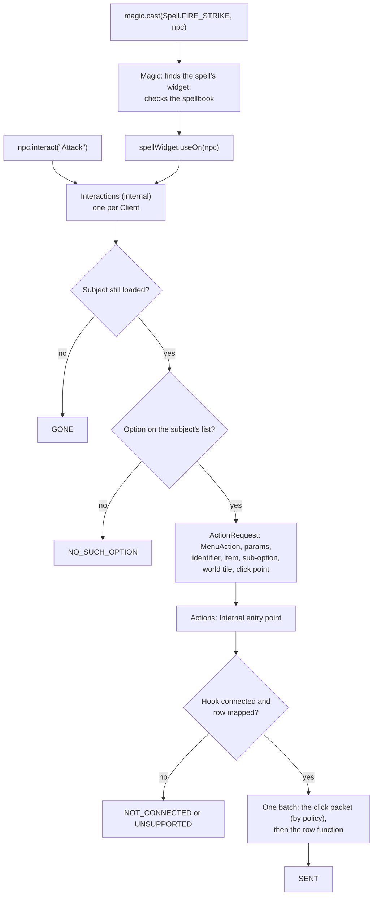

# Interaction API: Design

Status: proposal, 2026-10-31. Only the gaps of §9 are filled; nothing else on this page is built yet.

The interaction API lets a plugin act on the things it already holds, by the option text the player sees:
`npc.interact("Attack")`, `tree.interact("Chop down")`, `magic.cast(Spell.FIRE_STRIKE, npc)`. It sits on top of
[`Actions`](../api/src/main/java/com/kraken/api/action/Actions.java), which already runs every menu row the client can
build; how `Actions` reaches the game is in [Menu actions](developer/menu-actions.md).

## 1. The Problem

To run a menu row today, a plugin fills in the row the way the client's menu builder would. Attacking an NPC takes this:

```java
@Subscribe
public void onNpcSpawned(NpcSpawned event) {
    NPC npc = event.getNpc();
    NPCComposition shown = npc.getTransformedComposition();
    String[] options = (shown != null ? shown : npc.getComposition()).getActions();
    int op = -1;
    for (int i = 0; i < options.length; i++) {
        if ("Attack".equalsIgnoreCase(options[i])) {
            op = i + 1;
            break;
        }
    }
    MenuAction[] npcOps = {MenuAction.NPC_FIRST_OPTION, MenuAction.NPC_SECOND_OPTION, MenuAction.NPC_THIRD_OPTION,
            MenuAction.NPC_FOURTH_OPTION, MenuAction.NPC_FIFTH_OPTION};
    client.getActions().menuAction(0, 0, npcOps[op - 1], npc.getIndex());
}
```

Every kind of subject has its own rules:

- Which list holds its options: an NPC's transformed type, a loc's impostor, an item's ground actions, a component's ops.
- Which `MenuAction` family the op falls in.
- What goes in `param0`, `param1` and the identifier.
- Which tile a loc row names.

A spell needs its component in the spellbook. An inventory item needs its slot widget, in the inventory panel the
client shows at that moment. The Action Tester's
[`Subjects`](../client/src/main/java/com/kraken/client/plugins/actiontester/Subjects.java) class already does most of
this for its settings page, but plugins can't use it.

With this design:

```java
@Inject
private Magic magic;

@Subscribe
public void onNpcSpawned(NpcSpawned event) {
    NPC npc = event.getNpc();
    if (npc.getId() == 1234) {
        npc.interact("Attack");
    } else if (npc.getName().equals("Goblin")) {
        magic.cast(Spell.FIRE_STRIKE, npc);
    }
}

@Subscribe
public void onGameObjectSpawned(GameObjectSpawned event) {
    GameObject object = event.getGameObject();
    if (object.getName().contains("Tree")) {
        object.interact("Chop down");
    }
}
```

The spawn handlers are only examples. When tracking starts, the API posts a spawn for everything already loaded, so a
plugin that acts from spawn events would act on every tree in the scene at once. Real plugins usually pick one target
on a `GameTick`.

## 2. Goals and Non-Goals

Goals:

- Act on an `NPC`, `Player`, `TileObject`, `TileItem` or `Widget` by an option's text or number.
- Use an item, or cast a spell, on any of those.
- Common tasks by name: walking and running, dialogues, the inventory, magic, prayers, the bank, equipment.
- Say why an action wasn't sent.
- Keep `Actions` as the only code that builds native calls and packets.

Not goals here:

- Waiting for results, or chaining steps across ticks ("walk to the bank, open it, withdraw"). Each call sends one
  action at once. A task layer can be built on top later. Bank Withdraw-X is the one two-step call (§7.6).
- Pathfinding beyond the loaded scene, the minimap walk, Examine, the camera.
- Checking what the server checks: that the player can reach the NPC, or has the runes or the level.

## 3. Design Rules

1. **Built on `Actions`.** The new code never builds a `NativeCall` or a packet. It works out a row's arguments and
   hands them to `Actions`, so the captures, the packet helpers and the support checks stay in one place.
2. **Resolve the way the client's menu builder does.** An option is matched against the list the client builds the
   menu from: an NPC's transformed type, a loc's impostor, conditional ops resolved against the vars. The row sends
   what the client's own row would: a loc's base id and placed tile, a component's slot and item.
3. **One layer, on the existing classes.** The methods go on the classes plugins already have. No interfaces, no
   wrappers around `NPC` or `Widget`, nothing static.
4. **Report, don't throw.** Game state can change between the check and the send, so a failed check is a result, not
   an exception. Only programming errors, such as a null option, throw.
5. **One call, one batch.** A call sends one batch at once, or nothing. A select and its target are one batch.

## 4. Where the Methods Live

The request asks whether a spell cast should read `npc.castSpellOn(Spell.FIRE_STRIKE)` or
`Magic.castSpell(Spell.FIRE_STRIKE, npc)`. There are three shapes to choose from:

| Shape | Example | For | Against |
|---|---|---|---|
| A. On the target | `npc.interact("Attack")`, `npc.castSpellOn(Spell.FIRE_STRIKE)` | Found by autocomplete on the object the plugin holds. Reads like the game. Nothing to inject. | Two-subject verbs multiply: five target kinds times each verb (use an item, cast a spell, and any later ones). `NPC` would have to know about spellbooks and inventories. |
| B. Static helper | `Magic.castSpell(Spell.FIRE_STRIKE, npc)` | Short, and found by class name. | Needs a global `Client`, and the API has none: tests and tools make their own with `new Client(memory, mapping)`. It also hides that the call needs the hook's connection. |
| C. Session service | `magic.cast(Spell.FIRE_STRIKE, npc)`, injected or from `client.getMagic()` | Domain checks live in one place (is the spell in the spellbook shown?). One class holds the overloads for each target. Testable with a fake client. | One more thing to inject, and it isn't found from `npc.`. |

The recommendation splits by how many subjects a verb has:

- **One subject: on the subject (A).** `interact` is about one thing, so `NPC`, `Player`, `TileObject`, `TileItem` and
  `Widget` each get it.
- **Two subjects: on the source.** The game does "use X on Y" in two steps: select X (an item's Use, a spell's Cast),
  then click Y. Casting a spell runs the same select row as an item's Use, with no slot and no item (see
  [Selecting an item or spell](developer/menu-actions.md#selecting-an-item-or-spell)). So one method on `Widget`,
  `useOn(target)`, covers items and spells, with an overload for each kind of target.
- **Finding the source by id or name: a service (C).** `Inventory`, `Magic`, `Prayers` and the others find the widget
  (an inventory slot, a spell, a prayer) and call `interact` or `useOn` on it. Checks that need knowledge of the
  domain, such as the spellbook shown or run already being on, live there.

That gives one method per target kind plus one per source, rather than one for every pair. `npc.castSpellOn(spell)` is
left out: it would be a one-line delegate to `magic.cast(spell, npc)` on every target class, and every new kind of
source would add another to each. It can be added later without changing anything else (open question 1).

Static helpers (B) are ruled out by rule 3.

## 5. The Core

### 5.1 How a Call Flows



### 5.2 ActionResult

Every new method returns an `ActionResult`:

| Value | Meaning |
|---|---|
| `SENT` | The batch went to the hook. Same as `true` from `Actions` today: it doesn't mean the server accepted it. |
| `NOT_CONNECTED` | The hook isn't connected. Nothing is queued. |
| `UNSUPPORTED` | This build's mapping lacks the row function, a packet helper or an opcode, or the option is one no row sends (Examine). |
| `GONE` | The subject isn't loaded any more: the NPC or player left, the loc changed, the ground item was taken, the component closed or its slot holds another item. |
| `NO_SUCH_OPTION` | The subject has no option with that text or number, or the op has no such sub-option. |
| `NOT_FOUND` | A service couldn't find what it was asked for: the item isn't in the inventory, the spell isn't in the spellbook shown, no dialogue is open. |
| `OUT_OF_SCENE` | A walk tile is outside the loaded scene. |

`isSent()` returns `this == SENT`, so `if (npc.interact("Attack").isSent())` reads like the `boolean` did. Each failure
is also logged at `FINE` on `kraken.api` with the detail, for example `Goblin has no "Atack" option; it has Attack,
Examine`.

An enum rather than a `boolean`, because "why wasn't it sent?" is the first thing plugin authors ask, and the answers
need different handling: try again next tick, or fix the option's text. Not exceptions, because of rule 4.

### 5.3 Matching an Option

`interact(String)` turns the text into an op number the same way for every subject:

1. Remove the client's markup (`<col=ff9040>`) and trim.
2. Compare ignoring case, with spaces, `-` and `_` counted as the same: `"Chop-Down"`, `"chop down"` and `"Chop down"`
   all match.
3. The first op in the subject's order that matches wins.
4. Empty slots and the `"null"` name the cache gives unnamed things never match.

`interact(int op)` takes the number as the menu numbers it, from 1, up to the subject's limit: 5 for NPCs, locs and
ground items, 8 for players, 10 for components. A number out of range is `NO_SUCH_OPTION`.

The matcher is `Subjects.opOf` from the Action Tester, moved into the API with rule 2 added.

### 5.4 What Each Subject Matches and Sends

| Subject | Options matched against | Ops | Row it runs | Arguments | `GONE` when |
|---|---|---|---|---|---|
| `NPC` | `getTransformedComposition().getActions()`, else the base composition's; conditional ops resolved | 1-5 | `NPC_*_OPTION` | identifier = index | `getAddress()` is 0, or the transform shows no NPC |
| `Player` | `client.getPlayerOptions()`: the options the server set, the same for every player | 1-8 | `PLAYER_*_OPTION` | identifier = index | `getAddress()` is 0 |
| `TileObject` | The impostor's actions (`ObjectComposition.getImpostor()`), conditional ops resolved | 1-5 | `GAME_OBJECT_*_OPTION` | identifier = the base loc id, `getId()`; tile = the tile it was placed on, with its own plane | Its tile no longer holds a loc with that id |
| `TileItem` | `ItemComposition.getGroundActions()`; Take is op 3 | 1-5 | `GROUND_ITEM_*_OPTION` | identifier = item id; tile = its tile | Its tile's pile no longer holds that item |
| `Widget` with ops | `getActions()`, and a sub-option against `getSubOptions(op)` | 1-10 | `CC_OP` | param0 = `getIndex()` (-1 for a static widget), param1 = `getId()`, identifier = op, item = `getItemId()`, sub-option | The component isn't loaded, or a slot now holds another item |
| Inventory slot `Widget` with no ops of its own | Use, then the item's inventory actions (live check, §10) | 1-10 | `CC_OP` | as above | as above |
| Old-style button | None: `click()` only | | By `getEvent()`: 1 `WIDGET_TYPE_1`, 3 `WIDGET_CLOSE`, 4 `WIDGET_TYPE_4`, 5 `WIDGET_TYPE_5`, 6 `WIDGET_CONTINUE` | param1 = `getId()`; a pause button also its slot | as above |

`Actions` runs `CC_OP` and `CC_OP_LOW_PRIORITY` with the same row, so the new code always sends `CC_OP`.

The table settles two details that plugin code gets wrong today:

- **A loc's tile is the tile it was placed on.** `GameObject.getWorldLocation()` is the centre of its footprint, which
  is a different tile for objects three or more tiles across. The Action Tester's object option sends
  `getWorldLocation()`, so for those objects it sends the centre. Which tile the client's own loc row captures still
  needs a live check (§10).
- **A loc's plane is its own, not the player's.** `Actions.menuAction(param0, param1, ...)` turns scene coordinates
  into a world tile on the top-level world's current plane. The new entry point passes the world tile, as
  `menuAction(MenuEntry)` already does.

### 5.5 The Internal Pieces

| Piece | Package | Role |
|---|---|---|
| `Interactions` | `internal.action` | One per `Client`, from `client.getInteractions()` (Internal). Holds the rules of §5.4, the `GONE` checks, the click policy and the logging. The entity methods are one-line calls into it. |
| `OptionMatcher` | `internal.action` | The matching of §5.3. |
| `ActionRequest` | `internal.action` | A record of one row's arguments: the `MenuAction`, `param0`, `param1`, the identifier, the item, the sub-option, the world tile and the click point. |
| `ClickPoints` | `internal.action` | Where a subject is on the canvas, for the click policy: 100 units above an actor's tile, a loc's centre, a ground item's tile, a widget's centre; null when it is off the canvas. Moved from the Action Tester. |
| `Actions.run(ActionRequest)`, `Actions.useOn(ActionRequest source, ActionRequest target)` | `action` | New Internal entry points over the existing private `actionCall`, `useItemOn` and `clickAndRun`, returning an `ActionResult`. The public methods stay as they are. |

The rules sit in one internal class rather than across five entity classes. That keeps the entity classes small
(`Widget` is already 1,100 lines), lets one test class cover every kind, and leaves one place to change when a live
check moves a rule, such as the inventory numbering or the loc tile.

How the entity classes reach it:

- `Actor` and `TileObject` already hold the `Client`.
- `TileItem` reaches it through its `Tile`, with a package-private accessor.
- `Widget` only holds its `WidgetReader`. `Client` builds the reader with itself, as it already does for `MenuReader`,
  and the widget gets the client from its reader.

### 5.6 The Mouse Click Policy

`Actions.click(...)` sends the mouse click packet before the row, as the game does for a real click. The new methods
don't take canvas coordinates. `Interactions` has a policy instead:

| `ClickPolicy` | What is sent |
|---|---|
| `NONE` | The row only, as `menuAction` sends today |
| `ON_SCREEN` | The click packet at the subject's canvas point when it is on the canvas, then the row; the row alone when it isn't |

The policy is set with `client.getInteractions().setClickPolicy(...)` (Internal), and the client shows it as a setting
on its Settings page. The default is open question 2.

### 5.7 Threads and Timing

- The methods can be called from any thread. They read the subject (its options, whether it's loaded) on the calling
  thread and then send through `Actions`, which is synchronized. Event handlers already run on the client thread,
  which is the best place to call them from: the reads and the send then see the same poll.
- The hook runs the batch at the start of the next game frame. The subject can go in between. The NPC and player rows
  look their subject up by index and send nothing when it has gone, and the server ignores a loc or item that isn't
  there.
- Two calls from one handler are two batches. They run in order, in the same frame or in consecutive ones.
- An action sent through this API posts no `MenuOptionClicked`, the same as `Actions` today (see
  [Why the API calls the row functions](developer/menu-actions.md#why-the-api-calls-the-row-functions)).

## 6. On the Entity Classes

Every method below returns an `ActionResult`, except the reads, which are marked.

### NPC

```java
npc.interact("Attack");
npc.interact(2);
String[] options = npc.getActions();    // read: the list interact matches against
```

### Player

```java
player.interact("Trade with");
player.interact(3);
String[] options = player.getActions(); // read: client.getPlayerOptions(), which the server sets for every player
```

### TileObject

These methods cover walls, decorative objects, game objects and ground objects, which all run the same loc row.

```java
object.interact("Chop down");
object.interact(1);
String name = object.getName();         // read: the impostor's name, as the menu shows it
String[] options = object.getActions(); // read: the impostor's actions
```

`ObjectComposition.getImpostor()` (built) gives the composition the loc shows as, picked by its varbit or varp as the
client's loc transform picks it. It returns the composition itself when the loc doesn't transform, and null when the
loc shows nothing.

### TileItem

```java
item.interact("Take");
String name = item.getName();           // read
String[] options = item.getActions();   // read: the ground actions
```

### Widget

```java
widget.interact("Withdraw-10");
widget.interact("Drop", "All");         // an op with one of its sub-options
widget.interact(3);
widget.interact(3, 2);                  // op 3, sub-option 2
widget.click();                         // the first op, or an old-style button's action
slot.useOn(npc);                        // an inventory slot: use the item on the NPC
spell.useOn(npc);                       // a spellbook component: cast the spell on the NPC
slot.useOn(otherSlot);                  // an item on another item
spell.useOn(slot);                      // High Alchemy on an inventory item
```

`useOn` has an overload for each of `NPC`, `Player`, `TileObject`, `TileItem` and `Widget`. It selects this widget with
its id, its slot (`getIndex()`, -1 for a static widget) and its item (`getItemId()`, -1 for none), then runs the
target's targeted row (`WIDGET_TARGET_ON_*`), in one batch. An inventory slot gives its slot and item. A spell is a
static widget with no item, so it gives -1 for both, which is what the spellbook's own row selects. Spells need no
special case.

`useOn` returns `NO_SUCH_OPTION` when the source's target mask leaves out the target's kind: the client builds no
targeted row for it then. The mask is bits 11-16 of the source's `getClickMask()`, named by `WidgetConfig`:
`USE_GROUND_ITEM`, `USE_NPC`, `USE_OBJECT`, `USE_PLAYER`, and `USE_WIDGET` for a widget target that has
`WIDGET_USE_TARGET` itself.

`click()` runs the first of these the widget has: its first named op, its pause button (continue), or its old-style
button's action. A widget with none of them returns `NO_SUCH_OPTION`.

## 7. Services

Each service is a final class with a `(Client)` constructor. `Client` makes one of each (`client.getInventory()` and so
on), and the client's `SessionModule` binds them, so a plugin can `@Inject` them. They read through the client and act
through the entity methods of §6.

### 7.1 Movement

| Method | What it does |
|---|---|
| `walk(WorldPoint)`, `walk(LocalPoint)` | Walk here. `OUT_OF_SCENE` when the tile is outside the loaded scene (`WorldView.contains`). The client skips a tile equal to its last walk target. |
| `isRunning()` | Reads varp `OPTION_RUN` (173) |
| `setRunning(boolean)` | The run orb's op 1 (`Orbs.RUNBUTTON`, or the orb without the minimap), only when the state differs (§7.8) |
| `getDestination()` | `Client.getLocalDestinationLocation()` |

Walking beyond the loaded scene needs a pathfinder and is left out, as is the minimap walk, which isn't mapped.

### 7.2 Dialogue

| Method | What it does |
|---|---|
| `isOpen()` | Whether a continue button, an options menu or an input prompt is showing |
| `canContinue()`, `clickContinue()` | Finds a pause button that is showing outside the options menu, as `Subjects.firstPauseButton` finds one by `getEvent() == 6`, and presses it with `resumePause`. Named `clickContinue` because `continue` is a Java keyword. |
| `getOptions()` | The texts of the rows under `Chatmenu.OPTIONS`, without markup or the title row |
| `selectOption(String)`, `selectOption(int)` | Presses the row's pause button with its slot. Text is matched as in §5.3; numbers count from 1, as shown. |
| `enterAmount(int)`, `enterName(String)`, `enterText(String)`, `selectItem(int itemId)` | The four dialog answers, after checking that the matching prompt is showing: `InputDialog.of(varc MESLAYERMODE)` is `COUNT`, `NAME`, `STRING` or `OBJ`. `NOT_FOUND` when it isn't. `Actions.resume*Dialog` still sends without the check. |

Looking for pause buttons rather than listing every dialogue interface means new dialogue layouts work without changes.
One live check is needed: whether an option's slot is its child index (§10). The value each prompt sets in
`MESLAYERMODE` comes from the client's scripts and is in `InputDialog` (§9).

### 7.3 Inventory

The reads come from the inventory table (`getItemContainer(InventoryID.INV)`), which follows the server. The actions go
through the slot widgets of the inventory panel the client is showing now: the side panel's, the bank's side panel
while the bank is open (`Bankside`), a shop's while a shop is open (`Shopside`), the deposit box's
(`BankDepositbox`). The service picks the first of that list that is loaded and not hidden, so
`inventory.interact(ItemID.COINS, "Deposit-All")` works while the bank is open.

| Method | What it does |
|---|---|
| `contains(int itemId)`, `count(int itemId)`, `isFull()`, `getItems()` | Reads |
| `getSlot(int itemId)`, `getSlot(String name)` | The first slot widget holding the item, or null |
| `interact(int itemId, String option)` | `getSlot(itemId).interact(option)`; `NOT_FOUND` when no slot holds it |
| `use(int itemId, int onItemId)` | One item on another |
| `use(int itemId, target)` | `getSlot(itemId).useOn(target)`, with an overload for `NPC`, `Player`, `TileObject` and `TileItem` |
| `drop(int itemId)` | `interact(itemId, "Drop")` |

### 7.4 Magic and Spell

| Method | What it does |
|---|---|
| `cast(Spell)` | The spell's own op, for spells with no target such as teleports: `interact("Cast")`, else op 1 |
| `cast(Spell, target)` | `getSpell(spell).useOn(target)`, with an overload for `NPC`, `Player`, `TileObject` and `TileItem` |
| `cast(Spell, int itemId)` | On an inventory item: High Alchemy, Superheat Item |
| `getSpell(Spell)` | The spell's widget, or null when it isn't loaded |
| `isAvailable(Spell)` | Whether the spell's spellbook is the one shown (varbit `SPELLBOOK`) and its widget isn't hidden by itself |

A cast returns `NOT_FOUND` when the spell isn't in the spellbook shown, and `NO_SUCH_OPTION` when the spell can't
target that kind of thing (its target mask, §6). Runes and levels are left to the server.

`Spell` is an enum. Each constant names its `InterfaceID.MagicSpellbook` component and its spellbook, for example
`FIRE_STRIKE(InterfaceID.MagicSpellbook.FIRE_STRIKE, Spellbook.STANDARD)`. Referring to the gameval constant turns a
rename in a gameval update into a compile error rather than a wrong click. For a spell the enum lacks,
`client.getWidget(InterfaceID.MagicSpellbook.X).useOn(target)` does the same thing. Whether to write the enum by hand
or generate it is open question 3.

### 7.5 Prayers and Prayer

| Method | What it does |
|---|---|
| `isActive(Prayer)` | Reads the prayer's varbit, e.g. `PRAYER_PROTECTFROMMELEE` |
| `setActive(Prayer, boolean)` | The prayer book component's op 1, only when the state differs (§7.8) |
| `isQuickPrayerActive()`, `setQuickPrayer(boolean)` | The quick prayer orb |

Each `Prayer` constant names its `InterfaceID.Prayerbook` component and its varbit.

### 7.6 Bank

| Method | What it does |
|---|---|
| `isOpen()` | Whether `Bankmain` is loaded |
| `withdraw(int itemId, int amount)` | Runs "Withdraw-<amount>" or "Withdraw-All" on the item's bank widget. Any other amount runs "Withdraw-X", then answers the count prompt once the server opens it. |
| `deposit(int itemId, int amount)` | The same on the bank's inventory panel, with the "Deposit-" ops |
| `depositInventory()`, `depositEquipment()` | The bank's deposit buttons |
| `close()` | `Actions.closeInterface()` |

Withdraw-X is the one call with two steps, because the count prompt only opens after the server has the op. `withdraw`
sends the op and returns `SENT`. It also queues a client thread task (`GameSession.invoke(BooleanSupplier)`) that
answers the prompt when `MESLAYERMODE` shows it, and gives up with a log line after a few ticks.

The bank's ops name their amounts ("Withdraw-14" once 14 was the last X), so matching by name follows the bank's
quantity settings without reading them.

### 7.7 Equipment

| Method | What it does |
|---|---|
| `isEquipped(int itemId)`, `getItem(EquipmentInventorySlot)` | Reads from `InventoryID.WORN` |
| `remove(EquipmentInventorySlot)` | The worn-items slot component's "Remove" |
| `interact(EquipmentInventorySlot, String option)`, `interact(EquipmentInventorySlot, String option, String subOption)` | Any op on a worn item, such as "Rub", or a teleport's sub-option |

`EquipmentInventorySlot.getComponentId()` gives each slot's component on the worn-items interface: slot n is
`InterfaceID.Wornitems.SLOT<n>`.

### 7.8 Toggles and the Tick Lag

A setter that toggles (run, a prayer, quick prayers) reads the state before it decides to send. The state only changes
when the server's answer arrives, a tick or so later, so two calls in that window would toggle twice. Each toggle
remembers what it last sent, and `setActive` and `setRunning` treat that as the state until the var changes or two
ticks pass.

## 8. Changes to Existing Code

| Where | Change |
|---|---|
| `Actions` | Internal `run(ActionRequest)` and `useOn(ActionRequest, ActionRequest)`, returning `ActionResult`. The public methods stay as they are. |
| `Client` | `getInteractions()` (Internal) and a getter for each service. Builds `WidgetReader` with itself. |
| `NPC`, `Player`, `TileObject`, `TileItem`, `Widget` | The methods of §6 |
| `ObjectComposition` | `getImpostor()` (built) |
| `Tile` | A package-private accessor for its client, for `TileItem` |
| `SessionModule` (client) | Binds the services |
| Action Tester | Rebuilt on the new API, which tests that the API covers every action. `Subjects` keeps only its settings parsing and suggestion lists. |
| `Client.openWorldHopper`, `hopToWorld` | No change. They could call `Widget.interact` inside. |
| Docs | `docs/api.md`: an "Interacting" section before Menu Actions. `docs/writing-plugins.md`: an example. `docs/developer/menu-actions.md`: the layer above `Actions`. `CLAUDE.md`: the API bullet listing what the API writes. |

Package layout:

```text
com.kraken.api.action
    Actions                 public methods unchanged, plus the Internal ActionRequest entry points
    ActionResult
    ClickPolicy
    Movement, Dialogue, Inventory, Equipment, Bank
    Magic, Spell, Spellbook, Prayers, Prayer
com.kraken.api.internal.action
    Interactions, OptionMatcher, ActionRequest, ClickPoints
```

## 9. Gaps the Design Needed Filled

All five are filled (2026-10-31), ahead of the rest of the design:

| Gap | Needed for | Filled by |
|---|---|---|
| The player options ("Trade with", "Follow" and so on) | `Player.interact(String)`, `Player.getActions()` | `Client.getPlayerOptions()` and `getPlayerOptionsPriorities()`. The client keeps the server's options in the minimenu object: `Minimenu.playerOps`, eight EASTL strings, and `Minimenu.playerOpPriorities`, a byte each. The updater's `player_ops` recipe (`playerops.py`, `75-player-options.yaml`) finds them through the player row builder. The client keeps no table of menu types, so there's no `getPlayerMenuTypes()`. |
| `ObjectComposition.getImpostor()` | Loc names and options | `getImpostor()`, picking as the client's loc transform does: the varbit, else the varp (the copy varbits read); a value out of range takes the last id; -1 shows nothing. |
| The prompt values of `MESLAYERMODE` | The input checks in `Dialogue` | `InputDialog` (in `action`), read from the client's scripts rather than a live check: every chatbox input opens through script 677, which stores its mode, and the chatbox's key handler (script 681) sends the answer for the mode. Count: 7 and 19; name: 8; string: 9, 15, 20, 21, 27 and 29; item search: 14 and 17. `InputDialog.of(mode)` gives the dialog, or null. |
| The worn-items slot components | `Equipment` | `EquipmentInventorySlot.getComponentId()`: slot n is `InterfaceID.Wornitems.SLOT<n>`. |
| A spell's target mask | An optional check that a spell can target that kind of thing | `Widget.getClickMask()` and `WidgetConfig`. The mask is the server's events for the widget's slot (`Client.ifEvents`, a hash_multimap of slot ranges) or the widget's own (`IfType.events`), as the client's menu reads it; the updater's `cs2_click_mask` recipe (`components.py`) finds them through cs2 `cc_gettargetmask`. |

## 10. Live Checks

- The inventory's op numbering when a slot has no ops of its own. The Action Tester guesses Use as op 1, followed by
  the inventory actions; its menu replay settles it.
- The tile the client's loc row captures for an object three tiles across: the placed tile or the centre.
- The selection after `useOn`, already pending for `useItemOn`.
- `Chatmenu.OPTIONS`: whether an option's slot is its child index, and which row is the title.
- Withdraw-X: the count prompt answered by the follow-up task.
- The inventory panel picked while the bank, a shop or the deposit box is open.

## 11. Testing

- `InteractionsTest` in `internal.action`: for each kind of subject, the batch the new call sends equals the batch the
  matching `Actions` call sends, recorded with the fake invoker `ActionsTest` uses. The test compares against `Actions`
  rather than against offsets, so it holds across builds.
- `OptionMatcherTest`: markup, case, spaces and hyphens, numbers and their limits, empty and "null" slots.
- Each `ActionResult` for each kind: a gone NPC (address 0), a loc removed from its tile, a taken item, a closed
  widget, a slot holding another item, a missing option, no connection, a mapping without the row.
- Service tests: `Inventory` picks the bank's panel while the bank is open; toggles don't send twice within the lag;
  `Dialogue` reads the options of a fixture chat menu; `Magic` refuses a spell from another spellbook.
- `GameFixture` additions: an NPC with a transform, a loc with an impostor, a ground item, an inventory component with
  slot children and ops, a chat menu, a spellbook component.

## 12. Phases

1. **Core and entities.** `ActionResult`, `OptionMatcher`, `Interactions`, `ActionRequest`, `ClickPolicy` and the new
   `Actions` entry points. `interact` on `NPC`, `Player`, `TileObject`, `TileItem` and `Widget`. `Widget.click` and
   `useOn`. The Action Tester rebuilt on them.
2. **Services.** `Movement`, `Dialogue`, `Inventory`, `Magic` with `Spell`, `Prayers` with `Prayer`.
3. **The rest.** `Bank` with the Withdraw-X follow-up, and `Equipment`.

## 13. Open Questions

1. Should the target classes also get delegates such as `npc.cast(Spell)` and `npc.useItem(itemId)`? Answer: No they should not.
2. Which click policy should be the default, `NONE` or `ON_SCREEN`?: Answer: ON_SCREEN. There should be other policies like STATIC for a static coordinate and it should always default to 0,0 even if the element is off screen. Always send a click its necessary.
3. Should `Spell` and `Prayer` be written by hand, referring to the gameval constants, or generated along with gameval?
   Recommended: by hand. The spellbook interface also holds layout components that a generator would have to filter
   out, and each spell needs its spellbook, which gameval doesn't give. Answer: By Hand.
4. Is the loose matching of §5.3 (spaces, hyphens and underscores counted as the same) wanted, or only ignoring case? Answer: Loose matching is desired, yes. 
